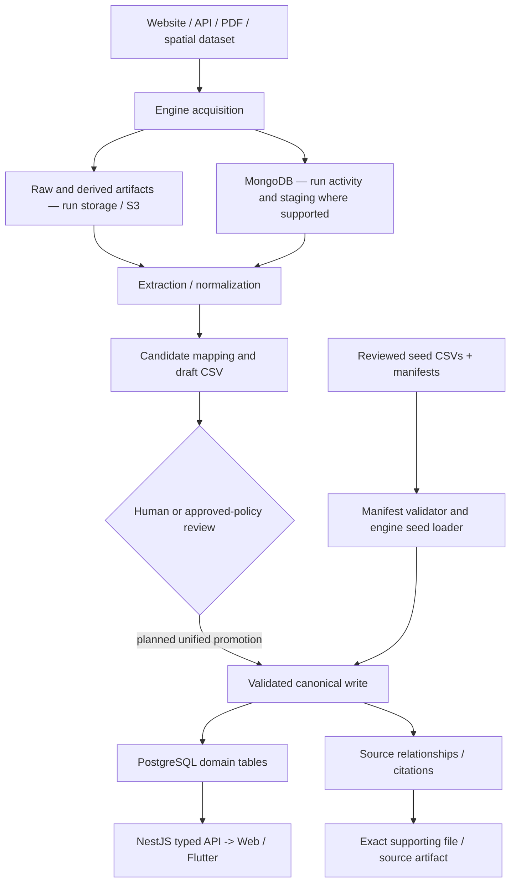

# The data flow: from source to a trusted Mzizi record

## The owner's question

Where, exactly, does data go after a crawler collects it? Which actor determines the target table, which store holds each intermediate representation, how are `*_code` references resolved, and when does a candidate become a database fact?

There are **two different implemented entry paths** that should not be confused.

## Current system at a glance

The dashed or proposed concept in this diagram is the **unified reviewed promotion** from arbitrary extracted candidates. The existing seed-loader route has a concrete implementation.

## Path A: reviewed CSV seed to PostgreSQL — implemented

1. A small seed CSV matches one **existing generated PostgreSQL table contract**. The path determines the target table; an authored source manifest does not create a new table.
2. The CSV's identity and FK-like link columns use typed **codes**, not database UUIDs. A column dictionary or mapping may propose matching columns, but is not by itself approved data.
3. `mzizi-manifest data <root>` validates rows, table columns, code references and other rules.
4. `mzizi-engine seed --root <root>` loads inside a transaction. Without `--apply` it rolls back; with `--apply` it commits. Stable internal IDs derive from the table and natural key. Link codes resolve to their canonical IDs through the loader's rules.
5. Loading is repeatable: changed columns are updated, unchanged rows stay untouched and missing seed rows are not automatically deleted.
6. The loader creates `source.relationships` (`prepared-from`) and `source.citations` records for each seeded record, tied to the CSV artifact and line.

**Important:** This verifies a loader and provenance mechanism, not the correctness of every value written. Approval and source checking remain necessary.

## Path B: collected evidence to draft — partially implemented

1. An assessed source describes collection scope and acquisition method. The engine uses fetch, crawler or browser capabilities to record what was actually retrieved.
2. Raw bytes are preserved in the run/artifact store and may be staged or released to S3; run metadata/activity is kept in MongoDB or local run state as configured.
3. Extraction produces text, tables, structured pages, figures or geospatial representations. Derivatives retain a relationship to the exact input; extraction quality and uncertain parsing remain visible.
4. Rules, terms, mappings and reference lookups propose target fields, identifiers and candidate rows. Existing `propose-mapping`, `draft-rows` and HTTP table-draft operations support parts of this workflow.
5. A human or policy-based reviewer must resolve ambiguous identities, the target table, evidence location, dates, units and missing required values.
6. **Unfinished boundary:** the general candidate-review-approval-to-versioned-canonical-write/change-ledger flow is still planned. Producing a valid CSV string is not the same as applying a fact to Main.

A documented IEBC office-document pilot exported 10 candidate rows, with nine exact matches and one unresolved name. The procurement API pilot collected 436 tenders; mapping them into `civic.*` remains incomplete. These are **proofs of acquisition/drafting**, not evidence of completed general promotion.

## Distinguish four different identities

| Identity | Example | Owner |
| --- | --- | --- |
| Real-world subject | Nairobi County | `geography.features` |
| Published information product | A county boundary dataset | `source.products` / editions / artifacts |
| Exact bytes | A particular downloaded GeoJSON file | `filesystem.file_versions` and object bytes |
| Assertion and its evidentiary location | "This geometry represents Nairobi County", with a file/locator | source relationships/citations and the affected domain record |

Equal files do not mean equal sources, and equal words do not mean equal places. Time of observation must be separate from the historical period in which a fact was valid.

## One example to clarify in our next discussion

Suppose an IEBC CSV says `KE-030` names Nairobi County. The mapper should identify the **identifier scheme**, resolve that identifier to one current or historical feature, and propose the correct `geography.identifiers` (or applicable target) row. It must retain the original CSV row, source, record locator and any ambiguity. A reviewed seed/approved promotion creates canonical links; an API can then present the feature in the required language with a citation.

If there are two plausible features, the record should **remain unresolved** rather than invent a new one or silently select one.

## Open design questions

- What precisely is the durable candidate/review record? What is its scope and ownership?
- Should approved seeds and reviewed research drafts call one typed canonical-write interface?
- Where should the append-only promotion/change ledger live and how does it enforce idempotency?
- How do we preserve amendments, contradictions, source corrections and rejected proposals without duplicating canonical identity?
- How are bulk GeoJSON/OSM uploads validated and promoted without forcing large binary files into seed CSVs?
- When is an extracted observation allowed to update an existing record, and who decides?

**No answers above are approved implementation decisions.**

## Current references

- [Engine and research HTTP operations](../../../../source/backend/engine/README.md)
- `Existing seed loader` (removed with the in-repository seed)
- Seed format and approval rules (seed now lives in the git-ignored `.dev/seed/`, [decision](../../../decisions/DEC-SEED-OUTSIDE-GIT-20261125.md))
- [Developer portal pilot and remaining work](../../../design/architecture/DEVELOPER_PORTAL.md)
- [Current database architecture](../../../design/data/DATABASE_ARCHITECTURE.md)
