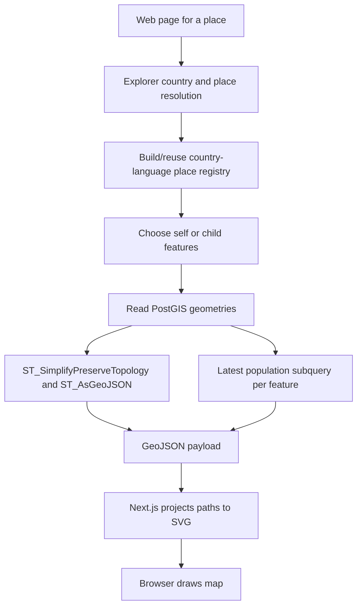

# Geography: identities, hierarchy, maps and slow reads

## User-reported problem

Geographic and related place queries are becoming slow. The cause has **not** been established by live timings. Code inspection identifies expensive-looking operations worth measuring first.

## Canonical Geography should remain separate from its display representations

A feature is a geographic identity. Names, classifications, identifiers, time-dependent geometry, relationships, and GIS file associations describe it. `source.slugs` describes a **web address**, not the geographic identity itself. An administrative relation, electoral relation, legal jurisdiction and URL parentage need not be the same thing.

Keep high-fidelity evidence and geometry. Rendering a county map does **not** require sending the full canonical polygon on every request.

## Current code path for a map

## Code findings to benchmark

| Observation | Why it could cost time | Where |
| --- | --- | --- |
| Country-language `registry` runs a recursive slug walk and loads all routable places (documented ~2,100 for Kenya) | Cold load is expensive; repeated name/citation reads and per-instance memory can grow with coverage | `reads/registry.ts`, `reads/queries.ts` |
| `insideOf(rows, place)` filters the entire registry and is invoked for each displayed shape to count children | Repeated O(N) in-memory scans; worst-case O(N × shapes) | `reads/registry.ts`, `reads/boundaries.ts` |
| The boundary endpoint retrieves geometries and simplifies them per request | Polygon complexity, serialization and payload size can dominate; simplification happens before transport | `reads/boundaries.ts` |
| `latestBaseline` is used as a scalar subquery for each geometry's population | Repeated statistical lookups are candidates for a grouped/joined retrieval | `reads/shared.ts` |
| Location search uses `ILIKE '%query%'` | A full substring search may not be supported by the currently generated name indexes | `locality/.../places.ts` |
| Multiple routines use recursive hierarchies based on different concepts | Repeated work and potentially inconsistent "inside", "served by" or parent interpretations | `explorer.ts` and locality/insights readers |

The generated snapshot already contains the PostGIS extension and a GiST index on `geography.geometries.geometry`; adding another generic spatial index is **not** a default answer. The snapshot enables `pg_trgm` but does not show a trigram index on `geography.names.name`. Verify actual indexes and query plans in the running database.

## Correctness findings

- `geography.geometries.area` currently uses `ST_Area(geometry)` on SRID 4326. For geographic coordinates this returns square degrees, **not square metres or km²**. Compare an appropriate geodetic computation and unit conventions before using it for area comparisons.
- Existing location paths use both `ST_Contains` and `ST_Covers`. They differ at boundaries. Decide boundary-point policy explicitly before unifying their behavior.
- Geometry versions, `from_year`/`to_year` and current-outline rules need one reviewed read policy. A historic boundary must not silently become today's display shape.
- Distinct hierarchies (electoral, administrative, jurisdictional, routing) must remain semantically separate even when accelerated with projections.

## Potential strategies — NOT approved

1. Targeted identity/path lookup instead of building a full country registry for every single-feature request.
2. Reuse or cache a resolved routing hierarchy **with explicit invalidation on seed/import, slug or name changes**; test with multiple API processes.
3. Server-side grouped counts, bulk names and latest-baseline retrieval instead of repeated per-feature subqueries.
4. Precompute simplified display geometry by area/zoom/detail tier. Keep canonical geometry unmodified. Consider vector tiles or optimized object-store derivatives when measurements justify them.
5. Consider `ST_Subdivide` or prepared spatial indexes for complex polygons if point/overlap plans demonstrate a benefit.
6. Benchmark text/name search using appropriate pg_trgm or normalized lookup indexes, respecting language and exact-name semantics.
7. Correct area units with an explicit migration and downstream compatibility plan **only after approval**.

## Performance experiments

Compare cold vs warm `/v1/explorer/location` and `/boundaries` for a country root, county, constituency and ward; compare dense and simple outlines; measure SQL duration, geometry serialization, API payload bytes, Next.js path generation, and browser render time. Record both the active plan and input dataset hash/size.

**Do not infer measured speedups from these suggestions.**

## Code references

- [PostGIS-generated schema](../../../../source/backend/database/sql/schema.sql)
- `Place registry` (removed in the 2026-11-25 rebuild)
- `Routing SQL` (removed in the 2026-11-25 rebuild)
- `Boundary query` (removed in the 2026-11-25 rebuild)
- `Locality resolution and search` (removed in the 2026-11-25 rebuild)
- [Web map projection](../../../../source/apps/web/src/lib/maps/project.ts)
