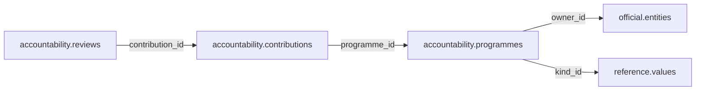

# accountability — Phase 01

> **Phase 01 civic accountability scope agreed; table and column proposals remain unapproved.** No implementation is authorized by this documentation reorganization.

[Folder index](README.md) · [Full catalogue and relocation inventory](../README.md)

## Agreed responsibility — 12 November 2026

Oversight findings, commitments, recommendations, responses, corrective actions, petitions, consultations, complaints and public participation.

Accountability combines public oversight and Participation in one schema while retaining distinct record types. Preserve the former participation programme, contribution and accepted review dictionaries; consultation, petition, complaint and response proposals remain distinct. Oversight findings are public civic claims, not operational audit events.

| Record family to review | Meaning and connections |
|---|---|
| Oversight findings | Evidence-backed findings about a responsible institution, finance item, procurement contract or Civic project; record issuer, scope, dates, uncertainty and dispute. |
| Commitments | Election or institutional promises with author, scope, due dates and evidence; the inherited candidate commitment dictionary is retained below. |
| Recommendations | Proposed remedies tied to a finding and accountable institution; distinguish recommendation from adoption. |
| Responses | Dated official replies to findings, recommendations, petitions, complaints or consultations; preserve respondent authority and evidence. |
| Corrective actions | Promised, started and verified remedial actions with responsibility, dates and delivery evidence. |
| Petitions, consultations and complaints | Distinct public participation cases and procedures, submissions and outcomes; protect private identities and do not turn allegations into verified findings. |
| Participation programmes, contributions and accepted reviews | Preserve the existing proposals; accepted civic content is distinct from staging moderation and operational review logs. |

These are responsibilities and proposal families, not approved new table/column designs. Link people and organizations through Official, authority through Governance, place through Geography, legal relationships through Reference, and provenance through Source. Operational review details stay in Staging/Audit; accepted record versions retain the necessary durable attribution. Public participation alone cannot silently change canonical facts.

## Retained table proposals and review context

The following dictionaries preserve the earlier proposal inputs, adjusted for the agreed ownership above. They remain unapproved. Earlier inventories retain their measured names; collapsed historical sections do not override the 12 November decisions.

## Retained participation proposal

> **PROPOSED — USER REVIEW REQUIRED.** Schema assignment is agreed; proposed tables and columns still require review. No SQL or migration is authorized.

## Purpose and ownership

**Target:** Main. **Purpose:** Accepted public and official contributions. Schema placement follows the 12 November scope decision; individual table/column designs remain proposals. Related owners follow the agreed responsibility section above.

## Current implementation and gaps

The active manifest has 30 manifest migrations and 49 distinct CREATE TABLE declarations (49 distinct current table names) in schemas `audit`, `auth`, `engine`, `filesystem`, `geography`, `legal`, `objects`, `reference`. Generated Dryv has 124 entities (digest `e0087da9cf5b00e91f283a5501c368c7696bdd841ea30629231dc9c590f7c1ee`). Counts describe current artifacts, not target design; SQL and Dryv diverge.

- SQL declarations: None found.
- Dryv entities: None found.

The inventory does not establish live database state and may miss ALTER-only changes. Before implementation, reconcile migrations, Dryv, generated output and callers.

## Proposed relationship map

> All nodes and edges are proposals. Main schemas may use local cross-schema foreign keys; no edge crosses the Main/Operations database boundary.

## Proposed table and column review

All tables and fields are hypothetical. Every proposed business column is listed; UUIDv7 `id` is a candidate default and remains open. Record every existing field disposition: KEEP / REMOVE / RENAME / MOVE / MERGE / SPLIT / DERIVE / ADD.

### `accountability.programmes` — Participation programme

- **Example:** County mapping exercise
- **Profile:** entity; planning envelope below.

| Column | Proposed type | Meaning | Nullable | Default | Relationship | Units / validation | Proposed disposition |
|---|---|---|---|---|---|---|---|
| `id` | `uuid` | Proposed stable identity | No | Rust UUIDv7 candidate | Primary key | UUIDv7 candidate; unique and immutable after publication | ADD (proposed target field; pending user approval) |
| `title` | `text` | Programme | No | — | — | Nonblank when required; enforce domain-specific length, normalization and controlled vocabulary | ADD (proposed target field; pending user approval) |
| `owner_id` | `uuid` | Owning body | No | — | FK → `official.entities` | UUID syntax; FK target must exist when the relationship is required | ADD (proposed target field; pending user approval) |
| `kind_id` | `uuid` | Programme type | No | — | FK → `reference.values` | UUID syntax; FK target must exist when the relationship is required | ADD (proposed target field; pending user approval) |
| `opened_on` | `date` | Start | Yes | — | — | Type checked; domain constraints and units must be approved for this field | ADD (proposed target field; pending user approval) |
| `closed_on` | `date` | End | Yes | — | — | Type checked; domain constraints and units must be approved for this field | ADD (proposed target field; pending user approval) |

- **FK action/cardinality:** Each non-null FK is many-to-one to its named target; nullable FKs are optional. Candidate delete/update behavior is RESTRICT/NO ACTION for accepted records; cascading canonical deletion is not proposed. Confirm uniqueness and exact behavior during review.
- **Constraints:** End >= start; operational submission workflow is Operations. Exact keys and cross-field checks remain for review.
- **Indexes:** primary key on `id`; candidate B-tree indexes on FK columns `owner_id`, `kind_id` for joins and referenced-entity filters; add temporal/spatial indexes only where the stated query needs them and benchmarks support them.
- **Relationships:** resolve each FK target. Main allows cross-schema FKs. Main and Operations have no cross-database FK.
- **Evidence/time:** preserve exact source/version, observation/retrieval time, historical context and uncertainty where applicable. Approve the exact evidence path for this table.
- **Growth/storage estimate (illustrative planning envelope, not measured):** Low: initial 1,000, +200/year, peak 20/day; five-year 2,000 rows ≈ 2.0 MiB live row+index budget; Expected: initial 10,000, +2,000/year, peak 200/day; five-year 20,000 rows ≈ 19.5 MiB live row+index budget; High: initial 100,000, +20,000/year, peak 2,000/day; five-year 200,000 rows ≈ 195.3 MiB live row+index budget. Model: initial rows + annual accepted rows × 5; multiply by a per-row budget of 1 KiB including a coarse index allowance. Replace assumptions with actual samples, ingest rates and `pg_total_relation_size` before approval. Large object bytes are excluded; WAL, replicas, backups and S3 are budgeted separately.
- **Workload:** Interactive lookup by identity and approved foreign keys; batch scans for import/reconciliation. Peak-day figure above is a scenario assumption, not a service-level commitment.
- **Partitioning:** None proposed initially; decide from measured scale/query plans. Check late data and partition count.
- **Files:** originals, full-resolution geometry, arrays, media and large exports may be immutable S3 objects. Keep searchable identity, required facts, hashes, coverage, access and provenance in PostgreSQL; use manifests and selective reads.
- **Retention/risks/benchmark:** preserve accepted evidence and corrections. Review late arrivals, contention, index/partition growth and recovery. Benchmark joins, filters, spatial access, ingestion bursts, concurrent access and interrupted publication.
### `accountability.contributions` — Accepted contribution identity

- **Example:** Validated community correction
- **Profile:** entity; planning envelope below.

| Column | Proposed type | Meaning | Nullable | Default | Relationship | Units / validation | Proposed disposition |
|---|---|---|---|---|---|---|---|
| `id` | `uuid` | Proposed stable identity | No | Rust UUIDv7 candidate | Primary key | UUIDv7 candidate; unique and immutable after publication | ADD (proposed target field; pending user approval) |
| `programme_id` | `uuid` | Programme | No | — | FK → `accountability.programmes` | UUID syntax; FK target must exist when the relationship is required | ADD (proposed target field; pending user approval) |
| `actor_id` | `uuid` | Privacy-scoped actor snapshot | Yes | — | — | UUID syntax; FK target must exist when the relationship is required | ADD (proposed target field; pending user approval) |
| `submitted_at` | `timestamptz` | Time | No | — | — | Type checked; domain constraints and units must be approved for this field | ADD (proposed target field; pending user approval) |
| `access` | `text` | Public, restricted, private | No | — | — | Nonblank when required; enforce domain-specific length, normalization and controlled vocabulary | ADD (proposed target field; pending user approval) |

- **FK action/cardinality:** Each non-null FK is many-to-one to its named target; nullable FKs are optional. Candidate delete/update behavior is RESTRICT/NO ACTION for accepted records; cascading canonical deletion is not proposed. Confirm uniqueness and exact behavior during review.
- **Constraints:** PII minimized; actor snapshot not FK to operational auth. Exact keys and cross-field checks remain for review.
- **Indexes:** primary key on `id`; candidate B-tree indexes on FK columns `programme_id` for joins and referenced-entity filters; add temporal/spatial indexes only where the stated query needs them and benchmarks support them.
- **Relationships:** resolve each FK target. Main allows cross-schema FKs. Main and Operations have no cross-database FK.
- **Evidence/time:** preserve exact source/version, observation/retrieval time, historical context and uncertainty where applicable. Approve the exact evidence path for this table.
- **Growth/storage estimate (illustrative planning envelope, not measured):** Low: initial 1,000, +200/year, peak 20/day; five-year 2,000 rows ≈ 2.0 MiB live row+index budget; Expected: initial 10,000, +2,000/year, peak 200/day; five-year 20,000 rows ≈ 19.5 MiB live row+index budget; High: initial 100,000, +20,000/year, peak 2,000/day; five-year 200,000 rows ≈ 195.3 MiB live row+index budget. Model: initial rows + annual accepted rows × 5; multiply by a per-row budget of 1 KiB including a coarse index allowance. Replace assumptions with actual samples, ingest rates and `pg_total_relation_size` before approval. Large object bytes are excluded; WAL, replicas, backups and S3 are budgeted separately.
- **Workload:** Interactive lookup by identity and approved foreign keys; batch scans for import/reconciliation. Peak-day figure above is a scenario assumption, not a service-level commitment.
- **Partitioning:** None proposed initially; decide from measured scale/query plans. Check late data and partition count.
- **Files:** originals, full-resolution geometry, arrays, media and large exports may be immutable S3 objects. Keep searchable identity, required facts, hashes, coverage, access and provenance in PostgreSQL; use manifests and selective reads.
- **Retention/risks/benchmark:** preserve accepted evidence and corrections. Review late arrivals, contention, index/partition growth and recovery. Benchmark joins, filters, spatial access, ingestion bursts, concurrent access and interrupted publication.
### `accountability.reviews` — Accepted participation review

- **Example:** Contribution accepted
- **Profile:** relation; planning envelope below.

| Column | Proposed type | Meaning | Nullable | Default | Relationship | Units / validation | Proposed disposition |
|---|---|---|---|---|---|---|---|
| `id` | `uuid` | Proposed stable identity | No | Rust UUIDv7 candidate | Primary key | UUIDv7 candidate; unique and immutable after publication | ADD (proposed target field; pending user approval) |
| `contribution_id` | `uuid` | Contribution | No | — | FK → `accountability.contributions` | UUID syntax; FK target must exist when the relationship is required | ADD (proposed target field; pending user approval) |
| `decision` | `text` | Accepted/rejected/withheld outcome | No | — | — | Controlled outcome vocabulary; no FK to Operations | ADD (proposed target field; pending user approval) |
| `reviewer_snapshot` | `jsonb` | Minimal durable reviewer identity and authority at publication | No | — | — | Versioned bounded shape; minimize personal data; no FK to Operations | ADD (proposed target field; pending user approval) |
| `reviewed_at` | `timestamptz` | Time | No | — | — | Type checked; domain constraints and units must be approved for this field | ADD (proposed target field; pending user approval) |
| `summary` | `text` | Accepted rationale | No | — | — | Nonblank when required; enforce domain-specific length, normalization and controlled vocabulary | ADD (proposed target field; pending user approval) |

- **FK action/cardinality:** Each non-null FK is many-to-one to its named target; nullable FKs are optional. Candidate delete/update behavior is RESTRICT/NO ACTION for accepted records; cascading canonical deletion is not proposed. Confirm uniqueness and exact behavior during review.
- **Constraints:** Preserve the durable decision and minimum reviewer attribution in Main; operational workflow details remain in Operations. No cross-database FK. Exact keys and cross-field checks remain for review.
- **Indexes:** primary key on `id`; candidate B-tree indexes on FK columns `contribution_id` for joins and referenced-entity filters; add temporal/spatial indexes only where the stated query needs them and benchmarks support them.
- **Relationships:** resolve each FK target. Main allows cross-schema FKs. Main and Operations have no cross-database FK.
- **Evidence/time:** preserve exact source/version, observation/retrieval time, historical context and uncertainty where applicable. Approve the exact evidence path for this table.
- **Growth/storage estimate (illustrative planning envelope, not measured):** Low: initial 1,000, +2,000/year, peak 100/day; five-year 11,000 rows ≈ 10.7 MiB live row+index budget; Expected: initial 10,000, +20,000/year, peak 1,000/day; five-year 110,000 rows ≈ 107.4 MiB live row+index budget; High: initial 100,000, +200,000/year, peak 10,000/day; five-year 1,100,000 rows ≈ 1,074.2 MiB live row+index budget. Model: initial rows + annual accepted rows × 5; multiply by a per-row budget of 1 KiB including a coarse index allowance. Replace assumptions with actual samples, ingest rates and `pg_total_relation_size` before approval. Large object bytes are excluded; WAL, replicas, backups and S3 are budgeted separately.
- **Workload:** Interactive lookup by identity and approved foreign keys; batch scans for import/reconciliation. Peak-day figure above is a scenario assumption, not a service-level commitment.
- **Partitioning:** None proposed initially; decide from measured scale/query plans. Check late data and partition count.
- **Files:** originals, full-resolution geometry, arrays, media and large exports may be immutable S3 objects. Keep searchable identity, required facts, hashes, coverage, access and provenance in PostgreSQL; use manifests and selective reads.
- **Retention/risks/benchmark:** preserve accepted evidence and corrections. Review late arrivals, contention, index/partition growth and recovery. Benchmark joins, filters, spatial access, ingestion bursts, concurrent access and interrupted publication.

## Queries, lifecycle, capacity and approval

**Representative query:** How did community review or contribute to a published claim?

Lifecycle: preserve source bytes; extract into candidate revisions; validate; review or use approved deterministic checks; atomically publish; serve. Corrections create explicit versions/supersession. Preserve disagreement and uncertainty.

Capacity is unmeasured. Use low/expected/high input scenarios, explicit formulas and workload benchmarks; do not assume sizes or universal partitions.

**Status:** NOT REVIEWED. Schema assignment follows the handoff; tables, columns, relationships, partitioning and S3 choices still require user approval. Feedback: none. Approval reference/date/revision: none. Implementation authorization: not granted. Material changes reopen approval.

Earlier schema proposal preserved for history; superseded and not an approval

---
id: DOC-7B194EF06A3C
name: Public and official participation domain schema proposal
type: documentation
tags: [improvements, schema-redesign, participation, consultation, planning]
extra: {status: planning_only, schema: new_proposed}
---

# Participation — public consultation, official input, feedback and responses

**PLANNING ONLY — this schema does not currently exist as an active MZIZI application schema. It is the user's proposal, not a database migration.**

## Why this must be a separate domain

The user explicitly requested a distinct `participation` schema for **government officials' participation, public participation, submitted feedback, consultation and related concerns**. This must be separate from operational `audit`, internal research `engine` reviews, ordinary `auth` role assignments, published source statements and domain-specific governance records.

A member of the public may comment on a law or budget; a government office may respond; an official may participate as a stakeholder, moderator, reviewer or respondent; an authenticated contributor may propose a correction to MZIZI. These are distinguishable actions with different legal and privacy requirements. Preserve authorship, applicable jurisdiction, issue, date, evidence, moderation and whether participation was officially submitted or merely displayed.

## No existing dedicated tables: consider only a small coherent model

| Candidate | Question it needs to answer | Alternative / consolidation |
|---|---|---|
| `consultations` | What formal consultation, hearing, survey or public call was opened, by whom, when and under which legal basis? | Could be a specialized activity but needs submission windows and procedural rules. |
| `submissions` | Who submitted which comment, petition, opinion or evidence, when and on what issue? | Prefer unified submission with kind/status rather than one table for every subtype. |
| `responses` | Which authority/official responded to a submission, accepted, rejected or explained action? | Could be linked reply table if response carries legal or decision state. |
| `participants` | Who can participate: public individual, organization representative, public official or anonymous participant? | Prefer FK associations to `person`, `auth` or `organization` with privacy-safe identity representations. |
| `attachments` or typed junctions | Which submitted documents/media support a submission or response? | Reuse `filesystem.versions` and typed FKs; no separate byte storage. |
| `moderation` or ``audit` events | Who moderated and why, with visibility/version changes? | Determine whether append-only audit evidence suffices; don't create duplicate moderation ledgers. |
| `topics`/`subjects` (optional) | Which `legal`, `governance`, `finance`, `procurement`, `activity` or `geography` record is being discussed? | Use typed link tables or constrained registry with enforced referential integrity. |

**These are candidate logical tables, not an approved SQL table list.** Avoid making one table per feedback type, or constructing a social network engine when simple public consultations suffice. The form of official participation may be a `consultations` type or distinct legally defined process; review before deciding.

## Required referential integrity and temporal context

FK consultation to responsible `governance.institutions`, jurisdiction/root geo unit and applicable `legal` rule if relevant; record public scope vs physical hearing venue and exact opening/closing times. FK submission and response to the consultation/topic, referenced person/account/org where appropriate, and official responder with a dated office/authority role. A public participant may be unauthenticated but still require spam prevention and privacy notices; do not fabricate a `person.individuals` identity for anonymous text. Publicly attributed official responses should link to a verified office/institution rather than a free-text badge.

Support discussions about county projects and laws without assuming the subject's geography equals the submitter's home/location. Distinguish **original submitted text** from a published redacted version and structured moderation outcome; preserve immutable evidence and correction trail when law/consent permits. Link file attachments to filesystem, but never store original sensitive documents as indiscriminately public.

## Acquisition classes, pattern behavior and activity integration

- **1A static curated:** official consultation frameworks, response categories and user-facing templates; not fabricated participant contributions.
- **1B pattern:** procedural consultation steps, required hearing schedules or response windows where legitimate local law/rules specify expectations.
- **2A automatically captured:** genuine user/official submissions, feedback, replies, and verifiable official consultation publications; submissions are user-generated, not "AI collected truth."
- **2B derived:** counts, participation rates, topics/aggregates and summarized themes, preserving source, quality, anonymity and limitations.

An expected consultation from a pattern does not imply it occurred; an submitted opinion does not become a verified public claim just because it is in MZIZI. `activity` can describe consultations as public events, but `participation` owns submissions and official reply/decision state.

## Example queries and decisions

Show consultations open for a Kenya county, with verified government sponsor and relevant law, then count public responses without exposing unnecessary personal identifiers. Show official response to a petition with attached reason and date. Trace a person's participation role without confusing their `auth` access with governmental office. Display anonymous feedback safely while retaining an operational moderation trail. Link a publicly submitted correction request to `engine` review without automatically mutating the canonical table.

**Open questions requiring user approval:**
1. Anonymous public submissions and identity verification requirements?
2. Public vs restricted original documents, personal contact privacy, export and moderation rules?
3. Whether all comments now in `audit.comments` move here, or only public-facing discussions (likely selective).
4. Consultation, hearing, petition, ballot/public survey, and formal government response distinctions?
5. Public feedback workflow into research candidate/quality review without turning opinion into fact?
6. Who controls participation permissions, official representative validity and legal submission deadlines?

Before adding DDL: review local public-participation laws/requirements and global neutrality; record schema/table/column comments, real cross-schema FKs, immutable history, source evidence, data classes, API contracts and independent pattern/migration checks.

**References:** [Master planning register](../../guides/mzizi-data-schema-storage-and-pipelines-redesign.md) · [Activity](../phase-02/activity.md) · [Audit](../mzizi-operational-db/audit.md) · [Auth](../mzizi-operational-db/auth.md). **Status: discussed, not approved.**

## Human review — editable user notes and design sign-off

**Review status:** `NOT REVIEWED` — AI-authored proposals in this document are not final approval.

**In my own words, what this schema should represent and exclude:**

> _My understanding and questions:_

**Tables/columns I want to keep, rename, move, merge, split, remove or add (and why):**

> _My proposed changes and alternative names:_

**Hard foreign keys, geographical and legal scope, pattern generation, classification and evidence I want changed or explained:**

> _My technical feedback, disagreements and alternatives:_

**Real data and queries I want to use to validate this design:**

> _My examples and expected results:_

**Unresolved decisions I want to discuss further:**

> _My remaining questions:_

**Final user decision:** `NOT DECIDED` / `NEEDS CHANGES` / `DESIGN VALIDATED BY USER` / `APPROVED FOR TASK PLANNING`.

**Approval reference and date:** _None. Only record explicit later user authorization. Even design validation does not authorize code, migration or Taskcode task creation._

## Mandatory per-table temporal, rigid-column and deletion review (2026-11-07)

**USER REQUIREMENT; planning only.** Examine every existing/proposed field and expressly record **KEEP / REMOVE / DERIVE / MOVE / RENAME / ADD** for `valid_from`, `valid_to`, `valid_from_precision`, `valid_to_precision`, `is_current`, `status`, `version`, `created_at`, `updated_at` and other copied/rigid flags. These fields are **opt-in by justified meaning**, not blanket schema conventions. Assess `deleted_at` only for recoverable soft deletion where appropriate. The full policy and migration/approval checklist is in [schema redesign README](../README.md).

**Domain-specific guidance:** Consultations may open/close on exact dates; submissions and responses have real submitted/replied times, not generic validity. Legal procedural deadlines can derive from the applicable pattern while actual public hearings have independent dates. Consider deletion of unpublished drafts; preserve published official responses, withdrawal/redaction and privacy-specific purge rules.

**OPEN for human review:** exact per-table/column disposition, derived status and as-of queries, pattern/legal links, justified precision, recoverable deletion versus domain lifecycle, history/identity preservation and hard-FK impact. No code or migration is authorized.

## 2026-11-11 — System-expansion alignment

Community participation and consent may be relevant to heritage and environmental knowledge; keep participation records distinct from canonical claims and audit decisions. See the [system-expansion proposal](../../guides/advancement-and-system-expansion.md). This alignment note does not approve proposed schemas, tables or implementation.

## Commitment proposal retained from Electoral

### `accountability.commitments` — Candidate election promises

- **Example:** Manifesto water-service promise
- **Profile:** relation; planning envelope below.

| Column | Proposed type | Meaning | Nullable | Default | Relationship | Units / validation | Proposed disposition |
|---|---|---|---|---|---|---|---|
| `id` | `uuid` | Proposed stable identity | No | Rust UUIDv7 candidate | Primary key | UUIDv7 candidate; unique and immutable after publication | KEEP (candidate match to current SQL/Dryv field; confirm meaning) |
| `candidate_id` | `uuid` | Promising candidate | No | — | FK → `politics.candidates` | UUID syntax; FK target must exist when the relationship is required | ADD (proposed target field; pending user approval) |
| `topic_id` | `uuid` | Subject | No | — | FK → `reference.topics` | UUID syntax; FK target must exist when the relationship is required | KEEP (candidate match to current SQL/Dryv field; confirm meaning) |
| `statement` | `text` | Attributed commitment | No | — | — | Nonblank when required; enforce domain-specific length, normalization and controlled vocabulary | ADD (proposed target field; pending user approval) |
| `file_version_id` | `uuid` | Manifesto source | No | — | FK → `filesystem.file_versions` | UUID syntax; FK target must exist when the relationship is required | ADD (proposed target field; pending user approval) |

- **Current SQL/Dryv fields without a proposed same-name column:** `created_at`, `is_current`, `manifesto_id`, `parent_id`, `sort_order`, `text`, `updated_at`, `valid_from`, `valid_from_precision`, `valid_to`, `valid_to_precision`, `version`. **Disposition:** unresolved per field; propose KEEP, REMOVE, RENAME, MOVE, MERGE, SPLIT or DERIVE in review. Do not drop these fields until the user resolves each one.
- **FK action/cardinality:** Each non-null FK is many-to-one to its named target; nullable FKs are optional. Candidate delete/update behavior is RESTRICT/NO ACTION for accepted records; cascading canonical deletion is not proposed. Confirm uniqueness and exact behavior during review.
- **Constraints:** Promises are not completed actions. Exact keys and cross-field checks remain for review.
- **Indexes:** primary key on `id`; candidate B-tree indexes on FK columns `candidate_id`, `topic_id`, `file_version_id` for joins and referenced-entity filters; add temporal/spatial indexes only where the stated query needs them and benchmarks support them.
- **Relationships:** resolve each FK target. Main allows cross-schema FKs. Main and Operations have no cross-database FK.
- **Evidence/time:** preserve exact source/version, observation/retrieval time, historical context and uncertainty where applicable. Approve the exact evidence path for this table.
- **Growth/storage estimate (illustrative planning envelope, not measured):** Low: initial 1,000, +2,000/year, peak 100/day; five-year 11,000 rows ≈ 10.7 MiB live row+index budget; Expected: initial 10,000, +20,000/year, peak 1,000/day; five-year 110,000 rows ≈ 107.4 MiB live row+index budget; High: initial 100,000, +200,000/year, peak 10,000/day; five-year 1,100,000 rows ≈ 1,074.2 MiB live row+index budget. Model: initial rows + annual accepted rows × 5; multiply by a per-row budget of 1 KiB including a coarse index allowance. Replace assumptions with actual samples, ingest rates and `pg_total_relation_size` before approval. Large object bytes are excluded; WAL, replicas, backups and S3 are budgeted separately.
- **Workload:** Interactive lookup by identity and approved foreign keys; batch scans for import/reconciliation. Peak-day figure above is a scenario assumption, not a service-level commitment.
- **Partitioning:** None proposed initially; decide from measured scale/query plans. Check late data and partition count.
- **Files:** originals, full-resolution geometry, arrays, media and large exports may be immutable S3 objects. Keep searchable identity, required facts, hashes, coverage, access and provenance in PostgreSQL; use manifests and selective reads.
- **Retention/risks/benchmark:** preserve accepted evidence and corrections. Review late arrivals, contention, index/partition growth and recovery. Benchmark joins, filters, spatial access, ingestion bursts, concurrent access and interrupted publication.

