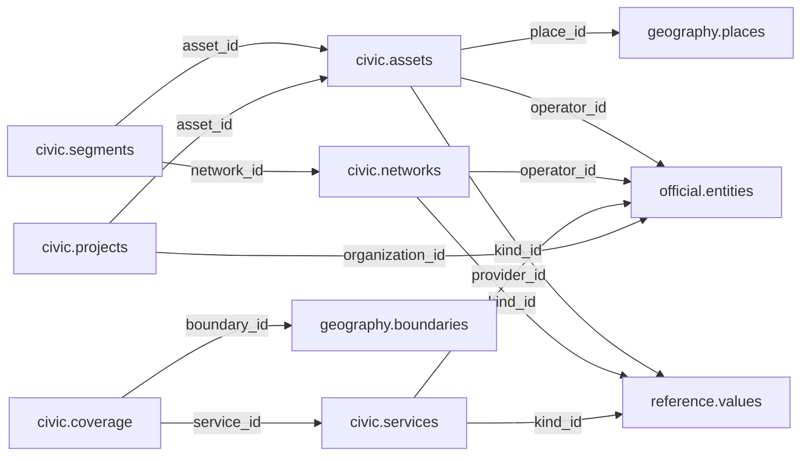

# civic — Phase 01

> **Geography/Reference alignment — 12 November 2026:** This schema remains a proposal. Its inherited `geography.boundaries`, `geography.countries`, `geography.legal_bases`, `reference.jurisdictions` or `reference.legal_bases` references (where present) predate the approved contracts. Re-review any such field against [Geography](geography.md) and [Reference](reference.md) before approving this schema; do not treat the old target names or links as current or implemented.

> **Phase 01 civic accountability scope agreed; table and column proposals remain unapproved.** No implementation is authorized by this documentation reorganization.

[Folder index](README.md) · [Full catalogue and relocation inventory](../../README.md)

## Agreed responsibility — 12 November 2026

Public infrastructure and assets, facilities, projects and services, with responsibility, location, funding and delivery links.

Civic covers public infrastructure, assets, facilities, networks, projects and services. Link responsible institutions and mandates through Governance, operator/provider identities through Official, physical places and geographic coverage through Geography, funding through Finance, and contracts/delivery through Procurement. Evidence belongs in Source, artifacts in Filesystem, and legal foundations are mediated by Reference.

A facility is not its organization, an asset is not its coordinate, a project is not its budget, and an offered service is not proof of actual delivery. Preserve status changes and dated responsibility/coverage with source evidence. School and health facilities needed by the pilot can be Civic records without starting deferred Education or Health schema redesign.

## Retained table proposals and review context

The following dictionaries preserve the earlier proposal inputs, adjusted for the agreed ownership above. They remain unapproved. Earlier inventories retain their measured names; collapsed historical sections do not override the 12 November decisions.

## Retained civic proposal

> **PROPOSED — USER REVIEW REQUIRED.** Schema assignment is agreed; proposed tables and columns still require review. No SQL or migration is authorized.

## Purpose and ownership

**Target:** Main. **Purpose:** Physical infrastructure roles and public services. Schema placement follows the 12 November scope decision; individual table/column designs remain proposals. Related owners follow the agreed responsibility section above.

## Current implementation and gaps

The active manifest has 30 manifest migrations and 49 distinct CREATE TABLE declarations (49 distinct current table names) in schemas `audit`, `auth`, `engine`, `filesystem`, `geography`, `legal`, `objects`, `reference`. Generated Dryv has 124 entities (digest `e0087da9cf5b00e91f283a5501c368c7696bdd841ea30629231dc9c590f7c1ee`). Counts describe current artifacts, not target design; SQL and Dryv diverge.

- SQL declarations: None found.
- Dryv entities: `civic.amenities` (services.Amenity), `civic.posts` (services.AmenityOffice), `civic.services` (services.PublicService), `civic.deliveries` (services.ServiceDelivery)

The inventory does not establish live database state and may miss ALTER-only changes. Before implementation, reconcile migrations, Dryv, generated output and callers.

## Proposed relationship map

> All nodes and edges are proposals. Main schemas may use local cross-schema foreign keys; no edge crosses the Main/Operations database boundary.

## Proposed table and column review

All tables and fields are hypothetical. Every proposed business column is listed; UUIDv7 `id` is a candidate default and remains open. Record every existing field disposition: KEEP / REMOVE / RENAME / MOVE / MERGE / SPLIT / DERIVE / ADD.

### `civic.assets` — Functional built asset identity

- **Example:** Public water facility
- **Profile:** entity; planning envelope below.

| Column | Proposed type | Meaning | Nullable | Default | Relationship | Units / validation | Proposed disposition |
|---|---|---|---|---|---|---|---|
| `id` | `uuid` | Proposed stable identity | No | Rust UUIDv7 candidate | Primary key | UUIDv7 candidate; unique and immutable after publication | ADD (proposed target field; pending user approval) |
| `name` | `text` | Accepted asset name | No | — | — | Nonblank when required; enforce domain-specific length, normalization and controlled vocabulary | ADD (proposed target field; pending user approval) |
| `kind_id` | `uuid` | Asset class | No | — | FK → `reference.values` | UUID syntax; FK target must exist when the relationship is required | ADD (proposed target field; pending user approval) |
| `place_id` | `uuid` | Physical place | Yes | — | FK → `geography.places` | UUID syntax; FK target must exist when the relationship is required | ADD (proposed target field; pending user approval) |
| `operator_id` | `uuid` | Operator | Yes | — | FK → `official.entities` | UUID syntax; FK target must exist when the relationship is required | ADD (proposed target field; pending user approval) |
| `commissioned_on` | `date` | Commissioning date | Yes | — | — | Type checked; domain constraints and units must be approved for this field | ADD (proposed target field; pending user approval) |

- **FK action/cardinality:** Each non-null FK is many-to-one to its named target; nullable FKs are optional. Candidate delete/update behavior is RESTRICT/NO ACTION for accepted records; cascading canonical deletion is not proposed. Confirm uniqueness and exact behavior during review.
- **Constraints:** One asset identity, geometry is in Geography. Exact keys and cross-field checks remain for review.
- **Indexes:** primary key on `id`; candidate B-tree indexes on FK columns `kind_id`, `place_id`, `operator_id` for joins and referenced-entity filters; add temporal/spatial indexes only where the stated query needs them and benchmarks support them.
- **Relationships:** resolve each FK target. Main allows cross-schema FKs. Main and Operations have no cross-database FK.
- **Evidence/time:** preserve exact source/version, observation/retrieval time, historical context and uncertainty where applicable. Approve the exact evidence path for this table.
- **Growth/storage estimate (illustrative planning envelope, not measured):** Low: initial 1,000, +200/year, peak 20/day; five-year 2,000 rows ≈ 2.0 MiB live row+index budget; Expected: initial 10,000, +2,000/year, peak 200/day; five-year 20,000 rows ≈ 19.5 MiB live row+index budget; High: initial 100,000, +20,000/year, peak 2,000/day; five-year 200,000 rows ≈ 195.3 MiB live row+index budget. Model: initial rows + annual accepted rows × 5; multiply by a per-row budget of 1 KiB including a coarse index allowance. Replace assumptions with actual samples, ingest rates and `pg_total_relation_size` before approval. Large object bytes are excluded; WAL, replicas, backups and S3 are budgeted separately.
- **Workload:** Interactive lookup by identity and approved foreign keys; batch scans for import/reconciliation. Peak-day figure above is a scenario assumption, not a service-level commitment.
- **Partitioning:** None proposed initially; decide from measured scale/query plans. Check late data and partition count.
- **Files:** originals, full-resolution geometry, arrays, media and large exports may be immutable S3 objects. Keep searchable identity, required facts, hashes, coverage, access and provenance in PostgreSQL; use manifests and selective reads.
- **Retention/risks/benchmark:** preserve accepted evidence and corrections. Review late arrivals, contention, index/partition growth and recovery. Benchmark joins, filters, spatial access, ingestion bursts, concurrent access and interrupted publication.
### `civic.networks` — Functional network identity

- **Example:** Road network
- **Profile:** entity; planning envelope below.

| Column | Proposed type | Meaning | Nullable | Default | Relationship | Units / validation | Proposed disposition |
|---|---|---|---|---|---|---|---|
| `id` | `uuid` | Proposed stable identity | No | Rust UUIDv7 candidate | Primary key | UUIDv7 candidate; unique and immutable after publication | ADD (proposed target field; pending user approval) |
| `name` | `text` | Network name | No | — | — | Nonblank when required; enforce domain-specific length, normalization and controlled vocabulary | ADD (proposed target field; pending user approval) |
| `kind_id` | `uuid` | Transport/water/energy | No | — | FK → `reference.values` | UUID syntax; FK target must exist when the relationship is required | ADD (proposed target field; pending user approval) |
| `operator_id` | `uuid` | Operator | Yes | — | FK → `official.entities` | UUID syntax; FK target must exist when the relationship is required | ADD (proposed target field; pending user approval) |

- **FK action/cardinality:** Each non-null FK is many-to-one to its named target; nullable FKs are optional. Candidate delete/update behavior is RESTRICT/NO ACTION for accepted records; cascading canonical deletion is not proposed. Confirm uniqueness and exact behavior during review.
- **Constraints:** Network can cross boundaries. Exact keys and cross-field checks remain for review.
- **Indexes:** primary key on `id`; candidate B-tree indexes on FK columns `kind_id`, `operator_id` for joins and referenced-entity filters; add temporal/spatial indexes only where the stated query needs them and benchmarks support them.
- **Relationships:** resolve each FK target. Main allows cross-schema FKs. Main and Operations have no cross-database FK.
- **Evidence/time:** preserve exact source/version, observation/retrieval time, historical context and uncertainty where applicable. Approve the exact evidence path for this table.
- **Growth/storage estimate (illustrative planning envelope, not measured):** Low: initial 1,000, +200/year, peak 20/day; five-year 2,000 rows ≈ 2.0 MiB live row+index budget; Expected: initial 10,000, +2,000/year, peak 200/day; five-year 20,000 rows ≈ 19.5 MiB live row+index budget; High: initial 100,000, +20,000/year, peak 2,000/day; five-year 200,000 rows ≈ 195.3 MiB live row+index budget. Model: initial rows + annual accepted rows × 5; multiply by a per-row budget of 1 KiB including a coarse index allowance. Replace assumptions with actual samples, ingest rates and `pg_total_relation_size` before approval. Large object bytes are excluded; WAL, replicas, backups and S3 are budgeted separately.
- **Workload:** Interactive lookup by identity and approved foreign keys; batch scans for import/reconciliation. Peak-day figure above is a scenario assumption, not a service-level commitment.
- **Partitioning:** None proposed initially; decide from measured scale/query plans. Check late data and partition count.
- **Files:** originals, full-resolution geometry, arrays, media and large exports may be immutable S3 objects. Keep searchable identity, required facts, hashes, coverage, access and provenance in PostgreSQL; use manifests and selective reads.
- **Retention/risks/benchmark:** preserve accepted evidence and corrections. Review late arrivals, contention, index/partition growth and recovery. Benchmark joins, filters, spatial access, ingestion bursts, concurrent access and interrupted publication.
### `civic.segments` — Spatial components of a network

- **Example:** Road segment
- **Profile:** geometry; planning envelope below.

| Column | Proposed type | Meaning | Nullable | Default | Relationship | Units / validation | Proposed disposition |
|---|---|---|---|---|---|---|---|
| `id` | `uuid` | Proposed stable identity | No | Rust UUIDv7 candidate | Primary key | UUIDv7 candidate; unique and immutable after publication | ADD (proposed target field; pending user approval) |
| `network_id` | `uuid` | Network | No | — | FK → `civic.networks` | UUID syntax; FK target must exist when the relationship is required | ADD (proposed target field; pending user approval) |
| `asset_id` | `uuid` | Segment identity | Yes | — | FK → `civic.assets` | UUID syntax; FK target must exist when the relationship is required | ADD (proposed target field; pending user approval) |
| `geometry` | `geometry(LineString,4326)` | Spatial route | No | — | — | Type checked; domain constraints and units must be approved for this field | ADD (proposed target field; pending user approval) |
| `length_m` | `numeric` | Measured metres | No | — | — | Type checked; domain constraints and units must be approved for this field | ADD (proposed target field; pending user approval) |

- **FK action/cardinality:** Each non-null FK is many-to-one to its named target; nullable FKs are optional. Candidate delete/update behavior is RESTRICT/NO ACTION for accepted records; cascading canonical deletion is not proposed. Confirm uniqueness and exact behavior during review.
- **Constraints:** length_m > 0; valid geometry. Exact keys and cross-field checks remain for review.
- **Indexes:** primary key on `id`; candidate B-tree indexes on FK columns `network_id`, `asset_id` for joins and referenced-entity filters; add temporal/spatial indexes only where the stated query needs them and benchmarks support them.
- **Relationships:** resolve each FK target. Main allows cross-schema FKs. Main and Operations have no cross-database FK.
- **Evidence/time:** preserve exact source/version, observation/retrieval time, historical context and uncertainty where applicable. Approve the exact evidence path for this table.
- **Growth/storage estimate (illustrative planning envelope, not measured):** Low: initial 100, +20/year, peak 10/day; five-year 200 rows ≈ 0.8 MiB live row+index budget; Expected: initial 1,000, +200/year, peak 100/day; five-year 2,000 rows ≈ 7.8 MiB live row+index budget; High: initial 10,000, +2,000/year, peak 1,000/day; five-year 20,000 rows ≈ 78.1 MiB live row+index budget. Model: initial rows + annual accepted rows × 5; multiply by a per-row budget of 4 KiB including a coarse index allowance. Replace assumptions with actual samples, ingest rates and `pg_total_relation_size` before approval. Large object bytes are excluded; WAL, replicas, backups and S3 are budgeted separately.
- **Workload:** Interactive lookup by identity and approved foreign keys; batch scans for import/reconciliation. Peak-day figure above is a scenario assumption, not a service-level commitment.
- **Partitioning:** No partition approved. Benchmark first; time range is a candidate for append-heavy observations, and keys must include partition columns. Releases are normally unpartitioned unless measured need appears. Check late data and partition count.
- **Files:** originals, full-resolution geometry, arrays, media and large exports may be immutable S3 objects. Keep searchable identity, required facts, hashes, coverage, access and provenance in PostgreSQL; use manifests and selective reads.
- **Retention/risks/benchmark:** preserve accepted evidence and corrections. Review late arrivals, contention, index/partition growth and recovery. Benchmark joins, filters, spatial access, ingestion bursts, concurrent access and interrupted publication.
### `civic.services` — Service offering and provider

- **Example:** Water supply
- **Profile:** entity; planning envelope below.

| Column | Proposed type | Meaning | Nullable | Default | Relationship | Units / validation | Proposed disposition |
|---|---|---|---|---|---|---|---|
| `id` | `uuid` | Proposed stable identity | No | Rust UUIDv7 candidate | Primary key | UUIDv7 candidate; unique and immutable after publication | KEEP (candidate match to current SQL/Dryv field; confirm meaning) |
| `name` | `text` | Service | No | — | — | Nonblank when required; enforce domain-specific length, normalization and controlled vocabulary | KEEP (candidate match to current SQL/Dryv field; confirm meaning) |
| `provider_id` | `uuid` | Provider | No | — | FK → `official.entities` | UUID syntax; FK target must exist when the relationship is required | ADD (proposed target field; pending user approval) |
| `kind_id` | `uuid` | Service class | No | — | FK → `reference.values` | UUID syntax; FK target must exist when the relationship is required | ADD (proposed target field; pending user approval) |

- **Current SQL/Dryv fields without a proposed same-name column:** `code`, `created_at`, `description`, `is_current`, `jurisdiction_id`, `legal_basis_id`, `sector_id`, `updated_at`, `valid_from`, `valid_from_precision`, `valid_to`, `valid_to_precision`, `version`. **Disposition:** unresolved per field; propose KEEP, REMOVE, RENAME, MOVE, MERGE, SPLIT or DERIVE in review. Do not drop these fields until the user resolves each one.
- **FK action/cardinality:** Each non-null FK is many-to-one to its named target; nullable FKs are optional. Candidate delete/update behavior is RESTRICT/NO ACTION for accepted records; cascading canonical deletion is not proposed. Confirm uniqueness and exact behavior during review.
- **Constraints:** Service differs from legal mandate. Exact keys and cross-field checks remain for review.
- **Indexes:** primary key on `id`; candidate B-tree indexes on FK columns `provider_id`, `kind_id` for joins and referenced-entity filters; add temporal/spatial indexes only where the stated query needs them and benchmarks support them.
- **Relationships:** resolve each FK target. Main allows cross-schema FKs. Main and Operations have no cross-database FK.
- **Evidence/time:** preserve exact source/version, observation/retrieval time, historical context and uncertainty where applicable. Approve the exact evidence path for this table.
- **Growth/storage estimate (illustrative planning envelope, not measured):** Low: initial 1,000, +200/year, peak 20/day; five-year 2,000 rows ≈ 2.0 MiB live row+index budget; Expected: initial 10,000, +2,000/year, peak 200/day; five-year 20,000 rows ≈ 19.5 MiB live row+index budget; High: initial 100,000, +20,000/year, peak 2,000/day; five-year 200,000 rows ≈ 195.3 MiB live row+index budget. Model: initial rows + annual accepted rows × 5; multiply by a per-row budget of 1 KiB including a coarse index allowance. Replace assumptions with actual samples, ingest rates and `pg_total_relation_size` before approval. Large object bytes are excluded; WAL, replicas, backups and S3 are budgeted separately.
- **Workload:** Interactive lookup by identity and approved foreign keys; batch scans for import/reconciliation. Peak-day figure above is a scenario assumption, not a service-level commitment.
- **Partitioning:** None proposed initially; decide from measured scale/query plans. Check late data and partition count.
- **Files:** originals, full-resolution geometry, arrays, media and large exports may be immutable S3 objects. Keep searchable identity, required facts, hashes, coverage, access and provenance in PostgreSQL; use manifests and selective reads.
- **Retention/risks/benchmark:** preserve accepted evidence and corrections. Review late arrivals, contention, index/partition growth and recovery. Benchmark joins, filters, spatial access, ingestion bursts, concurrent access and interrupted publication.
### `civic.coverage` — Service coverage assertions

- **Example:** Water coverage report
- **Profile:** relation; planning envelope below.

| Column | Proposed type | Meaning | Nullable | Default | Relationship | Units / validation | Proposed disposition |
|---|---|---|---|---|---|---|---|
| `id` | `uuid` | Proposed stable identity | No | Rust UUIDv7 candidate | Primary key | UUIDv7 candidate; unique and immutable after publication | ADD (proposed target field; pending user approval) |
| `service_id` | `uuid` | Service | No | — | FK → `civic.services` | UUID syntax; FK target must exist when the relationship is required | ADD (proposed target field; pending user approval) |
| `boundary_id` | `uuid` | Exact coverage boundary | No | — | FK → `geography.boundaries` | UUID syntax; FK target must exist when the relationship is required | ADD (proposed target field; pending user approval) |
| `served_during` | `daterange` | Coverage interval | No | — | — | Type checked; domain constraints and units must be approved for this field | ADD (proposed target field; pending user approval) |
| `basis` | `text` | reported or measured | No | — | — | Nonblank when required; enforce domain-specific length, normalization and controlled vocabulary | ADD (proposed target field; pending user approval) |

- **FK action/cardinality:** Each non-null FK is many-to-one to its named target; nullable FKs are optional. Candidate delete/update behavior is RESTRICT/NO ACTION for accepted records; cascading canonical deletion is not proposed. Confirm uniqueness and exact behavior during review.
- **Constraints:** Area coverage does not imply every household served. Exact keys and cross-field checks remain for review.
- **Indexes:** primary key on `id`; candidate B-tree indexes on FK columns `service_id`, `boundary_id` for joins and referenced-entity filters; add temporal/spatial indexes only where the stated query needs them and benchmarks support them.
- **Relationships:** resolve each FK target. Main allows cross-schema FKs. Main and Operations have no cross-database FK.
- **Evidence/time:** preserve exact source/version, observation/retrieval time, historical context and uncertainty where applicable. Approve the exact evidence path for this table.
- **Growth/storage estimate (illustrative planning envelope, not measured):** Low: initial 1,000, +2,000/year, peak 100/day; five-year 11,000 rows ≈ 10.7 MiB live row+index budget; Expected: initial 10,000, +20,000/year, peak 1,000/day; five-year 110,000 rows ≈ 107.4 MiB live row+index budget; High: initial 100,000, +200,000/year, peak 10,000/day; five-year 1,100,000 rows ≈ 1,074.2 MiB live row+index budget. Model: initial rows + annual accepted rows × 5; multiply by a per-row budget of 1 KiB including a coarse index allowance. Replace assumptions with actual samples, ingest rates and `pg_total_relation_size` before approval. Large object bytes are excluded; WAL, replicas, backups and S3 are budgeted separately.
- **Workload:** Interactive lookup by identity and approved foreign keys; batch scans for import/reconciliation. Peak-day figure above is a scenario assumption, not a service-level commitment.
- **Partitioning:** None proposed initially; decide from measured scale/query plans. Check late data and partition count.
- **Files:** originals, full-resolution geometry, arrays, media and large exports may be immutable S3 objects. Keep searchable identity, required facts, hashes, coverage, access and provenance in PostgreSQL; use manifests and selective reads.
- **Retention/risks/benchmark:** preserve accepted evidence and corrections. Review late arrivals, contention, index/partition growth and recovery. Benchmark joins, filters, spatial access, ingestion bursts, concurrent access and interrupted publication.
### `civic.projects` — Public development projects

- **Example:** Road construction project
- **Profile:** entity; planning envelope below.

| Column | Proposed type | Meaning | Nullable | Default | Relationship | Units / validation | Proposed disposition |
|---|---|---|---|---|---|---|---|
| `id` | `uuid` | Proposed stable identity | No | Rust UUIDv7 candidate | Primary key | UUIDv7 candidate; unique and immutable after publication | ADD (proposed target field; pending user approval) |
| `title` | `text` | Project | No | — | — | Nonblank when required; enforce domain-specific length, normalization and controlled vocabulary | ADD (proposed target field; pending user approval) |
| `organization_id` | `uuid` | Owner | No | — | FK → `official.entities` | UUID syntax; FK target must exist when the relationship is required | ADD (proposed target field; pending user approval) |
| `asset_id` | `uuid` | Created asset | Yes | — | FK → `civic.assets` | UUID syntax; FK target must exist when the relationship is required | ADD (proposed target field; pending user approval) |
| `started_on` | `date` | Actual start | Yes | — | — | Type checked; domain constraints and units must be approved for this field | ADD (proposed target field; pending user approval) |
| `finished_on` | `date` | Actual completion | Yes | — | — | Type checked; domain constraints and units must be approved for this field | ADD (proposed target field; pending user approval) |

- **FK action/cardinality:** Each non-null FK is many-to-one to its named target; nullable FKs are optional. Candidate delete/update behavior is RESTRICT/NO ACTION for accepted records; cascading canonical deletion is not proposed. Confirm uniqueness and exact behavior during review.
- **Constraints:** Keep planned versus actual distinct. Exact keys and cross-field checks remain for review.
- **Indexes:** primary key on `id`; candidate B-tree indexes on FK columns `organization_id`, `asset_id` for joins and referenced-entity filters; add temporal/spatial indexes only where the stated query needs them and benchmarks support them.
- **Relationships:** resolve each FK target. Main allows cross-schema FKs. Main and Operations have no cross-database FK.
- **Evidence/time:** preserve exact source/version, observation/retrieval time, historical context and uncertainty where applicable. Approve the exact evidence path for this table.
- **Growth/storage estimate (illustrative planning envelope, not measured):** Low: initial 1,000, +200/year, peak 20/day; five-year 2,000 rows ≈ 2.0 MiB live row+index budget; Expected: initial 10,000, +2,000/year, peak 200/day; five-year 20,000 rows ≈ 19.5 MiB live row+index budget; High: initial 100,000, +20,000/year, peak 2,000/day; five-year 200,000 rows ≈ 195.3 MiB live row+index budget. Model: initial rows + annual accepted rows × 5; multiply by a per-row budget of 1 KiB including a coarse index allowance. Replace assumptions with actual samples, ingest rates and `pg_total_relation_size` before approval. Large object bytes are excluded; WAL, replicas, backups and S3 are budgeted separately.
- **Workload:** Interactive lookup by identity and approved foreign keys; batch scans for import/reconciliation. Peak-day figure above is a scenario assumption, not a service-level commitment.
- **Partitioning:** None proposed initially; decide from measured scale/query plans. Check late data and partition count.
- **Files:** originals, full-resolution geometry, arrays, media and large exports may be immutable S3 objects. Keep searchable identity, required facts, hashes, coverage, access and provenance in PostgreSQL; use manifests and selective reads.
- **Retention/risks/benchmark:** preserve accepted evidence and corrections. Review late arrivals, contention, index/partition growth and recovery. Benchmark joins, filters, spatial access, ingestion bursts, concurrent access and interrupted publication.

## Queries, lifecycle, capacity and approval

**Representative query:** Which public asset or service is associated with this location?

Lifecycle: preserve source bytes; extract into candidate revisions; validate; review or use approved deterministic checks; atomically publish; serve. Corrections create explicit versions/supersession. Preserve disagreement and uncertainty.

Capacity is unmeasured. Use low/expected/high input scenarios, explicit formulas and workload benchmarks; do not assume sizes or universal partitions.

**Status:** NOT REVIEWED. Schema assignment follows the handoff; tables, columns, relationships, partitioning and S3 choices still require user approval. Feedback: none. Approval reference/date/revision: none. Implementation authorization: not granted. Material changes reopen approval.

Earlier schema proposal preserved for history; superseded and not an approval

---
id: DOC-EXP-CIVIC-20261111
name: Civic domain expansion brief
type: documentation
tags: [system-expansion, hypothetical, schema-design, civic]
extra: {status: hypothetical, approval: not_approved, implementation: not_authorized, recorded_on: 2026-11-11}
---

# Civic — infrastructure, networks and public services

> **Status: HYPOTHETICAL DOMAIN BRIEF.** Candidate responsibilities and tables are under investigation, not approved for SQL. Read alongside [the expansion proposal](../../../guides/advancement-and-system-expansion.md), [governance design](governance.md), and [geography design](geography.md).

## 1. Purpose and exploration areas

Civic describes built infrastructure and services that people use. It primarily serves Civic and Society and connects Geography and Nature, Statistics, Economy, History and Heritage.

## 2. Domain ownership

Candidate Civic ownership: infrastructure identity and function, transport/utility networks, component segments/nodes, public facilities, service delivery and construction/maintenance projects.

## 3. Exclusions

Geography owns geographic unit/place identity and canonical spatial representations. Governance owns institutions, offices, authority and office holders. Organization owns legal entities/operators. Finance and Procurement own budgets/transactions and purchasing processes. Activity owns event occurrences. Civic must not clone those records.

## 4. Existing schema and contract inventory

No Civic SQL schema exists in the active ordered migration tree. Current `dryv/contracts/domains/statistics` groups statistics and services with civic concepts. The previous 24-schema inventory included `civic.services`, `amenities`, `posts` and `deliveries`; those are a pre-rewrite historical inventory, not this target proposal. Current Governance design previously mapped public services into governance; that decision requires explicit reconciliation.

## 5. Candidate tables

| Candidate | Responsibility |
|---|---|
| `assets` | Stable identity and functional class for built infrastructure (bridges, dams, stations, plants). |
| `networks` | A connected transport, utility or communications system. |
| `segments` | Dated linear sections belonging to a network, with geometry reference and operational attributes. |
| `nodes` | Network junctions, terminals and interchanges. |
| `facilities` | Facility function such as school, clinic, library or public service point; physical site belongs to Geography. |
| `services` | Defined service offer and responsible provider, separate from a particular delivery/measurement. |
| `projects` | Construction, rehabilitation or maintenance project identity and lifecycle. |
| `project_assets` | Explicit association between projects and affected infrastructure assets. |

Each is a candidate requiring table-by-table justification. A single facility can deliver several services; a network can have many segments/nodes; one project can affect many assets.

## 6. Primary and foreign-key relationships

Prefer real FKs to Geography units/places/boundary representations, Organization entities, Governance institutions, source evidence, Finance records, Procurement contracts and Activity events. Exact target contracts and cardinalities require review. Avoid `subject_type + subject_id` without enforced target identity.

## 7. Cross-domain relationships

The [system-expansion proposal](../../../guides/advancement-and-system-expansion.md#16-cross-domain-ownership-rules-to-carry-into-detailed-designs) resolves provisional ownership: a road/railway is a Civic network with segments/nodes; its geometry is a geographic representation. A dam is built infrastructure; the reservoir is a geographic water feature. One physical facility identity must not be duplicated in Civic and Geography.

## 8. Geographic responsibilities

Use a Geography place for physical location and geography units for service/mandate coverage. Linear network geometry should be versioned and tied to source/derived assets. Jurisdiction, location, operator territory and service coverage are distinct.

## 9. Temporal responsibilities

Model commissioning, closure, operation, construction, maintenance and service-delivery periods only where those dates describe Civic facts. Keep event time separate from validity and retrieval time. Network segments may be realigned while identity or route continuity is retained through explicit relationships.

## 10. Evidence and provenance

Link asset/service/project claims to source artifacts and exact versions, source locators, acquisition method, verification, uncertainty and corrections. A planned project is not evidence that construction completed or a service operates.

## 11. Acquisition categories

Potentially seeded/static: curated network or facility classifications. Seeded/pattern: expected public service locations only where a reviewed rule establishes expectation. Automated/collected: sourced asset registers and project notices. Derived: coverage and connectivity measures. Each row retains actual origin; eligibility is not provenance.

## 12. Derived data

Civic may produce network topology and service coverage inputs. Statistical owns comparable published indicators such as population served or road density. Store derived geometry/tiles in filesystem artifacts with exact versioned inputs and method.

## 13. Example queries

- Which bridges connect the road network serving a selected area as of a date?
- Which health facilities deliver a selected service, and what evidence supports their operating status?
- Which contracts and projects are linked to a railway segment?

## 14. UI/API requirements

Capabilities should expose map layers, network traversal, facility/service profiles, project timelines and evidence links through stable queries. Do not expose generic table traversal or present expected facilities as verified.

## 15. Integrity constraints to investigate

Network membership, segment endpoint validity, spatial geometry compatibility, asset identity, operator intervals, facility-to-place uniqueness, project status transitions, non-overlapping active segments where appropriate, and explicit evidence for claimed service availability.

## 16. Technical standards to evaluate

PostGIS and OGC API – Features/Tiles; GeoPackage/GeoParquet; routing graph formats/engines; infrastructure-specific vocabularies and national asset registers. Standards are exchange references, not copied schema designs.

## 17. Open questions

Should Civic be a separate schema or a domain within Governance? Should public services remain Civic or be split by education/health? Is a road identity a whole route, authority asset or network segment? How are shared facilities and multi-operator infrastructure represented?

## 18. Review and approval status

Not reviewed or approved for implementation. Review against Governance, Geography, Organization, Procurement and Finance before any DDL planning.

