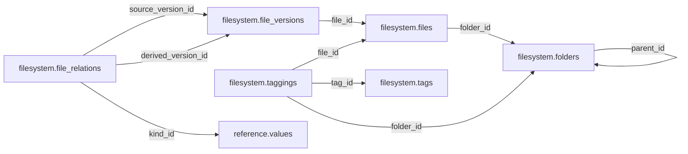

# filesystem — Phase 01

> **Phase 01 civic accountability scope agreed; table and column proposals remain unapproved.** No implementation is authorized by this documentation reorganization.

[Folder index](README.md) · [Full catalogue and relocation inventory](../../README.md)

## Agreed responsibility — 12 November 2026

Logical files, immutable versions, hashes, storage references and derivatives; separate from Source.

Filesystem stays separate from Source. It owns logical files, immutable versions, hashes, storage references, derivative relationships and access metadata. Bytes may live in S3/object storage while the civic database stores their identities and metadata. Keep raw artifacts and evidence/run snapshots immutable; a cleaned extraction or derivative must never overwrite its source.

Source links captures and citations to exact file versions. Operations tracks upload reservations, retries and temporary artifacts; accepted file metadata is published with verified object existence and content identity. Existing S3 artifacts are protected. The retained release/conflict-safe update proposals remain inputs for review; this reorganization changes neither storage nor runtime behavior.

## Retained table proposals and review context

The following dictionaries preserve the earlier proposal inputs, adjusted for the agreed ownership above. They remain unapproved. Earlier inventories retain their measured names; collapsed historical sections do not override the 12 November decisions.

## Retained filesystem proposal

> **PROPOSED — USER REVIEW REQUIRED.** Schema assignment is agreed; proposed tables and columns still require review. No SQL or migration is authorized.

## Purpose and ownership

**Target:** Main. **Purpose:** Published immutable file catalog with S3 object references. Schema placement follows the 12 November scope decision; individual table/column designs remain proposals. Related owners follow the agreed responsibility section above.

## Current implementation and gaps

The active manifest has 30 manifest migrations and 49 distinct CREATE TABLE declarations (49 distinct current table names) in schemas `audit`, `auth`, `engine`, `filesystem`, `geography`, `legal`, `objects`, `reference`. Generated Dryv has 124 entities (digest `e0087da9cf5b00e91f283a5501c368c7696bdd841ea30629231dc9c590f7c1ee`). Counts describe current artifacts, not target design; SQL and Dryv diverge.

- SQL declarations: `filesystem.folders` (filesystem/0001_filesystem.sql), `filesystem.files` (filesystem/0001_filesystem.sql), `filesystem.file_versions` (filesystem/0001_filesystem.sql), `filesystem.tags` (filesystem/0001_filesystem.sql), `filesystem.taggings` (filesystem/0001_filesystem.sql), `filesystem.file_relations` (filesystem/0001_filesystem.sql), `filesystem.uploads` (filesystem/0001_filesystem.sql)
- Dryv entities: `filesystem.files` (filesystem.File), `filesystem.attachments` (filesystem.FileAttachment), `filesystem.events` (filesystem.FileEvent), `filesystem.variants` (filesystem.FileVariant), `filesystem.versions` (filesystem.FileVersion), `filesystem.folders` (filesystem.Folder), `filesystem.formats` (filesystem.Format), `filesystem.stores` (filesystem.Store), `filesystem.objects` (filesystem.StoredObject), `filesystem.uploads` (filesystem.UploadSession)

The inventory does not establish live database state and may miss ALTER-only changes. Before implementation, reconcile migrations, Dryv, generated output and callers.

## Proposed relationship map

> All nodes and edges are proposals. Main schemas may use local cross-schema foreign keys; no edge crosses the Main/Operations database boundary.

## Proposed table and column review

All tables and fields are hypothetical. Every proposed business column is listed; UUIDv7 `id` is a candidate default and remains open. Record every existing field disposition: KEEP / REMOVE / RENAME / MOVE / MERGE / SPLIT / DERIVE / ADD.

### `filesystem.folders` — Logical published artifact hierarchy

- **Example:** Official documents
- **Profile:** entity; planning envelope below.

| Column | Proposed type | Meaning | Nullable | Default | Relationship | Units / validation | Proposed disposition |
|---|---|---|---|---|---|---|---|
| `id` | `uuid` | Proposed stable identity | No | Rust UUIDv7 candidate | Primary key | UUIDv7 candidate; unique and immutable after publication | KEEP (candidate match to current SQL/Dryv field; confirm meaning) |
| `parent_id` | `uuid` | Parent | Yes | — | FK → `filesystem.folders` | UUID syntax; FK target must exist when the relationship is required | KEEP (candidate match to current SQL/Dryv field; confirm meaning) |
| `name` | `text` | Folder label | No | — | — | Nonblank when required; enforce domain-specific length, normalization and controlled vocabulary | KEEP (candidate match to current SQL/Dryv field; confirm meaning) |
| `access` | `text` | public internal restricted private | No | — | — | Nonblank when required; enforce domain-specific length, normalization and controlled vocabulary | KEEP (candidate match to current SQL/Dryv field; confirm meaning) |
| `authorization` | `jsonb` | Public release authority | Yes | — | — | Type checked; domain constraints and units must be approved for this field | ADD (proposed target field; pending user approval) |
| `role` | `text` | Artifact purpose | No | — | — | Nonblank when required; enforce domain-specific length, normalization and controlled vocabulary | ADD (proposed target field; pending user approval) |

- **Current SQL/Dryv fields without a proposed same-name column:** `access_authorization`, `acquisition_class`, `allow_weaker_children`, `artifact_role`, `code`, `created_at`, `created_by`, `depth`, `description`, `is_seed`, `jurisdiction_code`, `metadata`, `path`, `preparation`, `revision`, `updated_at`, `version`, `visibility`. **Disposition:** unresolved per field; propose KEEP, REMOVE, RENAME, MOVE, MERGE, SPLIT or DERIVE in review. Do not drop these fields until the user resolves each one.
- **FK action/cardinality:** Each non-null FK is many-to-one to its named target; nullable FKs are optional. Candidate delete/update behavior is RESTRICT/NO ACTION for accepted records; cascading canonical deletion is not proposed. Confirm uniqueness and exact behavior during review.
- **Constraints:** Sibling identity unique; access cannot weaken without authorization. Exact keys and cross-field checks remain for review.
- **Indexes:** primary key on `id`; candidate B-tree indexes on FK columns `parent_id` for joins and referenced-entity filters; add temporal/spatial indexes only where the stated query needs them and benchmarks support them.
- **Relationships:** resolve each FK target. Main allows cross-schema FKs. Main and Operations have no cross-database FK.
- **Evidence/time:** preserve exact source/version, observation/retrieval time, historical context and uncertainty where applicable. Approve the exact evidence path for this table.
- **Growth/storage estimate (illustrative planning envelope, not measured):** Low: initial 1,000, +200/year, peak 20/day; five-year 2,000 rows ≈ 2.0 MiB live row+index budget; Expected: initial 10,000, +2,000/year, peak 200/day; five-year 20,000 rows ≈ 19.5 MiB live row+index budget; High: initial 100,000, +20,000/year, peak 2,000/day; five-year 200,000 rows ≈ 195.3 MiB live row+index budget. Model: initial rows + annual accepted rows × 5; multiply by a per-row budget of 1 KiB including a coarse index allowance. Replace assumptions with actual samples, ingest rates and `pg_total_relation_size` before approval. Large object bytes are excluded; WAL, replicas, backups and S3 are budgeted separately.
- **Workload:** Interactive lookup by identity and approved foreign keys; batch scans for import/reconciliation. Peak-day figure above is a scenario assumption, not a service-level commitment.
- **Partitioning:** None proposed initially; decide from measured scale/query plans. Check late data and partition count.
- **Files:** originals, full-resolution geometry, arrays, media and large exports may be immutable S3 objects. Keep searchable identity, required facts, hashes, coverage, access and provenance in PostgreSQL; use manifests and selective reads.
- **Retention/risks/benchmark:** preserve accepted evidence and corrections. Review late arrivals, contention, index/partition growth and recovery. Benchmark joins, filters, spatial access, ingestion bursts, concurrent access and interrupted publication.
### `filesystem.files` — Stable logical file identity

- **Example:** Official census PDF
- **Profile:** entity; planning envelope below.

| Column | Proposed type | Meaning | Nullable | Default | Relationship | Units / validation | Proposed disposition |
|---|---|---|---|---|---|---|---|
| `id` | `uuid` | Proposed stable identity | No | Rust UUIDv7 candidate | Primary key | UUIDv7 candidate; unique and immutable after publication | KEEP (candidate match to current SQL/Dryv field; confirm meaning) |
| `folder_id` | `uuid` | Folder | No | — | FK → `filesystem.folders` | UUID syntax; FK target must exist when the relationship is required | KEEP (candidate match to current SQL/Dryv field; confirm meaning) |
| `name` | `text` | Display name | No | — | — | Nonblank when required; enforce domain-specific length, normalization and controlled vocabulary | KEEP (candidate match to current SQL/Dryv field; confirm meaning) |
| `retention` | `text` | preserve_history or replace_current | No | — | — | Nonblank when required; enforce domain-specific length, normalization and controlled vocabulary | KEEP (candidate match to current SQL/Dryv field; confirm meaning) |
| `current_version_id` | `uuid` | Selected version | Yes | — | — | UUID syntax; FK target must exist when the relationship is required | KEEP (candidate match to current SQL/Dryv field; confirm meaning) |

- **Current SQL/Dryv fields without a proposed same-name column:** `code`, `created_at`, `created_by`, `is_legal_hold`, `last_revision`, `owner_account_id`, `revision`, `status`, `trashed_at`, `updated_at`, `version`, `visibility`. **Disposition:** unresolved per field; propose KEEP, REMOVE, RENAME, MOVE, MERGE, SPLIT or DERIVE in review. Do not drop these fields until the user resolves each one.
- **FK action/cardinality:** Each non-null FK is many-to-one to its named target; nullable FKs are optional. Candidate delete/update behavior is RESTRICT/NO ACTION for accepted records; cascading canonical deletion is not proposed. Confirm uniqueness and exact behavior during review.
- **Constraints:** Unique folder/name; current version belongs to file. Exact keys and cross-field checks remain for review.
- **Indexes:** primary key on `id`; candidate B-tree indexes on FK columns `folder_id` for joins and referenced-entity filters; add temporal/spatial indexes only where the stated query needs them and benchmarks support them.
- **Relationships:** resolve each FK target. Main allows cross-schema FKs. Main and Operations have no cross-database FK.
- **Evidence/time:** preserve exact source/version, observation/retrieval time, historical context and uncertainty where applicable. Approve the exact evidence path for this table.
- **Growth/storage estimate (illustrative planning envelope, not measured):** Low: initial 1,000, +200/year, peak 20/day; five-year 2,000 rows ≈ 2.0 MiB live row+index budget; Expected: initial 10,000, +2,000/year, peak 200/day; five-year 20,000 rows ≈ 19.5 MiB live row+index budget; High: initial 100,000, +20,000/year, peak 2,000/day; five-year 200,000 rows ≈ 195.3 MiB live row+index budget. Model: initial rows + annual accepted rows × 5; multiply by a per-row budget of 1 KiB including a coarse index allowance. Replace assumptions with actual samples, ingest rates and `pg_total_relation_size` before approval. Large object bytes are excluded; WAL, replicas, backups and S3 are budgeted separately.
- **Workload:** Interactive lookup by identity and approved foreign keys; batch scans for import/reconciliation. Peak-day figure above is a scenario assumption, not a service-level commitment.
- **Partitioning:** None proposed initially; decide from measured scale/query plans. Check late data and partition count.
- **Files:** originals, full-resolution geometry, arrays, media and large exports may be immutable S3 objects. Keep searchable identity, required facts, hashes, coverage, access and provenance in PostgreSQL; use manifests and selective reads.
- **Retention/risks/benchmark:** preserve accepted evidence and corrections. Review late arrivals, contention, index/partition growth and recovery. Benchmark joins, filters, spatial access, ingestion bursts, concurrent access and interrupted publication.
### `filesystem.file_versions` — Exact immutable content version

- **Example:** PDF exact bytes
- **Profile:** release; planning envelope below.

| Column | Proposed type | Meaning | Nullable | Default | Relationship | Units / validation | Proposed disposition |
|---|---|---|---|---|---|---|---|
| `id` | `uuid` | Proposed stable identity | No | Rust UUIDv7 candidate | Primary key | UUIDv7 candidate; unique and immutable after publication | KEEP (candidate match to current SQL/Dryv field; confirm meaning) |
| `file_id` | `uuid` | Logical file | No | — | FK → `filesystem.files` | UUID syntax; FK target must exist when the relationship is required | KEEP (candidate match to current SQL/Dryv field; confirm meaning) |
| `revision` | `integer` | Monotonic revision | No | — | — | Type checked; domain constraints and units must be approved for this field | KEEP (candidate match to current SQL/Dryv field; confirm meaning) |
| `s3_key` | `text` | Private/public object key | No | — | — | Nonblank when required; enforce domain-specific length, normalization and controlled vocabulary | KEEP (candidate match to current SQL/Dryv field; confirm meaning) |
| `sha256` | `text` | Content hash | No | — | — | Nonblank when required; enforce domain-specific length, normalization and controlled vocabulary | KEEP (candidate match to current SQL/Dryv field; confirm meaning) |
| `size_bytes` | `bigint` | Byte count | No | — | — | Type checked; domain constraints and units must be approved for this field | KEEP (candidate match to current SQL/Dryv field; confirm meaning) |
| `content_type` | `text` | Verified media type | No | — | — | Nonblank when required; enforce domain-specific length, normalization and controlled vocabulary | KEEP (candidate match to current SQL/Dryv field; confirm meaning) |
| `provenance` | `jsonb` | Origin and release identity | No | — | — | Type checked; domain constraints and units must be approved for this field | KEEP (candidate match to current SQL/Dryv field; confirm meaning) |
| `pinned` | `boolean` | Retention protection | No | — | — | Type checked; domain constraints and units must be approved for this field | KEEP (candidate match to current SQL/Dryv field; confirm meaning) |

- **Current SQL/Dryv fields without a proposed same-name column:** `created_at`, `created_by`, `extension`, `original_filename`, `pin_reason`. **Disposition:** unresolved per field; propose KEEP, REMOVE, RENAME, MOVE, MERGE, SPLIT or DERIVE in review. Do not drop these fields until the user resolves each one.
- **FK action/cardinality:** Each non-null FK is many-to-one to its named target; nullable FKs are optional. Candidate delete/update behavior is RESTRICT/NO ACTION for accepted records; cascading canonical deletion is not proposed. Confirm uniqueness and exact behavior during review.
- **Constraints:** UNIQUE(file_id,revision); hash format/size validate; S3 key access policy. Exact keys and cross-field checks remain for review.
- **Indexes:** primary key on `id`; candidate B-tree indexes on FK columns `file_id` for joins and referenced-entity filters; add temporal/spatial indexes only where the stated query needs them and benchmarks support them.
- **Relationships:** resolve each FK target. Main allows cross-schema FKs. Main and Operations have no cross-database FK.
- **Evidence/time:** preserve exact source/version, observation/retrieval time, historical context and uncertainty where applicable. Approve the exact evidence path for this table.
- **Growth/storage estimate (illustrative planning envelope, not measured):** Low: initial 100, +20/year, peak 10/day; five-year 200 rows ≈ 0.4 MiB live row+index budget; Expected: initial 1,000, +200/year, peak 100/day; five-year 2,000 rows ≈ 3.9 MiB live row+index budget; High: initial 10,000, +2,000/year, peak 1,000/day; five-year 20,000 rows ≈ 39.1 MiB live row+index budget. Model: initial rows + annual accepted rows × 5; multiply by a per-row budget of 2 KiB including a coarse index allowance. Replace assumptions with actual samples, ingest rates and `pg_total_relation_size` before approval. Large object bytes are excluded; WAL, replicas, backups and S3 are budgeted separately.
- **Workload:** Interactive lookup by identity and approved foreign keys; batch scans for import/reconciliation. Peak-day figure above is a scenario assumption, not a service-level commitment.
- **Partitioning:** No partition approved. Benchmark first; time range is a candidate for append-heavy observations, and keys must include partition columns. Releases are normally unpartitioned unless measured need appears. Check late data and partition count.
- **Files:** originals, full-resolution geometry, arrays, media and large exports may be immutable S3 objects. Keep searchable identity, required facts, hashes, coverage, access and provenance in PostgreSQL; use manifests and selective reads.
- **Retention/risks/benchmark:** preserve accepted evidence and corrections. Review late arrivals, contention, index/partition growth and recovery. Benchmark joins, filters, spatial access, ingestion bursts, concurrent access and interrupted publication.
### `filesystem.file_relations` — Typed derivative lineage

- **Example:** PDF OCR derivative relation
- **Profile:** relation; planning envelope below.

| Column | Proposed type | Meaning | Nullable | Default | Relationship | Units / validation | Proposed disposition |
|---|---|---|---|---|---|---|---|
| `id` | `uuid` | Proposed stable identity | No | Rust UUIDv7 candidate | Primary key | UUIDv7 candidate; unique and immutable after publication | KEEP (candidate match to current SQL/Dryv field; confirm meaning) |
| `source_version_id` | `uuid` | Input | No | — | FK → `filesystem.file_versions` | UUID syntax; FK target must exist when the relationship is required | KEEP (candidate match to current SQL/Dryv field; confirm meaning) |
| `derived_version_id` | `uuid` | Output | No | — | FK → `filesystem.file_versions` | UUID syntax; FK target must exist when the relationship is required | KEEP (candidate match to current SQL/Dryv field; confirm meaning) |
| `kind_id` | `uuid` | Derivative kind | No | — | FK → `reference.values` | UUID syntax; FK target must exist when the relationship is required | ADD (proposed target field; pending user approval) |

- **Current SQL/Dryv fields without a proposed same-name column:** `created_at`, `created_by`, `engine_job_id`, `relation`. **Disposition:** unresolved per field; propose KEEP, REMOVE, RENAME, MOVE, MERGE, SPLIT or DERIVE in review. Do not drop these fields until the user resolves each one.
- **FK action/cardinality:** Each non-null FK is many-to-one to its named target; nullable FKs are optional. Candidate delete/update behavior is RESTRICT/NO ACTION for accepted records; cascading canonical deletion is not proposed. Confirm uniqueness and exact behavior during review.
- **Constraints:** Different versions; acyclic. Exact keys and cross-field checks remain for review.
- **Indexes:** primary key on `id`; candidate B-tree indexes on FK columns `source_version_id`, `derived_version_id`, `kind_id` for joins and referenced-entity filters; add temporal/spatial indexes only where the stated query needs them and benchmarks support them.
- **Relationships:** resolve each FK target. Main allows cross-schema FKs. Main and Operations have no cross-database FK.
- **Evidence/time:** preserve exact source/version, observation/retrieval time, historical context and uncertainty where applicable. Approve the exact evidence path for this table.
- **Growth/storage estimate (illustrative planning envelope, not measured):** Low: initial 1,000, +2,000/year, peak 100/day; five-year 11,000 rows ≈ 10.7 MiB live row+index budget; Expected: initial 10,000, +20,000/year, peak 1,000/day; five-year 110,000 rows ≈ 107.4 MiB live row+index budget; High: initial 100,000, +200,000/year, peak 10,000/day; five-year 1,100,000 rows ≈ 1,074.2 MiB live row+index budget. Model: initial rows + annual accepted rows × 5; multiply by a per-row budget of 1 KiB including a coarse index allowance. Replace assumptions with actual samples, ingest rates and `pg_total_relation_size` before approval. Large object bytes are excluded; WAL, replicas, backups and S3 are budgeted separately.
- **Workload:** Interactive lookup by identity and approved foreign keys; batch scans for import/reconciliation. Peak-day figure above is a scenario assumption, not a service-level commitment.
- **Partitioning:** None proposed initially; decide from measured scale/query plans. Check late data and partition count.
- **Files:** originals, full-resolution geometry, arrays, media and large exports may be immutable S3 objects. Keep searchable identity, required facts, hashes, coverage, access and provenance in PostgreSQL; use manifests and selective reads.
- **Retention/risks/benchmark:** preserve accepted evidence and corrections. Review late arrivals, contention, index/partition growth and recovery. Benchmark joins, filters, spatial access, ingestion bursts, concurrent access and interrupted publication.
### `filesystem.tags` — Controlled file catalog labels

- **Example:** Official publication
- **Profile:** catalog; planning envelope below.

| Column | Proposed type | Meaning | Nullable | Default | Relationship | Units / validation | Proposed disposition |
|---|---|---|---|---|---|---|---|
| `id` | `uuid` | Proposed stable identity | No | Rust UUIDv7 candidate | Primary key | UUIDv7 candidate; unique and immutable after publication | KEEP (candidate match to current SQL/Dryv field; confirm meaning) |
| `code` | `text` | Tag identity | No | — | — | Nonblank when required; enforce domain-specific length, normalization and controlled vocabulary | ADD (proposed target field; pending user approval) |
| `title` | `text` | Meaning | No | — | — | Nonblank when required; enforce domain-specific length, normalization and controlled vocabulary | ADD (proposed target field; pending user approval) |

- **Current SQL/Dryv fields without a proposed same-name column:** `created_at`, `description`, `name`. **Disposition:** unresolved per field; propose KEEP, REMOVE, RENAME, MOVE, MERGE, SPLIT or DERIVE in review. Do not drop these fields until the user resolves each one.
- **FK action/cardinality:** Each non-null FK is many-to-one to its named target; nullable FKs are optional. Candidate delete/update behavior is RESTRICT/NO ACTION for accepted records; cascading canonical deletion is not proposed. Confirm uniqueness and exact behavior during review.
- **Constraints:** UNIQUE(code). Exact keys and cross-field checks remain for review.
- **Indexes:** primary key on `id` for joins and referenced-entity filters; add temporal/spatial indexes only where the stated query needs them and benchmarks support them.
- **Relationships:** resolve each FK target. Main allows cross-schema FKs. Main and Operations have no cross-database FK.
- **Evidence/time:** preserve exact source/version, observation/retrieval time, historical context and uncertainty where applicable. Approve the exact evidence path for this table.
- **Growth/storage estimate (illustrative planning envelope, not measured):** Low: initial 100, +100/year, peak 5/day; five-year 600 rows ≈ 0.6 MiB live row+index budget; Expected: initial 1,000, +500/year, peak 25/day; five-year 3,500 rows ≈ 3.4 MiB live row+index budget; High: initial 10,000, +5,000/year, peak 250/day; five-year 35,000 rows ≈ 34.2 MiB live row+index budget. Model: initial rows + annual accepted rows × 5; multiply by a per-row budget of 1 KiB including a coarse index allowance. Replace assumptions with actual samples, ingest rates and `pg_total_relation_size` before approval. Large object bytes are excluded; WAL, replicas, backups and S3 are budgeted separately.
- **Workload:** Interactive lookup by identity and approved foreign keys; batch scans for import/reconciliation. Peak-day figure above is a scenario assumption, not a service-level commitment.
- **Partitioning:** None proposed initially; decide from measured scale/query plans. Check late data and partition count.
- **Files:** originals, full-resolution geometry, arrays, media and large exports may be immutable S3 objects. Keep searchable identity, required facts, hashes, coverage, access and provenance in PostgreSQL; use manifests and selective reads.
- **Retention/risks/benchmark:** preserve accepted evidence and corrections. Review late arrivals, contention, index/partition growth and recovery. Benchmark joins, filters, spatial access, ingestion bursts, concurrent access and interrupted publication.
### `filesystem.taggings` — File or folder classification

- **Example:** Geographic source tag
- **Profile:** relation; planning envelope below.

| Column | Proposed type | Meaning | Nullable | Default | Relationship | Units / validation | Proposed disposition |
|---|---|---|---|---|---|---|---|
| `id` | `uuid` | Proposed stable identity | No | Rust UUIDv7 candidate | Primary key | UUIDv7 candidate; unique and immutable after publication | KEEP (candidate match to current SQL/Dryv field; confirm meaning) |
| `tag_id` | `uuid` | Tag | No | — | FK → `filesystem.tags` | UUID syntax; FK target must exist when the relationship is required | KEEP (candidate match to current SQL/Dryv field; confirm meaning) |
| `file_id` | `uuid` | File | Yes | — | FK → `filesystem.files` | UUID syntax; FK target must exist when the relationship is required | KEEP (candidate match to current SQL/Dryv field; confirm meaning) |
| `folder_id` | `uuid` | Folder | Yes | — | FK → `filesystem.folders` | UUID syntax; FK target must exist when the relationship is required | KEEP (candidate match to current SQL/Dryv field; confirm meaning) |

- **Current SQL/Dryv fields without a proposed same-name column:** `created_at`, `tagged_by`. **Disposition:** unresolved per field; propose KEEP, REMOVE, RENAME, MOVE, MERGE, SPLIT or DERIVE in review. Do not drop these fields until the user resolves each one.
- **FK action/cardinality:** Each non-null FK is many-to-one to its named target; nullable FKs are optional. Candidate delete/update behavior is RESTRICT/NO ACTION for accepted records; cascading canonical deletion is not proposed. Confirm uniqueness and exact behavior during review.
- **Constraints:** Exactly one target; target-specific FKs. Exact keys and cross-field checks remain for review.
- **Indexes:** primary key on `id`; candidate B-tree indexes on FK columns `tag_id`, `file_id`, `folder_id` for joins and referenced-entity filters; add temporal/spatial indexes only where the stated query needs them and benchmarks support them.
- **Relationships:** resolve each FK target. Main allows cross-schema FKs. Main and Operations have no cross-database FK.
- **Evidence/time:** preserve exact source/version, observation/retrieval time, historical context and uncertainty where applicable. Approve the exact evidence path for this table.
- **Growth/storage estimate (illustrative planning envelope, not measured):** Low: initial 1,000, +2,000/year, peak 100/day; five-year 11,000 rows ≈ 10.7 MiB live row+index budget; Expected: initial 10,000, +20,000/year, peak 1,000/day; five-year 110,000 rows ≈ 107.4 MiB live row+index budget; High: initial 100,000, +200,000/year, peak 10,000/day; five-year 1,100,000 rows ≈ 1,074.2 MiB live row+index budget. Model: initial rows + annual accepted rows × 5; multiply by a per-row budget of 1 KiB including a coarse index allowance. Replace assumptions with actual samples, ingest rates and `pg_total_relation_size` before approval. Large object bytes are excluded; WAL, replicas, backups and S3 are budgeted separately.
- **Workload:** Interactive lookup by identity and approved foreign keys; batch scans for import/reconciliation. Peak-day figure above is a scenario assumption, not a service-level commitment.
- **Partitioning:** None proposed initially; decide from measured scale/query plans. Check late data and partition count.
- **Files:** originals, full-resolution geometry, arrays, media and large exports may be immutable S3 objects. Keep searchable identity, required facts, hashes, coverage, access and provenance in PostgreSQL; use manifests and selective reads.
- **Retention/risks/benchmark:** preserve accepted evidence and corrections. Review late arrivals, contention, index/partition growth and recovery. Benchmark joins, filters, spatial access, ingestion bursts, concurrent access and interrupted publication.

## Queries, lifecycle, capacity and approval

**Representative query:** Which exact bytes and rights support this published record?

Lifecycle: preserve source bytes; extract into candidate revisions; validate; review or use approved deterministic checks; atomically publish; serve. Corrections create explicit versions/supersession. Preserve disagreement and uncertainty.

Capacity is unmeasured. Use low/expected/high input scenarios, explicit formulas and workload benchmarks; do not assume sizes or universal partitions.

**Status:** NOT REVIEWED. Schema assignment follows the handoff; tables, columns, relationships, partitioning and S3 choices still require user approval. Feedback: none. Approval reference/date/revision: none. Implementation authorization: not granted. Material changes reopen approval.

Earlier schema proposal preserved for history; superseded and not an approval

---
id: DOC-15FC8B06ED43
name: Filesystem schema redesign and external object storage mapping
type: documentation
tags: [improvements, schema-redesign, filesystem, s3, planning]
extra: {status: planning_only, object_store: existing_external}
---

# Filesystem — logical files, folders, tags, versions, storage and access

**PLANNING ONLY. The user already has a deployed self-hosted S3-compatible object-storage service. Do not add another S3 container or implement a second object store.**

## User's requirements, ownership and boundaries

Retain a powerful `filesystem` schema, with clear user-facing organization of logical **files, nested folders, tags, groups, searches, metadata, variants, content hashes, versions, attachments and access URLs**. Existing remote S3 service owns bytes/object operations and supported public/private URL/access functions; MZIZI owns logical organization, relationships to canonical records, artifact identity, provenance references and user experience. Do not make every publicly sourced document private by default; public access should be the normal outcome where the source's reuse rights and sensitivity allow it.

A logical file may be named and arranged differently from its remote S3 object key. Moving a folder must not duplicate or rewrite the bytes; one content-addressed object may back several logical file versions/source captures. Do not conflate `source.documents` and `filesystem.files`, or a website page's extracted Markdown version with its raw captured HTML.

## Current ten tables and recommendations

| Current table | Responsibility; audit and potential action |
|---|---|
| `filesystem.stores` | Registered external/local storage backends: configuration name, kind, tier and current state. Connect to existing S3 instance, not credentials embedded in row. |
| `filesystem.formats` | MIME/format dictionary; determine whether table is necessary versus standardized metadata. |
| `filesystem.folders` | Logical tree with stable IDs, parent, path, visibility and folder metadata; support folders without creating an S3 bucket per folder. |
| `filesystem.objects` | Physical remote object ref: store FK, object key, SHA-256/content hash, length, MIME/scan status and technical metadata. |
| `filesystem.files` | Human-facing logical file identity, name, folder FK, version selection, visibility, lifecycle and legal hold. |
| `filesystem.versions` | Immutable logical file revision → object FK; uploaded/created time and version number. |
| `filesystem.variants` | Generated thumbnail/preview/converted derivative, linked to input/output versions and rendering recipe. |
| `filesystem.attachments` | Associate a logical file/version with a canonical record; current flexible targets must be evaluated against hard-FK requirement. |
| `filesystem.uploads` | Upload-session metadata; keep only if MZIZI needs a workflow beyond what existing S3 service already provides. |
| `filesystem.events` | Immutable file lifecycle/audit events; decide whether these belong in filesystem operations or unified `audit`, without losing evidence. |

**Suggested candidate tables only where needed:** `tags`, `file_tags` for reusable tagged collections; `folder_permissions` or accessible collections; `derivations` if variants cannot express file lineage; `file_aliases` only if multiple virtual placements are required. Do not add all of these by default.

## Proposed logical folder/tag model

Example of **virtual** hierarchy: `sources/kenya/knbs/census`, `sources/kenya/iebc/elections`, `websites/site-structures`, `websites/markdown-pages`, `research/legal`, `generations/pattern-bundles` and `derived/validated-tables`. These are readable *examples*, not mandated S3 object keys or hard-coded classification. Allow tags like `jurisdiction:ke`, `source:knbs`, `content:statistics`, `acquisition:collected`, `artifact:markdown` and `year:2026`; tags should have an FK-controlled registry rather than unbounded free-text labels masquerading as reliable categories.

Folder hierarchy must preserve parent FKs and path resolution, unique sibling/path rules, rename/move behavior, policy-inheritance tradeoffs, restored/archived files and stable IDs. No expensive hot file counters should be updated on each upload unless measured necessity warrants them. Folder and tags should complement one another: folders answer "where should humans browse?", tags answer "what is this and where else is it relevant?"

## Object identity, hashing, files and dependencies

`filesystem.objects` must identify the remote content, not an ephemeral signed URL. A complete hash/length store key determines whether the bytes are already present; two distinct published `source.documents` can share identical bytes and still remain different source identities. `filesystem.versions` are immutable; later Markdown conversion is a **new derived version/artifact**, not overwrite of original evidence.

Plan at least: raw SHA-256, logical file version, source capture link, extraction/derivative version, content/semantic section hashes stored in appropriate execution/source metadata, uploader/publisher relation, declared/public access intent and last integrity check. ETag is not always SHA-256; verify service checksum capabilities. Keep signed/private URLs transient. Never give clients object-store secret credentials.

## FKs, visibility and source relations

Require actual FKs for `file.folder_id`, `version.file_id`, `version.object_id`, `object.store_id`, `variant` origins, `tags` junction, and well-typed references to `source.documents/captures`, institution, person, activity, project and legal source where structurally known. Generic `target_kind + target_id` in attachments lacks ordinary PostgreSQL FK integrity; evaluate typed attachments or constrained canonical record registry first. Authorization/RBAC uses `auth` rather than designing filesystem-specific users.

Public files: backend supplies public URL supported by existing remote service where lawful; private files use remote service access mechanisms and may have limited-expiry URLs; restricted source licenses, personally sensitive information and user uploads still need explicit policy. Do not store private session tokens in schema comments/docs.

## Four acquisition classes and generation

1A: curated uploads and static rule bundles. 1B: structured pattern files/site family bundles saved as versioned files. 2A: immutable crawled PDFs/HTML/CSV/images and the Markdown extracted from them. 2B: computed tables/visual previews/derivatives with input-file and tool version lineage. A file's **contents classification** (PDF vs Markdown) and **origin classification** (seed/pattern/collected/derived) are separate axes.

## Queries, migrations and unresolved decisions

Queries: show all KNBS census PDFs for 2019 and their Markdown/table derivatives; group websites by family and last content change; deduplicate identical bytes across URLs without merging source publications; show complete version history; find public URLs vs authorized private access; browse files via folders and tags independent of remote object key.

Current Python `.docs/_archives/2026-11-08-rewrite-snapshot/source/backend/engine/data/src/mzizi_data/files.py` uses `LocalDirectoryStore` and defaults created logical files to restricted. Migrate its adapter/access policy **only after inspecting** actual deployed S3 endpoint, bucket namespace, public URL rules, sign URL API, object versions and retention. No new storage service. Audit 10 table's current columns/FKs and clients; preserve all IDs, versions and hashes on backfill.

**OPEN:** exact S3 API/URL configuration; folder multiple placements vs one parent; tag schema; file retention and legal hold; attachment FK model; `formats/uploads/events` ownership; cache and integrity checks; default public/private policy by source classification; UI operations; migration of existing local objects. See [file-management plan](../../../guides/file-management-and-s3.md), [site Markdown plan](../../../guides/site-structure-and-markdown-extraction.md), and [master register](../../../guides/mzizi-data-schema-storage-and-pipelines-redesign.md).

**Status: proposals, no approved DDL.**

## Human review — editable user notes and design sign-off

**Review status:** `NOT REVIEWED` — AI-authored proposals in this document are not final approval.

**In my own words, what this schema should represent and exclude:**

> _My understanding and questions:_

**Tables/columns I want to keep, rename, move, merge, split, remove or add (and why):**

> _My proposed changes and alternative names:_

**Hard foreign keys, geographical and legal scope, pattern generation, classification and evidence I want changed or explained:**

> _My technical feedback, disagreements and alternatives:_

**Real data and queries I want to use to validate this design:**

> _My examples and expected results:_

**Unresolved decisions I want to discuss further:**

> _My remaining questions:_

**Final user decision:** `NOT DECIDED` / `NEEDS CHANGES` / `DESIGN VALIDATED BY USER` / `APPROVED FOR TASK PLANNING`.

**Approval reference and date:** _None. Only record explicit later user authorization. Even design validation does not authorize code, migration or Taskcode task creation._

## Mandatory per-table temporal, rigid-column and deletion review (2026-11-07)

**USER REQUIREMENT; planning only.** Examine every existing/proposed field and expressly record **KEEP / REMOVE / DERIVE / MOVE / RENAME / ADD** for `valid_from`, `valid_to`, `valid_from_precision`, `valid_to_precision`, `is_current`, `status`, `version`, `created_at`, `updated_at` and other copied/rigid flags. These fields are **opt-in by justified meaning**, not blanket schema conventions. Assess `deleted_at` only for recoverable soft deletion where appropriate. The full policy and migration/approval checklist is in [schema redesign README](../../README.md).

**Domain-specific guidance:** Immutable objects and versions have content identity and creation times, not real-world validity. Files and logical folders are candidates for selective deleted_at trash/restore, with FK and partial unique-index design; do not delete source evidence or remote S3 bytes by implication. Uploads/events have operational timestamps, not a copied is_current/precision bundle.

**OPEN for human review:** exact per-table/column disposition, derived status and as-of queries, pattern/legal links, justified precision, recoverable deletion versus domain lifecycle, history/identity preservation and hard-FK impact. No code or migration is authorized.

## 2026-11-08 — Root seed convention and folder/file-type design

The user now requires all manually or AI-prepared seed inputs, including auth baselines and site-structure YAML/JSON/CSV/code artifacts, under repository-root `seed/`. The authoritative convention and design proposal are in [seed/README.md](https://github.com/alidantech-org/mzizi.africa/blob/develop/seed/README.md). Use global file types without jurisdiction linkage, jurisdiction-specific fixed folder CSVs, and system/jurisdiction pattern definitions producing concrete folders from actual resources. Shared pattern definitions belong in reference, execution in engine. Files link to concrete folder and physical type; exact versions retain their actual format. Global/system/jurisdiction files are separated locally, and manifests identify dependencies, keys, recognized loaders/targets, hashes and S3 destination for each adopted artifact. Generated/reproducible outputs may be ignored but require replay or fetch metadata.

Existing SeaweedFS configuration is fixed: bucket `mzizi`, region `us-east-1`, existing environment credentials, laptop endpoint `http://192.168.100.13:18333`, Docker endpoint `http://object-storage:8333` on `home-services`, public origin `https://res.alidantech.org/mzizi/`. Only `public/` allows anonymous reads; every other prefix is private. Do not provision storage, regenerate credentials, use per-object public ACLs or change infrastructure. Local logical folder paths need not mirror object keys. Seed CSV bytes normally go under `internal/seeds/` even when their rows define public folders.

This approves documentation and the directory convention; bulk legacy relocation, actual catalog content, production folder generation, runtime manifest support and S3 uploads remain future work. Existing objects require inspection; disposable `mzizi_new` does not imply disposable S3. No backward compatibility is needed for the approved database rewrite. Earlier per-service seed locations and preservation/compatibility statements are historical and are superseded for this rewrite by the newer user direction.

## 2026-11-08 — Seed relocation completed; folder-level provenance requirements

Task `TSK-0F4398B91D38` relocated the real system seeds to root `seed/` (inventory: `seed/README.md`), added `_folder.yaml` folder descriptors (artifact role, acquisition class, preparation method, access class, scope, review state, with deterministic nearest-folder inheritance and explicit file overrides), a functional `seed/manifest.yaml` and a generated `seed/manifest.lock.json` that maps each file to a durable S3 key (`internal/seeds/...`) without uploading it. The filesystem design must persist this: folder-level metadata and inheritance, effective provenance captured when a seed artifact is registered (manifest release, checksum, descriptor source, generator/tool, intended access, S3 reference), historical origin kept apart from current placement, S3 prefixes consistent with effective access, and folders generated from reference-owned patterns. File formats come from the authoritative `seed/global/reference/media-formats.json`; the global file-type CSV, extension aliases and the Kenyan folder CSV are still to be derived and designed in this milestone. Implementation remains unauthorized.

## 2026-11-11 — System-expansion alignment

The expansion reuses immutable filesystem versions for original/derived spatial and heritage assets; domain identity, access policy, derivation lineage and canonical metadata remain separate concerns. See the [system-expansion proposal](../../../guides/advancement-and-system-expansion.md). This alignment note does not approve proposed schemas, tables or implementation.

