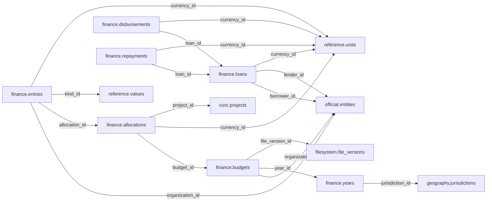

# finance — Phase 01

> **Phase 01 civic accountability scope agreed; table and column proposals remain unapproved.** No implementation is authorized by this documentation reorganization.

[Folder index](README.md) · [Full catalogue and relocation inventory](../README.md)

## Agreed responsibility — 12 November 2026

Public budgets, allocations, revenue, expenditure, transfers, public funds and debt.

Keep Finance separate from Procurement. Preserve budgets and editions, allocations, revenues, expenditures, transfers, public funds, borrowing, loan disbursements and debt service. Record the relevant fiscal/transaction time, currency and units, jurisdiction, responsible institution and exact evidence. Responsible mandates link to Governance and identities to Official; geographic scope uses Geography, including a country unit for national coverage. Legal foundations are mediated by Reference.

Existing years/budgets/allocations/entries/loans/repayments/disbursements dictionaries and the older funds, revenue and transfer proposals remain review inputs. Distinguish authorization, allocation, commitment, payment and actual delivery. Procurement contracts and Civic projects reference funding without duplicating authoritative amounts. Do not require deferred Economy or Statistical tables to publish pilot finance records.

## Retained table proposals and review context

The following dictionaries preserve the earlier proposal inputs, adjusted for the agreed ownership above. They remain unapproved. Earlier inventories retain their measured names; collapsed historical sections do not override the 12 November decisions.

## Retained finance proposal

> **PROPOSED — USER REVIEW REQUIRED.** Schema assignment is agreed; proposed tables and columns still require review. No SQL or migration is authorized.

## Purpose and ownership

**Target:** Main. **Purpose:** Public budget, revenue, expenditure and debt. Schema placement follows the 12 November scope decision; individual table/column designs remain proposals. Related owners follow the agreed responsibility section above.

## Current implementation and gaps

The active manifest has 30 manifest migrations and 49 distinct CREATE TABLE declarations (49 distinct current table names) in schemas `audit`, `auth`, `engine`, `filesystem`, `geography`, `legal`, `objects`, `reference`. Generated Dryv has 124 entities (digest `e0087da9cf5b00e91f283a5501c368c7696bdd841ea30629231dc9c590f7c1ee`). Counts describe current artifacts, not target design; SQL and Dryv diverge.

- SQL declarations: None found.
- Dryv entities: `finance.budgets` (finance.Budget), `finance.units` (finance.BudgetaryUnit), `finance.expenditures` (finance.Expenditure), `finance.years` (finance.FiscalYear), `finance.entries` (finance.LedgerEntry), `finance.revenues` (finance.RevenueRecord), `finance.transfers` (finance.Transfer)

The inventory does not establish live database state and may miss ALTER-only changes. Before implementation, reconcile migrations, Dryv, generated output and callers.

## Proposed relationship map

> All nodes and edges are proposals. Main schemas may use local cross-schema foreign keys; no edge crosses the Main/Operations database boundary.

## Proposed table and column review

All tables and fields are hypothetical. Every proposed business column is listed; UUIDv7 `id` is a candidate default and remains open. Record every existing field disposition: KEEP / REMOVE / RENAME / MOVE / MERGE / SPLIT / DERIVE / ADD.

### `finance.years` — Fiscal year periods

- **Example:** Fiscal year
- **Profile:** catalog; planning envelope below.

| Column | Proposed type | Meaning | Nullable | Default | Relationship | Units / validation | Proposed disposition |
|---|---|---|---|---|---|---|---|
| `id` | `uuid` | Proposed stable identity | No | Rust UUIDv7 candidate | Primary key | UUIDv7 candidate; unique and immutable after publication | KEEP (candidate match to current SQL/Dryv field; confirm meaning) |
| `jurisdiction_id` | `uuid` | Jurisdiction | No | — | FK → `geography.jurisdictions` | UUID syntax; FK target must exist when the relationship is required | KEEP (candidate match to current SQL/Dryv field; confirm meaning) |
| `label` | `text` | Publisher label | No | — | — | Nonblank when required; enforce domain-specific length, normalization and controlled vocabulary | ADD (proposed target field; pending user approval) |
| `period` | `daterange` | Exact fiscal interval | No | — | — | Type checked; domain constraints and units must be approved for this field | ADD (proposed target field; pending user approval) |

- **Current SQL/Dryv fields without a proposed same-name column:** `code`, `created_at`, `ends_on`, `is_current`, `starts_on`, `updated_at`, `valid_from`, `valid_from_precision`, `valid_to`, `valid_to_precision`, `version`. **Disposition:** unresolved per field; propose KEEP, REMOVE, RENAME, MOVE, MERGE, SPLIT or DERIVE in review. Do not drop these fields until the user resolves each one.
- **FK action/cardinality:** Each non-null FK is many-to-one to its named target; nullable FKs are optional. Candidate delete/update behavior is RESTRICT/NO ACTION for accepted records; cascading canonical deletion is not proposed. Confirm uniqueness and exact behavior during review.
- **Constraints:** UNIQUE(jurisdiction_id,label). Exact keys and cross-field checks remain for review.
- **Indexes:** primary key on `id`; candidate B-tree indexes on FK columns `jurisdiction_id` for joins and referenced-entity filters; add temporal/spatial indexes only where the stated query needs them and benchmarks support them.
- **Relationships:** resolve each FK target. Main allows cross-schema FKs. Main and Operations have no cross-database FK.
- **Evidence/time:** preserve exact source/version, observation/retrieval time, historical context and uncertainty where applicable. Approve the exact evidence path for this table.
- **Growth/storage estimate (illustrative planning envelope, not measured):** Low: initial 100, +100/year, peak 5/day; five-year 600 rows ≈ 0.6 MiB live row+index budget; Expected: initial 1,000, +500/year, peak 25/day; five-year 3,500 rows ≈ 3.4 MiB live row+index budget; High: initial 10,000, +5,000/year, peak 250/day; five-year 35,000 rows ≈ 34.2 MiB live row+index budget. Model: initial rows + annual accepted rows × 5; multiply by a per-row budget of 1 KiB including a coarse index allowance. Replace assumptions with actual samples, ingest rates and `pg_total_relation_size` before approval. Large object bytes are excluded; WAL, replicas, backups and S3 are budgeted separately.
- **Workload:** Interactive lookup by identity and approved foreign keys; batch scans for import/reconciliation. Peak-day figure above is a scenario assumption, not a service-level commitment.
- **Partitioning:** None proposed initially; decide from measured scale/query plans. Check late data and partition count.
- **Files:** originals, full-resolution geometry, arrays, media and large exports may be immutable S3 objects. Keep searchable identity, required facts, hashes, coverage, access and provenance in PostgreSQL; use manifests and selective reads.
- **Retention/risks/benchmark:** preserve accepted evidence and corrections. Review late arrivals, contention, index/partition growth and recovery. Benchmark joins, filters, spatial access, ingestion bursts, concurrent access and interrupted publication.
### `finance.budgets` — Budget identity and release

- **Example:** Approved annual budget
- **Profile:** release; planning envelope below.

| Column | Proposed type | Meaning | Nullable | Default | Relationship | Units / validation | Proposed disposition |
|---|---|---|---|---|---|---|---|
| `id` | `uuid` | Proposed stable identity | No | Rust UUIDv7 candidate | Primary key | UUIDv7 candidate; unique and immutable after publication | KEEP (candidate match to current SQL/Dryv field; confirm meaning) |
| `organization_id` | `uuid` | Budget holder | No | — | FK → `official.entities` | UUID syntax; FK target must exist when the relationship is required | ADD (proposed target field; pending user approval) |
| `year_id` | `uuid` | Fiscal period | No | — | FK → `finance.years` | UUID syntax; FK target must exist when the relationship is required | ADD (proposed target field; pending user approval) |
| `edition` | `text` | Release code | No | — | — | Nonblank when required; enforce domain-specific length, normalization and controlled vocabulary | ADD (proposed target field; pending user approval) |
| `stage` | `text` | proposal, approved, revised | No | — | — | Nonblank when required; enforce domain-specific length, normalization and controlled vocabulary | ADD (proposed target field; pending user approval) |
| `file_version_id` | `uuid` | Evidence document | No | — | FK → `filesystem.file_versions` | UUID syntax; FK target must exist when the relationship is required | ADD (proposed target field; pending user approval) |

- **Current SQL/Dryv fields without a proposed same-name column:** `approved_amount`, `created_at`, `currency_code`, `fiscal_year_id`, `is_current`, `kind`, `legal_basis_id`, `program_code`, `unit_id`, `updated_at`, `valid_from`, `valid_from_precision`, `valid_to`, `valid_to_precision`, `version`. **Disposition:** unresolved per field; propose KEEP, REMOVE, RENAME, MOVE, MERGE, SPLIT or DERIVE in review. Do not drop these fields until the user resolves each one.
- **FK action/cardinality:** Each non-null FK is many-to-one to its named target; nullable FKs are optional. Candidate delete/update behavior is RESTRICT/NO ACTION for accepted records; cascading canonical deletion is not proposed. Confirm uniqueness and exact behavior during review.
- **Constraints:** UNIQUE(organization_id,year_id,edition). Exact keys and cross-field checks remain for review.
- **Indexes:** primary key on `id`; candidate B-tree indexes on FK columns `organization_id`, `year_id`, `file_version_id` for joins and referenced-entity filters; add temporal/spatial indexes only where the stated query needs them and benchmarks support them.
- **Relationships:** resolve each FK target. Main allows cross-schema FKs. Main and Operations have no cross-database FK.
- **Evidence/time:** preserve exact source/version, observation/retrieval time, historical context and uncertainty where applicable. Approve the exact evidence path for this table.
- **Growth/storage estimate (illustrative planning envelope, not measured):** Low: initial 100, +20/year, peak 10/day; five-year 200 rows ≈ 0.4 MiB live row+index budget; Expected: initial 1,000, +200/year, peak 100/day; five-year 2,000 rows ≈ 3.9 MiB live row+index budget; High: initial 10,000, +2,000/year, peak 1,000/day; five-year 20,000 rows ≈ 39.1 MiB live row+index budget. Model: initial rows + annual accepted rows × 5; multiply by a per-row budget of 2 KiB including a coarse index allowance. Replace assumptions with actual samples, ingest rates and `pg_total_relation_size` before approval. Large object bytes are excluded; WAL, replicas, backups and S3 are budgeted separately.
- **Workload:** Interactive lookup by identity and approved foreign keys; batch scans for import/reconciliation. Peak-day figure above is a scenario assumption, not a service-level commitment.
- **Partitioning:** No partition approved. Benchmark first; time range is a candidate for append-heavy observations, and keys must include partition columns. Releases are normally unpartitioned unless measured need appears. Check late data and partition count.
- **Files:** originals, full-resolution geometry, arrays, media and large exports may be immutable S3 objects. Keep searchable identity, required facts, hashes, coverage, access and provenance in PostgreSQL; use manifests and selective reads.
- **Retention/risks/benchmark:** preserve accepted evidence and corrections. Review late arrivals, contention, index/partition growth and recovery. Benchmark joins, filters, spatial access, ingestion bursts, concurrent access and interrupted publication.
### `finance.allocations` — Budget line values

- **Example:** Budget for health program
- **Profile:** fact; planning envelope below.

| Column | Proposed type | Meaning | Nullable | Default | Relationship | Units / validation | Proposed disposition |
|---|---|---|---|---|---|---|---|
| `id` | `uuid` | Proposed stable identity | No | Rust UUIDv7 candidate | Primary key | UUIDv7 candidate; unique and immutable after publication | ADD (proposed target field; pending user approval) |
| `budget_id` | `uuid` | Release | No | — | FK → `finance.budgets` | UUID syntax; FK target must exist when the relationship is required | ADD (proposed target field; pending user approval) |
| `code` | `text` | Line code | No | — | — | Nonblank when required; enforce domain-specific length, normalization and controlled vocabulary | ADD (proposed target field; pending user approval) |
| `title` | `text` | Description | No | — | — | Nonblank when required; enforce domain-specific length, normalization and controlled vocabulary | ADD (proposed target field; pending user approval) |
| `amount` | `numeric` | Currency amount | No | — | — | Type checked; domain constraints and units must be approved for this field | ADD (proposed target field; pending user approval) |
| `currency_id` | `uuid` | Currency | No | — | FK → `reference.units` | UUID syntax; FK target must exist when the relationship is required | ADD (proposed target field; pending user approval) |
| `project_id` | `uuid` | Associated project | Yes | — | FK → `civic.projects` | UUID syntax; FK target must exist when the relationship is required | ADD (proposed target field; pending user approval) |

- **FK action/cardinality:** Each non-null FK is many-to-one to its named target; nullable FKs are optional. Candidate delete/update behavior is RESTRICT/NO ACTION for accepted records; cascading canonical deletion is not proposed. Confirm uniqueness and exact behavior during review.
- **Constraints:** UNIQUE(budget_id,code); signed semantics declared. Exact keys and cross-field checks remain for review.
- **Indexes:** primary key on `id`; candidate B-tree indexes on FK columns `budget_id`, `currency_id`, `project_id` for joins and referenced-entity filters; add temporal/spatial indexes only where the stated query needs them and benchmarks support them.
- **Relationships:** resolve each FK target. Main allows cross-schema FKs. Main and Operations have no cross-database FK.
- **Evidence/time:** preserve exact source/version, observation/retrieval time, historical context and uncertainty where applicable. Approve the exact evidence path for this table.
- **Growth/storage estimate (illustrative planning envelope, not measured):** Low: initial 10,000, +2,000/year, peak 100/day; five-year 20,000 rows ≈ 39.1 MiB live row+index budget; Expected: initial 100,000, +20,000/year, peak 1,000/day; five-year 200,000 rows ≈ 390.6 MiB live row+index budget; High: initial 1,000,000, +200,000/year, peak 10,000/day; five-year 2,000,000 rows ≈ 3,906.2 MiB live row+index budget. Model: initial rows + annual accepted rows × 5; multiply by a per-row budget of 2 KiB including a coarse index allowance. Replace assumptions with actual samples, ingest rates and `pg_total_relation_size` before approval. Large object bytes are excluded; WAL, replicas, backups and S3 are budgeted separately.
- **Workload:** Interactive lookup by identity and approved foreign keys; batch scans for import/reconciliation. Peak-day figure above is a scenario assumption, not a service-level commitment.
- **Partitioning:** None proposed initially; decide from measured scale/query plans. Check late data and partition count.
- **Files:** originals, full-resolution geometry, arrays, media and large exports may be immutable S3 objects. Keep searchable identity, required facts, hashes, coverage, access and provenance in PostgreSQL; use manifests and selective reads.
- **Retention/risks/benchmark:** preserve accepted evidence and corrections. Review late arrivals, contention, index/partition growth and recovery. Benchmark joins, filters, spatial access, ingestion bursts, concurrent access and interrupted publication.
### `finance.entries` — Published financial transactions

- **Example:** Expenditure item
- **Profile:** series; planning envelope below.

| Column | Proposed type | Meaning | Nullable | Default | Relationship | Units / validation | Proposed disposition |
|---|---|---|---|---|---|---|---|
| `id` | `uuid` | Proposed stable identity | No | Rust UUIDv7 candidate | Primary key | UUIDv7 candidate; unique and immutable after publication | KEEP (candidate match to current SQL/Dryv field; confirm meaning) |
| `organization_id` | `uuid` | Reporting body | No | — | FK → `official.entities` | UUID syntax; FK target must exist when the relationship is required | ADD (proposed target field; pending user approval) |
| `allocation_id` | `uuid` | Budget line | Yes | — | FK → `finance.allocations` | UUID syntax; FK target must exist when the relationship is required | ADD (proposed target field; pending user approval) |
| `posted_on` | `date` | Accounting date | No | — | — | Type checked; domain constraints and units must be approved for this field | KEEP (candidate match to current SQL/Dryv field; confirm meaning) |
| `kind_id` | `uuid` | Transaction class | No | — | FK → `reference.values` | UUID syntax; FK target must exist when the relationship is required | ADD (proposed target field; pending user approval) |
| `amount` | `numeric` | Signed value | No | — | — | Type checked; domain constraints and units must be approved for this field | ADD (proposed target field; pending user approval) |
| `currency_id` | `uuid` | Currency | No | — | FK → `reference.units` | UUID syntax; FK target must exist when the relationship is required | ADD (proposed target field; pending user approval) |
| `source_key` | `text` | Publisher row key | No | — | — | Nonblank when required; enforce domain-specific length, normalization and controlled vocabulary | ADD (proposed target field; pending user approval) |

- **Current SQL/Dryv fields without a proposed same-name column:** `account_code`, `created_at`, `credit_amount`, `currency_code`, `debit_amount`, `is_current`, `reference_id`, `reference_kind`, `unit_id`, `updated_at`, `valid_from`, `valid_from_precision`, `valid_to`, `valid_to_precision`, `version`. **Disposition:** unresolved per field; propose KEEP, REMOVE, RENAME, MOVE, MERGE, SPLIT or DERIVE in review. Do not drop these fields until the user resolves each one.
- **FK action/cardinality:** Each non-null FK is many-to-one to its named target; nullable FKs are optional. Candidate delete/update behavior is RESTRICT/NO ACTION for accepted records; cascading canonical deletion is not proposed. Confirm uniqueness and exact behavior during review.
- **Constraints:** UNIQUE(organization_id,source_key,publication_id); partition by posted_on only if measured growth warrants. Exact keys and cross-field checks remain for review.
- **Indexes:** primary key on `id`; candidate B-tree indexes on FK columns `organization_id`, `allocation_id`, `kind_id`, `currency_id` for joins and referenced-entity filters; add temporal/spatial indexes only where the stated query needs them and benchmarks support them.
- **Relationships:** resolve each FK target. Main allows cross-schema FKs. Main and Operations have no cross-database FK.
- **Evidence/time:** preserve exact source/version, observation/retrieval time, historical context and uncertainty where applicable. Approve the exact evidence path for this table.
- **Growth/storage estimate (illustrative planning envelope, not measured):** Low: initial 100,000, +100,000/year, peak 5,000/day; five-year 600,000 rows ≈ 1,171.9 MiB live row+index budget; Expected: initial 1,000,000, +1,000,000/year, peak 50,000/day; five-year 6,000,000 rows ≈ 11,718.8 MiB live row+index budget; High: initial 10,000,000, +10,000,000/year, peak 500,000/day; five-year 60,000,000 rows ≈ 117,187.5 MiB live row+index budget. Model: initial rows + annual accepted rows × 5; multiply by a per-row budget of 2 KiB including a coarse index allowance. Replace assumptions with actual samples, ingest rates and `pg_total_relation_size` before approval. Large object bytes are excluded; WAL, replicas, backups and S3 are budgeted separately.
- **Workload:** Interactive lookup by identity and approved foreign keys; batch scans for import/reconciliation. Peak-day figure above is a scenario assumption, not a service-level commitment.
- **Partitioning:** No partition approved. Benchmark first; time range is a candidate for append-heavy observations, and keys must include partition columns. Releases are normally unpartitioned unless measured need appears. Check late data and partition count.
- **Files:** originals, full-resolution geometry, arrays, media and large exports may be immutable S3 objects. Keep searchable identity, required facts, hashes, coverage, access and provenance in PostgreSQL; use manifests and selective reads.
- **Retention/risks/benchmark:** preserve accepted evidence and corrections. Review late arrivals, contention, index/partition growth and recovery. Benchmark joins, filters, spatial access, ingestion bursts, concurrent access and interrupted publication.
### `finance.loans` — Public loan agreement

- **Example:** Sovereign loan
- **Profile:** entity; planning envelope below.

| Column | Proposed type | Meaning | Nullable | Default | Relationship | Units / validation | Proposed disposition |
|---|---|---|---|---|---|---|---|
| `id` | `uuid` | Proposed stable identity | No | Rust UUIDv7 candidate | Primary key | UUIDv7 candidate; unique and immutable after publication | ADD (proposed target field; pending user approval) |
| `borrower_id` | `uuid` | Borrower | No | — | FK → `official.entities` | UUID syntax; FK target must exist when the relationship is required | ADD (proposed target field; pending user approval) |
| `lender_id` | `uuid` | Lender | No | — | FK → `official.entities` | UUID syntax; FK target must exist when the relationship is required | ADD (proposed target field; pending user approval) |
| `agreement_code` | `text` | Agreement | No | — | — | Nonblank when required; enforce domain-specific length, normalization and controlled vocabulary | ADD (proposed target field; pending user approval) |
| `signed_on` | `date` | Signature | Yes | — | — | Type checked; domain constraints and units must be approved for this field | ADD (proposed target field; pending user approval) |
| `principal` | `numeric` | Original amount | No | — | — | Type checked; domain constraints and units must be approved for this field | ADD (proposed target field; pending user approval) |
| `currency_id` | `uuid` | Currency | No | — | FK → `reference.units` | UUID syntax; FK target must exist when the relationship is required | ADD (proposed target field; pending user approval) |

- **FK action/cardinality:** Each non-null FK is many-to-one to its named target; nullable FKs are optional. Candidate delete/update behavior is RESTRICT/NO ACTION for accepted records; cascading canonical deletion is not proposed. Confirm uniqueness and exact behavior during review.
- **Constraints:** principal >= 0; UNIQUE(borrower_id,agreement_code). Exact keys and cross-field checks remain for review.
- **Indexes:** primary key on `id`; candidate B-tree indexes on FK columns `borrower_id`, `lender_id`, `currency_id` for joins and referenced-entity filters; add temporal/spatial indexes only where the stated query needs them and benchmarks support them.
- **Relationships:** resolve each FK target. Main allows cross-schema FKs. Main and Operations have no cross-database FK.
- **Evidence/time:** preserve exact source/version, observation/retrieval time, historical context and uncertainty where applicable. Approve the exact evidence path for this table.
- **Growth/storage estimate (illustrative planning envelope, not measured):** Low: initial 1,000, +200/year, peak 20/day; five-year 2,000 rows ≈ 2.0 MiB live row+index budget; Expected: initial 10,000, +2,000/year, peak 200/day; five-year 20,000 rows ≈ 19.5 MiB live row+index budget; High: initial 100,000, +20,000/year, peak 2,000/day; five-year 200,000 rows ≈ 195.3 MiB live row+index budget. Model: initial rows + annual accepted rows × 5; multiply by a per-row budget of 1 KiB including a coarse index allowance. Replace assumptions with actual samples, ingest rates and `pg_total_relation_size` before approval. Large object bytes are excluded; WAL, replicas, backups and S3 are budgeted separately.
- **Workload:** Interactive lookup by identity and approved foreign keys; batch scans for import/reconciliation. Peak-day figure above is a scenario assumption, not a service-level commitment.
- **Partitioning:** None proposed initially; decide from measured scale/query plans. Check late data and partition count.
- **Files:** originals, full-resolution geometry, arrays, media and large exports may be immutable S3 objects. Keep searchable identity, required facts, hashes, coverage, access and provenance in PostgreSQL; use manifests and selective reads.
- **Retention/risks/benchmark:** preserve accepted evidence and corrections. Review late arrivals, contention, index/partition growth and recovery. Benchmark joins, filters, spatial access, ingestion bursts, concurrent access and interrupted publication.
### `finance.repayments` — Published debt service

- **Example:** Debt repayment
- **Profile:** series; planning envelope below.

| Column | Proposed type | Meaning | Nullable | Default | Relationship | Units / validation | Proposed disposition |
|---|---|---|---|---|---|---|---|
| `id` | `uuid` | Proposed stable identity | No | Rust UUIDv7 candidate | Primary key | UUIDv7 candidate; unique and immutable after publication | ADD (proposed target field; pending user approval) |
| `loan_id` | `uuid` | Loan | No | — | FK → `finance.loans` | UUID syntax; FK target must exist when the relationship is required | ADD (proposed target field; pending user approval) |
| `paid_on` | `date` | Payment date | No | — | — | Type checked; domain constraints and units must be approved for this field | ADD (proposed target field; pending user approval) |
| `principal` | `numeric` | Principal paid | No | — | — | Type checked; domain constraints and units must be approved for this field | ADD (proposed target field; pending user approval) |
| `interest` | `numeric` | Interest paid | No | — | — | Type checked; domain constraints and units must be approved for this field | ADD (proposed target field; pending user approval) |
| `currency_id` | `uuid` | Currency | No | — | FK → `reference.units` | UUID syntax; FK target must exist when the relationship is required | ADD (proposed target field; pending user approval) |
| `source_key` | `text` | External transaction key | No | — | — | Nonblank when required; enforce domain-specific length, normalization and controlled vocabulary | ADD (proposed target field; pending user approval) |

- **FK action/cardinality:** Each non-null FK is many-to-one to its named target; nullable FKs are optional. Candidate delete/update behavior is RESTRICT/NO ACTION for accepted records; cascading canonical deletion is not proposed. Confirm uniqueness and exact behavior during review.
- **Constraints:** Amounts nonnegative; source key uniqueness. Exact keys and cross-field checks remain for review.
- **Indexes:** primary key on `id`; candidate B-tree indexes on FK columns `loan_id`, `currency_id` for joins and referenced-entity filters; add temporal/spatial indexes only where the stated query needs them and benchmarks support them.
- **Relationships:** resolve each FK target. Main allows cross-schema FKs. Main and Operations have no cross-database FK.
- **Evidence/time:** preserve exact source/version, observation/retrieval time, historical context and uncertainty where applicable. Approve the exact evidence path for this table.
- **Growth/storage estimate (illustrative planning envelope, not measured):** Low: initial 100,000, +100,000/year, peak 5,000/day; five-year 600,000 rows ≈ 1,171.9 MiB live row+index budget; Expected: initial 1,000,000, +1,000,000/year, peak 50,000/day; five-year 6,000,000 rows ≈ 11,718.8 MiB live row+index budget; High: initial 10,000,000, +10,000,000/year, peak 500,000/day; five-year 60,000,000 rows ≈ 117,187.5 MiB live row+index budget. Model: initial rows + annual accepted rows × 5; multiply by a per-row budget of 2 KiB including a coarse index allowance. Replace assumptions with actual samples, ingest rates and `pg_total_relation_size` before approval. Large object bytes are excluded; WAL, replicas, backups and S3 are budgeted separately.
- **Workload:** Interactive lookup by identity and approved foreign keys; batch scans for import/reconciliation. Peak-day figure above is a scenario assumption, not a service-level commitment.
- **Partitioning:** No partition approved. Benchmark first; time range is a candidate for append-heavy observations, and keys must include partition columns. Releases are normally unpartitioned unless measured need appears. Check late data and partition count.
- **Files:** originals, full-resolution geometry, arrays, media and large exports may be immutable S3 objects. Keep searchable identity, required facts, hashes, coverage, access and provenance in PostgreSQL; use manifests and selective reads.
- **Retention/risks/benchmark:** preserve accepted evidence and corrections. Review late arrivals, contention, index/partition growth and recovery. Benchmark joins, filters, spatial access, ingestion bursts, concurrent access and interrupted publication.
### `finance.disbursements` — Loan disbursement records

- **Example:** Disbursed tranche
- **Profile:** series; planning envelope below.

| Column | Proposed type | Meaning | Nullable | Default | Relationship | Units / validation | Proposed disposition |
|---|---|---|---|---|---|---|---|
| `id` | `uuid` | Proposed stable identity | No | Rust UUIDv7 candidate | Primary key | UUIDv7 candidate; unique and immutable after publication | ADD (proposed target field; pending user approval) |
| `loan_id` | `uuid` | Loan | No | — | FK → `finance.loans` | UUID syntax; FK target must exist when the relationship is required | ADD (proposed target field; pending user approval) |
| `paid_on` | `date` | Disbursement date | No | — | — | Type checked; domain constraints and units must be approved for this field | ADD (proposed target field; pending user approval) |
| `amount` | `numeric` | Amount | No | — | — | Type checked; domain constraints and units must be approved for this field | ADD (proposed target field; pending user approval) |
| `currency_id` | `uuid` | Currency | No | — | FK → `reference.units` | UUID syntax; FK target must exist when the relationship is required | ADD (proposed target field; pending user approval) |
| `source_key` | `text` | External key | No | — | — | Nonblank when required; enforce domain-specific length, normalization and controlled vocabulary | ADD (proposed target field; pending user approval) |

- **FK action/cardinality:** Each non-null FK is many-to-one to its named target; nullable FKs are optional. Candidate delete/update behavior is RESTRICT/NO ACTION for accepted records; cascading canonical deletion is not proposed. Confirm uniqueness and exact behavior during review.
- **Constraints:** amount >= 0; unique source key. Exact keys and cross-field checks remain for review.
- **Indexes:** primary key on `id`; candidate B-tree indexes on FK columns `loan_id`, `currency_id` for joins and referenced-entity filters; add temporal/spatial indexes only where the stated query needs them and benchmarks support them.
- **Relationships:** resolve each FK target. Main allows cross-schema FKs. Main and Operations have no cross-database FK.
- **Evidence/time:** preserve exact source/version, observation/retrieval time, historical context and uncertainty where applicable. Approve the exact evidence path for this table.
- **Growth/storage estimate (illustrative planning envelope, not measured):** Low: initial 100,000, +100,000/year, peak 5,000/day; five-year 600,000 rows ≈ 1,171.9 MiB live row+index budget; Expected: initial 1,000,000, +1,000,000/year, peak 50,000/day; five-year 6,000,000 rows ≈ 11,718.8 MiB live row+index budget; High: initial 10,000,000, +10,000,000/year, peak 500,000/day; five-year 60,000,000 rows ≈ 117,187.5 MiB live row+index budget. Model: initial rows + annual accepted rows × 5; multiply by a per-row budget of 2 KiB including a coarse index allowance. Replace assumptions with actual samples, ingest rates and `pg_total_relation_size` before approval. Large object bytes are excluded; WAL, replicas, backups and S3 are budgeted separately.
- **Workload:** Interactive lookup by identity and approved foreign keys; batch scans for import/reconciliation. Peak-day figure above is a scenario assumption, not a service-level commitment.
- **Partitioning:** No partition approved. Benchmark first; time range is a candidate for append-heavy observations, and keys must include partition columns. Releases are normally unpartitioned unless measured need appears. Check late data and partition count.
- **Files:** originals, full-resolution geometry, arrays, media and large exports may be immutable S3 objects. Keep searchable identity, required facts, hashes, coverage, access and provenance in PostgreSQL; use manifests and selective reads.
- **Retention/risks/benchmark:** preserve accepted evidence and corrections. Review late arrivals, contention, index/partition growth and recovery. Benchmark joins, filters, spatial access, ingestion bursts, concurrent access and interrupted publication.

## Queries, lifecycle, capacity and approval

**Representative query:** What was allocated or paid by this public body and when?

Lifecycle: preserve source bytes; extract into candidate revisions; validate; review or use approved deterministic checks; atomically publish; serve. Corrections create explicit versions/supersession. Preserve disagreement and uncertainty.

Capacity is unmeasured. Use low/expected/high input scenarios, explicit formulas and workload benchmarks; do not assume sizes or universal partitions.

**Status:** NOT REVIEWED. Schema assignment follows the handoff; tables, columns, relationships, partitioning and S3 choices still require user approval. Feedback: none. Approval reference/date/revision: none. Implementation authorization: not granted. Material changes reopen approval.

Earlier schema proposal preserved for history; superseded and not an approval

---
id: DOC-948E126B5CAD
name: Finance and debt domain schema redesign
type: documentation
tags: [improvements, schema-redesign, finance, debt, planning]
extra: {status: planning_only}
---

# Finance — budgets, fiscal units, funds, expenditure and debt

**PLANNING ONLY. User direction is to move `debt` into `finance`; no table move is authorized yet.**

## Domain ownership and user concern

Finance should explain who authorized, received, allocated, transferred, borrowed and spent public money, in which fiscal period, currency, geography and organization. The user wants public funds, procurement relationships, Kenya fiscal data and governance accountability to be easy to trace and query. Keep `procurement` separate: a tender or contract is not equivalent to an expenditure or ledger entry.

Debt is a form of financing, so the user's chosen grouping is `finance` absorbing `debt`. But a loan agreement, disbursement, repayment, budget, transfer, revenue and expenditure represent different financial facts with different legal effects, versions and parties.

## Current tables — explicit review of all ten

| Existing table | Real purpose and proposed action |
|---|---|
| `finance.years` | Fiscal-year and jurisdiction/calendar context; retain fiscal semantics and dated validity. |
| `finance.units` | Budgetary units/appropriation holders; relate to public institutions and canonical organization identities with FKs, not vague name matching. |
| `finance.budgets` | Approved and amended allocations or estimates by unit, period, fund/project/line and currency; compare versions. |
| `finance.transfers` | Public transfers between responsible units/funds; distinguish inflow/outflow, source and recipient. |
| `finance.revenues` | Collections by source, time, geo, reporting unit and classification; actual vs forecast. |
| `finance.expenditures` | Authorized, committed or paid amounts; define actual payment semantics rather than mixing them. |
| `finance.entries` | Ledger entries; assess whether they describe real accounting events or duplicate expenditures/transfers. |
| `debt.loans` | Move into `finance.loans` preserving loan identity, lender, borrower, terms, currency and evidence. |
| `debt.disbursements` | Move into `finance.disbursements`, retain FK to loan and dated actual receipt. |
| `debt.repayments` | Move into `finance.repayments`, principal vs interest/fees, dates, amounts and legal obligation. |

**Candidate additional concepts — not approved:** `finance.funds`, `programmes`, `projects`, `appropriations`, `obligations`. Before adding tables, inspect actual KNBS/budget, Treasury, county finance and NG-CDF workflows and determine what existing `finance.units/budgets/entries` can already express.

**Future column-by-column audit:** review all column names/types/defaults, primary/unique keys, numeric precision and units, currency codes, fiscal-year time span, instrument IDs, budget unit links, source IDs, versioning, geography and nullable meanings. Never infer that all amounts are KES or comparable without currency conversion.

## Legal, geographic and entity links

Require hard FKs to the correct `governance.institutions` or `organization.entities` for funding authority and to `finance.units` for budget owner. Fiscal records may link to `procurement.contracts` and project delivery location, but a contracted amount is not proof of actual payment. Differentiate the legally scoped jurisdiction, recipient location, implementation geo unit and statistical reporting geo unit. National transfer records might fund one county without being "located" there physically. Legal basis can attach to budget rules/appropriation laws; do not redundantly stamp a vague law ID onto every payment.

Debt should link to lender/borrower organizations, origin agreement/legal instrument, repayment schedule, disbursement/repayment events and historical amendments. Ensure strong FK links across `finance`, `organization`, `governance`, `geography`, `legal` and `reference` where relevant. Date validity must distinguish fiscal period, transaction/recorded date, due date and publishing date.

## Four acquisition classes and generation eligibility

- **1A static:** official fiscal-year calendars, public fund identity and budgetary units after verified registration.
- **1B pattern:** legally prescribed recurring fiscal reports, accounting/appropriation structures, annual reporting periods and expected unit coverage. No invented payments.
- **2A collected:** approved budgets, public funds, actual county transfers, loan agreements, debt schedules, revenue/expenditure statements and transaction reports.
- **2B derived:** budget execution ratios, debt-service ratios, committed vs disbursed/paid, per-capita spending, fund balances and county comparisons with formula, denominator and revision lineage.

Patterns should generate **expected reporting structures**, while source evidence establishes actual numbers. Link every output to source and data category; distinguish correction from revised official annual accounts.

## Test queries and accuracy criteria

Trace a fund's sources and recipients; compare initial budget, supplementary budget and actual spending for a county over its fiscal year without adding revised budget totals together. Identify which procurement contract and project were funded by a budget unit and what, if anything, was paid. Follow a sovereign loan from agreement through drawdowns, repayment and remaining balance without confusing principal/interest. Show reporting periods and currencies. Reconcile county-level sums to a credible national aggregate only when the data are compatible and nonoverlapping.

## Migration and preservation

Before consolidation, audit which downstream tables and API contracts reference `debt.loans`, `disbursements` and `repayments` and determine schema rename versus new DDL. Maintain IDs and exact financial amounts; fix broken references before adding cross-schema constraints. Investigate whether `finance.entries` is redundant or materially necessary; removal requires proof of no unique semantics. Avoid premature project/fund table additions. Use staged, reversible migrations after specific user approval.

## Explicit open decisions

1. Does MZIZI need fund/programme/project models in `finance`, `governance` or a later planning domain?
2. Ledger entries: double-entry accounting, simple transaction lines or redundant import artifacts?
3. Loan borrower/lender roles, guarantees, repayment schedules and multicurrency conversion?
4. Budget vs commitments vs obligations vs actual expenditures; required financial dates and versions?
5. Jurisdiction/fiscal period and geographic delivery vs physical institution location?
6. Which value corrections can be automated, and which require financial/official publication review?

**References:** [Master register](../../guides/mzizi-data-schema-storage-and-pipelines-redesign.md) · [Schema index](../README.md) · [Procurement](procurement.md) · [Statistics](../phase-02/statistical.md).

## Human review — editable user notes and design sign-off

**Review status:** `NOT REVIEWED` — AI-authored proposals in this document are not final approval.

**In my own words, what this schema should represent and exclude:**

> _My understanding and questions:_

**Tables/columns I want to keep, rename, move, merge, split, remove or add (and why):**

> _My proposed changes and alternative names:_

**Hard foreign keys, geographical and legal scope, pattern generation, classification and evidence I want changed or explained:**

> _My technical feedback, disagreements and alternatives:_

**Real data and queries I want to use to validate this design:**

> _My examples and expected results:_

**Unresolved decisions I want to discuss further:**

> _My remaining questions:_

**Final user decision:** `NOT DECIDED` / `NEEDS CHANGES` / `DESIGN VALIDATED BY USER` / `APPROVED FOR TASK PLANNING`.

**Approval reference and date:** _None. Only record explicit later user authorization. Even design validation does not authorize code, migration or Taskcode task creation._

## Mandatory per-table temporal, rigid-column and deletion review (2026-11-07)

**USER REQUIREMENT; planning only.** Examine every existing/proposed field and expressly record **KEEP / REMOVE / DERIVE / MOVE / RENAME / ADD** for `valid_from`, `valid_to`, `valid_from_precision`, `valid_to_precision`, `is_current`, `status`, `version`, `created_at`, `updated_at` and other copied/rigid flags. These fields are **opt-in by justified meaning**, not blanket schema conventions. Assess `deleted_at` only for recoverable soft deletion where appropriate. The full policy and migration/approval checklist is in [schema redesign README](../README.md).

**Domain-specific guidance:** Fiscal periods already have explicit dates; budget revisions need edition/approval dates, transactions need paid/booked times, loans need agreement/maturity dates, disbursements and repayments need occurrence dates. These are different semantics, not one blanket valid_from/to pair. Keep finance history and correct via versioning/reconciliation, not soft-delete or generic current flags.

**OPEN for human review:** exact per-table/column disposition, derived status and as-of queries, pattern/legal links, justified precision, recoverable deletion versus domain lifecycle, history/identity preservation and hard-FK impact. No code or migration is authorized.

## 2026-11-07 public budget schedules, announcement events and verification

**Planning only:** Under `reference`, evaluate generic legally based budget/fiscal schedule definitions and watcher rules (submission deadlines, debates, approval, supplementary budgets, Treasury/public reports). `activity` records expected/announced/completed stages and amendments with evidence; `finance` retains budgets, fiscal units, money amounts, source editions, expenditures/transfers and true financial events. The existence of a budget deadline or debate **does not prove approval, appropriation or payment**.

**Meaningful fields:** `finance.years.starts_on/ends_on` already defines fiscal periods. A budget `submitted_on`, `approved_on` and `revised_on` are different facts; expenses have `paid_at` or `booked_at` only if they mean actual transactions. Do not replace generic `valid_from/to` with unrelated renamed dates by template. An active fiscal process can have frequent monitoring but its prior approved edition and historical payment ledger remain cold unless an official correction or new source appears.

**Agent/admin flow:** An official-source announcement or admin-submitted budget event becomes a sourced `activity` candidate, may trigger budget publication checks by finance unit/jurisdiction and period, then create staged comparisons against approved `finance.budgets` and `statistical` derived measures. Advance verification history for unchanged facts, not their value timestamps. Preserve published versions and legal authority. Source selection and schedules must be jurisdiction-manifest driven, never embedded Kenya-specific constants. Final tables, columns and review thresholds remain **OPEN**.

## 2026-11-11 — System-expansion alignment

Finance remains owner of budgets, debt and transactions. Economy's production, prices and trade do not absorb financial accounting; links to projects/contracts require real target FKs. See the [system-expansion proposal](../../guides/advancement-and-system-expansion.md). This alignment note does not approve proposed schemas, tables or implementation.

