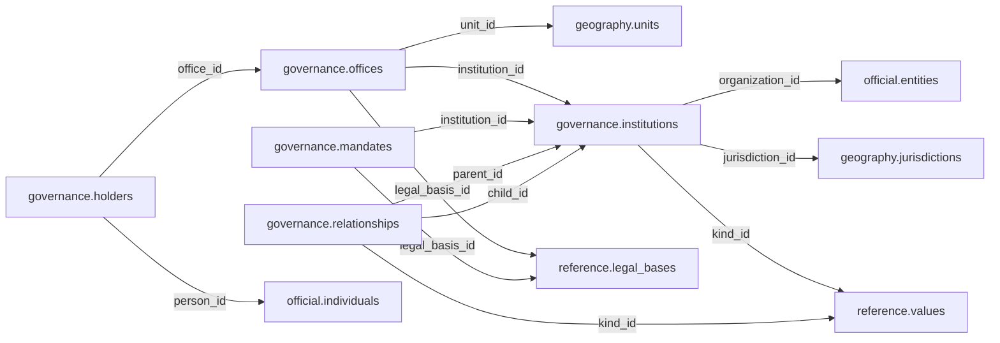

# governance — Phase 01

> **Phase 01 civic accountability scope agreed; table and column proposals remain unapproved.** No implementation is authorized by this documentation reorganization.

[Folder index](README.md) · [Full catalogue and relocation inventory](../README.md)

## Agreed responsibility — 12 November 2026

Government structures, institutional mandates, offices, officeholders, appointments, tenure and responsibility.

Government structures and institutions' mandates belong here, together with offices, officeholders, appointments, acting roles, tenure and responsibility. Institutional and person identities link through Official; locations and jurisdiction link through Geography; legal foundations link through Reference. No Governance record links directly to Legal.

Keep office definitions independent of current holders, and distinguish an appointment, election declaration, commencement of tenure, vacancy and departure. The retained office/mandate dictionaries replace `provision_id` with proposed `legal_basis_id` to Reference. A countrywide institution points to the whole-country geographic unit. Official identity, a physical address or a pattern expectation alone cannot establish authority or an incumbent.

## Retained table proposals and review context

The following dictionaries preserve the earlier proposal inputs, adjusted for the agreed ownership above. They remain unapproved. Earlier inventories retain their measured names; collapsed historical sections do not override the 12 November decisions.

## Retained governance proposal

> **PROPOSED — USER REVIEW REQUIRED.** Schema assignment is agreed; proposed tables and columns still require review. No SQL or migration is authorized.

## Purpose and ownership

**Target:** Main. **Purpose:** Formal authority and office occupancy. Schema placement follows the 12 November scope decision; individual table/column designs remain proposals. Related owners follow the agreed responsibility section above.

## Current implementation and gaps

The active manifest has 30 manifest migrations and 49 distinct CREATE TABLE declarations (49 distinct current table names) in schemas `audit`, `auth`, `engine`, `filesystem`, `geography`, `legal`, `objects`, `reference`. Generated Dryv has 124 entities (digest `e0087da9cf5b00e91f283a5501c368c7696bdd841ea30629231dc9c590f7c1ee`). Counts describe current artifacts, not target design; SQL and Dryv diverge.

- SQL declarations: None found.
- Dryv entities: `governance.institutions` (governance.Institution), `governance.relationships` (governance.InstitutionRelationship), `governance.offices` (governance.Office), `governance.holders` (governance.OfficeHolder), `governance.rules` (governance.OfficeRule), `governance.procedures` (governance.SelectionProcedure), `governance.stages` (governance.SelectionStage)

The inventory does not establish live database state and may miss ALTER-only changes. Before implementation, reconcile migrations, Dryv, generated output and callers.

## Proposed relationship map

> All nodes and edges are proposals. Main schemas may use local cross-schema foreign keys; no edge crosses the Main/Operations database boundary.

## Proposed table and column review

All tables and fields are hypothetical. Every proposed business column is listed; UUIDv7 `id` is a candidate default and remains open. Record every existing field disposition: KEEP / REMOVE / RENAME / MOVE / MERGE / SPLIT / DERIVE / ADD.

### `governance.institutions` — Government function of an organization

- **Example:** County executive
- **Profile:** entity; planning envelope below.

| Column | Proposed type | Meaning | Nullable | Default | Relationship | Units / validation | Proposed disposition |
|---|---|---|---|---|---|---|---|
| `id` | `uuid` | Proposed stable identity | No | Rust UUIDv7 candidate | Primary key | UUIDv7 candidate; unique and immutable after publication | KEEP (candidate match to current SQL/Dryv field; confirm meaning) |
| `organization_id` | `uuid` | Legal identity | No | — | FK → `official.entities` | UUID syntax; FK target must exist when the relationship is required | ADD (proposed target field; pending user approval) |
| `jurisdiction_id` | `uuid` | Authority context | No | — | FK → `geography.jurisdictions` | UUID syntax; FK target must exist when the relationship is required | KEEP (candidate match to current SQL/Dryv field; confirm meaning) |
| `kind_id` | `uuid` | Institutional role | No | — | FK → `reference.values` | UUID syntax; FK target must exist when the relationship is required | ADD (proposed target field; pending user approval) |

- **Current SQL/Dryv fields without a proposed same-name column:** `branch_id`, `code`, `created_at`, `description`, `entity_id`, `is_current`, `legal_basis_id`, `logo_marker`, `name`, `scope_geo_unit_id`, `type_id`, `updated_at`, `valid_from`, `valid_from_precision`, `valid_to`, `valid_to_precision`, `version`, `wikidata_id`. **Disposition:** unresolved per field; propose KEEP, REMOVE, RENAME, MOVE, MERGE, SPLIT or DERIVE in review. Do not drop these fields until the user resolves each one.
- **FK action/cardinality:** Each non-null FK is many-to-one to its named target; nullable FKs are optional. Candidate delete/update behavior is RESTRICT/NO ACTION for accepted records; cascading canonical deletion is not proposed. Confirm uniqueness and exact behavior during review.
- **Constraints:** UNIQUE(organization_id,jurisdiction_id,kind_id). Exact keys and cross-field checks remain for review.
- **Indexes:** primary key on `id`; candidate B-tree indexes on FK columns `organization_id`, `jurisdiction_id`, `kind_id` for joins and referenced-entity filters; add temporal/spatial indexes only where the stated query needs them and benchmarks support them.
- **Relationships:** resolve each FK target. Main allows cross-schema FKs. Main and Operations have no cross-database FK.
- **Evidence/time:** preserve exact source/version, observation/retrieval time, historical context and uncertainty where applicable. Approve the exact evidence path for this table.
- **Growth/storage estimate (illustrative planning envelope, not measured):** Low: initial 1,000, +200/year, peak 20/day; five-year 2,000 rows ≈ 2.0 MiB live row+index budget; Expected: initial 10,000, +2,000/year, peak 200/day; five-year 20,000 rows ≈ 19.5 MiB live row+index budget; High: initial 100,000, +20,000/year, peak 2,000/day; five-year 200,000 rows ≈ 195.3 MiB live row+index budget. Model: initial rows + annual accepted rows × 5; multiply by a per-row budget of 1 KiB including a coarse index allowance. Replace assumptions with actual samples, ingest rates and `pg_total_relation_size` before approval. Large object bytes are excluded; WAL, replicas, backups and S3 are budgeted separately.
- **Workload:** Interactive lookup by identity and approved foreign keys; batch scans for import/reconciliation. Peak-day figure above is a scenario assumption, not a service-level commitment.
- **Partitioning:** None proposed initially; decide from measured scale/query plans. Check late data and partition count.
- **Files:** originals, full-resolution geometry, arrays, media and large exports may be immutable S3 objects. Keep searchable identity, required facts, hashes, coverage, access and provenance in PostgreSQL; use manifests and selective reads.
- **Retention/risks/benchmark:** preserve accepted evidence and corrections. Review late arrivals, contention, index/partition growth and recovery. Benchmark joins, filters, spatial access, ingestion bursts, concurrent access and interrupted publication.
### `governance.offices` — Offices independent of current holders

- **Example:** Governor office
- **Profile:** entity; planning envelope below.

| Column | Proposed type | Meaning | Nullable | Default | Relationship | Units / validation | Proposed disposition |
|---|---|---|---|---|---|---|---|
| `id` | `uuid` | Proposed stable identity | No | Rust UUIDv7 candidate | Primary key | UUIDv7 candidate; unique and immutable after publication | KEEP (candidate match to current SQL/Dryv field; confirm meaning) |
| `institution_id` | `uuid` | Owning institution | No | — | FK → `governance.institutions` | UUID syntax; FK target must exist when the relationship is required | KEEP (candidate match to current SQL/Dryv field; confirm meaning) |
| `title` | `text` | Office title | No | — | — | Nonblank when required; enforce domain-specific length, normalization and controlled vocabulary | ADD (proposed target field; pending user approval) |
| `unit_id` | `uuid` | Area represented | Yes | — | FK → `geography.units` | UUID syntax; FK target must exist when the relationship is required | ADD (proposed target field; pending user approval) |
| `legal_basis_id` | `uuid` | Legal authority | No | — | FK → `reference.legal_bases` | UUID syntax; FK target must exist when the relationship is required | ADD (proposed target field; pending user approval) |

- **Current SQL/Dryv fields without a proposed same-name column:** `code`, `created_at`, `definition_code`, `description`, `is_current`, `is_singleton`, `name`, `parent_office_id`, `scope_geo_unit_id`, `updated_at`, `valid_from`, `valid_from_precision`, `valid_to`, `valid_to_precision`, `version`. **Disposition:** unresolved per field; propose KEEP, REMOVE, RENAME, MOVE, MERGE, SPLIT or DERIVE in review. Do not drop these fields until the user resolves each one.
- **FK action/cardinality:** Each non-null FK is many-to-one to its named target; nullable FKs are optional. Candidate delete/update behavior is RESTRICT/NO ACTION for accepted records; cascading canonical deletion is not proposed. Confirm uniqueness and exact behavior during review.
- **Constraints:** UNIQUE(institution_id,title,unit_id) NULLS NOT DISTINCT. Exact keys and cross-field checks remain for review.
- **Indexes:** primary key on `id`; candidate B-tree indexes on FK columns `institution_id`, `unit_id`, `legal_basis_id` for joins and referenced-entity filters; add temporal/spatial indexes only where the stated query needs them and benchmarks support them.
- **Relationships:** resolve each FK target. Main allows cross-schema FKs. Main and Operations have no cross-database FK.
- **Evidence/time:** preserve exact source/version, observation/retrieval time, historical context and uncertainty where applicable. Approve the exact evidence path for this table.
- **Growth/storage estimate (illustrative planning envelope, not measured):** Low: initial 1,000, +200/year, peak 20/day; five-year 2,000 rows ≈ 2.0 MiB live row+index budget; Expected: initial 10,000, +2,000/year, peak 200/day; five-year 20,000 rows ≈ 19.5 MiB live row+index budget; High: initial 100,000, +20,000/year, peak 2,000/day; five-year 200,000 rows ≈ 195.3 MiB live row+index budget. Model: initial rows + annual accepted rows × 5; multiply by a per-row budget of 1 KiB including a coarse index allowance. Replace assumptions with actual samples, ingest rates and `pg_total_relation_size` before approval. Large object bytes are excluded; WAL, replicas, backups and S3 are budgeted separately.
- **Workload:** Interactive lookup by identity and approved foreign keys; batch scans for import/reconciliation. Peak-day figure above is a scenario assumption, not a service-level commitment.
- **Partitioning:** None proposed initially; decide from measured scale/query plans. Check late data and partition count.
- **Files:** originals, full-resolution geometry, arrays, media and large exports may be immutable S3 objects. Keep searchable identity, required facts, hashes, coverage, access and provenance in PostgreSQL; use manifests and selective reads.
- **Retention/risks/benchmark:** preserve accepted evidence and corrections. Review late arrivals, contention, index/partition growth and recovery. Benchmark joins, filters, spatial access, ingestion bursts, concurrent access and interrupted publication.
### `governance.holders` — Evidence-backed office tenures

- **Example:** Acting governor tenure
- **Profile:** relation; planning envelope below.

| Column | Proposed type | Meaning | Nullable | Default | Relationship | Units / validation | Proposed disposition |
|---|---|---|---|---|---|---|---|
| `id` | `uuid` | Proposed stable identity | No | Rust UUIDv7 candidate | Primary key | UUIDv7 candidate; unique and immutable after publication | KEEP (candidate match to current SQL/Dryv field; confirm meaning) |
| `office_id` | `uuid` | Office | No | — | FK → `governance.offices` | UUID syntax; FK target must exist when the relationship is required | KEEP (candidate match to current SQL/Dryv field; confirm meaning) |
| `person_id` | `uuid` | Holder | No | — | FK → `official.individuals` | UUID syntax; FK target must exist when the relationship is required | KEEP (candidate match to current SQL/Dryv field; confirm meaning) |
| `appointed_on` | `date` | Appointment date | Yes | — | — | Type checked; domain constraints and units must be approved for this field | ADD (proposed target field; pending user approval) |
| `assumed_on` | `date` | Start exercising authority | No | — | — | Type checked; domain constraints and units must be approved for this field | ADD (proposed target field; pending user approval) |
| `left_on` | `date` | Departure date | Yes | — | — | Type checked; domain constraints and units must be approved for this field | ADD (proposed target field; pending user approval) |
| `capacity` | `text` | substantive acting or disputed | No | — | — | Nonblank when required; enforce domain-specific length, normalization and controlled vocabulary | ADD (proposed target field; pending user approval) |

- **Current SQL/Dryv fields without a proposed same-name column:** `created_at`, `departure_reason`, `is_current`, `legal_basis_id`, `selection_procedure_id`, `status`, `term_number`, `updated_at`, `valid_from`, `valid_from_precision`, `valid_to`, `valid_to_precision`, `version`. **Disposition:** unresolved per field; propose KEEP, REMOVE, RENAME, MOVE, MERGE, SPLIT or DERIVE in review. Do not drop these fields until the user resolves each one.
- **FK action/cardinality:** Each non-null FK is many-to-one to its named target; nullable FKs are optional. Candidate delete/update behavior is RESTRICT/NO ACTION for accepted records; cascading canonical deletion is not proposed. Confirm uniqueness and exact behavior during review.
- **Constraints:** left_on >= assumed_on; exclusion only for legally exclusive substantive offices. Exact keys and cross-field checks remain for review.
- **Indexes:** primary key on `id`; candidate B-tree indexes on FK columns `office_id`, `person_id` for joins and referenced-entity filters; add temporal/spatial indexes only where the stated query needs them and benchmarks support them.
- **Relationships:** resolve each FK target. Main allows cross-schema FKs. Main and Operations have no cross-database FK.
- **Evidence/time:** preserve exact source/version, observation/retrieval time, historical context and uncertainty where applicable. Approve the exact evidence path for this table.
- **Growth/storage estimate (illustrative planning envelope, not measured):** Low: initial 1,000, +2,000/year, peak 100/day; five-year 11,000 rows ≈ 10.7 MiB live row+index budget; Expected: initial 10,000, +20,000/year, peak 1,000/day; five-year 110,000 rows ≈ 107.4 MiB live row+index budget; High: initial 100,000, +200,000/year, peak 10,000/day; five-year 1,100,000 rows ≈ 1,074.2 MiB live row+index budget. Model: initial rows + annual accepted rows × 5; multiply by a per-row budget of 1 KiB including a coarse index allowance. Replace assumptions with actual samples, ingest rates and `pg_total_relation_size` before approval. Large object bytes are excluded; WAL, replicas, backups and S3 are budgeted separately.
- **Workload:** Interactive lookup by identity and approved foreign keys; batch scans for import/reconciliation. Peak-day figure above is a scenario assumption, not a service-level commitment.
- **Partitioning:** None proposed initially; decide from measured scale/query plans. Check late data and partition count.
- **Files:** originals, full-resolution geometry, arrays, media and large exports may be immutable S3 objects. Keep searchable identity, required facts, hashes, coverage, access and provenance in PostgreSQL; use manifests and selective reads.
- **Retention/risks/benchmark:** preserve accepted evidence and corrections. Review late arrivals, contention, index/partition growth and recovery. Benchmark joins, filters, spatial access, ingestion bursts, concurrent access and interrupted publication.
### `governance.mandates` — Specific responsibilities under law

- **Example:** Public service responsibility
- **Profile:** relation; planning envelope below.

| Column | Proposed type | Meaning | Nullable | Default | Relationship | Units / validation | Proposed disposition |
|---|---|---|---|---|---|---|---|
| `id` | `uuid` | Proposed stable identity | No | Rust UUIDv7 candidate | Primary key | UUIDv7 candidate; unique and immutable after publication | ADD (proposed target field; pending user approval) |
| `institution_id` | `uuid` | Responsible institution | No | — | FK → `governance.institutions` | UUID syntax; FK target must exist when the relationship is required | ADD (proposed target field; pending user approval) |
| `legal_basis_id` | `uuid` | Legal basis | No | — | FK → `reference.legal_bases` | UUID syntax; FK target must exist when the relationship is required | ADD (proposed target field; pending user approval) |
| `description` | `text` | Mandate meaning | No | — | — | Nonblank when required; enforce domain-specific length, normalization and controlled vocabulary | ADD (proposed target field; pending user approval) |

- **FK action/cardinality:** Each non-null FK is many-to-one to its named target; nullable FKs are optional. Candidate delete/update behavior is RESTRICT/NO ACTION for accepted records; cascading canonical deletion is not proposed. Confirm uniqueness and exact behavior during review.
- **Constraints:** UNIQUE(institution_id,legal_basis_id,publication_id). Exact keys and cross-field checks remain for review.
- **Indexes:** primary key on `id`; candidate B-tree indexes on FK columns `institution_id`, `legal_basis_id` for joins and referenced-entity filters; add temporal/spatial indexes only where the stated query needs them and benchmarks support them.
- **Relationships:** resolve each FK target. Main allows cross-schema FKs. Main and Operations have no cross-database FK.
- **Evidence/time:** preserve exact source/version, observation/retrieval time, historical context and uncertainty where applicable. Approve the exact evidence path for this table.
- **Growth/storage estimate (illustrative planning envelope, not measured):** Low: initial 1,000, +2,000/year, peak 100/day; five-year 11,000 rows ≈ 10.7 MiB live row+index budget; Expected: initial 10,000, +20,000/year, peak 1,000/day; five-year 110,000 rows ≈ 107.4 MiB live row+index budget; High: initial 100,000, +200,000/year, peak 10,000/day; five-year 1,100,000 rows ≈ 1,074.2 MiB live row+index budget. Model: initial rows + annual accepted rows × 5; multiply by a per-row budget of 1 KiB including a coarse index allowance. Replace assumptions with actual samples, ingest rates and `pg_total_relation_size` before approval. Large object bytes are excluded; WAL, replicas, backups and S3 are budgeted separately.
- **Workload:** Interactive lookup by identity and approved foreign keys; batch scans for import/reconciliation. Peak-day figure above is a scenario assumption, not a service-level commitment.
- **Partitioning:** None proposed initially; decide from measured scale/query plans. Check late data and partition count.
- **Files:** originals, full-resolution geometry, arrays, media and large exports may be immutable S3 objects. Keep searchable identity, required facts, hashes, coverage, access and provenance in PostgreSQL; use manifests and selective reads.
- **Retention/risks/benchmark:** preserve accepted evidence and corrections. Review late arrivals, contention, index/partition growth and recovery. Benchmark joins, filters, spatial access, ingestion bursts, concurrent access and interrupted publication.
### `governance.relationships` — Dated institutional supervision

- **Example:** Agency supervised by ministry
- **Profile:** relation; planning envelope below.

| Column | Proposed type | Meaning | Nullable | Default | Relationship | Units / validation | Proposed disposition |
|---|---|---|---|---|---|---|---|
| `id` | `uuid` | Proposed stable identity | No | Rust UUIDv7 candidate | Primary key | UUIDv7 candidate; unique and immutable after publication | KEEP (candidate match to current SQL/Dryv field; confirm meaning) |
| `parent_id` | `uuid` | Supervising institution | No | — | FK → `governance.institutions` | UUID syntax; FK target must exist when the relationship is required | ADD (proposed target field; pending user approval) |
| `child_id` | `uuid` | Subordinate institution | No | — | FK → `governance.institutions` | UUID syntax; FK target must exist when the relationship is required | ADD (proposed target field; pending user approval) |
| `kind_id` | `uuid` | Relation kind | No | — | FK → `reference.values` | UUID syntax; FK target must exist when the relationship is required | ADD (proposed target field; pending user approval) |
| `effective` | `daterange` | Authority interval | No | — | — | Type checked; domain constraints and units must be approved for this field | ADD (proposed target field; pending user approval) |

- **Current SQL/Dryv fields without a proposed same-name column:** `created_at`, `is_current`, `kind`, `legal_basis_id`, `object_id`, `object_kind`, `subject_id`, `subject_kind`, `updated_at`, `valid_from`, `valid_from_precision`, `valid_to`, `valid_to_precision`, `version`. **Disposition:** unresolved per field; propose KEEP, REMOVE, RENAME, MOVE, MERGE, SPLIT or DERIVE in review. Do not drop these fields until the user resolves each one.
- **FK action/cardinality:** Each non-null FK is many-to-one to its named target; nullable FKs are optional. Candidate delete/update behavior is RESTRICT/NO ACTION for accepted records; cascading canonical deletion is not proposed. Confirm uniqueness and exact behavior during review.
- **Constraints:** No self links; hierarchy cycles rejected where applicable. Exact keys and cross-field checks remain for review.
- **Indexes:** primary key on `id`; candidate B-tree indexes on FK columns `parent_id`, `child_id`, `kind_id` for joins and referenced-entity filters; add temporal/spatial indexes only where the stated query needs them and benchmarks support them.
- **Relationships:** resolve each FK target. Main allows cross-schema FKs. Main and Operations have no cross-database FK.
- **Evidence/time:** preserve exact source/version, observation/retrieval time, historical context and uncertainty where applicable. Approve the exact evidence path for this table.
- **Growth/storage estimate (illustrative planning envelope, not measured):** Low: initial 1,000, +2,000/year, peak 100/day; five-year 11,000 rows ≈ 10.7 MiB live row+index budget; Expected: initial 10,000, +20,000/year, peak 1,000/day; five-year 110,000 rows ≈ 107.4 MiB live row+index budget; High: initial 100,000, +200,000/year, peak 10,000/day; five-year 1,100,000 rows ≈ 1,074.2 MiB live row+index budget. Model: initial rows + annual accepted rows × 5; multiply by a per-row budget of 1 KiB including a coarse index allowance. Replace assumptions with actual samples, ingest rates and `pg_total_relation_size` before approval. Large object bytes are excluded; WAL, replicas, backups and S3 are budgeted separately.
- **Workload:** Interactive lookup by identity and approved foreign keys; batch scans for import/reconciliation. Peak-day figure above is a scenario assumption, not a service-level commitment.
- **Partitioning:** None proposed initially; decide from measured scale/query plans. Check late data and partition count.
- **Files:** originals, full-resolution geometry, arrays, media and large exports may be immutable S3 objects. Keep searchable identity, required facts, hashes, coverage, access and provenance in PostgreSQL; use manifests and selective reads.
- **Retention/risks/benchmark:** preserve accepted evidence and corrections. Review late arrivals, contention, index/partition growth and recovery. Benchmark joins, filters, spatial access, ingestion bursts, concurrent access and interrupted publication.

## Queries, lifecycle, capacity and approval

**Representative query:** Who held authority over this area under which law?

Lifecycle: preserve source bytes; extract into candidate revisions; validate; review or use approved deterministic checks; atomically publish; serve. Corrections create explicit versions/supersession. Preserve disagreement and uncertainty.

Capacity is unmeasured. Use low/expected/high input scenarios, explicit formulas and workload benchmarks; do not assume sizes or universal partitions.

**Status:** NOT REVIEWED. Schema assignment follows the handoff; tables, columns, relationships, partitioning and S3 choices still require user approval. Feedback: none. Approval reference/date/revision: none. Implementation authorization: not granted. Material changes reopen approval.

Earlier schema proposal preserved for history; superseded and not an approval

---
id: DOC-7CE43B819FA2
name: Institutions, offices, holders, public services and rule patterns
type: documentation
tags: [improvements, schema-redesign, governance, planning]
extra: {status: planning_only, implementation: not_approved}
---

> **11 November 2026 precedence:** the connected foundation update at the end of this document supersedes conflicting jurisdiction, compatibility and cross-domain assumptions in the historical proposal below. Detailed table names remain design candidates; task 03 is prepared for design work, not a claim of completed implementation.

# Institutions, offices, holders, public services and rule patterns

**Planning only. Not approved for code changes or Taskcode task creation.** The user will direct the order of final design review and later tasks. All physical table/column changes below are proposals, not authorized migrations.

## 1. Current domain, user intent and boundaries

Governance is central to MZIZI's goal of explaining how African administrations are structured. **Keep `governance` separate from `person` and `organization`.** The user leans toward moving relevant `civic` public services closer to governance, but the services/amenities model must still distinguish **who is responsible**, **what service is delivered**, **where it is offered** and **who holds an office**.

Address the previously noted country-wide geo unit defect: national ministries/IEBC-style institutions should have valid country-root scope, while actual headquarters and offices have separate place/occupancy links. Pattern-generated expected offices do not prove current holders or operating locations.

## 2. Current database table and column inventory

These **real migration-declared** table/column names are from `.docs/_archives/2026-11-08-rewrite-snapshot/source/backend/engine/database/migrations/1793607856459-initial.ts` and relevant subsequent CREATE-table migrations. They form the **baseline**, not a certified live/current column audit: later ALTER migrations, current TypeORM entities and deployed schema may add/remove/rename fields. Compare against `source/backend/api/src/modules/`, Dryv and PostgreSQL before finalizing any column decision. This document deliberately does not invent exact types/FKs not yet checked against live metadata.

| Existing table | Columns declared at initial CREATE TABLE (baseline) |
|---|---|
| `civic.amenities` | `id`, `code`, `created_at`, `geo_unit_id`, `is_active`, `is_current`, `jurisdiction_id`, `name`, `sector_id`, `updated_at`, `valid_from`, `valid_from_precision`, `valid_to`, `valid_to_precision`, `version` |
| `civic.deliveries` | `id`, `amenity_id`, `budget_id`, `created_at`, `is_current`, `responsible_office_id`, `service_id`, `status`, `updated_at`, `valid_from`, `valid_from_precision`, `valid_to`, `valid_to_precision`, `version` |
| `civic.posts` | `id`, `amenity_id`, `created_at`, `is_current`, `office_id`, `role_kind_id`, `updated_at`, `valid_from`, `valid_from_precision`, `valid_to`, `valid_to_precision`, `version` |
| `civic.services` | `id`, `code`, `created_at`, `description`, `is_current`, `jurisdiction_id`, `legal_basis_id`, `name`, `sector_id`, `updated_at`, `valid_from`, `valid_from_precision`, `valid_to`, `valid_to_precision`, `version` |
| `governance.holders` | `id`, `created_at`, `departure_reason`, `is_current`, `legal_basis_id`, `office_id`, `person_id`, `selection_procedure_id`, `status`, `term_number`, `updated_at`, `valid_from`, `valid_from_precision`, `valid_to`, `valid_to_precision`, `version` |
| `governance.institutions` | `id`, `branch_id`, `code`, `created_at`, `description`, `geo_unit_id`, `is_current`, `jurisdiction_id`, `legal_basis_id`, `name`, `type_id`, `updated_at`, `valid_from`, `valid_from_precision`, `valid_to`, `valid_to_precision`, `version` |
| `governance.offices` | `id`, `code`, `created_at`, `description`, `institution_id`, `is_current`, `is_singleton`, `name`, `parent_office_id`, `updated_at`, `valid_from`, `valid_from_precision`, `valid_to`, `valid_to_precision`, `version` |
| `governance.procedures` | `id`, `created_at`, `description`, `is_current`, `legal_basis_id`, `method_id`, `office_id`, `updated_at`, `valid_from`, `valid_from_precision`, `valid_to`, `valid_to_precision`, `version` |
| `governance.relationships` | `id`, `child_institution_id`, `created_at`, `is_current`, `kind`, `legal_basis_id`, `parent_institution_id`, `updated_at`, `valid_from`, `valid_from_precision`, `valid_to`, `valid_to_precision`, `version` |
| `governance.rules` | `id`, `created_at`, `is_current`, `kind`, `legal_basis_id`, `numeric_value`, `office_id`, `text_value`, `updated_at`, `valid_from`, `valid_from_precision`, `valid_to`, `valid_to_precision`, `version` |
| `governance.stages` | `id`, `actor_institution_id`, `actor_office_id`, `created_at`, `description`, `is_current`, `kind`, `procedure_id`, `stage_order`, `updated_at`, `valid_from`, `valid_from_precision`, `valid_to`, `valid_to_precision`, `version` |

## 3. Potential target table responsibilities — **proposals only**

| Current/candidate | Specific purpose / issue |
|---|---|
| `institutions` | Public institution identity, legal establishment, jurisdiction/scope, relation to actual organization entity if relevant. |
| `relationships` | Dated institution-to-institution parent, oversight, subordinate, mandate, collaboration links; avoid uncontrolled polymorphism. |
| `offices` | Legally/structurally expected and observed posts, rank, scope, institution, office type, validity. |
| `rules` | Pattern/office definition and applicability, count, generating scope, legal provision and version. |
| `procedures` / `stages` | Selection, election, appointment, succession and other office filling procedures, jurisdiction/time aware. |
| `holders` | Individuals in offices, status, appointment dates, service intervals, authority/evidence. |
| `civic.services` / `deliveries` | Public service identity and actual delivery records, funding and reach. |
| `civic.amenities` / `posts` | Facilities/service posts; decide fit with `geography.places` and expected `occupancies` before any table move. |
| Proposed pattern registry linkage | Office/service expectations, counts, generation runs, deviations, reviewed overrides. |

## 4. Strong relationships, geography, law and query design

Real FKs: institutions → jurisdiction/root geography/legal basis where applicable; offices → institution, office rule, service region/seat; holders → person and office; governance.rules → legal authority/provision where relevant; physical `amenities`/facilities → place and scope; public service delivery → governing institution/finance units/geo and time. **No cross-schema soft-ID doctrine**. Use explicit typed junctions for multiple service territories or an office supported by several provisions. Avoid duplicating the same law FK on hundreds of generated offices if an approved pattern already supplies the reason, while retaining overrides/exception proofs.

## 5. Four-class acquisition, patterns and traceability

**Static seeded:** constitutional/legally established public institution definitions and basic controlled office types. **Pattern seeded:** county government offices, legislative seats, ministry structures and expected service locations generated by jurisdiction/period/geo unit. **Automated collected:** governors/deputies, ministers, commissioners, official holders, appointment/gazette notices, actual facilities and service delivery. **Derived:** coverage ratios, expected vs verified holders, cabinet composition and ministry responsibilities based on validated inputs.

For all retained/new tables, add concise PostgreSQL **schema/table/column comments**, plus a maintained Markdown/table registry describing each column's meaning, nullability decision, allowed acquisition classes and expected pattern/automated inputs. Record per-row origin via traceable lineage and real FKs where structurally possible. Do not treat a table's class eligibility as every row's origin.

## 6. Query scenarios the design must support

For a county/year list legally required offices, verified current holders, vacancies and their sources; show national ministries in county-relevant views without claiming HQ there; trace an office's legal origin; map parent institutions and local service facilities; distinguish expected/deployed services from delivered outputs; list missing county deputies without fabricating them.

## 7. Migration, preservation, integrity and compatibility

Audit 2026-11 existing governance generalisation and pattern scripts/fixtures (`ke-office-patterns.json`), `governance.institutions`, `offices` scope and `governance.rules` relations. Check current holders/office duplicates; do **not** trust historical guessed counts automatically. Move civic service tables only after full column, query and FK compatibility review. Resolve outdated jurisdiction-wide null geo links as a separate, evidence-checked backfill. Preserve office holder history across office pattern changes.

Global requirements: check live data, orphans, actual FK constraints, indexes and enum/lookup validity; reconcile every old→new table/column; preserve historical identities, evidence, versioning and record counts; update Dryv, API, ingestion and filesystem references with migrations only after explicit user approval. Never rewrite canonical facts to make a schema migration pass.

## 8. Decisions the user has not yet approved

1. Which civic public services belong in governance vs a service delivery subdomain?
2. Are `governance.rules` sufficient for pattern definitions, or do they need a separate versioned pattern table?
3. Which kinds of nationwide, subnational and institution-specific office should use direct vs multi-geo links?
4. What counts as "current" vs expected, acting, deputy, vacant or historically superseded?
5. How to model historical nonmodern institutions or different government forms worldwide?
6. Can one office have multiple holders simultaneously and under which appointment rules?

## 9. Related planning resources and decision status

See [master register](../../guides/mzizi-data-schema-storage-and-pipelines-redesign.md), [schema review index](../README.md), [data classes/patterns](../../guides/data-categories-and-patterns.md), and [independent pipelines](../../guides/independent-data-pipelines.md). **Any preference noted here is a planning recommendation; the user decides the final schema/table/column specification and authorizes tasks one at a time.**

## Human review — editable user notes and design sign-off

**Review status:** `NOT REVIEWED` — AI-authored proposals in this document are not final approval.

**In my own words, what this schema should represent and exclude:**

> _My understanding and questions:_

**Tables/columns I want to keep, rename, move, merge, split, remove or add (and why):**

> _My proposed changes and alternative names:_

**Hard foreign keys, geographical and legal scope, pattern generation, classification and evidence I want changed or explained:**

> _My technical feedback, disagreements and alternatives:_

**Real data and queries I want to use to validate this design:**

> _My examples and expected results:_

**Unresolved decisions I want to discuss further:**

> _My remaining questions:_

**Final user decision:** `NOT DECIDED` / `NEEDS CHANGES` / `DESIGN VALIDATED BY USER` / `APPROVED FOR TASK PLANNING`.

**Approval reference and date:** _None. Only record explicit later user authorization. Even design validation does not authorize code, migration or Taskcode task creation._

## Mandatory per-table temporal, rigid-column and deletion review (2026-11-07)

**USER REQUIREMENT; planning only.** Examine every existing/proposed field and expressly record **KEEP / REMOVE / DERIVE / MOVE / RENAME / ADD** for `valid_from`, `valid_to`, `valid_from_precision`, `valid_to_precision`, `is_current`, `status`, `version`, `created_at`, `updated_at` and other copied/rigid flags. These fields are **opt-in by justified meaning**, not blanket schema conventions. Assess `deleted_at` only for recoverable soft deletion where appropriate. The full policy and migration/approval checklist is in [schema redesign README](../README.md).

**Domain-specific guidance:** Key example: governance.offices should generally derive structural/legal applicability from the referenced pattern and law, rather than duplicating its validity period. An office may still independently open/close or be abolished, requiring a real history/exception. governance.holders DOES need appointment/tenure boundaries; exact modern dates rarely need precision columns. Institution and civic-service existence, operational status and source completeness are separate. Retirement is not deletion.

**OPEN for human review:** exact per-table/column disposition, derived status and as-of queries, pattern/legal links, justified precision, recoverable deletion versus domain lifecycle, history/identity preservation and hard-FK impact. No code or migration is authorized.

## 2026-11-11 — Connected foundation direction (controlling for task 03)

Distinguish broad office classification, country/system-specific office definition, actual office, institution and dated holder. Link actual offices/institutions and rules to precise legal bases and separately to typed territorial mandates. An office can remain vacant; law establishing it does not identify a holder, premise or operational service. Multiple legal bases may explain establishment, powers and selection. Organization identity must not be duplicated merely to create a governance profile.

The county-governor proof case separates Articles 176, 179 and 180 and their roles. A contest targets an office; declaration and beginning an officeholding term are separate. Regional organizations have real organs/posts and mandates; a continent unit does not appoint a continental leader. Task 03 establishes contracts and query traces; task 04 owns full governance schema/rule/holder implementation. Reference patterns generate only established structure and preserve independent factual edits.

Read [the connected foundation](../../guides/connected-reference-geography-legal-foundation.md) for the decisions, candidate models, query examples, proof cases and primary research sources. Fresh construction in `mzizi_new` has no legacy database ID/data compatibility requirement; existing S3 evidence remains protected. This update records accepted direction and design deliverables, not final DDL or broad implementation authorization.

## 2026-11-11 — System-expansion alignment

Reconcile the earlier governance/civic service mapping with the expansion proposal: Governance owns institutions/offices/authority; Civic may own infrastructure function and service delivery. This boundary remains open. See the [system-expansion proposal](../../guides/advancement-and-system-expansion.md). This alignment note does not approve proposed schemas, tables or implementation.

