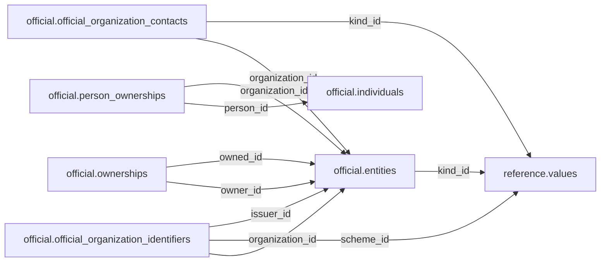
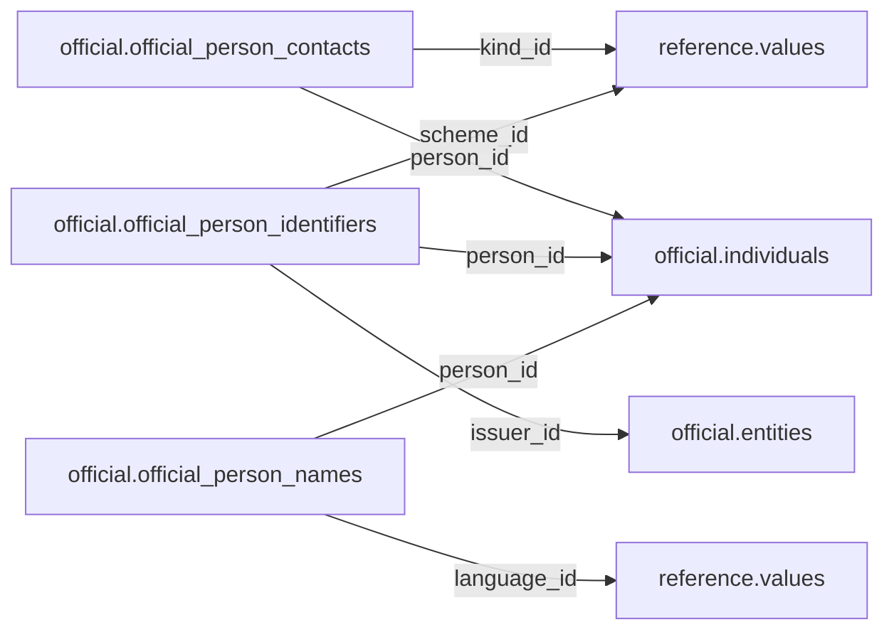

# official — Phase 01

> **Phase 01 civic accountability scope agreed; table and column proposals remain unapproved.** No implementation is authorized by this documentation reorganization.

[Folder index](README.md) · [Full catalogue and relocation inventory](../README.md)

## Agreed responsibility — 12 November 2026

Officially identified people and organizations, including schools and institutions; names, identifiers, profiles and contact details.

Official combines the former Person and Organization schema proposals while retaining distinct person and organization record types. It owns officially identified individuals and entities, official names and aliases, identifiers and issuers, profiles/biographies, public handles and contact details. Schools, suppliers, public bodies and other institutions belong here when officially identified; a school identity does not require the deferred Education schema.

Identity alone must not imply government authority or officeholding. Governance links institutional identities, offices, appointments and tenure to Official; Geography provides actual places and dated location/jurisdiction context; Civic links facility operators, service providers and project participants to those identities. A school organization, its campus/facility and its government mandate are different records. Auth accounts stay in Operations and are not civic people.

The retained dictionaries use candidate names `official.individuals`, `official.entities`, `official.person_names`, `official.person_identifiers`, `official.organization_identifiers`, `official.person_contacts` and `official.organization_contacts` to avoid collisions between the two inputs. Profiles, handles, organization names and ownership relationships remain review inputs from the older inventories; none is silently dropped or approved. Resolve the final names and column dispositions during review. Preserve dated identity changes, evidence, ambiguity and contact visibility. Name similarity alone cannot authorize an identity merge.

## Retained table proposals and review context

The following dictionaries preserve the earlier proposal inputs, adjusted for the agreed ownership above. They remain unapproved. Earlier inventories retain their measured names; collapsed historical sections do not override the 12 November decisions.

## Retained organization proposal

> **PROPOSED — USER REVIEW REQUIRED.** Schema assignment is agreed; proposed tables and columns still require review. No SQL or migration is authorized.

## Purpose and ownership

**Target:** Main. **Purpose:** Shared legal or public organization identities. Schema placement follows the 12 November scope decision; individual table/column designs remain proposals. Related owners follow the agreed responsibility section above.

## Current implementation and gaps

The active manifest has 30 manifest migrations and 49 distinct CREATE TABLE declarations (49 distinct current table names) in schemas `audit`, `auth`, `engine`, `filesystem`, `geography`, `legal`, `objects`, `reference`. Generated Dryv has 124 entities (digest `e0087da9cf5b00e91f283a5501c368c7696bdd841ea30629231dc9c590f7c1ee`). Counts describe current artifacts, not target design; SQL and Dryv diverge.

- SQL declarations: None found.
- Dryv entities: `organization.identifiers` (entities.EntityIdentifier), `organization.ownerships` (entities.EntityOwnership), `organization.entities` (entities.LegalEntity)

The inventory does not establish live database state and may miss ALTER-only changes. Before implementation, reconcile migrations, Dryv, generated output and callers.

## Proposed relationship map

> All nodes and edges are proposals. Main schemas may use local cross-schema foreign keys; no edge crosses the Main/Operations database boundary.

## Proposed table and column review

All tables and fields are hypothetical. Every proposed business column is listed; UUIDv7 `id` is a candidate default and remains open. Record every existing field disposition: KEEP / REMOVE / RENAME / MOVE / MERGE / SPLIT / DERIVE / ADD.

### `official.entities` — Stable organization identity

- **Example:** Government ministry
- **Profile:** entity; planning envelope below.

| Column | Proposed type | Meaning | Nullable | Default | Relationship | Units / validation | Proposed disposition |
|---|---|---|---|---|---|---|---|
| `id` | `uuid` | Proposed stable identity | No | Rust UUIDv7 candidate | Primary key | UUIDv7 candidate; unique and immutable after publication | KEEP (candidate match to current SQL/Dryv field; confirm meaning) |
| `name` | `text` | Accepted name | No | — | — | Nonblank when required; enforce domain-specific length, normalization and controlled vocabulary | ADD (proposed target field; pending user approval) |
| `kind_id` | `uuid` | Organization class | No | — | FK → `reference.values` | UUID syntax; FK target must exist when the relationship is required | ADD (proposed target field; pending user approval) |
| `registered_on` | `date` | Registration | Yes | — | — | Type checked; domain constraints and units must be approved for this field | ADD (proposed target field; pending user approval) |
| `dissolved_on` | `date` | Dissolution | Yes | — | — | Type checked; domain constraints and units must be approved for this field | ADD (proposed target field; pending user approval) |

- **Current SQL/Dryv fields without a proposed same-name column:** `code`, `created_at`, `entity_type_id`, `is_current`, `jurisdiction_id`, `official_name`, `parent_entity_id`, `status`, `updated_at`, `valid_from`, `valid_from_precision`, `valid_to`, `valid_to_precision`, `version`. **Disposition:** unresolved per field; propose KEEP, REMOVE, RENAME, MOVE, MERGE, SPLIT or DERIVE in review. Do not drop these fields until the user resolves each one.
- **FK action/cardinality:** Each non-null FK is many-to-one to its named target; nullable FKs are optional. Candidate delete/update behavior is RESTRICT/NO ACTION for accepted records; cascading canonical deletion is not proposed. Confirm uniqueness and exact behavior during review.
- **Constraints:** Dissolution >= registration; names not unique. Exact keys and cross-field checks remain for review.
- **Indexes:** primary key on `id`; candidate B-tree indexes on FK columns `kind_id` for joins and referenced-entity filters; add temporal/spatial indexes only where the stated query needs them and benchmarks support them.
- **Relationships:** resolve each FK target. Main allows cross-schema FKs. Main and Operations have no cross-database FK.
- **Evidence/time:** preserve exact source/version, observation/retrieval time, historical context and uncertainty where applicable. Approve the exact evidence path for this table.
- **Growth/storage estimate (illustrative planning envelope, not measured):** Low: initial 1,000, +200/year, peak 20/day; five-year 2,000 rows ≈ 2.0 MiB live row+index budget; Expected: initial 10,000, +2,000/year, peak 200/day; five-year 20,000 rows ≈ 19.5 MiB live row+index budget; High: initial 100,000, +20,000/year, peak 2,000/day; five-year 200,000 rows ≈ 195.3 MiB live row+index budget. Model: initial rows + annual accepted rows × 5; multiply by a per-row budget of 1 KiB including a coarse index allowance. Replace assumptions with actual samples, ingest rates and `pg_total_relation_size` before approval. Large object bytes are excluded; WAL, replicas, backups and S3 are budgeted separately.
- **Workload:** Interactive lookup by identity and approved foreign keys; batch scans for import/reconciliation. Peak-day figure above is a scenario assumption, not a service-level commitment.
- **Partitioning:** None proposed initially; decide from measured scale/query plans. Check late data and partition count.
- **Files:** originals, full-resolution geometry, arrays, media and large exports may be immutable S3 objects. Keep searchable identity, required facts, hashes, coverage, access and provenance in PostgreSQL; use manifests and selective reads.
- **Retention/risks/benchmark:** preserve accepted evidence and corrections. Review late arrivals, contention, index/partition growth and recovery. Benchmark joins, filters, spatial access, ingestion bursts, concurrent access and interrupted publication.
### `official.official_organization_identifiers` — Issuer and scheme-specific identifier

- **Example:** Company number
- **Profile:** relation; planning envelope below.

| Column | Proposed type | Meaning | Nullable | Default | Relationship | Units / validation | Proposed disposition |
|---|---|---|---|---|---|---|---|
| `id` | `uuid` | Proposed stable identity | No | Rust UUIDv7 candidate | Primary key | UUIDv7 candidate; unique and immutable after publication | KEEP (candidate match to current SQL/Dryv field; confirm meaning) |
| `organization_id` | `uuid` | Entity | No | — | FK → `official.entities` | UUID syntax; FK target must exist when the relationship is required | ADD (proposed target field; pending user approval) |
| `scheme_id` | `uuid` | Identifier | No | — | FK → `reference.values` | UUID syntax; FK target must exist when the relationship is required | KEEP (candidate match to current SQL/Dryv field; confirm meaning) |
| `value` | `text` | External code | No | — | — | Nonblank when required; enforce domain-specific length, normalization and controlled vocabulary | KEEP (candidate match to current SQL/Dryv field; confirm meaning) |
| `issuer_id` | `uuid` | Issuer | Yes | — | FK → `official.entities` | UUID syntax; FK target must exist when the relationship is required | ADD (proposed target field; pending user approval) |

- **Current SQL/Dryv fields without a proposed same-name column:** `created_at`, `entity_id`, `is_current`, `issuing_authority_id`, `updated_at`, `valid_from`, `valid_from_precision`, `valid_to`, `valid_to_precision`, `version`. **Disposition:** unresolved per field; propose KEEP, REMOVE, RENAME, MOVE, MERGE, SPLIT or DERIVE in review. Do not drop these fields until the user resolves each one.
- **FK action/cardinality:** Each non-null FK is many-to-one to its named target; nullable FKs are optional. Candidate delete/update behavior is RESTRICT/NO ACTION for accepted records; cascading canonical deletion is not proposed. Confirm uniqueness and exact behavior during review.
- **Constraints:** Unique scheme/value/issuer. Exact keys and cross-field checks remain for review.
- **Indexes:** primary key on `id`; candidate B-tree indexes on FK columns `organization_id`, `scheme_id`, `issuer_id` for joins and referenced-entity filters; add temporal/spatial indexes only where the stated query needs them and benchmarks support them.
- **Relationships:** resolve each FK target. Main allows cross-schema FKs. Main and Operations have no cross-database FK.
- **Evidence/time:** preserve exact source/version, observation/retrieval time, historical context and uncertainty where applicable. Approve the exact evidence path for this table.
- **Growth/storage estimate (illustrative planning envelope, not measured):** Low: initial 1,000, +2,000/year, peak 100/day; five-year 11,000 rows ≈ 10.7 MiB live row+index budget; Expected: initial 10,000, +20,000/year, peak 1,000/day; five-year 110,000 rows ≈ 107.4 MiB live row+index budget; High: initial 100,000, +200,000/year, peak 10,000/day; five-year 1,100,000 rows ≈ 1,074.2 MiB live row+index budget. Model: initial rows + annual accepted rows × 5; multiply by a per-row budget of 1 KiB including a coarse index allowance. Replace assumptions with actual samples, ingest rates and `pg_total_relation_size` before approval. Large object bytes are excluded; WAL, replicas, backups and S3 are budgeted separately.
- **Workload:** Interactive lookup by identity and approved foreign keys; batch scans for import/reconciliation. Peak-day figure above is a scenario assumption, not a service-level commitment.
- **Partitioning:** None proposed initially; decide from measured scale/query plans. Check late data and partition count.
- **Files:** originals, full-resolution geometry, arrays, media and large exports may be immutable S3 objects. Keep searchable identity, required facts, hashes, coverage, access and provenance in PostgreSQL; use manifests and selective reads.
- **Retention/risks/benchmark:** preserve accepted evidence and corrections. Review late arrivals, contention, index/partition growth and recovery. Benchmark joins, filters, spatial access, ingestion bursts, concurrent access and interrupted publication.
### `official.ownerships` — Organization control relationship

- **Example:** Holding company
- **Profile:** relation; planning envelope below.

| Column | Proposed type | Meaning | Nullable | Default | Relationship | Units / validation | Proposed disposition |
|---|---|---|---|---|---|---|---|
| `id` | `uuid` | Proposed stable identity | No | Rust UUIDv7 candidate | Primary key | UUIDv7 candidate; unique and immutable after publication | KEEP (candidate match to current SQL/Dryv field; confirm meaning) |
| `owner_id` | `uuid` | Owner | No | — | FK → `official.entities` | UUID syntax; FK target must exist when the relationship is required | ADD (proposed target field; pending user approval) |
| `owned_id` | `uuid` | Owned | No | — | FK → `official.entities` | UUID syntax; FK target must exist when the relationship is required | ADD (proposed target field; pending user approval) |
| `share` | `numeric` | Percentage | Yes | — | — | Type checked; domain constraints and units must be approved for this field | ADD (proposed target field; pending user approval) |
| `held_during` | `daterange` | Interval | Yes | — | — | Type checked; domain constraints and units must be approved for this field | ADD (proposed target field; pending user approval) |

- **Current SQL/Dryv fields without a proposed same-name column:** `created_at`, `entity_id`, `is_current`, `owner_entity_id`, `owner_person_id`, `percentage`, `position`, `updated_at`, `valid_from`, `valid_from_precision`, `valid_to`, `valid_to_precision`, `version`. **Disposition:** unresolved per field; propose KEEP, REMOVE, RENAME, MOVE, MERGE, SPLIT or DERIVE in review. Do not drop these fields until the user resolves each one.
- **FK action/cardinality:** Each non-null FK is many-to-one to its named target; nullable FKs are optional. Candidate delete/update behavior is RESTRICT/NO ACTION for accepted records; cascading canonical deletion is not proposed. Confirm uniqueness and exact behavior during review.
- **Constraints:** No self edge; percentage 0..100; cycle policy explicit. Exact keys and cross-field checks remain for review.
- **Indexes:** primary key on `id`; candidate B-tree indexes on FK columns `owner_id`, `owned_id` for joins and referenced-entity filters; add temporal/spatial indexes only where the stated query needs them and benchmarks support them.
- **Relationships:** resolve each FK target. Main allows cross-schema FKs. Main and Operations have no cross-database FK.
- **Evidence/time:** preserve exact source/version, observation/retrieval time, historical context and uncertainty where applicable. Approve the exact evidence path for this table.
- **Growth/storage estimate (illustrative planning envelope, not measured):** Low: initial 1,000, +2,000/year, peak 100/day; five-year 11,000 rows ≈ 10.7 MiB live row+index budget; Expected: initial 10,000, +20,000/year, peak 1,000/day; five-year 110,000 rows ≈ 107.4 MiB live row+index budget; High: initial 100,000, +200,000/year, peak 10,000/day; five-year 1,100,000 rows ≈ 1,074.2 MiB live row+index budget. Model: initial rows + annual accepted rows × 5; multiply by a per-row budget of 1 KiB including a coarse index allowance. Replace assumptions with actual samples, ingest rates and `pg_total_relation_size` before approval. Large object bytes are excluded; WAL, replicas, backups and S3 are budgeted separately.
- **Workload:** Interactive lookup by identity and approved foreign keys; batch scans for import/reconciliation. Peak-day figure above is a scenario assumption, not a service-level commitment.
- **Partitioning:** None proposed initially; decide from measured scale/query plans. Check late data and partition count.
- **Files:** originals, full-resolution geometry, arrays, media and large exports may be immutable S3 objects. Keep searchable identity, required facts, hashes, coverage, access and provenance in PostgreSQL; use manifests and selective reads.
- **Retention/risks/benchmark:** preserve accepted evidence and corrections. Review late arrivals, contention, index/partition growth and recovery. Benchmark joins, filters, spatial access, ingestion bursts, concurrent access and interrupted publication.
### `official.person_ownerships` — Individual ownership relationship

- **Example:** Beneficial ownership
- **Profile:** relation; planning envelope below.

| Column | Proposed type | Meaning | Nullable | Default | Relationship | Units / validation | Proposed disposition |
|---|---|---|---|---|---|---|---|
| `id` | `uuid` | Proposed stable identity | No | Rust UUIDv7 candidate | Primary key | UUIDv7 candidate; unique and immutable after publication | ADD (proposed target field; pending user approval) |
| `person_id` | `uuid` | Owner | No | — | FK → `official.individuals` | UUID syntax; FK target must exist when the relationship is required | ADD (proposed target field; pending user approval) |
| `organization_id` | `uuid` | Owned | No | — | FK → `official.entities` | UUID syntax; FK target must exist when the relationship is required | ADD (proposed target field; pending user approval) |
| `share` | `numeric` | Percentage | Yes | — | — | Type checked; domain constraints and units must be approved for this field | ADD (proposed target field; pending user approval) |
| `held_during` | `daterange` | Interval | Yes | — | — | Type checked; domain constraints and units must be approved for this field | ADD (proposed target field; pending user approval) |

- **FK action/cardinality:** Each non-null FK is many-to-one to its named target; nullable FKs are optional. Candidate delete/update behavior is RESTRICT/NO ACTION for accepted records; cascading canonical deletion is not proposed. Confirm uniqueness and exact behavior during review.
- **Constraints:** Privacy/legal eligibility review. Exact keys and cross-field checks remain for review.
- **Indexes:** primary key on `id`; candidate B-tree indexes on FK columns `person_id`, `organization_id` for joins and referenced-entity filters; add temporal/spatial indexes only where the stated query needs them and benchmarks support them.
- **Relationships:** resolve each FK target. Main allows cross-schema FKs. Main and Operations have no cross-database FK.
- **Evidence/time:** preserve exact source/version, observation/retrieval time, historical context and uncertainty where applicable. Approve the exact evidence path for this table.
- **Growth/storage estimate (illustrative planning envelope, not measured):** Low: initial 1,000, +2,000/year, peak 100/day; five-year 11,000 rows ≈ 10.7 MiB live row+index budget; Expected: initial 10,000, +20,000/year, peak 1,000/day; five-year 110,000 rows ≈ 107.4 MiB live row+index budget; High: initial 100,000, +200,000/year, peak 10,000/day; five-year 1,100,000 rows ≈ 1,074.2 MiB live row+index budget. Model: initial rows + annual accepted rows × 5; multiply by a per-row budget of 1 KiB including a coarse index allowance. Replace assumptions with actual samples, ingest rates and `pg_total_relation_size` before approval. Large object bytes are excluded; WAL, replicas, backups and S3 are budgeted separately.
- **Workload:** Interactive lookup by identity and approved foreign keys; batch scans for import/reconciliation. Peak-day figure above is a scenario assumption, not a service-level commitment.
- **Partitioning:** None proposed initially; decide from measured scale/query plans. Check late data and partition count.
- **Files:** originals, full-resolution geometry, arrays, media and large exports may be immutable S3 objects. Keep searchable identity, required facts, hashes, coverage, access and provenance in PostgreSQL; use manifests and selective reads.
- **Retention/risks/benchmark:** preserve accepted evidence and corrections. Review late arrivals, contention, index/partition growth and recovery. Benchmark joins, filters, spatial access, ingestion bursts, concurrent access and interrupted publication.
### `official.official_organization_contacts` — Organization-specific contact channels

- **Example:** Official website/email
- **Profile:** relation; planning envelope below.

| Column | Proposed type | Meaning | Nullable | Default | Relationship | Units / validation | Proposed disposition |
|---|---|---|---|---|---|---|---|
| `id` | `uuid` | Proposed stable identity | No | Rust UUIDv7 candidate | Primary key | UUIDv7 candidate; unique and immutable after publication | ADD (proposed target field; pending user approval) |
| `organization_id` | `uuid` | Organization | No | — | FK → `official.entities` | UUID syntax; FK target must exist when the relationship is required | ADD (proposed target field; pending user approval) |
| `kind_id` | `uuid` | Channel | No | — | FK → `reference.values` | UUID syntax; FK target must exist when the relationship is required | ADD (proposed target field; pending user approval) |
| `value` | `text` | Channel | No | — | — | Nonblank when required; enforce domain-specific length, normalization and controlled vocabulary | ADD (proposed target field; pending user approval) |
| `access` | `text` | public restricted private | No | — | — | Nonblank when required; enforce domain-specific length, normalization and controlled vocabulary | ADD (proposed target field; pending user approval) |

- **FK action/cardinality:** Each non-null FK is many-to-one to its named target; nullable FKs are optional. Candidate delete/update behavior is RESTRICT/NO ACTION for accepted records; cascading canonical deletion is not proposed. Confirm uniqueness and exact behavior during review.
- **Constraints:** Never copy personal contact without basis. Exact keys and cross-field checks remain for review.
- **Indexes:** primary key on `id`; candidate B-tree indexes on FK columns `organization_id`, `kind_id` for joins and referenced-entity filters; add temporal/spatial indexes only where the stated query needs them and benchmarks support them.
- **Relationships:** resolve each FK target. Main allows cross-schema FKs. Main and Operations have no cross-database FK.
- **Evidence/time:** preserve exact source/version, observation/retrieval time, historical context and uncertainty where applicable. Approve the exact evidence path for this table.
- **Growth/storage estimate (illustrative planning envelope, not measured):** Low: initial 1,000, +2,000/year, peak 100/day; five-year 11,000 rows ≈ 10.7 MiB live row+index budget; Expected: initial 10,000, +20,000/year, peak 1,000/day; five-year 110,000 rows ≈ 107.4 MiB live row+index budget; High: initial 100,000, +200,000/year, peak 10,000/day; five-year 1,100,000 rows ≈ 1,074.2 MiB live row+index budget. Model: initial rows + annual accepted rows × 5; multiply by a per-row budget of 1 KiB including a coarse index allowance. Replace assumptions with actual samples, ingest rates and `pg_total_relation_size` before approval. Large object bytes are excluded; WAL, replicas, backups and S3 are budgeted separately.
- **Workload:** Interactive lookup by identity and approved foreign keys; batch scans for import/reconciliation. Peak-day figure above is a scenario assumption, not a service-level commitment.
- **Partitioning:** None proposed initially; decide from measured scale/query plans. Check late data and partition count.
- **Files:** originals, full-resolution geometry, arrays, media and large exports may be immutable S3 objects. Keep searchable identity, required facts, hashes, coverage, access and provenance in PostgreSQL; use manifests and selective reads.
- **Retention/risks/benchmark:** preserve accepted evidence and corrections. Review late arrivals, contention, index/partition growth and recovery. Benchmark joins, filters, spatial access, ingestion bursts, concurrent access and interrupted publication.

## Queries, lifecycle, capacity and approval

**Representative query:** Is the procurement supplier the same entity as the published institution?

Lifecycle: preserve source bytes; extract into candidate revisions; validate; review or use approved deterministic checks; atomically publish; serve. Corrections create explicit versions/supersession. Preserve disagreement and uncertainty.

Capacity is unmeasured. Use low/expected/high input scenarios, explicit formulas and workload benchmarks; do not assume sizes or universal partitions.

**Status:** NOT REVIEWED. Schema assignment follows the handoff; tables, columns, relationships, partitioning and S3 choices still require user approval. Feedback: none. Approval reference/date/revision: none. Implementation authorization: not granted. Material changes reopen approval.

Earlier schema proposal preserved for history; superseded and not an approval

---
id: DOC-BC719E5A03D2
name: Canonical organizations, legal identities and identifiers
type: documentation
tags: [improvements, schema-redesign, organization, planning]
extra: {status: planning_only, implementation: not_approved}
---

# Canonical organizations, legal identities and identifiers

**Planning only. Not approved for code changes or Taskcode task creation.** The user will direct the order of final design review and later tasks. All physical table/column changes below are proposals, not authorized migrations.

## 1. Current domain, user intent and boundaries

**Confirmed**: retain a distinct `organization` schema for legal entities, private companies, NGOs, public bodies' legal identities, suppliers and other organizations, while keeping their `governance` institution/office definitions separate. Organization identity should be stable across tender bids, contract awards, financial records, websites and legal changes. A single procurement supplier should not become a second new organization merely because its name is spelled differently at a portal.

**Important limitation:** old `organization.locations` was explicitly removed in an earlier migration; physical presence belongs in the place/occupancy model. Do not revive a duplicate organization-location table merely to attach one county.

## 2. Current database table and column inventory

These **real migration-declared** table/column names are from `.docs/_archives/2026-11-08-rewrite-snapshot/source/backend/engine/database/migrations/1793607856459-initial.ts` and relevant subsequent CREATE-table migrations. They form the **baseline**, not a certified live/current column audit: later ALTER migrations, current TypeORM entities and deployed schema may add/remove/rename fields. Compare against `source/backend/api/src/modules/`, Dryv and PostgreSQL before finalizing any column decision. This document deliberately does not invent exact types/FKs not yet checked against live metadata.

| Existing table | Columns declared at initial CREATE TABLE (baseline) |
|---|---|
| `organization.entities` | `id`, `code`, `created_at`, `entity_type_id`, `is_current`, `jurisdiction_id`, `official_name`, `parent_entity_id`, `status`, `updated_at`, `valid_from`, `valid_from_precision`, `valid_to`, `valid_to_precision`, `version` |
| `organization.identifiers` | `id`, `created_at`, `entity_id`, `is_current`, `issuing_authority_id`, `scheme_id`, `updated_at`, `valid_from`, `valid_from_precision`, `valid_to`, `valid_to_precision`, `value`, `version` |
| `organization.ownerships` | `id`, `created_at`, `entity_id`, `is_current`, `owner_entity_id`, `owner_person_id`, `percentage`, `position`, `updated_at`, `valid_from`, `valid_from_precision`, `valid_to`, `valid_to_precision`, `version` |

## 3. Potential target table responsibilities — **proposals only**

| Current table | Purpose and redesign review |
|---|---|
| `entities` | Stable canonical legal identity, type/category, registered jurisdiction, parent affiliations and temporal status. |
| `identifiers` | Scheme/value/issuer/valid period; enable verified PPIP/e-GP identifiers, business registries, and historic identifier aliases. |
| `ownerships` | Dated share/control/relationship between organizations; real FKs to both parties. |
| `organization.locations` | **Retired**; replace ambiguous HQ/service/county roles with `geography.places`/occupancies and typed scope links. |
| Potential `names` | Only if historical aliases cannot be expressed cleanly via current entity fields/source claims. |
| Potential `roles` | Consider contextual role junction tables in domains (e.g., procurement), not a globally ambiguous "supplier type" on identity. |

## 4. Strong relationships, geography, law and query design

Use direct FKs from `procurement.bids`, `procurement.contracts`, `finance.units`, `source.publishers`, `website` publisher/owner associations and `governance.institutions.entity_id` if appropriate. A legal organization and a public institution may be tightly connected but are not interchangeable; validate the 1:1/1:N cases. Model registered jurisdiction, HQ physical occupancy, public-service jurisdiction, procurement roles and delivery location separately. Treat organizational relationships as dated, directional, typed FKs.

## 5. Four-class acquisition, patterns and traceability

**Static seeded:** canonical state/public bodies and verified organization registries. **Pattern seeded:** expected regional government bodies where law/structure creates them, but a private company must not be conjured from a pattern. **Automated collected:** supplier lists, statutory bodies, ownership/registration changes, official identifiers and contact points. **Derived:** linked entity rollups, procurement exposure, organizational network views. Each row's actual origin is evidence-linked and corrected with history.

For all retained/new tables, add concise PostgreSQL **schema/table/column comments**, plus a maintained Markdown/table registry describing each column's meaning, nullability decision, allowed acquisition classes and expected pattern/automated inputs. Record per-row origin via traceable lineage and real FKs where structurally possible. Do not treat a table's class eligibility as every row's origin.

## 6. Query scenarios the design must support

Find all tenders for one public body across name variants; link supplier bids to same verified entity across portals; find an organization physically in County A vs registered nationally vs delivering projects in County B; trace parent/subordinate organizations; audit an organization merge proposal and all affected FKs.

## 7. Migration, preservation, integrity and compatibility

Inventory organization identifiers and duplicate merges before enforcing uniqueness (scheme, issuing authority, value, valid interval). Carefully reconcile public institution vs organization entity mapping. Verify existing `entity_id` columns and later additions. Preserve IDs and aliases; do not absorb `person` or `governance` into organization.

Global requirements: check live data, orphans, actual FK constraints, indexes and enum/lookup validity; reconcile every old→new table/column; preserve historical identities, evidence, versioning and record counts; update Dryv, API, ingestion and filesystem references with migrations only after explicit user approval. Never rewrite canonical facts to make a schema migration pass.

## 8. Decisions the user has not yet approved

1. What identities represent government offices that are not separately incorporated?
2. Which supplier identifiers are authoritative and publicly reusable?
3. Who may correct an organization ID/name, and how are mergers/splits represented?
4. Are type classifications well-defined by jurisdiction, or mixed generic labels?
5. Which owner/parent/branch relationships are legal, financial or operational?

## 9. Related planning resources and decision status

See [master register](../../guides/mzizi-data-schema-storage-and-pipelines-redesign.md), [schema review index](../README.md), [data classes/patterns](../../guides/data-categories-and-patterns.md), and [independent pipelines](../../guides/independent-data-pipelines.md). **Any preference noted here is a planning recommendation; the user decides the final schema/table/column specification and authorizes tasks one at a time.**

## Human review — editable user notes and design sign-off

**Review status:** `NOT REVIEWED` — AI-authored proposals in this document are not final approval.

**In my own words, what this schema should represent and exclude:**

> _My understanding and questions:_

**Tables/columns I want to keep, rename, move, merge, split, remove or add (and why):**

> _My proposed changes and alternative names:_

**Hard foreign keys, geographical and legal scope, pattern generation, classification and evidence I want changed or explained:**

> _My technical feedback, disagreements and alternatives:_

**Real data and queries I want to use to validate this design:**

> _My examples and expected results:_

**Unresolved decisions I want to discuss further:**

> _My remaining questions:_

**Final user decision:** `NOT DECIDED` / `NEEDS CHANGES` / `DESIGN VALIDATED BY USER` / `APPROVED FOR TASK PLANNING`.

**Approval reference and date:** _None. Only record explicit later user authorization. Even design validation does not authorize code, migration or Taskcode task creation._

## Mandatory per-table temporal, rigid-column and deletion review (2026-11-07)

**USER REQUIREMENT; planning only.** Examine every existing/proposed field and expressly record **KEEP / REMOVE / DERIVE / MOVE / RENAME / ADD** for `valid_from`, `valid_to`, `valid_from_precision`, `valid_to_precision`, `is_current`, `status`, `version`, `created_at`, `updated_at` and other copied/rigid flags. These fields are **opt-in by justified meaning**, not blanket schema conventions. Assess `deleted_at` only for recoverable soft deletion where appropriate. The full policy and migration/approval checklist is in [schema redesign README](../README.md).

**Domain-specific guidance:** Canonical organization identity is stable; registration, dissolution, merger and renaming have specific lifecycles, not automatically valid_from/to everywhere. Issued identifiers and ownerships may have real validity intervals; ordinary entity names may require history. Avoid soft-delete for canonical public bodies/suppliers and use domain retirement or supersession instead.

**OPEN for human review:** exact per-table/column disposition, derived status and as-of queries, pattern/legal links, justified precision, recoverable deletion versus domain lifecycle, history/identity preservation and hard-FK impact. No code or migration is authorized.

## 2026-11-11 — System-expansion alignment

Infrastructure operators, market actors, custodial institutions and farm organizations should reuse Organization identities rather than create domain-local duplicates. See the [system-expansion proposal](../../guides/advancement-and-system-expansion.md). This alignment note does not approve proposed schemas, tables or implementation.

## Retained person proposal

> **PROPOSED — USER REVIEW REQUIRED.** Schema assignment is agreed; proposed tables and columns still require review. No SQL or migration is authorized.

## Purpose and ownership

**Target:** Main. **Purpose:** Public/historical individual identity distinct from auth account. Schema placement follows the 12 November scope decision; individual table/column designs remain proposals. Related owners follow the agreed responsibility section above.

## Current implementation and gaps

The active manifest has 30 manifest migrations and 49 distinct CREATE TABLE declarations (49 distinct current table names) in schemas `audit`, `auth`, `engine`, `filesystem`, `geography`, `legal`, `objects`, `reference`. Generated Dryv has 124 entities (digest `e0087da9cf5b00e91f283a5501c368c7696bdd841ea30629231dc9c590f7c1ee`). Counts describe current artifacts, not target design; SQL and Dryv diverge.

- SQL declarations: None found.
- Dryv entities: `person.individuals` (person.Person), `person.contacts` (person.PersonContact), `person.handles` (person.PersonHandle), `person.names` (person.PersonName), `person.profiles` (person.PersonProfile)

The inventory does not establish live database state and may miss ALTER-only changes. Before implementation, reconcile migrations, Dryv, generated output and callers.

## Proposed relationship map

> All nodes and edges are proposals. Main schemas may use local cross-schema foreign keys; no edge crosses the Main/Operations database boundary.

## Proposed table and column review

All tables and fields are hypothetical. Every proposed business column is listed; UUIDv7 `id` is a candidate default and remains open. Record every existing field disposition: KEEP / REMOVE / RENAME / MOVE / MERGE / SPLIT / DERIVE / ADD.

### `official.individuals` — Canonical person identity

- **Example:** Public official
- **Profile:** entity; planning envelope below.

| Column | Proposed type | Meaning | Nullable | Default | Relationship | Units / validation | Proposed disposition |
|---|---|---|---|---|---|---|---|
| `id` | `uuid` | Proposed stable identity | No | Rust UUIDv7 candidate | Primary key | UUIDv7 candidate; unique and immutable after publication | KEEP (candidate match to current SQL/Dryv field; confirm meaning) |
| `display_name` | `text` | Preferred sourced label | No | — | — | Nonblank when required; enforce domain-specific length, normalization and controlled vocabulary | KEEP (candidate match to current SQL/Dryv field; confirm meaning) |
| `born_on` | `date` | Known birth | Yes | — | — | Type checked; domain constraints and units must be approved for this field | ADD (proposed target field; pending user approval) |
| `died_on` | `date` | Known death | Yes | — | — | Type checked; domain constraints and units must be approved for this field | ADD (proposed target field; pending user approval) |
| `date_note` | `text` | Uncertainty | Yes | — | — | Nonblank when required; enforce domain-specific length, normalization and controlled vocabulary | ADD (proposed target field; pending user approval) |

- **Current SQL/Dryv fields without a proposed same-name column:** `birth_date`, `birth_date_precision`, `birth_place_id`, `code`, `created_at`, `death_date`, `death_date_precision`, `family_name`, `given_name`, `is_current`, `life_status`, `portrait_marker`, `updated_at`, `valid_from`, `valid_from_precision`, `valid_to`, `valid_to_precision`, `version`, `wikidata_id`. **Disposition:** unresolved per field; propose KEEP, REMOVE, RENAME, MOVE, MERGE, SPLIT or DERIVE in review. Do not drop these fields until the user resolves each one.
- **FK action/cardinality:** Each non-null FK is many-to-one to its named target; nullable FKs are optional. Candidate delete/update behavior is RESTRICT/NO ACTION for accepted records; cascading canonical deletion is not proposed. Confirm uniqueness and exact behavior during review.
- **Constraints:** No identity inferred from name match alone. Exact keys and cross-field checks remain for review.
- **Indexes:** primary key on `id` for joins and referenced-entity filters; add temporal/spatial indexes only where the stated query needs them and benchmarks support them.
- **Relationships:** resolve each FK target. Main allows cross-schema FKs. Main and Operations have no cross-database FK.
- **Evidence/time:** preserve exact source/version, observation/retrieval time, historical context and uncertainty where applicable. Approve the exact evidence path for this table.
- **Growth/storage estimate (illustrative planning envelope, not measured):** Low: initial 1,000, +200/year, peak 20/day; five-year 2,000 rows ≈ 2.0 MiB live row+index budget; Expected: initial 10,000, +2,000/year, peak 200/day; five-year 20,000 rows ≈ 19.5 MiB live row+index budget; High: initial 100,000, +20,000/year, peak 2,000/day; five-year 200,000 rows ≈ 195.3 MiB live row+index budget. Model: initial rows + annual accepted rows × 5; multiply by a per-row budget of 1 KiB including a coarse index allowance. Replace assumptions with actual samples, ingest rates and `pg_total_relation_size` before approval. Large object bytes are excluded; WAL, replicas, backups and S3 are budgeted separately.
- **Workload:** Interactive lookup by identity and approved foreign keys; batch scans for import/reconciliation. Peak-day figure above is a scenario assumption, not a service-level commitment.
- **Partitioning:** None proposed initially; decide from measured scale/query plans. Check late data and partition count.
- **Files:** originals, full-resolution geometry, arrays, media and large exports may be immutable S3 objects. Keep searchable identity, required facts, hashes, coverage, access and provenance in PostgreSQL; use manifests and selective reads.
- **Retention/risks/benchmark:** preserve accepted evidence and corrections. Review late arrivals, contention, index/partition growth and recovery. Benchmark joins, filters, spatial access, ingestion bursts, concurrent access and interrupted publication.
### `official.official_person_names` — Attested names and forms

- **Example:** Alternate spelling
- **Profile:** relation; planning envelope below.

| Column | Proposed type | Meaning | Nullable | Default | Relationship | Units / validation | Proposed disposition |
|---|---|---|---|---|---|---|---|
| `id` | `uuid` | Proposed stable identity | No | Rust UUIDv7 candidate | Primary key | UUIDv7 candidate; unique and immutable after publication | KEEP (candidate match to current SQL/Dryv field; confirm meaning) |
| `person_id` | `uuid` | Person | No | — | FK → `official.individuals` | UUID syntax; FK target must exist when the relationship is required | KEEP (candidate match to current SQL/Dryv field; confirm meaning) |
| `name` | `text` | Attested name | No | — | — | Nonblank when required; enforce domain-specific length, normalization and controlled vocabulary | KEEP (candidate match to current SQL/Dryv field; confirm meaning) |
| `language_id` | `uuid` | Language | Yes | — | FK → `reference.values` | UUID syntax; FK target must exist when the relationship is required | ADD (proposed target field; pending user approval) |
| `used_during` | `daterange` | Use interval | Yes | — | — | Type checked; domain constraints and units must be approved for this field | ADD (proposed target field; pending user approval) |

- **Current SQL/Dryv fields without a proposed same-name column:** `created_at`, `is_current`, `kind`, `language`, `updated_at`, `valid_from`, `valid_from_precision`, `valid_to`, `valid_to_precision`, `version`. **Disposition:** unresolved per field; propose KEEP, REMOVE, RENAME, MOVE, MERGE, SPLIT or DERIVE in review. Do not drop these fields until the user resolves each one.
- **FK action/cardinality:** Each non-null FK is many-to-one to its named target; nullable FKs are optional. Candidate delete/update behavior is RESTRICT/NO ACTION for accepted records; cascading canonical deletion is not proposed. Confirm uniqueness and exact behavior during review.
- **Constraints:** UNIQUE(person,name,publication). Exact keys and cross-field checks remain for review.
- **Indexes:** primary key on `id`; candidate B-tree indexes on FK columns `person_id`, `language_id` for joins and referenced-entity filters; add temporal/spatial indexes only where the stated query needs them and benchmarks support them.
- **Relationships:** resolve each FK target. Main allows cross-schema FKs. Main and Operations have no cross-database FK.
- **Evidence/time:** preserve exact source/version, observation/retrieval time, historical context and uncertainty where applicable. Approve the exact evidence path for this table.
- **Growth/storage estimate (illustrative planning envelope, not measured):** Low: initial 1,000, +2,000/year, peak 100/day; five-year 11,000 rows ≈ 10.7 MiB live row+index budget; Expected: initial 10,000, +20,000/year, peak 1,000/day; five-year 110,000 rows ≈ 107.4 MiB live row+index budget; High: initial 100,000, +200,000/year, peak 10,000/day; five-year 1,100,000 rows ≈ 1,074.2 MiB live row+index budget. Model: initial rows + annual accepted rows × 5; multiply by a per-row budget of 1 KiB including a coarse index allowance. Replace assumptions with actual samples, ingest rates and `pg_total_relation_size` before approval. Large object bytes are excluded; WAL, replicas, backups and S3 are budgeted separately.
- **Workload:** Interactive lookup by identity and approved foreign keys; batch scans for import/reconciliation. Peak-day figure above is a scenario assumption, not a service-level commitment.
- **Partitioning:** None proposed initially; decide from measured scale/query plans. Check late data and partition count.
- **Files:** originals, full-resolution geometry, arrays, media and large exports may be immutable S3 objects. Keep searchable identity, required facts, hashes, coverage, access and provenance in PostgreSQL; use manifests and selective reads.
- **Retention/risks/benchmark:** preserve accepted evidence and corrections. Review late arrivals, contention, index/partition growth and recovery. Benchmark joins, filters, spatial access, ingestion bursts, concurrent access and interrupted publication.
### `official.official_person_identifiers` — Public external identifiers

- **Example:** Public office code
- **Profile:** relation; planning envelope below.

| Column | Proposed type | Meaning | Nullable | Default | Relationship | Units / validation | Proposed disposition |
|---|---|---|---|---|---|---|---|
| `id` | `uuid` | Proposed stable identity | No | Rust UUIDv7 candidate | Primary key | UUIDv7 candidate; unique and immutable after publication | ADD (proposed target field; pending user approval) |
| `person_id` | `uuid` | Person | No | — | FK → `official.individuals` | UUID syntax; FK target must exist when the relationship is required | ADD (proposed target field; pending user approval) |
| `scheme_id` | `uuid` | Scheme | No | — | FK → `reference.values` | UUID syntax; FK target must exist when the relationship is required | ADD (proposed target field; pending user approval) |
| `value` | `text` | Identifier | No | — | — | Nonblank when required; enforce domain-specific length, normalization and controlled vocabulary | ADD (proposed target field; pending user approval) |
| `issuer_id` | `uuid` | Issuer | Yes | — | FK → `official.entities` | UUID syntax; FK target must exist when the relationship is required | ADD (proposed target field; pending user approval) |

- **FK action/cardinality:** Each non-null FK is many-to-one to its named target; nullable FKs are optional. Candidate delete/update behavior is RESTRICT/NO ACTION for accepted records; cascading canonical deletion is not proposed. Confirm uniqueness and exact behavior during review.
- **Constraints:** UNIQUE(scheme,value,issuer); sensitive identifiers prohibited by default. Exact keys and cross-field checks remain for review.
- **Indexes:** primary key on `id`; candidate B-tree indexes on FK columns `person_id`, `scheme_id`, `issuer_id` for joins and referenced-entity filters; add temporal/spatial indexes only where the stated query needs them and benchmarks support them.
- **Relationships:** resolve each FK target. Main allows cross-schema FKs. Main and Operations have no cross-database FK.
- **Evidence/time:** preserve exact source/version, observation/retrieval time, historical context and uncertainty where applicable. Approve the exact evidence path for this table.
- **Growth/storage estimate (illustrative planning envelope, not measured):** Low: initial 1,000, +2,000/year, peak 100/day; five-year 11,000 rows ≈ 10.7 MiB live row+index budget; Expected: initial 10,000, +20,000/year, peak 1,000/day; five-year 110,000 rows ≈ 107.4 MiB live row+index budget; High: initial 100,000, +200,000/year, peak 10,000/day; five-year 1,100,000 rows ≈ 1,074.2 MiB live row+index budget. Model: initial rows + annual accepted rows × 5; multiply by a per-row budget of 1 KiB including a coarse index allowance. Replace assumptions with actual samples, ingest rates and `pg_total_relation_size` before approval. Large object bytes are excluded; WAL, replicas, backups and S3 are budgeted separately.
- **Workload:** Interactive lookup by identity and approved foreign keys; batch scans for import/reconciliation. Peak-day figure above is a scenario assumption, not a service-level commitment.
- **Partitioning:** None proposed initially; decide from measured scale/query plans. Check late data and partition count.
- **Files:** originals, full-resolution geometry, arrays, media and large exports may be immutable S3 objects. Keep searchable identity, required facts, hashes, coverage, access and provenance in PostgreSQL; use manifests and selective reads.
- **Retention/risks/benchmark:** preserve accepted evidence and corrections. Review late arrivals, contention, index/partition growth and recovery. Benchmark joins, filters, spatial access, ingestion bursts, concurrent access and interrupted publication.
### `official.official_person_contacts` — Public sourced contact channel

- **Example:** Published office contact
- **Profile:** relation; planning envelope below.

| Column | Proposed type | Meaning | Nullable | Default | Relationship | Units / validation | Proposed disposition |
|---|---|---|---|---|---|---|---|
| `id` | `uuid` | Proposed stable identity | No | Rust UUIDv7 candidate | Primary key | UUIDv7 candidate; unique and immutable after publication | KEEP (candidate match to current SQL/Dryv field; confirm meaning) |
| `person_id` | `uuid` | Person | No | — | FK → `official.individuals` | UUID syntax; FK target must exist when the relationship is required | KEEP (candidate match to current SQL/Dryv field; confirm meaning) |
| `kind_id` | `uuid` | Channel | No | — | FK → `reference.values` | UUID syntax; FK target must exist when the relationship is required | ADD (proposed target field; pending user approval) |
| `value` | `text` | Value | No | — | — | Nonblank when required; enforce domain-specific length, normalization and controlled vocabulary | KEEP (candidate match to current SQL/Dryv field; confirm meaning) |
| `access` | `text` | public/restricted/private | No | — | — | Nonblank when required; enforce domain-specific length, normalization and controlled vocabulary | ADD (proposed target field; pending user approval) |

- **Current SQL/Dryv fields without a proposed same-name column:** `created_at`, `exposure`, `is_current`, `kind`, `label`, `office_id`, `updated_at`, `valid_from`, `valid_from_precision`, `valid_to`, `valid_to_precision`, `version`. **Disposition:** unresolved per field; propose KEEP, REMOVE, RENAME, MOVE, MERGE, SPLIT or DERIVE in review. Do not drop these fields until the user resolves each one.
- **FK action/cardinality:** Each non-null FK is many-to-one to its named target; nullable FKs are optional. Candidate delete/update behavior is RESTRICT/NO ACTION for accepted records; cascading canonical deletion is not proposed. Confirm uniqueness and exact behavior during review.
- **Constraints:** Privacy, consent and retention review. Exact keys and cross-field checks remain for review.
- **Indexes:** primary key on `id`; candidate B-tree indexes on FK columns `person_id`, `kind_id` for joins and referenced-entity filters; add temporal/spatial indexes only where the stated query needs them and benchmarks support them.
- **Relationships:** resolve each FK target. Main allows cross-schema FKs. Main and Operations have no cross-database FK.
- **Evidence/time:** preserve exact source/version, observation/retrieval time, historical context and uncertainty where applicable. Approve the exact evidence path for this table.
- **Growth/storage estimate (illustrative planning envelope, not measured):** Low: initial 1,000, +2,000/year, peak 100/day; five-year 11,000 rows ≈ 10.7 MiB live row+index budget; Expected: initial 10,000, +20,000/year, peak 1,000/day; five-year 110,000 rows ≈ 107.4 MiB live row+index budget; High: initial 100,000, +200,000/year, peak 10,000/day; five-year 1,100,000 rows ≈ 1,074.2 MiB live row+index budget. Model: initial rows + annual accepted rows × 5; multiply by a per-row budget of 1 KiB including a coarse index allowance. Replace assumptions with actual samples, ingest rates and `pg_total_relation_size` before approval. Large object bytes are excluded; WAL, replicas, backups and S3 are budgeted separately.
- **Workload:** Interactive lookup by identity and approved foreign keys; batch scans for import/reconciliation. Peak-day figure above is a scenario assumption, not a service-level commitment.
- **Partitioning:** None proposed initially; decide from measured scale/query plans. Check late data and partition count.
- **Files:** originals, full-resolution geometry, arrays, media and large exports may be immutable S3 objects. Keep searchable identity, required facts, hashes, coverage, access and provenance in PostgreSQL; use manifests and selective reads.
- **Retention/risks/benchmark:** preserve accepted evidence and corrections. Review late arrivals, contention, index/partition growth and recovery. Benchmark joins, filters, spatial access, ingestion bursts, concurrent access and interrupted publication.

## Queries, lifecycle, capacity and approval

**Representative query:** How does an actor appear across names, institutions and periods?

Lifecycle: preserve source bytes; extract into candidate revisions; validate; review or use approved deterministic checks; atomically publish; serve. Corrections create explicit versions/supersession. Preserve disagreement and uncertainty.

Capacity is unmeasured. Use low/expected/high input scenarios, explicit formulas and workload benchmarks; do not assume sizes or universal partitions.

**Status:** NOT REVIEWED. Schema assignment follows the handoff; tables, columns, relationships, partitioning and S3 choices still require user approval. Feedback: none. Approval reference/date/revision: none. Implementation authorization: not granted. Material changes reopen approval.

Earlier schema proposal preserved for history; superseded and not an approval

---
id: DOC-A26F5B1C48D0
name: Real-world persons, identities and public profiles
type: documentation
tags: [improvements, schema-redesign, person, planning]
extra: {status: planning_only, implementation: not_approved}
---

# Real-world persons, identities and public profiles

**Planning only. Not approved for code changes or Taskcode task creation.** The user will direct the order of final design review and later tasks. All physical table/column changes below are proposals, not authorized migrations.

## 1. Current domain, user intent and boundaries

**Confirmed**: `person` remains separate from `organization`, `governance` and `auth`. A person is a real human who may hold several offices, be an election candidate, hold political membership, publish research, or be a contributor. An app account is not the person. People can have changing names, aliases, roles and documented historical identity over time.

User priorities around public figures and politicians include government Cabinet Secretaries, elected county leadership, candidates, historical office holders and the people linked across governance, political, electoral and activity data. Avoid duplicate person rows generated by different extractors; preserve disputed/ambiguous matching.

## 2. Current database table and column inventory

These **real migration-declared** table/column names are from `.docs/_archives/2026-11-08-rewrite-snapshot/source/backend/engine/database/migrations/1793607856459-initial.ts` and relevant subsequent CREATE-table migrations. They form the **baseline**, not a certified live/current column audit: later ALTER migrations, current TypeORM entities and deployed schema may add/remove/rename fields. Compare against `source/backend/api/src/modules/`, Dryv and PostgreSQL before finalizing any column decision. This document deliberately does not invent exact types/FKs not yet checked against live metadata.

| Existing table | Columns declared at initial CREATE TABLE (baseline) |
|---|---|
| `person.contacts` | `id`, `created_at`, `exposure`, `is_current`, `kind`, `label`, `office_id`, `person_id`, `updated_at`, `valid_from`, `valid_from_precision`, `valid_to`, `valid_to_precision`, `value`, `version` |
| `person.handles` | `id`, `created_at`, `exposure`, `handle`, `is_current`, `is_verified`, `person_id`, `platform_id`, `updated_at`, `url`, `valid_from`, `valid_from_precision`, `valid_to`, `valid_to_precision`, `version` |
| `person.individuals` | `id`, `birth_date`, `birth_date_precision`, `birth_place_id`, `code`, `created_at`, `death_date`, `death_date_precision`, `display_name`, `family_name`, `given_name`, `is_current`, `life_status`, `updated_at`, `valid_from`, `valid_from_precision`, `valid_to`, `valid_to_precision`, `version` |
| `person.names` | `id`, `created_at`, `is_current`, `kind`, `language`, `name`, `person_id`, `updated_at`, `valid_from`, `valid_from_precision`, `valid_to`, `valid_to_precision`, `version` |
| `person.profiles` | `id`, `biography`, `created_at`, `is_current`, `language`, `nationality_id`, `occupation`, `person_id`, `summary`, `updated_at`, `valid_from`, `valid_from_precision`, `valid_to`, `valid_to_precision`, `version` |

## 3. Potential target table responsibilities — **proposals only**

| Current table | Review focus |
|---|---|
| `individuals` | Stable canonical identity independent of one institution/office; name, jurisdiction and optional public identifiers. |
| `names` | Full/part/alternative names with language, time and evidence, including disputed forms. |
| `profiles` | Biography, occupations and other stable descriptive claims; distinguish source content from synthesis. |
| `contacts` | Actual contact points; audit whether duplicative with `contact.points` and what publication permissions apply. |
| `handles` | Public identifiers/social-media handles and their validity, ideally with platform scheme and source. |
| Proposed `aliases` / `identifiers` | Evaluate whether existing `names` and `handles` suffice; don't add tables for their own sake. |

## 4. Strong relationships, geography, law and query design

Current `governance.holders.individual_id`, `electoral.candidates.person_id` (verify current naming), `political.memberships` and `auth.accounts` relationships should use proper FKs to stable `person.individuals` identities where present. One person can hold many roles over time; time-bounded FK junctions, not copied office titles on the person row. Respect jurisdiction vs birth/residence vs electoral representation distinctions. Profiles can be published public information but private contact data must be treated separately.

## 5. Four-class acquisition, patterns and traceability

**Static seeded:** individually curated people where finite/official record sets exist. **Pattern seeded:** generally **NO pattern-generated real humans**; patterns may expect a holder but must never invent a human identity. **Automated collected:** official records of elected officials, candidates, appointees, departures, biographies and verified public handles. **Derived:** public factual summaries/role histories with input lineage, not fabricated biographical claims. More stringent matching/review for identity merges.

For all retained/new tables, add concise PostgreSQL **schema/table/column comments**, plus a maintained Markdown/table registry describing each column's meaning, nullability decision, allowed acquisition classes and expected pattern/automated inputs. Record per-row origin via traceable lineage and real FKs where structurally possible. Do not treat a table's class eligibility as every row's origin.

## 6. Query scenarios the design must support

Find the current and historical offices of one public figure; trace a candidate→election result→office holder without collapsing distinct people with similar names; list office holders for one county and period; show sources supporting a public profile field; detect conflicting dates/roles across official lists.

## 7. Migration, preservation, integrity and compatibility

Audit person names/handles and legacy governance/party person references, linking to canonical person IDs. Review privacy and contact visibility. Keep provenance and corrections separate from structural identity. Do not auto-merge based on name, county or inferred demographics; include strong identifiers and human review. Confirm FK constraints on every individual reference.

Global requirements: check live data, orphans, actual FK constraints, indexes and enum/lookup validity; reconcile every old→new table/column; preserve historical identities, evidence, versioning and record counts; update Dryv, API, ingestion and filesystem references with migrations only after explicit user approval. Never rewrite canonical facts to make a schema migration pass.

## 8. Decisions the user has not yet approved

1. How to represent people with uncertain or anonymous identities?
2. Should contacts remain in person, or move to a consistent shared contact capability?
3. Which person fields are public, restricted, disputed or not safe to infer?
4. Which identifiers make matching conclusive versus provisional?
5. What person profile fields should be evidence-backed individual claims instead of copied prose?

## 9. Related planning resources and decision status

See [master register](../../guides/mzizi-data-schema-storage-and-pipelines-redesign.md), [schema review index](../README.md), [data classes/patterns](../../guides/data-categories-and-patterns.md), and [independent pipelines](../../guides/independent-data-pipelines.md). **Any preference noted here is a planning recommendation; the user decides the final schema/table/column specification and authorizes tasks one at a time.**

## Human review — editable user notes and design sign-off

**Review status:** `NOT REVIEWED` — AI-authored proposals in this document are not final approval.

**In my own words, what this schema should represent and exclude:**

> _My understanding and questions:_

**Tables/columns I want to keep, rename, move, merge, split, remove or add (and why):**

> _My proposed changes and alternative names:_

**Hard foreign keys, geographical and legal scope, pattern generation, classification and evidence I want changed or explained:**

> _My technical feedback, disagreements and alternatives:_

**Real data and queries I want to use to validate this design:**

> _My examples and expected results:_

**Unresolved decisions I want to discuss further:**

> _My remaining questions:_

**Final user decision:** `NOT DECIDED` / `NEEDS CHANGES` / `DESIGN VALIDATED BY USER` / `APPROVED FOR TASK PLANNING`.

**Approval reference and date:** _None. Only record explicit later user authorization. Even design validation does not authorize code, migration or Taskcode task creation._

## Mandatory per-table temporal, rigid-column and deletion review (2026-11-07)

**USER REQUIREMENT; planning only.** Examine every existing/proposed field and expressly record **KEEP / REMOVE / DERIVE / MOVE / RENAME / ADD** for `valid_from`, `valid_to`, `valid_from_precision`, `valid_to_precision`, `is_current`, `status`, `version`, `created_at`, `updated_at` and other copied/rigid flags. These fields are **opt-in by justified meaning**, not blanket schema conventions. Assess `deleted_at` only for recoverable soft deletion where appropriate. The full policy and migration/approval checklist is in [schema redesign README](../README.md).

**Domain-specific guidance:** A real individual is not a temporarily valid record just because a generic entity template says so. Names, contacts, public handles and profiles may have specific observed usage periods; keep only where needed. Privacy-driven erasure/anonymization differs from soft deletion of public facts. Remove redundant is_current and precision fields unless justified.

**OPEN for human review:** exact per-table/column disposition, derived status and as-of queries, pattern/legal links, justified precision, recoverable deletion versus domain lifecycle, history/identity preservation and hard-FK impact. No code or migration is authorized.

## 2026-11-11 — System-expansion alignment

Demographic aggregates remain Statistical; they do not create Person identities. Heritage/community records must also respect identity exposure and consent. See the [system-expansion proposal](../../guides/advancement-and-system-expansion.md). This alignment note does not approve proposed schemas, tables or implementation.

