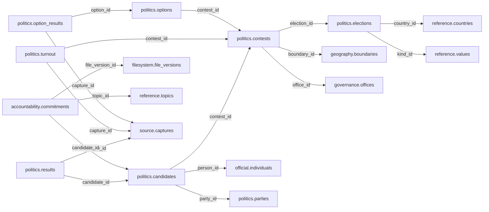
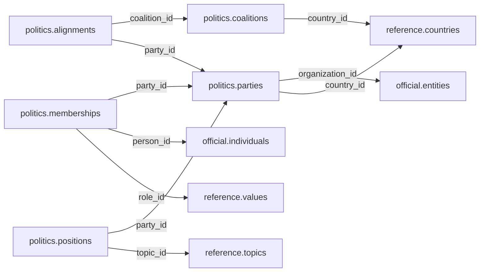

# politics — Phase 01

> **Approved contract implementation — 12 November 2026.** This is the current contract inventory and supersedes older proposed/unapproved wording below. These authored Dryv contracts are not generated migrations and do not change a live database.

## Current implemented contract

**Tables:** `Parties, Memberships, Coalitions, Alignments, Elections, Contests, Candidates, Electorates, Results, Manifestos, ManifestoItems, ReferendumOptions, OptionResults`.

Candidate party affiliation is captured on the candidacy as it stood for that election. Results and electorate counts retain distinct measures and source citations. Referendum options and option results have separate row types and are never modeled as people or candidates.

All cross-schema relations target same-Main Dryv schemas. Older inventories and examples below are retained as historical design input and do not override the implemented contract above.

[Folder index](README.md) · [Full catalogue and relocation inventory](../../README.md)

## Agreed responsibility — 12 November 2026

Parties, memberships, affiliations, elections, contests, candidates, electorates, results and representation.

Politics combines the former Political and Electoral proposals. Parties, memberships, affiliations, coalitions and internal political positions remain distinct from elections, contests, candidates, electorates, turnout, results and representation in their respective tables. Candidate affiliation at the election date is not today's party membership; a declared result is not itself an appointment or tenure record in Governance.

Link people and organizational identities through Official, offices through Governance, electoral areas and reporting boundaries through Geography, and legal frameworks through Reference. Preserve registered voters, ballots cast, valid/rejected votes, candidate totals and allocated seats as different measures; avoid summing overlapping reporting totals. Source evidence must establish declarations and corrections.

Results and electorate rows use typed Source citations, not a deferred Statistical release or a raw capture ID. Accountability persists no promises; manifesto items are attributed political policy text, and a promise-to-project relationship is not asserted without an explicit reviewed relation. Referendum options/results have separate row types.

## Retained table proposals and review context

The following dictionaries preserve the earlier proposal inputs, adjusted for the agreed ownership above. They remain unapproved. Earlier inventories retain their measured names; collapsed historical sections do not override the 12 November decisions.

## Retained electoral proposal

> **PROPOSED — USER REVIEW REQUIRED.** Schema assignment is agreed; proposed tables and columns still require review. No SQL or migration is authorized.

## Purpose and ownership

**Target:** Main. **Purpose:** Elections, contests, candidates and official outcomes. Schema placement follows the 12 November scope decision; individual table/column designs remain proposals. Related owners follow the agreed responsibility section above.

## Current implementation and gaps

The active manifest has 30 manifest migrations and 49 distinct CREATE TABLE declarations (49 distinct current table names) in schemas `audit`, `auth`, `engine`, `filesystem`, `geography`, `legal`, `objects`, `reference`. Generated Dryv has 124 entities (digest `e0087da9cf5b00e91f283a5501c368c7696bdd841ea30629231dc9c590f7c1ee`). Counts describe current artifacts, not target design; SQL and Dryv diverge.

- SQL declarations: None found.
- Dryv entities: `electoral.candidates` (elections.Candidate), `electoral.elections` (elections.Election), `electoral.results` (elections.ElectionResult), `electoral.electorates` (elections.Electorate), `electoral.manifestos` (elections.Manifesto), `electoral.commitments` (elections.ManifestoCommitment), `electoral.referendum_options` (elections.ReferendumOption), `electoral.referendum_questions` (elections.ReferendumQuestion), `electoral.referendum_results` (elections.ReferendumResult), `electoral.seats` (elections.Seat), `electoral.seat_allocations` (elections.SeatAllocation)

The inventory does not establish live database state and may miss ALTER-only changes. Before implementation, reconcile migrations, Dryv, generated output and callers.

## Proposed relationship map

> All nodes and edges are proposals. Main schemas may use local cross-schema foreign keys; no edge crosses the Main/Operations database boundary.

## Proposed table and column review

All tables and fields are hypothetical. Every proposed business column is listed; UUIDv7 `id` is a candidate default and remains open. Record every existing field disposition: KEEP / REMOVE / RENAME / MOVE / MERGE / SPLIT / DERIVE / ADD.

### `politics.elections` — Election identity and schedule

- **Example:** General election
- **Profile:** entity; planning envelope below.

| Column | Proposed type | Meaning | Nullable | Default | Relationship | Units / validation | Proposed disposition |
|---|---|---|---|---|---|---|---|
| `id` | `uuid` | Proposed stable identity | No | Rust UUIDv7 candidate | Primary key | UUIDv7 candidate; unique and immutable after publication | KEEP (candidate match to current SQL/Dryv field; confirm meaning) |
| `title` | `text` | Election title | No | — | — | Nonblank when required; enforce domain-specific length, normalization and controlled vocabulary | ADD (proposed target field; pending user approval) |
| `country_id` | `uuid` | Country identity | No | — | FK → `reference.countries` | UUID syntax; FK target must exist when the relationship is required | KEEP (candidate match to current SQL/Dryv field; confirm meaning) |
| `held_on` | `date` | Actual polling date | Yes | — | — | Type checked; domain constraints and units must be approved for this field | ADD (proposed target field; pending user approval) |
| `kind_id` | `uuid` | Election classification | No | — | FK → `reference.values` | UUID syntax; FK target must exist when the relationship is required | ADD (proposed target field; pending user approval) |

- **Current SQL/Dryv fields without a proposed same-name column:** `administering_institution_id`, `code`, `created_at`, `geo_unit_id`, `held_date`, `is_current`, `legal_basis_id`, `name`, `scheduled_date`, `status`, `type_id`, `updated_at`, `valid_from`, `valid_from_precision`, `valid_to`, `valid_to_precision`, `version`. **Disposition:** unresolved per field; propose KEEP, REMOVE, RENAME, MOVE, MERGE, SPLIT or DERIVE in review. Do not drop these fields until the user resolves each one.
- **FK action/cardinality:** Each non-null FK is many-to-one to its named target; nullable FKs are optional. Candidate delete/update behavior is RESTRICT/NO ACTION for accepted records; cascading canonical deletion is not proposed. Confirm uniqueness and exact behavior during review.
- **Constraints:** Scheduled dates belong to announced events until verified. Exact keys and cross-field checks remain for review.
- **Indexes:** primary key on `id`; candidate B-tree indexes on FK columns `country_id`, `kind_id` for joins and referenced-entity filters; add temporal/spatial indexes only where the stated query needs them and benchmarks support them.
- **Relationships:** resolve each FK target. Main allows cross-schema FKs. Main and Operations have no cross-database FK.
- **Evidence/time:** preserve exact source/version, observation/retrieval time, historical context and uncertainty where applicable. Approve the exact evidence path for this table.
- **Growth/storage estimate (illustrative planning envelope, not measured):** Low: initial 1,000, +200/year, peak 20/day; five-year 2,000 rows ≈ 2.0 MiB live row+index budget; Expected: initial 10,000, +2,000/year, peak 200/day; five-year 20,000 rows ≈ 19.5 MiB live row+index budget; High: initial 100,000, +20,000/year, peak 2,000/day; five-year 200,000 rows ≈ 195.3 MiB live row+index budget. Model: initial rows + annual accepted rows × 5; multiply by a per-row budget of 1 KiB including a coarse index allowance. Replace assumptions with actual samples, ingest rates and `pg_total_relation_size` before approval. Large object bytes are excluded; WAL, replicas, backups and S3 are budgeted separately.
- **Workload:** Interactive lookup by identity and approved foreign keys; batch scans for import/reconciliation. Peak-day figure above is a scenario assumption, not a service-level commitment.
- **Partitioning:** None proposed initially; decide from measured scale/query plans. Check late data and partition count.
- **Files:** originals, full-resolution geometry, arrays, media and large exports may be immutable S3 objects. Keep searchable identity, required facts, hashes, coverage, access and provenance in PostgreSQL; use manifests and selective reads.
- **Retention/risks/benchmark:** preserve accepted evidence and corrections. Review late arrivals, contention, index/partition growth and recovery. Benchmark joins, filters, spatial access, ingestion bursts, concurrent access and interrupted publication.
### `politics.contests` — One office or question contested

- **Example:** County governor contest
- **Profile:** entity; planning envelope below.

| Column | Proposed type | Meaning | Nullable | Default | Relationship | Units / validation | Proposed disposition |
|---|---|---|---|---|---|---|---|
| `id` | `uuid` | Proposed stable identity | No | Rust UUIDv7 candidate | Primary key | UUIDv7 candidate; unique and immutable after publication | ADD (proposed target field; pending user approval) |
| `election_id` | `uuid` | Election | No | — | FK → `politics.elections` | UUID syntax; FK target must exist when the relationship is required | ADD (proposed target field; pending user approval) |
| `office_id` | `uuid` | Office contested | Yes | — | FK → `governance.offices` | UUID syntax; FK target must exist when the relationship is required | ADD (proposed target field; pending user approval) |
| `boundary_id` | `uuid` | Exact electoral area | No | — | FK → `geography.boundaries` | UUID syntax; FK target must exist when the relationship is required | ADD (proposed target field; pending user approval) |
| `question` | `text` | Referendum question | Yes | — | — | Nonblank when required; enforce domain-specific length, normalization and controlled vocabulary | ADD (proposed target field; pending user approval) |
| `seats` | `integer` | Number of seats | No | — | — | Type checked; domain constraints and units must be approved for this field | ADD (proposed target field; pending user approval) |

- **FK action/cardinality:** Each non-null FK is many-to-one to its named target; nullable FKs are optional. Candidate delete/update behavior is RESTRICT/NO ACTION for accepted records; cascading canonical deletion is not proposed. Confirm uniqueness and exact behavior during review.
- **Constraints:** office_id XOR question; seats >= 1. Exact keys and cross-field checks remain for review.
- **Indexes:** primary key on `id`; candidate B-tree indexes on FK columns `election_id`, `office_id`, `boundary_id` for joins and referenced-entity filters; add temporal/spatial indexes only where the stated query needs them and benchmarks support them.
- **Relationships:** resolve each FK target. Main allows cross-schema FKs. Main and Operations have no cross-database FK.
- **Evidence/time:** preserve exact source/version, observation/retrieval time, historical context and uncertainty where applicable. Approve the exact evidence path for this table.
- **Growth/storage estimate (illustrative planning envelope, not measured):** Low: initial 1,000, +200/year, peak 20/day; five-year 2,000 rows ≈ 2.0 MiB live row+index budget; Expected: initial 10,000, +2,000/year, peak 200/day; five-year 20,000 rows ≈ 19.5 MiB live row+index budget; High: initial 100,000, +20,000/year, peak 2,000/day; five-year 200,000 rows ≈ 195.3 MiB live row+index budget. Model: initial rows + annual accepted rows × 5; multiply by a per-row budget of 1 KiB including a coarse index allowance. Replace assumptions with actual samples, ingest rates and `pg_total_relation_size` before approval. Large object bytes are excluded; WAL, replicas, backups and S3 are budgeted separately.
- **Workload:** Interactive lookup by identity and approved foreign keys; batch scans for import/reconciliation. Peak-day figure above is a scenario assumption, not a service-level commitment.
- **Partitioning:** None proposed initially; decide from measured scale/query plans. Check late data and partition count.
- **Files:** originals, full-resolution geometry, arrays, media and large exports may be immutable S3 objects. Keep searchable identity, required facts, hashes, coverage, access and provenance in PostgreSQL; use manifests and selective reads.
- **Retention/risks/benchmark:** preserve accepted evidence and corrections. Review late arrivals, contention, index/partition growth and recovery. Benchmark joins, filters, spatial access, ingestion bursts, concurrent access and interrupted publication.
### `politics.candidates` — Person candidature

- **Example:** Independent candidate
- **Profile:** relation; planning envelope below.

| Column | Proposed type | Meaning | Nullable | Default | Relationship | Units / validation | Proposed disposition |
|---|---|---|---|---|---|---|---|
| `id` | `uuid` | Proposed stable identity | No | Rust UUIDv7 candidate | Primary key | UUIDv7 candidate; unique and immutable after publication | KEEP (candidate match to current SQL/Dryv field; confirm meaning) |
| `contest_id` | `uuid` | Contest | No | — | FK → `politics.contests` | UUID syntax; FK target must exist when the relationship is required | ADD (proposed target field; pending user approval) |
| `person_id` | `uuid` | Candidate | No | — | FK → `official.individuals` | UUID syntax; FK target must exist when the relationship is required | KEEP (candidate match to current SQL/Dryv field; confirm meaning) |
| `party_id` | `uuid` | Party or independent NULL | Yes | — | FK → `politics.parties` | UUID syntax; FK target must exist when the relationship is required | KEEP (candidate match to current SQL/Dryv field; confirm meaning) |
| `ballot_name` | `text` | Published ballot label | No | — | — | Nonblank when required; enforce domain-specific length, normalization and controlled vocabulary | ADD (proposed target field; pending user approval) |

- **Current SQL/Dryv fields without a proposed same-name column:** `created_at`, `is_current`, `is_independent`, `nomination_status`, `seat_id`, `updated_at`, `valid_from`, `valid_from_precision`, `valid_to`, `valid_to_precision`, `version`. **Disposition:** unresolved per field; propose KEEP, REMOVE, RENAME, MOVE, MERGE, SPLIT or DERIVE in review. Do not drop these fields until the user resolves each one.
- **FK action/cardinality:** Each non-null FK is many-to-one to its named target; nullable FKs are optional. Candidate delete/update behavior is RESTRICT/NO ACTION for accepted records; cascading canonical deletion is not proposed. Confirm uniqueness and exact behavior during review.
- **Constraints:** UNIQUE(contest_id,person_id). Exact keys and cross-field checks remain for review.
- **Indexes:** primary key on `id`; candidate B-tree indexes on FK columns `contest_id`, `person_id`, `party_id` for joins and referenced-entity filters; add temporal/spatial indexes only where the stated query needs them and benchmarks support them.
- **Relationships:** resolve each FK target. Main allows cross-schema FKs. Main and Operations have no cross-database FK.
- **Evidence/time:** preserve exact source/version, observation/retrieval time, historical context and uncertainty where applicable. Approve the exact evidence path for this table.
- **Growth/storage estimate (illustrative planning envelope, not measured):** Low: initial 1,000, +2,000/year, peak 100/day; five-year 11,000 rows ≈ 10.7 MiB live row+index budget; Expected: initial 10,000, +20,000/year, peak 1,000/day; five-year 110,000 rows ≈ 107.4 MiB live row+index budget; High: initial 100,000, +200,000/year, peak 10,000/day; five-year 1,100,000 rows ≈ 1,074.2 MiB live row+index budget. Model: initial rows + annual accepted rows × 5; multiply by a per-row budget of 1 KiB including a coarse index allowance. Replace assumptions with actual samples, ingest rates and `pg_total_relation_size` before approval. Large object bytes are excluded; WAL, replicas, backups and S3 are budgeted separately.
- **Workload:** Interactive lookup by identity and approved foreign keys; batch scans for import/reconciliation. Peak-day figure above is a scenario assumption, not a service-level commitment.
- **Partitioning:** None proposed initially; decide from measured scale/query plans. Check late data and partition count.
- **Files:** originals, full-resolution geometry, arrays, media and large exports may be immutable S3 objects. Keep searchable identity, required facts, hashes, coverage, access and provenance in PostgreSQL; use manifests and selective reads.
- **Retention/risks/benchmark:** preserve accepted evidence and corrections. Review late arrivals, contention, index/partition growth and recovery. Benchmark joins, filters, spatial access, ingestion bursts, concurrent access and interrupted publication.
### `politics.results` — Published candidate vote counts

- **Example:** Official declared vote total
- **Profile:** fact; planning envelope below.

| Column | Proposed type | Meaning | Nullable | Default | Relationship | Units / validation | Proposed disposition |
|---|---|---|---|---|---|---|---|
| `id` | `uuid` | Proposed stable identity | No | Rust UUIDv7 candidate | Primary key | UUIDv7 candidate; unique and immutable after publication | KEEP (candidate match to current SQL/Dryv field; confirm meaning) |
| `candidate_id` | `uuid` | Candidate | No | — | FK → `politics.candidates` | UUID syntax; FK target must exist when the relationship is required | KEEP (candidate match to current SQL/Dryv field; confirm meaning) |
| `capture_id` | `uuid` | Official results release | No | — | FK → `source.captures` | UUID syntax; FK target must exist when the relationship is required | ADD (proposed target field; pending user approval) |
| `votes` | `bigint` | Nonnegative votes | No | — | — | Type checked; domain constraints and units must be approved for this field | KEEP (candidate match to current SQL/Dryv field; confirm meaning) |
| `declared_on` | `date` | Declaration date | No | — | — | Type checked; domain constraints and units must be approved for this field | ADD (proposed target field; pending user approval) |
| `outcome` | `text` | elected not_elected disputed or pending | No | — | — | Nonblank when required; enforce domain-specific length, normalization and controlled vocabulary | ADD (proposed target field; pending user approval) |

- **Current SQL/Dryv fields without a proposed same-name column:** `created_at`, `declared_at`, `declaring_institution_id`, `geo_unit_id`, `is_current`, `is_winner`, `rank`, `result_level_id`, `seat_id`, `updated_at`, `valid_from`, `valid_from_precision`, `valid_to`, `valid_to_precision`, `version`. **Disposition:** unresolved per field; propose KEEP, REMOVE, RENAME, MOVE, MERGE, SPLIT or DERIVE in review. Do not drop these fields until the user resolves each one.
- **FK action/cardinality:** Each non-null FK is many-to-one to its named target; nullable FKs are optional. Candidate delete/update behavior is RESTRICT/NO ACTION for accepted records; cascading canonical deletion is not proposed. Confirm uniqueness and exact behavior during review.
- **Constraints:** UNIQUE(candidate_id,capture_id); votes >= 0. Exact keys and cross-field checks remain for review.
- **Indexes:** primary key on `id`; candidate B-tree indexes on FK columns `candidate_id`, `capture_id` for joins and referenced-entity filters; add temporal/spatial indexes only where the stated query needs them and benchmarks support them.
- **Relationships:** resolve each FK target. Main allows cross-schema FKs. Main and Operations have no cross-database FK.
- **Evidence/time:** preserve exact source/version, observation/retrieval time, historical context and uncertainty where applicable. Approve the exact evidence path for this table.
- **Growth/storage estimate (illustrative planning envelope, not measured):** Low: initial 10,000, +2,000/year, peak 100/day; five-year 20,000 rows ≈ 39.1 MiB live row+index budget; Expected: initial 100,000, +20,000/year, peak 1,000/day; five-year 200,000 rows ≈ 390.6 MiB live row+index budget; High: initial 1,000,000, +200,000/year, peak 10,000/day; five-year 2,000,000 rows ≈ 3,906.2 MiB live row+index budget. Model: initial rows + annual accepted rows × 5; multiply by a per-row budget of 2 KiB including a coarse index allowance. Replace assumptions with actual samples, ingest rates and `pg_total_relation_size` before approval. Large object bytes are excluded; WAL, replicas, backups and S3 are budgeted separately.
- **Workload:** Interactive lookup by identity and approved foreign keys; batch scans for import/reconciliation. Peak-day figure above is a scenario assumption, not a service-level commitment.
- **Partitioning:** None proposed initially; decide from measured scale/query plans. Check late data and partition count.
- **Files:** originals, full-resolution geometry, arrays, media and large exports may be immutable S3 objects. Keep searchable identity, required facts, hashes, coverage, access and provenance in PostgreSQL; use manifests and selective reads.
- **Retention/risks/benchmark:** preserve accepted evidence and corrections. Review late arrivals, contention, index/partition growth and recovery. Benchmark joins, filters, spatial access, ingestion bursts, concurrent access and interrupted publication.
### `politics.turnout` — Contest-level electorate and ballot totals

- **Example:** Turnout with rejected ballots
- **Profile:** fact; planning envelope below.

| Column | Proposed type | Meaning | Nullable | Default | Relationship | Units / validation | Proposed disposition |
|---|---|---|---|---|---|---|---|
| `id` | `uuid` | Proposed stable identity | No | Rust UUIDv7 candidate | Primary key | UUIDv7 candidate; unique and immutable after publication | ADD (proposed target field; pending user approval) |
| `contest_id` | `uuid` | Contest | No | — | FK → `politics.contests` | UUID syntax; FK target must exist when the relationship is required | ADD (proposed target field; pending user approval) |
| `capture_id` | `uuid` | Results release | No | — | FK → `source.captures` | UUID syntax; FK target must exist when the relationship is required | ADD (proposed target field; pending user approval) |
| `registered` | `bigint` | Registered voters | Yes | — | — | Type checked; domain constraints and units must be approved for this field | ADD (proposed target field; pending user approval) |
| `cast` | `bigint` | Ballots cast | Yes | — | — | Type checked; domain constraints and units must be approved for this field | ADD (proposed target field; pending user approval) |
| `rejected` | `bigint` | Rejected ballots | Yes | — | — | Type checked; domain constraints and units must be approved for this field | ADD (proposed target field; pending user approval) |

- **FK action/cardinality:** Each non-null FK is many-to-one to its named target; nullable FKs are optional. Candidate delete/update behavior is RESTRICT/NO ACTION for accepted records; cascading canonical deletion is not proposed. Confirm uniqueness and exact behavior during review.
- **Constraints:** Counts nonnegative; missing differs from zero; validate publisher-specific totals. Exact keys and cross-field checks remain for review.
- **Indexes:** primary key on `id`; candidate B-tree indexes on FK columns `contest_id`, `capture_id` for joins and referenced-entity filters; add temporal/spatial indexes only where the stated query needs them and benchmarks support them.
- **Relationships:** resolve each FK target. Main allows cross-schema FKs. Main and Operations have no cross-database FK.
- **Evidence/time:** preserve exact source/version, observation/retrieval time, historical context and uncertainty where applicable. Approve the exact evidence path for this table.
- **Growth/storage estimate (illustrative planning envelope, not measured):** Low: initial 10,000, +2,000/year, peak 100/day; five-year 20,000 rows ≈ 39.1 MiB live row+index budget; Expected: initial 100,000, +20,000/year, peak 1,000/day; five-year 200,000 rows ≈ 390.6 MiB live row+index budget; High: initial 1,000,000, +200,000/year, peak 10,000/day; five-year 2,000,000 rows ≈ 3,906.2 MiB live row+index budget. Model: initial rows + annual accepted rows × 5; multiply by a per-row budget of 2 KiB including a coarse index allowance. Replace assumptions with actual samples, ingest rates and `pg_total_relation_size` before approval. Large object bytes are excluded; WAL, replicas, backups and S3 are budgeted separately.
- **Workload:** Interactive lookup by identity and approved foreign keys; batch scans for import/reconciliation. Peak-day figure above is a scenario assumption, not a service-level commitment.
- **Partitioning:** None proposed initially; decide from measured scale/query plans. Check late data and partition count.
- **Files:** originals, full-resolution geometry, arrays, media and large exports may be immutable S3 objects. Keep searchable identity, required facts, hashes, coverage, access and provenance in PostgreSQL; use manifests and selective reads.
- **Retention/risks/benchmark:** preserve accepted evidence and corrections. Review late arrivals, contention, index/partition growth and recovery. Benchmark joins, filters, spatial access, ingestion bursts, concurrent access and interrupted publication.
### `politics.options` — Referendum ballot choices

- **Example:** Yes option
- **Profile:** catalog; planning envelope below.

| Column | Proposed type | Meaning | Nullable | Default | Relationship | Units / validation | Proposed disposition |
|---|---|---|---|---|---|---|---|
| `id` | `uuid` | Proposed stable identity | No | Rust UUIDv7 candidate | Primary key | UUIDv7 candidate; unique and immutable after publication | ADD (proposed target field; pending user approval) |
| `contest_id` | `uuid` | Referendum contest | No | — | FK → `politics.contests` | UUID syntax; FK target must exist when the relationship is required | ADD (proposed target field; pending user approval) |
| `label` | `text` | Ballot option | No | — | — | Nonblank when required; enforce domain-specific length, normalization and controlled vocabulary | ADD (proposed target field; pending user approval) |

- **FK action/cardinality:** Each non-null FK is many-to-one to its named target; nullable FKs are optional. Candidate delete/update behavior is RESTRICT/NO ACTION for accepted records; cascading canonical deletion is not proposed. Confirm uniqueness and exact behavior during review.
- **Constraints:** UNIQUE(contest_id,label); contest must be referendum. Exact keys and cross-field checks remain for review.
- **Indexes:** primary key on `id`; candidate B-tree indexes on FK columns `contest_id` for joins and referenced-entity filters; add temporal/spatial indexes only where the stated query needs them and benchmarks support them.
- **Relationships:** resolve each FK target. Main allows cross-schema FKs. Main and Operations have no cross-database FK.
- **Evidence/time:** preserve exact source/version, observation/retrieval time, historical context and uncertainty where applicable. Approve the exact evidence path for this table.
- **Growth/storage estimate (illustrative planning envelope, not measured):** Low: initial 100, +100/year, peak 5/day; five-year 600 rows ≈ 0.6 MiB live row+index budget; Expected: initial 1,000, +500/year, peak 25/day; five-year 3,500 rows ≈ 3.4 MiB live row+index budget; High: initial 10,000, +5,000/year, peak 250/day; five-year 35,000 rows ≈ 34.2 MiB live row+index budget. Model: initial rows + annual accepted rows × 5; multiply by a per-row budget of 1 KiB including a coarse index allowance. Replace assumptions with actual samples, ingest rates and `pg_total_relation_size` before approval. Large object bytes are excluded; WAL, replicas, backups and S3 are budgeted separately.
- **Workload:** Interactive lookup by identity and approved foreign keys; batch scans for import/reconciliation. Peak-day figure above is a scenario assumption, not a service-level commitment.
- **Partitioning:** None proposed initially; decide from measured scale/query plans. Check late data and partition count.
- **Files:** originals, full-resolution geometry, arrays, media and large exports may be immutable S3 objects. Keep searchable identity, required facts, hashes, coverage, access and provenance in PostgreSQL; use manifests and selective reads.
- **Retention/risks/benchmark:** preserve accepted evidence and corrections. Review late arrivals, contention, index/partition growth and recovery. Benchmark joins, filters, spatial access, ingestion bursts, concurrent access and interrupted publication.
### `politics.option_results` — Official referendum results

- **Example:** Votes for referendum option
- **Profile:** fact; planning envelope below.

| Column | Proposed type | Meaning | Nullable | Default | Relationship | Units / validation | Proposed disposition |
|---|---|---|---|---|---|---|---|
| `id` | `uuid` | Proposed stable identity | No | Rust UUIDv7 candidate | Primary key | UUIDv7 candidate; unique and immutable after publication | ADD (proposed target field; pending user approval) |
| `option_id` | `uuid` | Choice | No | — | FK → `politics.options` | UUID syntax; FK target must exist when the relationship is required | ADD (proposed target field; pending user approval) |
| `capture_id` | `uuid` | Release | No | — | FK → `source.captures` | UUID syntax; FK target must exist when the relationship is required | ADD (proposed target field; pending user approval) |
| `votes` | `bigint` | Votes | No | — | — | Type checked; domain constraints and units must be approved for this field | ADD (proposed target field; pending user approval) |

- **FK action/cardinality:** Each non-null FK is many-to-one to its named target; nullable FKs are optional. Candidate delete/update behavior is RESTRICT/NO ACTION for accepted records; cascading canonical deletion is not proposed. Confirm uniqueness and exact behavior during review.
- **Constraints:** UNIQUE(option_id,capture_id); votes >= 0. Exact keys and cross-field checks remain for review.
- **Indexes:** primary key on `id`; candidate B-tree indexes on FK columns `option_id`, `capture_id` for joins and referenced-entity filters; add temporal/spatial indexes only where the stated query needs them and benchmarks support them.
- **Relationships:** resolve each FK target. Main allows cross-schema FKs. Main and Operations have no cross-database FK.
- **Evidence/time:** preserve exact source/version, observation/retrieval time, historical context and uncertainty where applicable. Approve the exact evidence path for this table.
- **Growth/storage estimate (illustrative planning envelope, not measured):** Low: initial 10,000, +2,000/year, peak 100/day; five-year 20,000 rows ≈ 39.1 MiB live row+index budget; Expected: initial 100,000, +20,000/year, peak 1,000/day; five-year 200,000 rows ≈ 390.6 MiB live row+index budget; High: initial 1,000,000, +200,000/year, peak 10,000/day; five-year 2,000,000 rows ≈ 3,906.2 MiB live row+index budget. Model: initial rows + annual accepted rows × 5; multiply by a per-row budget of 2 KiB including a coarse index allowance. Replace assumptions with actual samples, ingest rates and `pg_total_relation_size` before approval. Large object bytes are excluded; WAL, replicas, backups and S3 are budgeted separately.
- **Workload:** Interactive lookup by identity and approved foreign keys; batch scans for import/reconciliation. Peak-day figure above is a scenario assumption, not a service-level commitment.
- **Partitioning:** None proposed initially; decide from measured scale/query plans. Check late data and partition count.
- **Files:** originals, full-resolution geometry, arrays, media and large exports may be immutable S3 objects. Keep searchable identity, required facts, hashes, coverage, access and provenance in PostgreSQL; use manifests and selective reads.
- **Retention/risks/benchmark:** preserve accepted evidence and corrections. Review late arrivals, contention, index/partition growth and recovery. Benchmark joins, filters, spatial access, ingestion bursts, concurrent access and interrupted publication.
### Election commitments

The complete inherited commitment dictionary is preserved in [Accountability](accountability.md#accountabilitycommitments--candidate-election-promises), which owns commitments and follow-up.

## Queries, lifecycle, capacity and approval

**Representative query:** Who contested this seat and what was the official result?

Lifecycle: preserve source bytes; extract into candidate revisions; validate; review or use approved deterministic checks; atomically publish; serve. Corrections create explicit versions/supersession. Preserve disagreement and uncertainty.

Capacity is unmeasured. Use low/expected/high input scenarios, explicit formulas and workload benchmarks; do not assume sizes or universal partitions.

**Status:** NOT REVIEWED. Schema assignment follows the handoff; tables, columns, relationships, partitioning and S3 choices still require user approval. Feedback: none. Approval reference/date/revision: none. Implementation authorization: not granted. Material changes reopen approval.

Earlier schema proposal preserved for history; superseded and not an approval

---
id: DOC-4125ED9B7A63
name: Electoral domain schema redesign
type: documentation
tags: [improvements, schema-redesign, electoral, planning]
extra: {status: planning_only}
---

> **11 November 2026 precedence:** the connected foundation update at the end of this document supersedes conflicting country, compatibility and cross-domain assumptions in the historical proposal below. Detailed table names remain design candidates; task 03 is prepared for design work, not a claim of completed implementation.

# Electoral — elections, electorates, candidates, vote results and referendums

**PLANNING ONLY — detailed design review required; not authorized to implement.**

## Confirmed boundary

`electoral` remains **separate from `political`**. The user wants comprehensive Kenya IEBC results, candidates, voters by geographic level, seats, party affiliation at contest time, official declarations and meaningful historical comparisons, while retaining worldwide applicability. A **registered voter count** is not the same as votes cast, counted valid votes, declared vote for a candidate, turnout rate or number of allocated seats. Distinguish nomination, contest, tally, declaration and certification.

## Current tables (11) and their responsibilities

| Current table | Review focus and possible improvement |
|---|---|
| `elections` | Elections/election rounds or by-elections, country, organizer, law, dates and status. |
| `seats` | Contest/representative seat identity, valid period and geo unit represented, not a candidate identity. |
| `candidates` | Person contesting a seat, party affiliation/nomination at **that election**, withdrawal/disqualification status. |
| `results` | Official vote tallies, reporting unit, candidate/contest, declaration level, status and correction edition. |
| `electorates` | Registered/eligible voters, cast/valid/rejected/spoilt votes, source date/geo scope; introduced in later migration. |
| `referendum_questions` | Legally specified question linked to an electoral event. |
| `referendum_options` | Ordered, defined responses to a question with stable identity. |
| `referendum_results` | Official votes for each option at a geo reporting level and declaration version. |
| `seat_allocations` | Seat allocation results, party/election and applicable rule, not directly equivalent to voting totals. |
| `manifestos` | Dated party/candidate electoral platform with external source. |
| `commitments` | Individually traceable manifesto pledges and possible later associated activity. |

The current initial schema plus the `1794800000000-electoral-ballots.ts` migration must be compared with **all current TypeORM columns, Dryv contract types and deployed DB constraints**. For each table audit exact PK, FK, `election_id`, `seat_id`, `person_id`/`individual_id`, `party_id`, `geo_unit_id`, value fields, round, declaration status, valid dates, version and provenance. Those names are **semantic audit targets**, not assertions that every table has them.

## Proposal: hard links and defensible results

Use hard FK for election→country/organizing institution, seat→geography/office/legal pattern, candidate→person and election/seat, candidate party→political party at nomination time, result→candidate/seat/election/geo and source version, referendum option→question, and constituency representation→correct historical geography. Add unique/functional constraints to avoid duplicates by (election, contest, reporting geography, round, choice/candidate, official edition).

National and county results are overlapping reported totals, **not independent additive records** when one already includes the other. The geography ancestor/descendant query model must avoid reporting double totals; a national total cannot automatically be disaggregated to counties. Country-root scope and report geography must remain separate from ballot-center venue and declaring institution HQ.

Legal procedure link should identify the electoral framework in force at the election time, including boundary changes, seat allocation rules and certification process. A claim of a winner requires declaration evidence, not just an AI-generated ranking.

## Four data categories and generation

- **1A:** election and seat definitions, official roles, known timelines and legally established electoral units.
- **1B:** seats/contests expected under a verified law or administrative pattern; never auto-generate candidates or votes.
- **2A:** IEBC and other election authority registered voters, nominations, official election results, reports and referenda.
- **2B:** turnout rates, shares, swings, comparisons and seat/party summaries, with explicit formula, denominators, vintage and geo consistency.

The `statistical` domain may reuse official electoral quantities as a dataset, but must not create competing canonical vote identities. Preserve official source snapshots and corrections.

## Query/acceptance examples

Which candidates actually ran for a county/constituency seat on election day? Show registered voters vs cast/valid votes at every official reporting level. Find a county total from certified results without mixing an earlier provisional edition. Show a voter's region aggregate historically despite boundary changes, without disclosing person-level voting behavior. Trace a seat winner→`governance.holders` only when independent office assumption evidence is available.

## Migration and decision risks

Reconcile results/states/aggregation and historical geo unit links; test registered voter denominators before computing turnout. Preserve source edition/correction history and candidacies that were later withdrawn. Enforce all known cross-domain FKs only after resolving orphans and duplicates; no destructive reset. Update Dryv/client contract changes carefully.

## Open questions

1. Should a referendum be an election subtype or a separate electoral event identity?
2. How are rounds, results statuses, recounts and official corrected declarations versioned?
3. Which precise reporting geo systems and date-aware boundaries apply?
4. How to model independently published voter registration datasets versus election-day turnout?
5. Where should campaign manifestos and commitment verification reside?
6. Which official releases can be auto-imported vs require review?

**Links:** [Schema index](../../README.md), [Master record](../../../guides/mzizi-data-schema-storage-and-pipelines-redesign.md), [Geography](geography.md), [Statistics](../phase-02/statistical.md).

## Human review — editable user notes and design sign-off

**Review status:** `NOT REVIEWED` — AI-authored proposals in this document are not final approval.

**In my own words, what this schema should represent and exclude:**

> _My understanding and questions:_

**Tables/columns I want to keep, rename, move, merge, split, remove or add (and why):**

> _My proposed changes and alternative names:_

**Hard foreign keys, geographical and legal scope, pattern generation, classification and evidence I want changed or explained:**

> _My technical feedback, disagreements and alternatives:_

**Real data and queries I want to use to validate this design:**

> _My examples and expected results:_

**Unresolved decisions I want to discuss further:**

> _My remaining questions:_

**Final user decision:** `NOT DECIDED` / `NEEDS CHANGES` / `DESIGN VALIDATED BY USER` / `APPROVED FOR TASK PLANNING`.

**Approval reference and date:** _None. Only record explicit later user authorization. Even design validation does not authorize code, migration or Taskcode task creation._

## Mandatory per-table temporal, rigid-column and deletion review (2026-11-07)

**USER REQUIREMENT; planning only.** Examine every existing/proposed field and expressly record **KEEP / REMOVE / DERIVE / MOVE / RENAME / ADD** for `valid_from`, `valid_to`, `valid_from_precision`, `valid_to_precision`, `is_current`, `status`, `version`, `created_at`, `updated_at` and other copied/rigid flags. These fields are **opt-in by justified meaning**, not blanket schema conventions. Assess `deleted_at` only for recoverable soft deletion where appropriate. The full policy and migration/approval checklist is in [schema redesign README](../../README.md).

**Domain-specific guidance:** Elections have occurrence/round dates, candidates have nomination/withdrawal events, seats can derive structural applicability from electoral law/patterns, and results have official declaration/vintage history. Avoid generic validity/precision/is_current on every electoral row. Never soft-delete official historic election results; preserve corrected versions and evidence.

**OPEN for human review:** exact per-table/column disposition, derived status and as-of queries, pattern/legal links, justified precision, recoverable deletion versus domain lifecycle, history/identity preservation and hard-FK impact. No code or migration is authorized.

## 2026-11-07 calendar and freshness integration — elections as domain facts, activity as timeline

**Not approved for DDL.** Existing `source/backend/api/src/modules/elections/entities/election.entity.ts` already distinguishes `scheduled_date` and `held_date`. `calendar.events` separately has `starts_on`, `ends_on` and `is_recurring`. Review an authoritative mapping so those two models do not create independently conflicting "election date" sources.

**Proposal:** `reference` owns legally applicable electoral cycle/schedule definitions and dependent watcher rules; `activity` stores planned/announced/postponed/held/declaration occurrences, with source and timestamps; `electoral.elections` remains the canonical election identity and election-specific facts. A planned general election triggers checks for commission announcements, seats, registrations and nominations. An official result publication triggers result/turnout/candidate revalidation and dependent `statistical` rollup verification. An announced election date changing must not be reported as a held event, nor should a theoretical cycle generate voters or results.

**Field semantics and monitoring:** A seat definition or historical identity may be cold, whereas live nominations and provisional results may be hot near official phases. Freshness policies should target the **actual field group and reporting geography**; a national election announcement doesn't verify every county result. “Last checked” must be distinct from "last verified" and source publication/retrieval time. Source-backed correction/vintage history prevents a previous declaration from disappearing.

**Admin/agent use cases:** Admin records a sourced nomination announcement or submits a scoped refresh request; registered source agents observe official statements and propose `activity` instances; engine deduplicates triggers and sends targeted checks rather than blindly overwriting `electoral`. Exact schedule shape, target FKs, trust thresholds, status words and refresh frequency remain **OPEN**.

## 2026-11-11 — Connected foundation direction (controlling for task 03)

Connect an election contest to the office(s) it fills, its electoral area/reporting coverage and reviewed legal rules. Candidacy identifies the person and dated electoral party affiliation; results/declarations and assumption of office are distinct records/events. Selection procedures may differ even within one paired office: do not reduce all selection to a single elected boolean. Exact legal provision versions support rules and interpretations.

Boundaries and reporting areas are dated and need not follow an administrative parent chain. Voter counts belong to a defined registration release/coverage, not a generic current local number. Task 03 supplies interfaces and a contest-to-office-to-holder fixture; task 04 finalizes real tables and full electoral rule/version semantics. No fabricated results or terms from pattern expectations.

Read [the connected foundation](../../../guides/connected-reference-geography-legal-foundation.md) for the decisions, candidate models, query examples, proof cases and primary research sources. Fresh construction in `mzizi_new` has no legacy database ID/data compatibility requirement; existing S3 evidence remains protected. This update records accepted direction and design deliverables, not final DDL or broad implementation authorization.

## 2026-11-11 — System-expansion alignment

Electoral owns results and election facts; derived turnout or comparisons belong to Statistical with pinned definitions, source releases and geographic coverage. See the [system-expansion proposal](../../../guides/advancement-and-system-expansion.md). This alignment note does not approve proposed schemas, tables or implementation.

## Retained political proposal

> **PROPOSED — USER REVIEW REQUIRED.** Schema assignment is agreed; proposed tables and columns still require review. No SQL or migration is authorized.

## Purpose and ownership

**Target:** Main. **Purpose:** Political parties and political affiliations. Schema placement follows the 12 November scope decision; individual table/column designs remain proposals. Related owners follow the agreed responsibility section above.

## Current implementation and gaps

The active manifest has 30 manifest migrations and 49 distinct CREATE TABLE declarations (49 distinct current table names) in schemas `audit`, `auth`, `engine`, `filesystem`, `geography`, `legal`, `objects`, `reference`. Generated Dryv has 124 entities (digest `e0087da9cf5b00e91f283a5501c368c7696bdd841ea30629231dc9c590f7c1ee`). Counts describe current artifacts, not target design; SQL and Dryv diverge.

- SQL declarations: None found.
- Dryv entities: `political.ideologies` (political.Ideology), `political.parties` (political.Party), `political.alignments` (political.PartyIdeology), `political.memberships` (political.PartyMembership), `political.positions` (political.PartyPosition), `political.holders` (political.PartyPositionHolder), `political.units` (political.PartyUnit)

The inventory does not establish live database state and may miss ALTER-only changes. Before implementation, reconcile migrations, Dryv, generated output and callers.

## Proposed relationship map

> All nodes and edges are proposals. Main schemas may use local cross-schema foreign keys; no edge crosses the Main/Operations database boundary.

## Proposed table and column review

All tables and fields are hypothetical. Every proposed business column is listed; UUIDv7 `id` is a candidate default and remains open. Record every existing field disposition: KEEP / REMOVE / RENAME / MOVE / MERGE / SPLIT / DERIVE / ADD.

### `politics.parties` — Political role of a shared organization

- **Example:** Registered party
- **Profile:** entity; planning envelope below.

| Column | Proposed type | Meaning | Nullable | Default | Relationship | Units / validation | Proposed disposition |
|---|---|---|---|---|---|---|---|
| `id` | `uuid` | Proposed stable identity | No | Rust UUIDv7 candidate | Primary key | UUIDv7 candidate; unique and immutable after publication | KEEP (candidate match to current SQL/Dryv field; confirm meaning) |
| `organization_id` | `uuid` | Organization | No | — | FK → `official.entities` | UUID syntax; FK target must exist when the relationship is required | ADD (proposed target field; pending user approval) |
| `country_id` | `uuid` | Registration country | No | — | FK → `reference.countries` | UUID syntax; FK target must exist when the relationship is required | KEEP (candidate match to current SQL/Dryv field; confirm meaning) |
| `registered_on` | `date` | Registration | Yes | — | — | Type checked; domain constraints and units must be approved for this field | ADD (proposed target field; pending user approval) |

- **Current SQL/Dryv fields without a proposed same-name column:** `abbreviation`, `code`, `created_at`, `is_current`, `logo_marker`, `name`, `registry_authority_id`, `registry_identifier`, `status`, `symbol_url`, `updated_at`, `valid_from`, `valid_from_precision`, `valid_to`, `valid_to_precision`, `version`, `wikidata_id`. **Disposition:** unresolved per field; propose KEEP, REMOVE, RENAME, MOVE, MERGE, SPLIT or DERIVE in review. Do not drop these fields until the user resolves each one.
- **FK action/cardinality:** Each non-null FK is many-to-one to its named target; nullable FKs are optional. Candidate delete/update behavior is RESTRICT/NO ACTION for accepted records; cascading canonical deletion is not proposed. Confirm uniqueness and exact behavior during review.
- **Constraints:** UNIQUE(organization_id,country_id). Exact keys and cross-field checks remain for review.
- **Indexes:** primary key on `id`; candidate B-tree indexes on FK columns `organization_id`, `country_id` for joins and referenced-entity filters; add temporal/spatial indexes only where the stated query needs them and benchmarks support them.
- **Relationships:** resolve each FK target. Main allows cross-schema FKs. Main and Operations have no cross-database FK.
- **Evidence/time:** preserve exact source/version, observation/retrieval time, historical context and uncertainty where applicable. Approve the exact evidence path for this table.
- **Growth/storage estimate (illustrative planning envelope, not measured):** Low: initial 1,000, +200/year, peak 20/day; five-year 2,000 rows ≈ 2.0 MiB live row+index budget; Expected: initial 10,000, +2,000/year, peak 200/day; five-year 20,000 rows ≈ 19.5 MiB live row+index budget; High: initial 100,000, +20,000/year, peak 2,000/day; five-year 200,000 rows ≈ 195.3 MiB live row+index budget. Model: initial rows + annual accepted rows × 5; multiply by a per-row budget of 1 KiB including a coarse index allowance. Replace assumptions with actual samples, ingest rates and `pg_total_relation_size` before approval. Large object bytes are excluded; WAL, replicas, backups and S3 are budgeted separately.
- **Workload:** Interactive lookup by identity and approved foreign keys; batch scans for import/reconciliation. Peak-day figure above is a scenario assumption, not a service-level commitment.
- **Partitioning:** None proposed initially; decide from measured scale/query plans. Check late data and partition count.
- **Files:** originals, full-resolution geometry, arrays, media and large exports may be immutable S3 objects. Keep searchable identity, required facts, hashes, coverage, access and provenance in PostgreSQL; use manifests and selective reads.
- **Retention/risks/benchmark:** preserve accepted evidence and corrections. Review late arrivals, contention, index/partition growth and recovery. Benchmark joins, filters, spatial access, ingestion bursts, concurrent access and interrupted publication.
### `politics.memberships` — Sourced political affiliation

- **Example:** Documented party membership
- **Profile:** relation; planning envelope below.

| Column | Proposed type | Meaning | Nullable | Default | Relationship | Units / validation | Proposed disposition |
|---|---|---|---|---|---|---|---|
| `id` | `uuid` | Proposed stable identity | No | Rust UUIDv7 candidate | Primary key | UUIDv7 candidate; unique and immutable after publication | KEEP (candidate match to current SQL/Dryv field; confirm meaning) |
| `party_id` | `uuid` | Party | No | — | FK → `politics.parties` | UUID syntax; FK target must exist when the relationship is required | KEEP (candidate match to current SQL/Dryv field; confirm meaning) |
| `person_id` | `uuid` | Member | No | — | FK → `official.individuals` | UUID syntax; FK target must exist when the relationship is required | KEEP (candidate match to current SQL/Dryv field; confirm meaning) |
| `joined_on` | `date` | Joining | Yes | — | — | Type checked; domain constraints and units must be approved for this field | ADD (proposed target field; pending user approval) |
| `left_on` | `date` | Leaving | Yes | — | — | Type checked; domain constraints and units must be approved for this field | ADD (proposed target field; pending user approval) |
| `role_id` | `uuid` | Membership role | No | — | FK → `reference.values` | UUID syntax; FK target must exist when the relationship is required | ADD (proposed target field; pending user approval) |

- **Current SQL/Dryv fields without a proposed same-name column:** `created_at`, `is_current`, `role_title`, `updated_at`, `valid_from`, `valid_from_precision`, `valid_to`, `valid_to_precision`, `version`. **Disposition:** unresolved per field; propose KEEP, REMOVE, RENAME, MOVE, MERGE, SPLIT or DERIVE in review. Do not drop these fields until the user resolves each one.
- **FK action/cardinality:** Each non-null FK is many-to-one to its named target; nullable FKs are optional. Candidate delete/update behavior is RESTRICT/NO ACTION for accepted records; cascading canonical deletion is not proposed. Confirm uniqueness and exact behavior during review.
- **Constraints:** left_on >= joined_on; contested evidence retained. Exact keys and cross-field checks remain for review.
- **Indexes:** primary key on `id`; candidate B-tree indexes on FK columns `party_id`, `person_id`, `role_id` for joins and referenced-entity filters; add temporal/spatial indexes only where the stated query needs them and benchmarks support them.
- **Relationships:** resolve each FK target. Main allows cross-schema FKs. Main and Operations have no cross-database FK.
- **Evidence/time:** preserve exact source/version, observation/retrieval time, historical context and uncertainty where applicable. Approve the exact evidence path for this table.
- **Growth/storage estimate (illustrative planning envelope, not measured):** Low: initial 1,000, +2,000/year, peak 100/day; five-year 11,000 rows ≈ 10.7 MiB live row+index budget; Expected: initial 10,000, +20,000/year, peak 1,000/day; five-year 110,000 rows ≈ 107.4 MiB live row+index budget; High: initial 100,000, +200,000/year, peak 10,000/day; five-year 1,100,000 rows ≈ 1,074.2 MiB live row+index budget. Model: initial rows + annual accepted rows × 5; multiply by a per-row budget of 1 KiB including a coarse index allowance. Replace assumptions with actual samples, ingest rates and `pg_total_relation_size` before approval. Large object bytes are excluded; WAL, replicas, backups and S3 are budgeted separately.
- **Workload:** Interactive lookup by identity and approved foreign keys; batch scans for import/reconciliation. Peak-day figure above is a scenario assumption, not a service-level commitment.
- **Partitioning:** None proposed initially; decide from measured scale/query plans. Check late data and partition count.
- **Files:** originals, full-resolution geometry, arrays, media and large exports may be immutable S3 objects. Keep searchable identity, required facts, hashes, coverage, access and provenance in PostgreSQL; use manifests and selective reads.
- **Retention/risks/benchmark:** preserve accepted evidence and corrections. Review late arrivals, contention, index/partition growth and recovery. Benchmark joins, filters, spatial access, ingestion bursts, concurrent access and interrupted publication.
### `politics.coalitions` — Coalition identity

- **Example:** Election coalition
- **Profile:** entity; planning envelope below.

| Column | Proposed type | Meaning | Nullable | Default | Relationship | Units / validation | Proposed disposition |
|---|---|---|---|---|---|---|---|
| `id` | `uuid` | Proposed stable identity | No | Rust UUIDv7 candidate | Primary key | UUIDv7 candidate; unique and immutable after publication | ADD (proposed target field; pending user approval) |
| `name` | `text` | Coalition name | No | — | — | Nonblank when required; enforce domain-specific length, normalization and controlled vocabulary | ADD (proposed target field; pending user approval) |
| `country_id` | `uuid` | Context country identity | No | — | FK → `reference.countries` | UUID syntax; FK target must exist when the relationship is required | ADD (proposed target field; pending user approval) |
| `formed_on` | `date` | Formation | Yes | — | — | Type checked; domain constraints and units must be approved for this field | ADD (proposed target field; pending user approval) |
| `ended_on` | `date` | Dissolution | Yes | — | — | Type checked; domain constraints and units must be approved for this field | ADD (proposed target field; pending user approval) |

- **FK action/cardinality:** Each non-null FK is many-to-one to its named target; nullable FKs are optional. Candidate delete/update behavior is RESTRICT/NO ACTION for accepted records; cascading canonical deletion is not proposed. Confirm uniqueness and exact behavior during review.
- **Constraints:** ended_on >= formed_on. Exact keys and cross-field checks remain for review.
- **Indexes:** primary key on `id`; candidate B-tree indexes on FK columns `country_id` for joins and referenced-entity filters; add temporal/spatial indexes only where the stated query needs them and benchmarks support them.
- **Relationships:** resolve each FK target. Main allows cross-schema FKs. Main and Operations have no cross-database FK.
- **Evidence/time:** preserve exact source/version, observation/retrieval time, historical context and uncertainty where applicable. Approve the exact evidence path for this table.
- **Growth/storage estimate (illustrative planning envelope, not measured):** Low: initial 1,000, +200/year, peak 20/day; five-year 2,000 rows ≈ 2.0 MiB live row+index budget; Expected: initial 10,000, +2,000/year, peak 200/day; five-year 20,000 rows ≈ 19.5 MiB live row+index budget; High: initial 100,000, +20,000/year, peak 2,000/day; five-year 200,000 rows ≈ 195.3 MiB live row+index budget. Model: initial rows + annual accepted rows × 5; multiply by a per-row budget of 1 KiB including a coarse index allowance. Replace assumptions with actual samples, ingest rates and `pg_total_relation_size` before approval. Large object bytes are excluded; WAL, replicas, backups and S3 are budgeted separately.
- **Workload:** Interactive lookup by identity and approved foreign keys; batch scans for import/reconciliation. Peak-day figure above is a scenario assumption, not a service-level commitment.
- **Partitioning:** None proposed initially; decide from measured scale/query plans. Check late data and partition count.
- **Files:** originals, full-resolution geometry, arrays, media and large exports may be immutable S3 objects. Keep searchable identity, required facts, hashes, coverage, access and provenance in PostgreSQL; use manifests and selective reads.
- **Retention/risks/benchmark:** preserve accepted evidence and corrections. Review late arrivals, contention, index/partition growth and recovery. Benchmark joins, filters, spatial access, ingestion bursts, concurrent access and interrupted publication.
### `politics.alignments` — Party membership in coalition

- **Example:** Party coalition agreement
- **Profile:** relation; planning envelope below.

| Column | Proposed type | Meaning | Nullable | Default | Relationship | Units / validation | Proposed disposition |
|---|---|---|---|---|---|---|---|
| `id` | `uuid` | Proposed stable identity | No | Rust UUIDv7 candidate | Primary key | UUIDv7 candidate; unique and immutable after publication | KEEP (candidate match to current SQL/Dryv field; confirm meaning) |
| `coalition_id` | `uuid` | Coalition | No | — | FK → `politics.coalitions` | UUID syntax; FK target must exist when the relationship is required | ADD (proposed target field; pending user approval) |
| `party_id` | `uuid` | Party | No | — | FK → `politics.parties` | UUID syntax; FK target must exist when the relationship is required | KEEP (candidate match to current SQL/Dryv field; confirm meaning) |
| `joined_on` | `date` | Joining | Yes | — | — | Type checked; domain constraints and units must be approved for this field | ADD (proposed target field; pending user approval) |
| `left_on` | `date` | Departure | Yes | — | — | Type checked; domain constraints and units must be approved for this field | ADD (proposed target field; pending user approval) |

- **Current SQL/Dryv fields without a proposed same-name column:** `created_at`, `ideology_id`, `is_current`, `updated_at`, `valid_from`, `valid_from_precision`, `valid_to`, `valid_to_precision`, `version`. **Disposition:** unresolved per field; propose KEEP, REMOVE, RENAME, MOVE, MERGE, SPLIT or DERIVE in review. Do not drop these fields until the user resolves each one.
- **FK action/cardinality:** Each non-null FK is many-to-one to its named target; nullable FKs are optional. Candidate delete/update behavior is RESTRICT/NO ACTION for accepted records; cascading canonical deletion is not proposed. Confirm uniqueness and exact behavior during review.
- **Constraints:** UNIQUE(coalition_id,party_id,publication_id). Exact keys and cross-field checks remain for review.
- **Indexes:** primary key on `id`; candidate B-tree indexes on FK columns `coalition_id`, `party_id` for joins and referenced-entity filters; add temporal/spatial indexes only where the stated query needs them and benchmarks support them.
- **Relationships:** resolve each FK target. Main allows cross-schema FKs. Main and Operations have no cross-database FK.
- **Evidence/time:** preserve exact source/version, observation/retrieval time, historical context and uncertainty where applicable. Approve the exact evidence path for this table.
- **Growth/storage estimate (illustrative planning envelope, not measured):** Low: initial 1,000, +2,000/year, peak 100/day; five-year 11,000 rows ≈ 10.7 MiB live row+index budget; Expected: initial 10,000, +20,000/year, peak 1,000/day; five-year 110,000 rows ≈ 107.4 MiB live row+index budget; High: initial 100,000, +200,000/year, peak 10,000/day; five-year 1,100,000 rows ≈ 1,074.2 MiB live row+index budget. Model: initial rows + annual accepted rows × 5; multiply by a per-row budget of 1 KiB including a coarse index allowance. Replace assumptions with actual samples, ingest rates and `pg_total_relation_size` before approval. Large object bytes are excluded; WAL, replicas, backups and S3 are budgeted separately.
- **Workload:** Interactive lookup by identity and approved foreign keys; batch scans for import/reconciliation. Peak-day figure above is a scenario assumption, not a service-level commitment.
- **Partitioning:** None proposed initially; decide from measured scale/query plans. Check late data and partition count.
- **Files:** originals, full-resolution geometry, arrays, media and large exports may be immutable S3 objects. Keep searchable identity, required facts, hashes, coverage, access and provenance in PostgreSQL; use manifests and selective reads.
- **Retention/risks/benchmark:** preserve accepted evidence and corrections. Review late arrivals, contention, index/partition growth and recovery. Benchmark joins, filters, spatial access, ingestion bursts, concurrent access and interrupted publication.
### `politics.positions` — Attributed policy statements

- **Example:** Manifesto position
- **Profile:** relation; planning envelope below.

| Column | Proposed type | Meaning | Nullable | Default | Relationship | Units / validation | Proposed disposition |
|---|---|---|---|---|---|---|---|
| `id` | `uuid` | Proposed stable identity | No | Rust UUIDv7 candidate | Primary key | UUIDv7 candidate; unique and immutable after publication | KEEP (candidate match to current SQL/Dryv field; confirm meaning) |
| `party_id` | `uuid` | Party | No | — | FK → `politics.parties` | UUID syntax; FK target must exist when the relationship is required | ADD (proposed target field; pending user approval) |
| `topic_id` | `uuid` | Topic | No | — | FK → `reference.topics` | UUID syntax; FK target must exist when the relationship is required | ADD (proposed target field; pending user approval) |
| `statement` | `text` | Published position | No | — | — | Nonblank when required; enforce domain-specific length, normalization and controlled vocabulary | ADD (proposed target field; pending user approval) |
| `announced_on` | `date` | Announcement | Yes | — | — | Type checked; domain constraints and units must be approved for this field | ADD (proposed target field; pending user approval) |

- **Current SQL/Dryv fields without a proposed same-name column:** `code`, `created_at`, `is_current`, `title`, `unit_id`, `updated_at`, `valid_from`, `valid_from_precision`, `valid_to`, `valid_to_precision`, `version`. **Disposition:** unresolved per field; propose KEEP, REMOVE, RENAME, MOVE, MERGE, SPLIT or DERIVE in review. Do not drop these fields until the user resolves each one.
- **FK action/cardinality:** Each non-null FK is many-to-one to its named target; nullable FKs are optional. Candidate delete/update behavior is RESTRICT/NO ACTION for accepted records; cascading canonical deletion is not proposed. Confirm uniqueness and exact behavior during review.
- **Constraints:** Do not convert analyst categorization to party self-description. Exact keys and cross-field checks remain for review.
- **Indexes:** primary key on `id`; candidate B-tree indexes on FK columns `party_id`, `topic_id` for joins and referenced-entity filters; add temporal/spatial indexes only where the stated query needs them and benchmarks support them.
- **Relationships:** resolve each FK target. Main allows cross-schema FKs. Main and Operations have no cross-database FK.
- **Evidence/time:** preserve exact source/version, observation/retrieval time, historical context and uncertainty where applicable. Approve the exact evidence path for this table.
- **Growth/storage estimate (illustrative planning envelope, not measured):** Low: initial 1,000, +2,000/year, peak 100/day; five-year 11,000 rows ≈ 10.7 MiB live row+index budget; Expected: initial 10,000, +20,000/year, peak 1,000/day; five-year 110,000 rows ≈ 107.4 MiB live row+index budget; High: initial 100,000, +200,000/year, peak 10,000/day; five-year 1,100,000 rows ≈ 1,074.2 MiB live row+index budget. Model: initial rows + annual accepted rows × 5; multiply by a per-row budget of 1 KiB including a coarse index allowance. Replace assumptions with actual samples, ingest rates and `pg_total_relation_size` before approval. Large object bytes are excluded; WAL, replicas, backups and S3 are budgeted separately.
- **Workload:** Interactive lookup by identity and approved foreign keys; batch scans for import/reconciliation. Peak-day figure above is a scenario assumption, not a service-level commitment.
- **Partitioning:** None proposed initially; decide from measured scale/query plans. Check late data and partition count.
- **Files:** originals, full-resolution geometry, arrays, media and large exports may be immutable S3 objects. Keep searchable identity, required facts, hashes, coverage, access and provenance in PostgreSQL; use manifests and selective reads.
- **Retention/risks/benchmark:** preserve accepted evidence and corrections. Review late arrivals, contention, index/partition growth and recovery. Benchmark joins, filters, spatial access, ingestion bursts, concurrent access and interrupted publication.

## Queries, lifecycle, capacity and approval

**Representative query:** Which party affiliations and coalitions were documented at a date?

Lifecycle: preserve source bytes; extract into candidate revisions; validate; review or use approved deterministic checks; atomically publish; serve. Corrections create explicit versions/supersession. Preserve disagreement and uncertainty.

Capacity is unmeasured. Use low/expected/high input scenarios, explicit formulas and workload benchmarks; do not assume sizes or universal partitions.

**Status:** NOT REVIEWED. Schema assignment follows the handoff; tables, columns, relationships, partitioning and S3 choices still require user approval. Feedback: none. Approval reference/date/revision: none. Implementation authorization: not granted. Material changes reopen approval.

Earlier schema proposal preserved for history; superseded and not an approval

---
id: DOC-5E71D4BA902F
name: Political domain schema redesign
type: documentation
tags: [improvements, schema-redesign, political, planning]
extra: {status: planning_only}
---

> **11 November 2026 precedence:** the connected foundation update at the end of this document supersedes conflicting country, compatibility and cross-domain assumptions in the historical proposal below. Detailed table names remain design candidates; task 03 is prepared for design work, not a claim of completed implementation.

# Political — parties, party organizations, affiliations and internal leadership

**PLANNING ONLY. No table/schema change or Taskcode task is authorized.**

## User decision and conceptual boundary

Keep `political` **separate from `electoral`**. Political entities and ideological positions are not identical to elections, and real people remain anchored in `person`. Preserve neutral, globally applicable political classifications rather than encoding a single nation's party system. An individual can change political affiliations, stand as a candidate for one party at an earlier election, hold an internal party office, or hold a government office; those are different relationships and time intervals.

## Existing schema and table-level review

Current active tables, verified in the entity catalogue:

| Table | Existing responsibility; candidate treatment |
|---|---|
| `political.parties` | Canonical party identity; review registration status, aliases, legal country, identifiers and historical continuity. **Retain concept.** |
| `political.memberships` | Person-to-party association over valid time; audit uniqueness, type of membership, evidence, uncertain affiliation and expiry. |
| `political.units` | Party internal geographic/organizational branches; distinguish units from `geography.units`. |
| `political.ideologies` | Named political theories/ideological concepts; review whether these belong in reference scheme or remain domain entities. |
| `political.alignments` | Existing party-ideology association; **do not confuse with alliances/coalitions** without examining its exact columns. |
| `political.positions` | Party posts/leadership position definitions, distinct from constitutional/government offices. |
| `political.holders` | People holding party positions with start/end/acting/verified status and historical evidence. |

**Column audit needed for each current table:** `id`/stable business identifiers, names, `country_id`, `geo_unit_id` if any, `party_id`, `person_id`/`individual_id`, `position_id`, validity, record version, provenance links, and type identifiers. This is a **review checklist**, not a statement that each listed column exists on every table. Extract the full column/type/index/FK report from current entities and actual PostgreSQL before deciding rename or removal.

## Relationship plan: real foreign keys

Political memberships and holders should FK to `person.individuals`, with party/position FKs inside `political`. A party may reference a legal identity in `organization.entities` where that entity really exists; the party and organization must not be collapsed into one concept automatically. Country is distinct from county branch territory and from election seat geography; links to `reference` and `geography` must reflect actual semantics. Where party units have multiple geographic scopes, evaluate an explicit typed junction with hard FKs. Link nomination/party at an election through `electoral` at the historical election date, not by copying today's membership onto an old result.

**Questions for SQL review:** What was the person's documented party at election time? Are two same-named parties in separate countries different identities? Which party unit represents county scope versus merely having an office physically in that county? Which party office did a person hold during a coalition period? What is the source of an asserted ideological alignment?

## Acquisition categories and patterns

- **1A static seeded:** carefully curated registered and historical parties, official identifiers and controlled party-post types.
- **1B pattern seeded:** expected party leadership positions or geographic party branches only when approved party structures establish them; an expected chapter is not proof it exists.
- **2A automated collected:** registrations, party leadership changes, official membership/affiliation announcements, electoral nominations, deregistration and alliances.
- **2B derived:** membership histories, leadership tenure, official party-linked vote summaries and neutral aggregate analysis.

Add acquisition eligibility to table comments/Markdown, with per-row lineage identifying actual acquisition. No pattern may invent human membership or affiliations.

## Redesign candidates, tradeoffs and migration

An explicit `coalitions`/`alliances` concept may be useful but only after auditing whether existing relationships represent dated coalitions reliably. Controlled `ideologies` may benefit from dedicated classes if relationships carry more than a label; otherwise simplify vocabulary tables. Prefer stable party IDs and dated name/status/affiliation history over rewriting past values. Enforce FKs to person/organization/country and membership temporal constraints without deleting historic ties.

Preserve existing party and member identifiers, API contracts, source attributions and importer mappings during any later migration. Audit all old classification FKs, political-membership join uniqueness, and distinctions between party membership, elected office and governance appointment.

## Explicitly open user decisions

1. Optional vs required party→legal-organization FK.
2. Party alliances/coalitions: standalone table vs typed party relationship.
3. Historic disputed/provisional/dissolved registrations and their source requirements.
4. Party chapter scope and physical HQ/branch address ownership.
5. Whether ideology classification needs its own dedicated table.
6. Which fields are permitted to change automatically, with review and audit.

**Links:** [Schema redesign index](../../README.md) · [Master record](../../../guides/mzizi-data-schema-storage-and-pipelines-redesign.md) · [Classification/patterns](../../../guides/data-categories-and-patterns.md).

## Human review — editable user notes and design sign-off

**Review status:** `NOT REVIEWED` — AI-authored proposals in this document are not final approval.

**In my own words, what this schema should represent and exclude:**

> _My understanding and questions:_

**Tables/columns I want to keep, rename, move, merge, split, remove or add (and why):**

> _My proposed changes and alternative names:_

**Hard foreign keys, geographical and legal scope, pattern generation, classification and evidence I want changed or explained:**

> _My technical feedback, disagreements and alternatives:_

**Real data and queries I want to use to validate this design:**

> _My examples and expected results:_

**Unresolved decisions I want to discuss further:**

> _My remaining questions:_

**Final user decision:** `NOT DECIDED` / `NEEDS CHANGES` / `DESIGN VALIDATED BY USER` / `APPROVED FOR TASK PLANNING`.

**Approval reference and date:** _None. Only record explicit later user authorization. Even design validation does not authorize code, migration or Taskcode task creation._

## Mandatory per-table temporal, rigid-column and deletion review (2026-11-07)

**USER REQUIREMENT; planning only.** Examine every existing/proposed field and expressly record **KEEP / REMOVE / DERIVE / MOVE / RENAME / ADD** for `valid_from`, `valid_to`, `valid_from_precision`, `valid_to_precision`, `is_current`, `status`, `version`, `created_at`, `updated_at` and other copied/rigid flags. These fields are **opt-in by justified meaning**, not blanket schema conventions. Assess `deleted_at` only for recoverable soft deletion where appropriate. The full policy and migration/approval checklist is in [schema redesign README](../../README.md).

**Domain-specific guidance:** Political parties may have dated registration/dissolution events, but membership and internal position holding are independent dated relationships. Ideologies and party position definitions should not automatically carry validity/precision/is_current fields. Genuine mergers, splits, changes of affiliation and disputed histories need explicit lifecycle evidence rather than soft delete.

**OPEN for human review:** exact per-table/column disposition, derived status and as-of queries, pattern/legal links, justified precision, recoverable deletion versus domain lifecycle, history/identity preservation and hard-FK impact. No code or migration is authorized.

## 2026-11-11 — Connected foundation direction (controlling for task 03)

Parties, coalitions and memberships are actual political/organization-domain records, not reference labels. Link classifications to schemes and actual affiliations to people/organizations with periods and evidence. Candidacy affiliation in an election does not establish timeless party membership; local presence/branches and geographic coverage require their own evidence. Legal registration and other requirements use typed links to exact provisions/rules, without treating citation as compliance.

Task 03 specifies the political/electoral/governance integration contract; task 04 finalizes political identity, membership, coalition and legal-rule relationships. Cross-border movements and historical organizations must not be forced into single-country ownership or inferred territorial control.

Read [the connected foundation](../../../guides/connected-reference-geography-legal-foundation.md) for the decisions, candidate models, query examples, proof cases and primary research sources. Fresh construction in `mzizi_new` has no legacy database ID/data compatibility requirement; existing S3 evidence remains protected. This update records accepted direction and design deliverables, not final DDL or broad implementation authorization.

## 2026-11-11 — System-expansion alignment

Political parties and affiliations remain distinct from History interpretation; historical claims link to dated party facts and evidence without duplicating membership/event systems. See the [system-expansion proposal](../../../guides/advancement-and-system-expansion.md). This alignment note does not approve proposed schemas, tables or implementation.

