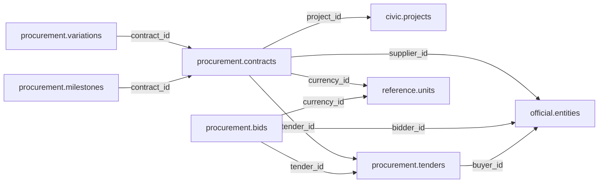

# procurement — Phase 01

> **Superseded on 12 November 2026.** Procurement is not a standalone database schema. Current tables are `civic.procurements`, `civic.bids`, `civic.contracts` and `civic.deliveries` in [Civic](civic.md). The historical proposal below is retained for context only and does not define current ownership or authorize SQL.

[Folder index](README.md) · [Full catalogue and relocation inventory](../../README.md)

## Agreed responsibility — 12 November 2026

Historical scope only: procurement lifecycle records are now owned by Civic; Finance remains a distinct schema.

Procurement is its own Phase 01 schema; Finance and Procurement are **not merged**. Cover tenders, bidders/bids, awards, contracts, amendments/variations and delivery obligations, preserving the distinct notice, decision, signing, amendment and delivery dates.

Suppliers and bidders link through Official; public funding through Finance; projects through Civic; evidence through Source and exact Filesystem versions; legal bases through Reference. The retained tender/bid/contract/milestone/variation proposals and older award concepts stay under review. Separate award decisions from signed contracts and delivery from payment; a contract award alone cannot prove completed work.

## Retained table proposals and review context

The following dictionaries preserve the earlier proposal inputs, adjusted for the agreed ownership above. They remain unapproved. Earlier inventories retain their measured names; collapsed historical sections do not override the 12 November decisions.

## Retained procurement proposal

> **PROPOSED — USER REVIEW REQUIRED.** Schema assignment is agreed; proposed tables and columns still require review. No SQL or migration is authorized.

## Purpose and ownership

**Target:** Main. **Purpose:** Public tenders, awards and contractual delivery. Schema placement follows the 12 November scope decision; individual table/column designs remain proposals. Related owners follow the agreed responsibility section above.

## Current implementation and gaps

The active manifest has 30 manifest migrations and 49 distinct CREATE TABLE declarations (49 distinct current table names) in schemas `audit`, `auth`, `engine`, `filesystem`, `geography`, `legal`, `objects`, `reference`. Generated Dryv has 124 entities (digest `e0087da9cf5b00e91f283a5501c368c7696bdd841ea30629231dc9c590f7c1ee`). Counts describe current artifacts, not target design; SQL and Dryv diverge.

- SQL declarations: None found.
- Dryv entities: `procurement.bids` (procurement.Bid), `procurement.milestones` (procurement.ContractMilestone), `procurement.variations` (procurement.ContractVariation), `procurement.contracts` (procurement.ProcurementContract), `procurement.tenders` (procurement.Tender)

The inventory does not establish live database state and may miss ALTER-only changes. Before implementation, reconcile migrations, Dryv, generated output and callers.

## Proposed relationship map

> All nodes and edges are proposals. Main schemas may use local cross-schema foreign keys; no edge crosses the Main/Operations database boundary.

## Proposed table and column review

All tables and fields are hypothetical. Every proposed business column is listed; UUIDv7 `id` is a candidate default and remains open. Record every existing field disposition: KEEP / REMOVE / RENAME / MOVE / MERGE / SPLIT / DERIVE / ADD.

### `procurement.tenders` — Published procurement opportunity

- **Example:** Road tender
- **Profile:** entity; planning envelope below.

| Column | Proposed type | Meaning | Nullable | Default | Relationship | Units / validation | Proposed disposition |
|---|---|---|---|---|---|---|---|
| `id` | `uuid` | Proposed stable identity | No | Rust UUIDv7 candidate | Primary key | UUIDv7 candidate; unique and immutable after publication | KEEP (candidate match to current SQL/Dryv field; confirm meaning) |
| `buyer_id` | `uuid` | Buyer | No | — | FK → `official.entities` | UUID syntax; FK target must exist when the relationship is required | ADD (proposed target field; pending user approval) |
| `code` | `text` | Official code | No | — | — | Nonblank when required; enforce domain-specific length, normalization and controlled vocabulary | KEEP (candidate match to current SQL/Dryv field; confirm meaning) |
| `title` | `text` | Requirement | No | — | — | Nonblank when required; enforce domain-specific length, normalization and controlled vocabulary | KEEP (candidate match to current SQL/Dryv field; confirm meaning) |
| `published_at` | `timestamptz` | Published time | No | — | — | Type checked; domain constraints and units must be approved for this field | ADD (proposed target field; pending user approval) |
| `closes_at` | `timestamptz` | Closing time | Yes | — | — | Type checked; domain constraints and units must be approved for this field | ADD (proposed target field; pending user approval) |

- **Current SQL/Dryv fields without a proposed same-name column:** `budget_id`, `closes_on`, `created_at`, `currency_code`, `estimated_value`, `is_current`, `issuing_unit_id`, `kind_id`, `legal_basis_id`, `method_id`, `procuring_office_id`, `published_on`, `status`, `updated_at`, `valid_from`, `valid_from_precision`, `valid_to`, `valid_to_precision`, `version`, `version_number`. **Disposition:** unresolved per field; propose KEEP, REMOVE, RENAME, MOVE, MERGE, SPLIT or DERIVE in review. Do not drop these fields until the user resolves each one.
- **FK action/cardinality:** Each non-null FK is many-to-one to its named target; nullable FKs are optional. Candidate delete/update behavior is RESTRICT/NO ACTION for accepted records; cascading canonical deletion is not proposed. Confirm uniqueness and exact behavior during review.
- **Constraints:** UNIQUE(buyer_id,code); closing >= publication. Exact keys and cross-field checks remain for review.
- **Indexes:** primary key on `id`; candidate B-tree indexes on FK columns `buyer_id` for joins and referenced-entity filters; add temporal/spatial indexes only where the stated query needs them and benchmarks support them.
- **Relationships:** resolve each FK target. Main allows cross-schema FKs. Main and Operations have no cross-database FK.
- **Evidence/time:** preserve exact source/version, observation/retrieval time, historical context and uncertainty where applicable. Approve the exact evidence path for this table.
- **Growth/storage estimate (illustrative planning envelope, not measured):** Low: initial 1,000, +200/year, peak 20/day; five-year 2,000 rows ≈ 2.0 MiB live row+index budget; Expected: initial 10,000, +2,000/year, peak 200/day; five-year 20,000 rows ≈ 19.5 MiB live row+index budget; High: initial 100,000, +20,000/year, peak 2,000/day; five-year 200,000 rows ≈ 195.3 MiB live row+index budget. Model: initial rows + annual accepted rows × 5; multiply by a per-row budget of 1 KiB including a coarse index allowance. Replace assumptions with actual samples, ingest rates and `pg_total_relation_size` before approval. Large object bytes are excluded; WAL, replicas, backups and S3 are budgeted separately.
- **Workload:** Interactive lookup by identity and approved foreign keys; batch scans for import/reconciliation. Peak-day figure above is a scenario assumption, not a service-level commitment.
- **Partitioning:** None proposed initially; decide from measured scale/query plans. Check late data and partition count.
- **Files:** originals, full-resolution geometry, arrays, media and large exports may be immutable S3 objects. Keep searchable identity, required facts, hashes, coverage, access and provenance in PostgreSQL; use manifests and selective reads.
- **Retention/risks/benchmark:** preserve accepted evidence and corrections. Review late arrivals, contention, index/partition growth and recovery. Benchmark joins, filters, spatial access, ingestion bursts, concurrent access and interrupted publication.
### `procurement.bids` — Published tender bids

- **Example:** Supplier bid
- **Profile:** relation; planning envelope below.

| Column | Proposed type | Meaning | Nullable | Default | Relationship | Units / validation | Proposed disposition |
|---|---|---|---|---|---|---|---|
| `id` | `uuid` | Proposed stable identity | No | Rust UUIDv7 candidate | Primary key | UUIDv7 candidate; unique and immutable after publication | KEEP (candidate match to current SQL/Dryv field; confirm meaning) |
| `tender_id` | `uuid` | Tender | No | — | FK → `procurement.tenders` | UUID syntax; FK target must exist when the relationship is required | KEEP (candidate match to current SQL/Dryv field; confirm meaning) |
| `bidder_id` | `uuid` | Bidder | No | — | FK → `official.entities` | UUID syntax; FK target must exist when the relationship is required | ADD (proposed target field; pending user approval) |
| `amount` | `numeric` | Bid value | Yes | — | — | Type checked; domain constraints and units must be approved for this field | KEEP (candidate match to current SQL/Dryv field; confirm meaning) |
| `currency_id` | `uuid` | Currency | Yes | — | FK → `reference.units` | UUID syntax; FK target must exist when the relationship is required | ADD (proposed target field; pending user approval) |

- **Current SQL/Dryv fields without a proposed same-name column:** `bidder_entity_id`, `created_at`, `currency_code`, `evaluation_note`, `is_compliant`, `is_current`, `status`, `submitted_on`, `updated_at`, `valid_from`, `valid_from_precision`, `valid_to`, `valid_to_precision`, `version`. **Disposition:** unresolved per field; propose KEEP, REMOVE, RENAME, MOVE, MERGE, SPLIT or DERIVE in review. Do not drop these fields until the user resolves each one.
- **FK action/cardinality:** Each non-null FK is many-to-one to its named target; nullable FKs are optional. Candidate delete/update behavior is RESTRICT/NO ACTION for accepted records; cascading canonical deletion is not proposed. Confirm uniqueness and exact behavior during review.
- **Constraints:** UNIQUE(tender_id,bidder_id,publication_id); amount/currency paired. Exact keys and cross-field checks remain for review.
- **Indexes:** primary key on `id`; candidate B-tree indexes on FK columns `tender_id`, `bidder_id`, `currency_id` for joins and referenced-entity filters; add temporal/spatial indexes only where the stated query needs them and benchmarks support them.
- **Relationships:** resolve each FK target. Main allows cross-schema FKs. Main and Operations have no cross-database FK.
- **Evidence/time:** preserve exact source/version, observation/retrieval time, historical context and uncertainty where applicable. Approve the exact evidence path for this table.
- **Growth/storage estimate (illustrative planning envelope, not measured):** Low: initial 1,000, +2,000/year, peak 100/day; five-year 11,000 rows ≈ 10.7 MiB live row+index budget; Expected: initial 10,000, +20,000/year, peak 1,000/day; five-year 110,000 rows ≈ 107.4 MiB live row+index budget; High: initial 100,000, +200,000/year, peak 10,000/day; five-year 1,100,000 rows ≈ 1,074.2 MiB live row+index budget. Model: initial rows + annual accepted rows × 5; multiply by a per-row budget of 1 KiB including a coarse index allowance. Replace assumptions with actual samples, ingest rates and `pg_total_relation_size` before approval. Large object bytes are excluded; WAL, replicas, backups and S3 are budgeted separately.
- **Workload:** Interactive lookup by identity and approved foreign keys; batch scans for import/reconciliation. Peak-day figure above is a scenario assumption, not a service-level commitment.
- **Partitioning:** None proposed initially; decide from measured scale/query plans. Check late data and partition count.
- **Files:** originals, full-resolution geometry, arrays, media and large exports may be immutable S3 objects. Keep searchable identity, required facts, hashes, coverage, access and provenance in PostgreSQL; use manifests and selective reads.
- **Retention/risks/benchmark:** preserve accepted evidence and corrections. Review late arrivals, contention, index/partition growth and recovery. Benchmark joins, filters, spatial access, ingestion bursts, concurrent access and interrupted publication.
### `procurement.contracts` — Awarded contract

- **Example:** Bridge contract
- **Profile:** entity; planning envelope below.

| Column | Proposed type | Meaning | Nullable | Default | Relationship | Units / validation | Proposed disposition |
|---|---|---|---|---|---|---|---|
| `id` | `uuid` | Proposed stable identity | No | Rust UUIDv7 candidate | Primary key | UUIDv7 candidate; unique and immutable after publication | KEEP (candidate match to current SQL/Dryv field; confirm meaning) |
| `tender_id` | `uuid` | Origin | No | — | FK → `procurement.tenders` | UUID syntax; FK target must exist when the relationship is required | KEEP (candidate match to current SQL/Dryv field; confirm meaning) |
| `supplier_id` | `uuid` | Supplier | No | — | FK → `official.entities` | UUID syntax; FK target must exist when the relationship is required | ADD (proposed target field; pending user approval) |
| `code` | `text` | Contract code | No | — | — | Nonblank when required; enforce domain-specific length, normalization and controlled vocabulary | KEEP (candidate match to current SQL/Dryv field; confirm meaning) |
| `signed_on` | `date` | Signature | Yes | — | — | Type checked; domain constraints and units must be approved for this field | ADD (proposed target field; pending user approval) |
| `amount` | `numeric` | Award value | No | — | — | Type checked; domain constraints and units must be approved for this field | ADD (proposed target field; pending user approval) |
| `currency_id` | `uuid` | Currency | No | — | FK → `reference.units` | UUID syntax; FK target must exist when the relationship is required | ADD (proposed target field; pending user approval) |
| `project_id` | `uuid` | Project | Yes | — | FK → `civic.projects` | UUID syntax; FK target must exist when the relationship is required | ADD (proposed target field; pending user approval) |

- **Current SQL/Dryv fields without a proposed same-name column:** `awarded_entity_id`, `awarded_on`, `contracting_office_id`, `contracting_unit_id`, `created_at`, `currency_code`, `is_current`, `status`, `updated_at`, `valid_from`, `valid_from_precision`, `valid_to`, `valid_to_precision`, `value`, `version`. **Disposition:** unresolved per field; propose KEEP, REMOVE, RENAME, MOVE, MERGE, SPLIT or DERIVE in review. Do not drop these fields until the user resolves each one.
- **FK action/cardinality:** Each non-null FK is many-to-one to its named target; nullable FKs are optional. Candidate delete/update behavior is RESTRICT/NO ACTION for accepted records; cascading canonical deletion is not proposed. Confirm uniqueness and exact behavior during review.
- **Constraints:** UNIQUE(tender_id,code); amount >= 0. Exact keys and cross-field checks remain for review.
- **Indexes:** primary key on `id`; candidate B-tree indexes on FK columns `tender_id`, `supplier_id`, `currency_id`, `project_id` for joins and referenced-entity filters; add temporal/spatial indexes only where the stated query needs them and benchmarks support them.
- **Relationships:** resolve each FK target. Main allows cross-schema FKs. Main and Operations have no cross-database FK.
- **Evidence/time:** preserve exact source/version, observation/retrieval time, historical context and uncertainty where applicable. Approve the exact evidence path for this table.
- **Growth/storage estimate (illustrative planning envelope, not measured):** Low: initial 1,000, +200/year, peak 20/day; five-year 2,000 rows ≈ 2.0 MiB live row+index budget; Expected: initial 10,000, +2,000/year, peak 200/day; five-year 20,000 rows ≈ 19.5 MiB live row+index budget; High: initial 100,000, +20,000/year, peak 2,000/day; five-year 200,000 rows ≈ 195.3 MiB live row+index budget. Model: initial rows + annual accepted rows × 5; multiply by a per-row budget of 1 KiB including a coarse index allowance. Replace assumptions with actual samples, ingest rates and `pg_total_relation_size` before approval. Large object bytes are excluded; WAL, replicas, backups and S3 are budgeted separately.
- **Workload:** Interactive lookup by identity and approved foreign keys; batch scans for import/reconciliation. Peak-day figure above is a scenario assumption, not a service-level commitment.
- **Partitioning:** None proposed initially; decide from measured scale/query plans. Check late data and partition count.
- **Files:** originals, full-resolution geometry, arrays, media and large exports may be immutable S3 objects. Keep searchable identity, required facts, hashes, coverage, access and provenance in PostgreSQL; use manifests and selective reads.
- **Retention/risks/benchmark:** preserve accepted evidence and corrections. Review late arrivals, contention, index/partition growth and recovery. Benchmark joins, filters, spatial access, ingestion bursts, concurrent access and interrupted publication.
### `procurement.milestones` — Contractual delivery obligations

- **Example:** Road completion milestone
- **Profile:** relation; planning envelope below.

| Column | Proposed type | Meaning | Nullable | Default | Relationship | Units / validation | Proposed disposition |
|---|---|---|---|---|---|---|---|
| `id` | `uuid` | Proposed stable identity | No | Rust UUIDv7 candidate | Primary key | UUIDv7 candidate; unique and immutable after publication | KEEP (candidate match to current SQL/Dryv field; confirm meaning) |
| `contract_id` | `uuid` | Contract | No | — | FK → `procurement.contracts` | UUID syntax; FK target must exist when the relationship is required | KEEP (candidate match to current SQL/Dryv field; confirm meaning) |
| `title` | `text` | Deliverable | No | — | — | Nonblank when required; enforce domain-specific length, normalization and controlled vocabulary | KEEP (candidate match to current SQL/Dryv field; confirm meaning) |
| `due_on` | `date` | Due | Yes | — | — | Type checked; domain constraints and units must be approved for this field | KEEP (candidate match to current SQL/Dryv field; confirm meaning) |
| `completed_on` | `date` | Verified completion | Yes | — | — | Type checked; domain constraints and units must be approved for this field | KEEP (candidate match to current SQL/Dryv field; confirm meaning) |

- **Current SQL/Dryv fields without a proposed same-name column:** `amount`, `created_at`, `currency_code`, `is_current`, `updated_at`, `valid_from`, `valid_from_precision`, `valid_to`, `valid_to_precision`, `version`. **Disposition:** unresolved per field; propose KEEP, REMOVE, RENAME, MOVE, MERGE, SPLIT or DERIVE in review. Do not drop these fields until the user resolves each one.
- **FK action/cardinality:** Each non-null FK is many-to-one to its named target; nullable FKs are optional. Candidate delete/update behavior is RESTRICT/NO ACTION for accepted records; cascading canonical deletion is not proposed. Confirm uniqueness and exact behavior during review.
- **Constraints:** Completion evidence required. Exact keys and cross-field checks remain for review.
- **Indexes:** primary key on `id`; candidate B-tree indexes on FK columns `contract_id` for joins and referenced-entity filters; add temporal/spatial indexes only where the stated query needs them and benchmarks support them.
- **Relationships:** resolve each FK target. Main allows cross-schema FKs. Main and Operations have no cross-database FK.
- **Evidence/time:** preserve exact source/version, observation/retrieval time, historical context and uncertainty where applicable. Approve the exact evidence path for this table.
- **Growth/storage estimate (illustrative planning envelope, not measured):** Low: initial 1,000, +2,000/year, peak 100/day; five-year 11,000 rows ≈ 10.7 MiB live row+index budget; Expected: initial 10,000, +20,000/year, peak 1,000/day; five-year 110,000 rows ≈ 107.4 MiB live row+index budget; High: initial 100,000, +200,000/year, peak 10,000/day; five-year 1,100,000 rows ≈ 1,074.2 MiB live row+index budget. Model: initial rows + annual accepted rows × 5; multiply by a per-row budget of 1 KiB including a coarse index allowance. Replace assumptions with actual samples, ingest rates and `pg_total_relation_size` before approval. Large object bytes are excluded; WAL, replicas, backups and S3 are budgeted separately.
- **Workload:** Interactive lookup by identity and approved foreign keys; batch scans for import/reconciliation. Peak-day figure above is a scenario assumption, not a service-level commitment.
- **Partitioning:** None proposed initially; decide from measured scale/query plans. Check late data and partition count.
- **Files:** originals, full-resolution geometry, arrays, media and large exports may be immutable S3 objects. Keep searchable identity, required facts, hashes, coverage, access and provenance in PostgreSQL; use manifests and selective reads.
- **Retention/risks/benchmark:** preserve accepted evidence and corrections. Review late arrivals, contention, index/partition growth and recovery. Benchmark joins, filters, spatial access, ingestion bursts, concurrent access and interrupted publication.
### `procurement.variations` — Authorized changes to contract

- **Example:** Cost variation
- **Profile:** relation; planning envelope below.

| Column | Proposed type | Meaning | Nullable | Default | Relationship | Units / validation | Proposed disposition |
|---|---|---|---|---|---|---|---|
| `id` | `uuid` | Proposed stable identity | No | Rust UUIDv7 candidate | Primary key | UUIDv7 candidate; unique and immutable after publication | KEEP (candidate match to current SQL/Dryv field; confirm meaning) |
| `contract_id` | `uuid` | Contract | No | — | FK → `procurement.contracts` | UUID syntax; FK target must exist when the relationship is required | KEEP (candidate match to current SQL/Dryv field; confirm meaning) |
| `authorized_on` | `date` | Approval date | No | — | — | Type checked; domain constraints and units must be approved for this field | ADD (proposed target field; pending user approval) |
| `amount_change` | `numeric` | Signed adjustment | No | — | — | Type checked; domain constraints and units must be approved for this field | KEEP (candidate match to current SQL/Dryv field; confirm meaning) |
| `reason` | `text` | Documented reason | No | — | — | Nonblank when required; enforce domain-specific length, normalization and controlled vocabulary | KEEP (candidate match to current SQL/Dryv field; confirm meaning) |

- **Current SQL/Dryv fields without a proposed same-name column:** `approved_on`, `created_at`, `currency_code`, `is_current`, `updated_at`, `valid_from`, `valid_from_precision`, `valid_to`, `valid_to_precision`, `version`. **Disposition:** unresolved per field; propose KEEP, REMOVE, RENAME, MOVE, MERGE, SPLIT or DERIVE in review. Do not drop these fields until the user resolves each one.
- **FK action/cardinality:** Each non-null FK is many-to-one to its named target; nullable FKs are optional. Candidate delete/update behavior is RESTRICT/NO ACTION for accepted records; cascading canonical deletion is not proposed. Confirm uniqueness and exact behavior during review.
- **Constraints:** Retain original award and derive current total. Exact keys and cross-field checks remain for review.
- **Indexes:** primary key on `id`; candidate B-tree indexes on FK columns `contract_id` for joins and referenced-entity filters; add temporal/spatial indexes only where the stated query needs them and benchmarks support them.
- **Relationships:** resolve each FK target. Main allows cross-schema FKs. Main and Operations have no cross-database FK.
- **Evidence/time:** preserve exact source/version, observation/retrieval time, historical context and uncertainty where applicable. Approve the exact evidence path for this table.
- **Growth/storage estimate (illustrative planning envelope, not measured):** Low: initial 1,000, +2,000/year, peak 100/day; five-year 11,000 rows ≈ 10.7 MiB live row+index budget; Expected: initial 10,000, +20,000/year, peak 1,000/day; five-year 110,000 rows ≈ 107.4 MiB live row+index budget; High: initial 100,000, +200,000/year, peak 10,000/day; five-year 1,100,000 rows ≈ 1,074.2 MiB live row+index budget. Model: initial rows + annual accepted rows × 5; multiply by a per-row budget of 1 KiB including a coarse index allowance. Replace assumptions with actual samples, ingest rates and `pg_total_relation_size` before approval. Large object bytes are excluded; WAL, replicas, backups and S3 are budgeted separately.
- **Workload:** Interactive lookup by identity and approved foreign keys; batch scans for import/reconciliation. Peak-day figure above is a scenario assumption, not a service-level commitment.
- **Partitioning:** None proposed initially; decide from measured scale/query plans. Check late data and partition count.
- **Files:** originals, full-resolution geometry, arrays, media and large exports may be immutable S3 objects. Keep searchable identity, required facts, hashes, coverage, access and provenance in PostgreSQL; use manifests and selective reads.
- **Retention/risks/benchmark:** preserve accepted evidence and corrections. Review late arrivals, contention, index/partition growth and recovery. Benchmark joins, filters, spatial access, ingestion bursts, concurrent access and interrupted publication.

## Queries, lifecycle, capacity and approval

**Representative query:** Who received a contract and what was delivered?

Lifecycle: preserve source bytes; extract into candidate revisions; validate; review or use approved deterministic checks; atomically publish; serve. Corrections create explicit versions/supersession. Preserve disagreement and uncertainty.

Capacity is unmeasured. Use low/expected/high input scenarios, explicit formulas and workload benchmarks; do not assume sizes or universal partitions.

**Status:** NOT REVIEWED. Schema assignment follows the handoff; tables, columns, relationships, partitioning and S3 choices still require user approval. Feedback: none. Approval reference/date/revision: none. Implementation authorization: not granted. Material changes reopen approval.

Earlier schema proposal preserved for history; superseded and not an approval

---
id: DOC-8F3C5B62DE19
name: Procurement domain schema redesign
type: documentation
tags: [improvements, schema-redesign, procurement, parties, geography, planning]
extra: {status: planning_only, design: explicitly_unapproved}
---

# Procurement — procuring entities, bidders, suppliers, awards and contract geography

**PLANNING ONLY. IMPORTANT: The user specifically withheld approval of the suggested procurement party/table design and wants further discussion.**

## User's problem and initial direction

Existing Kenya PPIP/e-GP and OCDS-style procurement data contain procuring entities and suppliers that are not consistently linked to MZIZI's canonical institutions/organizations and appropriate geographic units. The user wants true queryable links and better contract data, including contract type, responsible parties, values, dates and implementation information. They leaned toward canonical `organization.entities` for both procuring entities and suppliers, with `procurement` representing their participation and transactions, **but also suggested straightforward direct procurer/supplier FK columns and asked for tradeoff evaluation**.

Do not equate procuring authority, buyer, finance unit, contracting office, bidder, awardee, supplier, subcontractor, headquarters, registered country and delivery/project location. The organization legally registered in Nairobi may supply a contract delivered elsewhere. A ministry's legally national scope does not mean its HQ or a construction site is nationwide.

## Five active tables: preserve and examine their real fields

| Existing table | Review focus |
|---|---|
| `procurement.tenders` | Issuer/procurer, official ref code, tender version, method/type, publication/closing dates, price estimate and applicable legal/financial rules. |
| `procurement.bids` | Bidder canonical organization, tender FK, offer amounts/currency, submission time, bid validity, stage/status and evidence. |
| `procurement.contracts` | Awarded legal entity, contracting finance unit/office, tender link, contract type, signed/effective/end dates, original/current amount, status and valid history. |
| `procurement.milestones` | Expected deliveries, due dates, completion evidence, actual performance and delays. |
| `procurement.variations` | Price/scope/term/date amendments, actor, approval basis, difference from prior contract version. |

**Verified examples from current model:** `tenders.issuing_unit_id`, optionally `procuring_office_id`; `bids.bidder_entity_id`; `contracts.awarded_entity_id`, `contracting_unit_id` and optionally `contracting_office_id`. Audit every other current TypeORM field (including late tender-version migration) before final column decisions. Avoid duplicating canonical organizations in procurement-specific entity tables.

### Candidates to debate, NOT approved

| Potential table | Why it may be needed | Alternative |
|---|---|---|
| `processes` | One procurement lifecycle can include multiple notices, awards and contracts; common official stable ID such as OCID. | Existing tender could own lifecycle if 1:1 and real sources justify it. |
| `awards` | Award decisions may precede contracts or cover multiple recipients; distinct value/date/status. | Award fields embedded in contract only when consistently 1:1. |
| `parties` | Multi-role/multi-organization association to process, award and contract. | Explicit direct buyer/procurer/supplier columns for truly singular roles. |
| `items` | Goods/works/services, quantities/classification. | Use tender/contract line items only if needed by source data. |
| `locations` | Multiple project/delivery geographic sites distinct from supplier HQ. | A singular project geo FK when one delivery area is reliably established. |

**Assistant recommendation pending user review:** A *hybrid* of direct FKs for genuinely singular common roles and FK-backed participant junction tables for multiple bidders, suppliers or contracting parties. Never mark this architecture approved simply because it is proposed here.

## Legal, geographic, financial and identity references

Require proper cross-schema FKs to `organization.entities` for procuring/supplying/bidding identities, `governance.institutions/offices` for public authority roles, `finance.units` for budgetary liability, `geography.units/places` for contract implementation, and `legal` rule/provision when relevant. Distinguish registration location, HQ, buyer country, geographic beneficiary and contract delivery location. Match PPIP identifiers through `organization.identifiers` with verified issuer/scheme/value, not names alone.

Geographic resolution order: (1) authoritative explicitly given unit/site; (2) independently verified institutional relationships; (3) candidate inference requiring review; (4) unresolved instead of fabricated county. Preserve separate evidence for buyer identity and supplier address. Link publication and documents through `source` and `filesystem`; source bytes are not contract table fields.

## Acquisition and pattern eligibility

- **1A:** verified registries of public procuring entities, official procurement methods/classes and institutional identities.
- **1B:** legally expected procuring units or recurring procurement reporting structures, not imaginary tenders or awards.
- **2A:** official notices, bids, award publications, contracts, variation notices, supplier identifiers and delivery sites.
- **2B:** bidder competition, contract value changes, spend by county/sector/issuer and performance ratios with documented methods.

Use content hashes, portal IDs, stable aliases, dated records, reviewed conflicts and source links. Reprocessing an unchanged contract notice should not create a duplicate record; corrected contract data need supersession history.

## Grounded implementation starting points and risks

The repository importer `.docs/_archives/2026-11-08-rewrite-snapshot/source/backend/engine/data/src/mzizi_data/imports/procurement.py` already stages procuring entities and organizations, optional official county data, tender and contracts. Audit exactly when it writes the organization's geo_unit_id, the source address and the procuring unit's service scope; previous code risks conflating location and country. Compare portal outputs to canonical target relationships and hard FKs, then plan non-destructive reconciliation, not silent reseeding.

Test: Same supplier bidding for contracts in different counties, joint award recipients, national procurer with local contract site, contract variation to date/value, explicit winning vs losing bidders, and provenance-based correction of a wrongly assigned county.

## Decisions explicitly reserved to the user

1. Should each tender/contract have direct `procuring_entity_id`/`supplier_id` columns, a party association table, or both? **NOT APPROVED.**
2. Exactly which contract types, dates, money fields, legal classifications and statuses are required?
3. Distinct procurement process, award, contract and tender identity: which tables are necessary?
4. How to represent multiple suppliers, subcontractors, joint ventures and multiple delivery geographies?
5. PPIP/e-GP/OCDS source mapping and institution-vs-budget-unit role separation?
6. Which automatic matching/correction thresholds and supporting evidence are acceptable?

**References:** [Master register](../../../guides/mzizi-data-schema-storage-and-pipelines-redesign.md) · [Organization](official.md) · [Finance](finance.md) · [Geography](geography.md).

## Human review — editable user notes and design sign-off

**Review status:** `NOT REVIEWED` — AI-authored proposals in this document are not final approval.

**In my own words, what this schema should represent and exclude:**

> _My understanding and questions:_

**Tables/columns I want to keep, rename, move, merge, split, remove or add (and why):**

> _My proposed changes and alternative names:_

**Hard foreign keys, geographical and legal scope, pattern generation, classification and evidence I want changed or explained:**

> _My technical feedback, disagreements and alternatives:_

**Real data and queries I want to use to validate this design:**

> _My examples and expected results:_

**Unresolved decisions I want to discuss further:**

> _My remaining questions:_

**Final user decision:** `NOT DECIDED` / `NEEDS CHANGES` / `DESIGN VALIDATED BY USER` / `APPROVED FOR TASK PLANNING`.

**Approval reference and date:** _None. Only record explicit later user authorization. Even design validation does not authorize code, migration or Taskcode task creation._

## Mandatory per-table temporal, rigid-column and deletion review (2026-11-07)

**USER REQUIREMENT; planning only.** Examine every existing/proposed field and expressly record **KEEP / REMOVE / DERIVE / MOVE / RENAME / ADD** for `valid_from`, `valid_to`, `valid_from_precision`, `valid_to_precision`, `is_current`, `status`, `version`, `created_at`, `updated_at` and other copied/rigid flags. These fields are **opt-in by justified meaning**, not blanket schema conventions. Assess `deleted_at` only for recoverable soft deletion where appropriate. The full policy and migration/approval checklist is in [schema redesign README](../../README.md).

**Domain-specific guidance:** Tenders need publication/closing deadlines; bids submission dates; contracts signing/effectiveness/end dates; milestones due/completed dates; variations amendment dates. Generic validity cannot represent these different legal events. Official historical transactions require version/supersession, not is_current or soft-delete. Drafts may justify recoverable deletion if explicitly modeled.

**OPEN for human review:** exact per-table/column disposition, derived status and as-of queries, pattern/legal links, justified precision, recoverable deletion versus domain lifecycle, history/identity preservation and hard-FK impact. No code or migration is authorized.

## 2026-11-11 — System-expansion alignment

Procurement remains the purchasing process owner. Economic market/product facts and Civic infrastructure assets may be linked but are not duplicate procurement records. See the [system-expansion proposal](../../../guides/advancement-and-system-expansion.md). This alignment note does not approve proposed schemas, tables or implementation.

