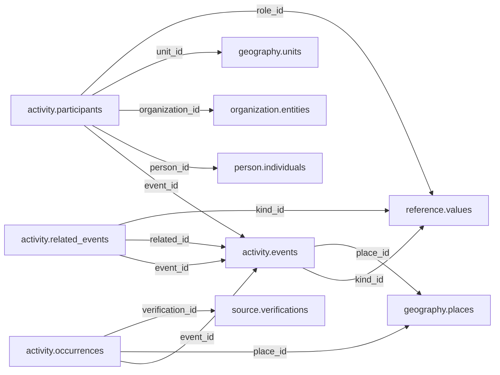

# activity — Phase 02

> **DEFERRED AND UNAPPROVED.** Retained for complete inventory only. Moving this proposal here does not approve it, start planning, or authorize table redesign or implementation. Older review/approval wording below is historical; this status controls.

See [Phase 02](README.md) and [the catalogue](../../README.md). References to the former Person/Organization, Political/Electoral and Participation names in the retained proposal mean historical inputs now organized under Official, Politics and Accountability. Direct domain-to-Legal links in this deferred material are not current contracts; any future review must follow Reference mediation.

## Retained proposal — unchanged design

# activity schema — review and approval proposal

> **PROPOSED — USER REVIEW REQUIRED.** This is the review authority for whether the schema should exist and which tables/columns it owns. No SQL or migration is authorized.

## Purpose and ownership

**Target:** Main. **Purpose:** Verified real events and public actions. This separate schema is a proposal based on distinct lifecycle, vocabulary and queries; merging or rejection remains open. Related owners: history,electoral,governance.

## Current implementation and gaps

The active manifest has 30 manifest migrations and 49 distinct CREATE TABLE declarations (49 distinct current table names) in schemas `audit`, `auth`, `engine`, `filesystem`, `geography`, `legal`, `objects`, `reference`. Generated Dryv has 124 entities (digest `e0087da9cf5b00e91f283a5501c368c7696bdd841ea30629231dc9c590f7c1ee`). Counts describe current artifacts, not target design; SQL and Dryv diverge.

- SQL declarations: None found.
- Dryv entities: None found.

The inventory does not establish live database state and may miss ALTER-only changes. Before implementation, reconcile migrations, Dryv, generated output and callers.

## Proposed relationship map

> All nodes and edges are proposals. Main schemas may use local cross-schema foreign keys; no edge crosses the Main/Operations database boundary.

## Proposed table and column review

All tables and fields are hypothetical. Every proposed business column is listed; UUIDv7 `id` is a candidate default and remains open. Record every existing field disposition: KEEP / REMOVE / RENAME / MOVE / MERGE / SPLIT / DERIVE / ADD.

### `activity.events` — Sourced real event identity

- **Example:** Public parliamentary sitting
- **Profile:** entity; planning envelope below.

| Column | Proposed type | Meaning | Nullable | Default | Relationship | Units / validation | Proposed disposition |
|---|---|---|---|---|---|---|---|
| `id` | `uuid` | Proposed stable identity | No | Rust UUIDv7 candidate | Primary key | UUIDv7 candidate; unique and immutable after publication | ADD (proposed target field; pending user approval) |
| `title` | `text` | Event label | No | — | — | Nonblank when required; enforce domain-specific length, normalization and controlled vocabulary | ADD (proposed target field; pending user approval) |
| `kind_id` | `uuid` | Event kind | No | — | FK → `reference.values` | UUID syntax; FK target must exist when the relationship is required | ADD (proposed target field; pending user approval) |
| `occurred_from` | `timestamptz` | Start | Yes | — | — | Type checked; domain constraints and units must be approved for this field | ADD (proposed target field; pending user approval) |
| `occurred_to` | `timestamptz` | End | Yes | — | — | Type checked; domain constraints and units must be approved for this field | ADD (proposed target field; pending user approval) |
| `date_note` | `text` | Date uncertainty | Yes | — | — | Nonblank when required; enforce domain-specific length, normalization and controlled vocabulary | ADD (proposed target field; pending user approval) |
| `place_id` | `uuid` | Specific place | Yes | — | FK → `geography.places` | UUID syntax; FK target must exist when the relationship is required | ADD (proposed target field; pending user approval) |

- **FK action/cardinality:** Each non-null FK is many-to-one to its named target; nullable FKs are optional. Candidate delete/update behavior is RESTRICT/NO ACTION for accepted records; cascading canonical deletion is not proposed. Confirm uniqueness and exact behavior during review.
- **Constraints:** End >= start; schedule alone is not occurrence. Exact keys and cross-field checks remain for review.
- **Indexes:** primary key on `id`; candidate B-tree indexes on FK columns `kind_id`, `place_id` for joins and referenced-entity filters; add temporal/spatial indexes only where the stated query needs them and benchmarks support them.
- **Relationships:** resolve each FK target. Main allows cross-schema FKs. Main and Operations have no cross-database FK.
- **Evidence/time:** preserve exact source/version, observation/retrieval time, historical context and uncertainty where applicable. Approve the exact evidence path for this table.
- **Growth/storage estimate (illustrative planning envelope, not measured):** Low: initial 1,000, +200/year, peak 20/day; five-year 2,000 rows ≈ 2.0 MiB live row+index budget; Expected: initial 10,000, +2,000/year, peak 200/day; five-year 20,000 rows ≈ 19.5 MiB live row+index budget; High: initial 100,000, +20,000/year, peak 2,000/day; five-year 200,000 rows ≈ 195.3 MiB live row+index budget. Model: initial rows + annual accepted rows × 5; multiply by a per-row budget of 1 KiB including a coarse index allowance. Replace assumptions with actual samples, ingest rates and `pg_total_relation_size` before approval. Large object bytes are excluded; WAL, replicas, backups and S3 are budgeted separately.
- **Workload:** Interactive lookup by identity and approved foreign keys; batch scans for import/reconciliation. Peak-day figure above is a scenario assumption, not a service-level commitment.
- **Partitioning:** None proposed initially; decide from measured scale/query plans. Check late data and partition count.
- **Files:** originals, full-resolution geometry, arrays, media and large exports may be immutable S3 objects. Keep searchable identity, required facts, hashes, coverage, access and provenance in PostgreSQL; use manifests and selective reads.
- **Retention/risks/benchmark:** preserve accepted evidence and corrections. Review late arrivals, contention, index/partition growth and recovery. Benchmark joins, filters, spatial access, ingestion bursts, concurrent access and interrupted publication.
### `activity.participants` — Typed event participants

- **Example:** Agency announced public action
- **Profile:** relation; planning envelope below.

| Column | Proposed type | Meaning | Nullable | Default | Relationship | Units / validation | Proposed disposition |
|---|---|---|---|---|---|---|---|
| `id` | `uuid` | Proposed stable identity | No | Rust UUIDv7 candidate | Primary key | UUIDv7 candidate; unique and immutable after publication | ADD (proposed target field; pending user approval) |
| `event_id` | `uuid` | Event | No | — | FK → `activity.events` | UUID syntax; FK target must exist when the relationship is required | ADD (proposed target field; pending user approval) |
| `person_id` | `uuid` | Person | Yes | — | FK → `person.individuals` | UUID syntax; FK target must exist when the relationship is required | ADD (proposed target field; pending user approval) |
| `organization_id` | `uuid` | Organization | Yes | — | FK → `organization.entities` | UUID syntax; FK target must exist when the relationship is required | ADD (proposed target field; pending user approval) |
| `unit_id` | `uuid` | Area | Yes | — | FK → `geography.units` | UUID syntax; FK target must exist when the relationship is required | ADD (proposed target field; pending user approval) |
| `role_id` | `uuid` | Role | No | — | FK → `reference.values` | UUID syntax; FK target must exist when the relationship is required | ADD (proposed target field; pending user approval) |

- **FK action/cardinality:** Each non-null FK is many-to-one to its named target; nullable FKs are optional. Candidate delete/update behavior is RESTRICT/NO ACTION for accepted records; cascading canonical deletion is not proposed. Confirm uniqueness and exact behavior during review.
- **Constraints:** Exactly one typed subject; specialized join tables may be required by integrity review. Exact keys and cross-field checks remain for review.
- **Indexes:** primary key on `id`; candidate B-tree indexes on FK columns `event_id`, `person_id`, `organization_id`, `unit_id`, `role_id` for joins and referenced-entity filters; add temporal/spatial indexes only where the stated query needs them and benchmarks support them.
- **Relationships:** resolve each FK target. Main allows cross-schema FKs. Main and Operations have no cross-database FK.
- **Evidence/time:** preserve exact source/version, observation/retrieval time, historical context and uncertainty where applicable. Approve the exact evidence path for this table.
- **Growth/storage estimate (illustrative planning envelope, not measured):** Low: initial 1,000, +2,000/year, peak 100/day; five-year 11,000 rows ≈ 10.7 MiB live row+index budget; Expected: initial 10,000, +20,000/year, peak 1,000/day; five-year 110,000 rows ≈ 107.4 MiB live row+index budget; High: initial 100,000, +200,000/year, peak 10,000/day; five-year 1,100,000 rows ≈ 1,074.2 MiB live row+index budget. Model: initial rows + annual accepted rows × 5; multiply by a per-row budget of 1 KiB including a coarse index allowance. Replace assumptions with actual samples, ingest rates and `pg_total_relation_size` before approval. Large object bytes are excluded; WAL, replicas, backups and S3 are budgeted separately.
- **Workload:** Interactive lookup by identity and approved foreign keys; batch scans for import/reconciliation. Peak-day figure above is a scenario assumption, not a service-level commitment.
- **Partitioning:** None proposed initially; decide from measured scale/query plans. Check late data and partition count.
- **Files:** originals, full-resolution geometry, arrays, media and large exports may be immutable S3 objects. Keep searchable identity, required facts, hashes, coverage, access and provenance in PostgreSQL; use manifests and selective reads.
- **Retention/risks/benchmark:** preserve accepted evidence and corrections. Review late arrivals, contention, index/partition growth and recovery. Benchmark joins, filters, spatial access, ingestion bursts, concurrent access and interrupted publication.
### `activity.related_events` — Event-to-event relationship

- **Example:** Protest followed decision
- **Profile:** relation; planning envelope below.

| Column | Proposed type | Meaning | Nullable | Default | Relationship | Units / validation | Proposed disposition |
|---|---|---|---|---|---|---|---|
| `id` | `uuid` | Proposed stable identity | No | Rust UUIDv7 candidate | Primary key | UUIDv7 candidate; unique and immutable after publication | ADD (proposed target field; pending user approval) |
| `event_id` | `uuid` | Event | No | — | FK → `activity.events` | UUID syntax; FK target must exist when the relationship is required | ADD (proposed target field; pending user approval) |
| `related_id` | `uuid` | Related event | No | — | FK → `activity.events` | UUID syntax; FK target must exist when the relationship is required | ADD (proposed target field; pending user approval) |
| `kind_id` | `uuid` | Relation | No | — | FK → `reference.values` | UUID syntax; FK target must exist when the relationship is required | ADD (proposed target field; pending user approval) |
| `description` | `text` | Context | Yes | — | — | Nonblank when required; enforce domain-specific length, normalization and controlled vocabulary | ADD (proposed target field; pending user approval) |

- **FK action/cardinality:** Each non-null FK is many-to-one to its named target; nullable FKs are optional. Candidate delete/update behavior is RESTRICT/NO ACTION for accepted records; cascading canonical deletion is not proposed. Confirm uniqueness and exact behavior during review.
- **Constraints:** No self edge; cycle policy by relation kind. Exact keys and cross-field checks remain for review.
- **Indexes:** primary key on `id`; candidate B-tree indexes on FK columns `event_id`, `related_id`, `kind_id` for joins and referenced-entity filters; add temporal/spatial indexes only where the stated query needs them and benchmarks support them.
- **Relationships:** resolve each FK target. Main allows cross-schema FKs. Main and Operations have no cross-database FK.
- **Evidence/time:** preserve exact source/version, observation/retrieval time, historical context and uncertainty where applicable. Approve the exact evidence path for this table.
- **Growth/storage estimate (illustrative planning envelope, not measured):** Low: initial 1,000, +2,000/year, peak 100/day; five-year 11,000 rows ≈ 10.7 MiB live row+index budget; Expected: initial 10,000, +20,000/year, peak 1,000/day; five-year 110,000 rows ≈ 107.4 MiB live row+index budget; High: initial 100,000, +200,000/year, peak 10,000/day; five-year 1,100,000 rows ≈ 1,074.2 MiB live row+index budget. Model: initial rows + annual accepted rows × 5; multiply by a per-row budget of 1 KiB including a coarse index allowance. Replace assumptions with actual samples, ingest rates and `pg_total_relation_size` before approval. Large object bytes are excluded; WAL, replicas, backups and S3 are budgeted separately.
- **Workload:** Interactive lookup by identity and approved foreign keys; batch scans for import/reconciliation. Peak-day figure above is a scenario assumption, not a service-level commitment.
- **Partitioning:** None proposed initially; decide from measured scale/query plans. Check late data and partition count.
- **Files:** originals, full-resolution geometry, arrays, media and large exports may be immutable S3 objects. Keep searchable identity, required facts, hashes, coverage, access and provenance in PostgreSQL; use manifests and selective reads.
- **Retention/risks/benchmark:** preserve accepted evidence and corrections. Review late arrivals, contention, index/partition growth and recovery. Benchmark joins, filters, spatial access, ingestion bursts, concurrent access and interrupted publication.
### `activity.occurrences` — Verified realization of announced event

- **Example:** Hearing held
- **Profile:** relation; planning envelope below.

| Column | Proposed type | Meaning | Nullable | Default | Relationship | Units / validation | Proposed disposition |
|---|---|---|---|---|---|---|---|
| `id` | `uuid` | Proposed stable identity | No | Rust UUIDv7 candidate | Primary key | UUIDv7 candidate; unique and immutable after publication | ADD (proposed target field; pending user approval) |
| `event_id` | `uuid` | Event | No | — | FK → `activity.events` | UUID syntax; FK target must exist when the relationship is required | ADD (proposed target field; pending user approval) |
| `occurred_at` | `timestamptz` | Verified time | No | — | — | Type checked; domain constraints and units must be approved for this field | ADD (proposed target field; pending user approval) |
| `place_id` | `uuid` | Actual place | Yes | — | FK → `geography.places` | UUID syntax; FK target must exist when the relationship is required | ADD (proposed target field; pending user approval) |
| `verification_id` | `uuid` | Review reference | No | — | FK → `source.verifications` | UUID syntax; FK target must exist when the relationship is required | ADD (proposed target field; pending user approval) |

- **FK action/cardinality:** Each non-null FK is many-to-one to its named target; nullable FKs are optional. Candidate delete/update behavior is RESTRICT/NO ACTION for accepted records; cascading canonical deletion is not proposed. Confirm uniqueness and exact behavior during review.
- **Constraints:** Only completed/cancelled/rescheduled states after evidence review. Exact keys and cross-field checks remain for review.
- **Indexes:** primary key on `id`; candidate B-tree indexes on FK columns `event_id`, `place_id`, `verification_id` for joins and referenced-entity filters; add temporal/spatial indexes only where the stated query needs them and benchmarks support them.
- **Relationships:** resolve each FK target. Main allows cross-schema FKs. Main and Operations have no cross-database FK.
- **Evidence/time:** preserve exact source/version, observation/retrieval time, historical context and uncertainty where applicable. Approve the exact evidence path for this table.
- **Growth/storage estimate (illustrative planning envelope, not measured):** Low: initial 1,000, +2,000/year, peak 100/day; five-year 11,000 rows ≈ 10.7 MiB live row+index budget; Expected: initial 10,000, +20,000/year, peak 1,000/day; five-year 110,000 rows ≈ 107.4 MiB live row+index budget; High: initial 100,000, +200,000/year, peak 10,000/day; five-year 1,100,000 rows ≈ 1,074.2 MiB live row+index budget. Model: initial rows + annual accepted rows × 5; multiply by a per-row budget of 1 KiB including a coarse index allowance. Replace assumptions with actual samples, ingest rates and `pg_total_relation_size` before approval. Large object bytes are excluded; WAL, replicas, backups and S3 are budgeted separately.
- **Workload:** Interactive lookup by identity and approved foreign keys; batch scans for import/reconciliation. Peak-day figure above is a scenario assumption, not a service-level commitment.
- **Partitioning:** None proposed initially; decide from measured scale/query plans. Check late data and partition count.
- **Files:** originals, full-resolution geometry, arrays, media and large exports may be immutable S3 objects. Keep searchable identity, required facts, hashes, coverage, access and provenance in PostgreSQL; use manifests and selective reads.
- **Retention/risks/benchmark:** preserve accepted evidence and corrections. Review late arrivals, contention, index/partition growth and recovery. Benchmark joins, filters, spatial access, ingestion bursts, concurrent access and interrupted publication.

## Queries, lifecycle, capacity and approval

**Representative query:** What happened, where, when and according to which source?

Lifecycle: preserve source bytes; extract into candidate revisions; validate; review or use approved deterministic checks; atomically publish; serve. Corrections create explicit versions/supersession. Preserve disagreement and uncertainty.

Capacity is unmeasured. Use low/expected/high input scenarios, explicit formulas and workload benchmarks; do not assume sizes or universal partitions.

**Status:** NOT REVIEWED. Schema existence, tables, columns, relationships, partitioning and S3 choices require user approval. Feedback: none. Approval reference/date/revision: none. Implementation authorization: not granted. Material changes reopen approval.

Earlier schema proposal preserved for history; superseded and not an approval

---
id: DOC-56E9A1D42BC0
name: Activity schema redesign
type: documentation
tags: [improvements, schema-redesign, activity, events, news, planning]
extra: {status: planning_only}
---

# Activity — events, public actions, news and meaningful timelines

**PLANNING ONLY — the user requested `calendar` → `activity`, not the implementation of new tables today.**

## User direction and domain boundary

Rename `calendar` to `activity` and extend from calendar entries to government/public events, actions, news updates and links. Build explainable timelines across law, governance, finance, electoral activity, procurement and institutions. **Do not** confuse an event with a published source article reporting it; a published article with an actual appointment notice may support multiple actions, and one action may be evidenced by several publications.

`activity` is **not** a generic bucket for backend job executions (`engine`), source downloads (`source`), reviewer decisions (`audit`) or public feedback (`participation`). It should improve the public-facing historical narrative without replacing the authoritative domain records.

## Existing tables and target model candidates

| Current table / candidate | Proposed meaning |
|---|---|
| `calendar.events` → `activity.events` | Actual or expected occurrence; kind, time precision, country, applicable geo, responsible participant, source and status. |
| `calendar.links` → `activity.links` | Typed links to a subject office/person/institution/law/contract/election; evaluate hard FK association design. |
| **Candidate** `activity.actions` | If distinct from events: formal decision/official act (appoint, approve, sign, enact) with actor/target/date/result. |
| **Candidate** `activity.updates` | Human-authored or curated news/public-update identity, headline/summary/publication timestamp and linked sources/events. |
| **Candidate** `activity.series` | Repeated/expected schedule templates if recurring activity requires its own identity and versions. |

Actual table columns, enum types, indexes, entity relations and `calendar` Dryv contracts must be read before adopting any rename. In particular, compare `occurred_at`/`start_at`/`end_at`/`valid_from`/`published_at` as semantic concepts rather than assuming existing fields are interchangeable.

## Integrity, geography, law and source provenance

Use explicit FK references to `geography.units` for the legally relevant geographic scope and `geography.places` for the venue/physical event location. National regulatory action may be Kenya-wide but announced in a Nairobi building. Link actor identities appropriately to `person` or `organization/governance`; do not infer one from the other. For variable targets, assess domain-specific typed association tables or rigorously constrained record registry rather than unenforceable generic `target_kind+target_id` strings.

Legal instruments and proceedings may be linked to activity, but an enacted law remains canonical in `legal`. A contract signature event links to `procurement.contracts`, but `procurement` owns the contract fields and price. News links to publisher/source page and versioned Markdown derivative while preserving its actual publication and retrieval dates.

**Temporal vocabulary:** scheduled, announced, occurred, recorded, published and amended dates are different, and each may be unknown, approximate or historically changed. Canceled scheduled activities must not be presented as completed occurrences.

## Acquisition categories and generation

- **1A seeded/static:** researched historical events and known formal official ceremonies.
- **1B seeded/pattern:** expected recurring deadlines/schedules, not proof a planned ceremony or report occurred.
- **2A automated/collected:** official announcements, gazettes, parliamentary proceedings, procurement awards, appointment notices and events identified from website Markdown.
- **2B derived:** timelines, frequency comparisons and news summaries based on verified inputs.

Store source Markdown/page hashes, capture version and extracted candidate mapping so a page update can reopen review of a past event rather than silently erase the record.

## Representative usage

For one county, show actual appointment and inauguration dates with people, offices and evidence. For a ministry, show enactment of legal mandate, official actions, procurement announcements and public activities separately. Show published news about a contract variation while contract figures remain in the procurement domain. Distinguish an expected legal deadline from a recorded submission.

## Migration plan to evaluate, not execute

1. Audit all event/link records, columns, enums, geo nulls, source attributions and API usages.
2. Compare rename-in-place vs new tables with compatibility views and ID-preserving backfills.
3. Decide actions/events/update structure and typed link FKs.
4. Generate Dryv and API changes only after approval, preserving existing calendar history.
5. Evaluate site Markdown pipeline mappings and public UI timeline queries before rollout.

## Unresolved decisions

1. `actions` as separate table versus subtype of `events`?
2. Original publisher news identity versus MZIZI-authored update identity?
3. How should dated source retraction/correction affect an event claim?
4. Event's multiple actors, legal sources and geographical roles: what must be explicitly FK-enforced?
5. What public moderation and review are necessary for activity notes or user-submitted corrections?

**Links:** [Schema index](../../README.md), [Master register](../../../guides/mzizi-data-schema-storage-and-pipelines-redesign.md), [Site Markdown extraction](../../../guides/site-structure-and-markdown-extraction.md).

## Human review — editable user notes and design sign-off

**Review status:** `NOT REVIEWED` — AI-authored proposals in this document are not final approval.

**In my own words, what this schema should represent and exclude:**

> _My understanding and questions:_

**Tables/columns I want to keep, rename, move, merge, split, remove or add (and why):**

> _My proposed changes and alternative names:_

**Hard foreign keys, geographical and legal scope, pattern generation, classification and evidence I want changed or explained:**

> _My technical feedback, disagreements and alternatives:_

**Real data and queries I want to use to validate this design:**

> _My examples and expected results:_

**Unresolved decisions I want to discuss further:**

> _My remaining questions:_

**Final user decision:** `NOT DECIDED` / `NEEDS CHANGES` / `DESIGN VALIDATED BY USER` / `APPROVED FOR TASK PLANNING`.

**Approval reference and date:** _None. Only record explicit later user authorization. Even design validation does not authorize code, migration or Taskcode task creation._

## Mandatory per-table temporal, rigid-column and deletion review (2026-11-07)

**USER REQUIREMENT; planning only.** Examine every existing/proposed field and expressly record **KEEP / REMOVE / DERIVE / MOVE / RENAME / ADD** for `valid_from`, `valid_to`, `valid_from_precision`, `valid_to_precision`, `is_current`, `status`, `version`, `created_at`, `updated_at` and other copied/rigid flags. These fields are **opt-in by justified meaning**, not blanket schema conventions. Assess `deleted_at` only for recoverable soft deletion where appropriate. The full policy and migration/approval checklist is in [schema redesign README](../../README.md).

**Domain-specific guidance:** Events require meaningful scheduled/occurred/cancelled times, not blanket valid_from/to. Historical imprecision may justify date-specific precision only where evidenced. News has publication time distinct from event time and fetch time. Activity links ordinarily do not need validity unless they independently start/end; public history is corrected, not trash-deleted.

**OPEN for human review:** exact per-table/column disposition, derived status and as-of queries, pattern/legal links, justified precision, recoverable deletion versus domain lifecycle, history/identity preservation and hard-FK impact. No code or migration is authorized.

## 2026-11-07 proposal: schedules, agent-discovered announcements and admin-entered activities

**USER DIRECTION FOR DESIGN REVIEW:** Make `activity` a bridge from **expected schedules** to **real announced, postponed, cancelled or completed occurrences**, and from those occurrences to narrowly targeted freshness/research triggers. Government announcements, election dates and results, census release notices, parliamentary proceedings, budget cycles, public appointments and procurement decisions all fit as activity **links/timelines**—but the full canonical election, budget, statistical observation, holder or contract must remain in its owning domain. A scheduled event is **not** evidence that it actually happened.

### Three distinct identities and explicit links

| Layer | Owns | Does not own |
|---|---|---|
| `reference` schedule/pattern | Versioned generic timing or trigger definition, legal/country applicability, expected activity category | The real occurrence, official declaration or executed job |
| `activity` event/action/update | Announced or scheduled instance, amendments/rescheduling, verified occurrence and evidence-linked chronology | Numerical election result, vote count, budget amount, official appointment tenure or scientific observation |
| Domain tables (e.g. `electoral.elections`, `finance.budgets`) | Domain-specific truth and dates, status/version and records | Duplicate independently conflicting public calendar state |

An event may be **derived as an expected schedule entry** only when its schedule is valid; its existence in `activity` must be marked as scheduled/expected until official evidence confirms the announcement or occurrence. A legally required event may be overdue or cancelled; passage of time alone never means completion.

**Current repo evidence on `develop`:** `source/backend/api/src/modules/events/entities/event.entity.ts` defines `calendar.events` with `starts_on`, optional `ends_on`, `is_recurring`, `status`, `is_current` and generic `valid_from/to` plus precision fields. `event-link.entity.ts` stores `target_kind` + `target_id`. The separate `electoral.elections` entity already has `scheduled_date` and `held_date`. This is an **entity/code inspection, not a validated live database audit**. The redesign should decide which of those fields to retain, derive or replace and how to enforce **real target FKs**; avoid redundant event/domain dates being independently edited without reconciliation.

### Real administrative and external input workflows

1. **Official-source agent:** Authorized site watcher detects a relevant announcement or date change, captures original evidence and Markdown derivative, extracts an event candidate and recognizes existing activities by real-world identity, source/publication identifiers and semantic linkage.
2. **Admin records an event:** Authenticated, authorized admin chooses event type, country, responsible entity, real domain subject, date/precision if appropriate, source/evidence and the assertion being made. Actions must distinguish **submit candidate**, **approve verified activity** and **request refresh**; editing a title should not secretly change an election result.
3. **Admin requests verification independently of an event:** An authorized person can ask the engine to verify a holder, budget release, census publication or official website even when no event has been asserted. Include justification, scope, target, source preference and optional recurrence.
4. **Event is evaluated:** Rule/watcher checks applicability, effective rule version, required evidence, matched domain record and allowed tools; triggers `engine` jobs for affected fields/relationships only. A source announcement can require review before it becomes a verified event or triggers sensitive updates.
5. **Domain facts are verified and reconciled:** An event can cause rechecking, but does not by itself imply a canonical row change. Preserve old official dates and supersessions, and record successful unchanged verification separately from publication and modification timestamps.

### Representative trigger examples

- Scheduled general election → refresh nominated candidates and voter registration **according to applicable election phase**; official vote declaration → check result releases, geography rollups and holder transitions. Avoid asserting a winner from a predicted polling date.
- Census plan → watch for enumeration and publication notices; official dataset release → refresh `statistical.datasets`, vintages/observations and derivations. Census *occurrence* and *data publication* may be separate activities years apart.
- Parliamentary calendar → watch official agendas/readings/committee proceedings; confirmed Bill passage or Act assent → evaluate `legal` and dependent governance/pattern links.
- Budget timetable → expected submission/approval/report dates; actual budget amendment/publication → recheck `finance` units, versions and measurements, never copy approval amounts into expenditure.
- Appointment announcement → update `activity` with source-backed proposal, run holder/office verification, recognize no-change or disputed evidence, then update tenure when reviewed.
- Tender closing/award/contract publication → watch `procurement` lifecycle and relevant source notices rather than bulk-refreshing every procurement row.

### Design safeguards

- **Do not create one event per reporting website**; deduplicate by real-world occurrence identity while retaining multiple independent source captures.
- **Do not equate schedule firing with occurrence:** a missed deadline creates an overdue/investigation condition, not a synthetic completed action.
- **Do not infer canonical values solely from human submission or AI news extraction:** record assertion/source/review status and avoid privileged auto-promotion.
- An event might trigger several watchers, but they must use **stable idempotency keys and affected-field scopes** to prevent duplicate cascades.
- The public UI must distinguish `expected`, `officially announced`, `verified occurred`, `postponed`, `cancelled`, `reported/disputed`, and the actual source date. Exact status words and tables remain open; do not add overlapping Booleans.
- Source collection permission and S3 file access policy still apply, as do RBAC, manual submission audit, correction history, versioned schedules and source citations.

### Decisions reserved for the user

Whether `activity.updates` and `activity.actions` need distinct tables; whether `is_recurring` should be derived from a schedule FK; whether announced event and completed occurrence are one versioned event identity or related records; how canonical domain dates and event dates are reconciled; whether a manually recorded event can bypass review; typed FK association design, and which trigger levels can refresh automatically. **Planning only; no database/API/UI changes or tasks approved.**

## 2026-11-11 — System-expansion alignment

Activity remains the canonical occurrence/event owner. History may define chronologies and interpretations that point to Activity events through enforceable typed relationships. See the [system-expansion proposal](../../../guides/advancement-and-system-expansion.md). This alignment note does not approve proposed schemas, tables or implementation.

