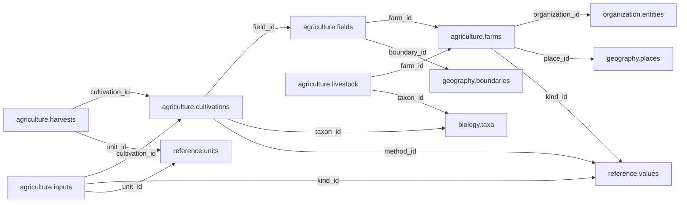

# agriculture — Phase 02

> **DEFERRED AND UNAPPROVED.** Retained for complete inventory only. Moving this proposal here does not approve it, start planning, or authorize table redesign or implementation. Older review/approval wording below is historical; this status controls.

See [Phase 02](README.md) and [the catalogue](../README.md). References to the former Person/Organization, Political/Electoral and Participation names in the retained proposal mean historical inputs now organized under Official, Politics and Accountability. Direct domain-to-Legal links in this deferred material are not current contracts; any future review must follow Reference mediation.

## Retained proposal — unchanged design

# agriculture schema — review and approval proposal

> **PROPOSED — USER REVIEW REQUIRED.** This is the review authority for whether the schema should exist and which tables/columns it owns. No SQL or migration is authorized.

## Purpose and ownership

**Target:** Main. **Purpose:** Farm operations, cultivation and harvest. This separate schema is a proposal based on distinct lifecycle, vocabulary and queries; merging or rejection remains open. Related owners: biology,environment,economy,geography.

## Current implementation and gaps

The active manifest has 30 manifest migrations and 49 distinct CREATE TABLE declarations (49 distinct current table names) in schemas `audit`, `auth`, `engine`, `filesystem`, `geography`, `legal`, `objects`, `reference`. Generated Dryv has 124 entities (digest `e0087da9cf5b00e91f283a5501c368c7696bdd841ea30629231dc9c590f7c1ee`). Counts describe current artifacts, not target design; SQL and Dryv diverge.

- SQL declarations: None found.
- Dryv entities: None found.

The inventory does not establish live database state and may miss ALTER-only changes. Before implementation, reconcile migrations, Dryv, generated output and callers.

## Proposed relationship map

> All nodes and edges are proposals. Main schemas may use local cross-schema foreign keys; no edge crosses the Main/Operations database boundary.

## Proposed table and column review

All tables and fields are hypothetical. Every proposed business column is listed; UUIDv7 `id` is a candidate default and remains open. Record every existing field disposition: KEEP / REMOVE / RENAME / MOVE / MERGE / SPLIT / DERIVE / ADD.

### `agriculture.farms` — Managed operation identity

- **Example:** Smallholder farm
- **Profile:** entity; planning envelope below.

| Column | Proposed type | Meaning | Nullable | Default | Relationship | Units / validation | Proposed disposition |
|---|---|---|---|---|---|---|---|
| `id` | `uuid` | Proposed stable identity | No | Rust UUIDv7 candidate | Primary key | UUIDv7 candidate; unique and immutable after publication | ADD (proposed target field; pending user approval) |
| `organization_id` | `uuid` | Operator | Yes | — | FK → `organization.entities` | UUID syntax; FK target must exist when the relationship is required | ADD (proposed target field; pending user approval) |
| `place_id` | `uuid` | Farm site | No | — | FK → `geography.places` | UUID syntax; FK target must exist when the relationship is required | ADD (proposed target field; pending user approval) |
| `name` | `text` | Farm name | No | — | — | Nonblank when required; enforce domain-specific length, normalization and controlled vocabulary | ADD (proposed target field; pending user approval) |
| `kind_id` | `uuid` | Farm kind | No | — | FK → `reference.values` | UUID syntax; FK target must exist when the relationship is required | ADD (proposed target field; pending user approval) |

- **FK action/cardinality:** Each non-null FK is many-to-one to its named target; nullable FKs are optional. Candidate delete/update behavior is RESTRICT/NO ACTION for accepted records; cascading canonical deletion is not proposed. Confirm uniqueness and exact behavior during review.
- **Constraints:** Farm does not imply land title. Exact keys and cross-field checks remain for review.
- **Indexes:** primary key on `id`; candidate B-tree indexes on FK columns `organization_id`, `place_id`, `kind_id` for joins and referenced-entity filters; add temporal/spatial indexes only where the stated query needs them and benchmarks support them.
- **Relationships:** resolve each FK target. Main allows cross-schema FKs. Main and Operations have no cross-database FK.
- **Evidence/time:** preserve exact source/version, observation/retrieval time, historical context and uncertainty where applicable. Approve the exact evidence path for this table.
- **Growth/storage estimate (illustrative planning envelope, not measured):** Low: initial 1,000, +200/year, peak 20/day; five-year 2,000 rows ≈ 2.0 MiB live row+index budget; Expected: initial 10,000, +2,000/year, peak 200/day; five-year 20,000 rows ≈ 19.5 MiB live row+index budget; High: initial 100,000, +20,000/year, peak 2,000/day; five-year 200,000 rows ≈ 195.3 MiB live row+index budget. Model: initial rows + annual accepted rows × 5; multiply by a per-row budget of 1 KiB including a coarse index allowance. Replace assumptions with actual samples, ingest rates and `pg_total_relation_size` before approval. Large object bytes are excluded; WAL, replicas, backups and S3 are budgeted separately.
- **Workload:** Interactive lookup by identity and approved foreign keys; batch scans for import/reconciliation. Peak-day figure above is a scenario assumption, not a service-level commitment.
- **Partitioning:** None proposed initially; decide from measured scale/query plans. Check late data and partition count.
- **Files:** originals, full-resolution geometry, arrays, media and large exports may be immutable S3 objects. Keep searchable identity, required facts, hashes, coverage, access and provenance in PostgreSQL; use manifests and selective reads.
- **Retention/risks/benchmark:** preserve accepted evidence and corrections. Review late arrivals, contention, index/partition growth and recovery. Benchmark joins, filters, spatial access, ingestion bursts, concurrent access and interrupted publication.
### `agriculture.fields` — Spatial cultivation area

- **Example:** Crop field
- **Profile:** geometry; planning envelope below.

| Column | Proposed type | Meaning | Nullable | Default | Relationship | Units / validation | Proposed disposition |
|---|---|---|---|---|---|---|---|
| `id` | `uuid` | Proposed stable identity | No | Rust UUIDv7 candidate | Primary key | UUIDv7 candidate; unique and immutable after publication | ADD (proposed target field; pending user approval) |
| `farm_id` | `uuid` | Operator | No | — | FK → `agriculture.farms` | UUID syntax; FK target must exist when the relationship is required | ADD (proposed target field; pending user approval) |
| `boundary_id` | `uuid` | Boundary | Yes | — | FK → `geography.boundaries` | UUID syntax; FK target must exist when the relationship is required | ADD (proposed target field; pending user approval) |
| `geometry` | `geometry(MultiPolygon,4326)` | Field | No | — | — | Type checked; domain constraints and units must be approved for this field | ADD (proposed target field; pending user approval) |
| `area_ha` | `numeric` | Area hectares | No | — | — | Type checked; domain constraints and units must be approved for this field | ADD (proposed target field; pending user approval) |

- **FK action/cardinality:** Each non-null FK is many-to-one to its named target; nullable FKs are optional. Candidate delete/update behavior is RESTRICT/NO ACTION for accepted records; cascading canonical deletion is not proposed. Confirm uniqueness and exact behavior during review.
- **Constraints:** area > 0; valid geometry. Exact keys and cross-field checks remain for review.
- **Indexes:** primary key on `id`; candidate B-tree indexes on FK columns `farm_id`, `boundary_id` for joins and referenced-entity filters; add temporal/spatial indexes only where the stated query needs them and benchmarks support them.
- **Relationships:** resolve each FK target. Main allows cross-schema FKs. Main and Operations have no cross-database FK.
- **Evidence/time:** preserve exact source/version, observation/retrieval time, historical context and uncertainty where applicable. Approve the exact evidence path for this table.
- **Growth/storage estimate (illustrative planning envelope, not measured):** Low: initial 100, +20/year, peak 10/day; five-year 200 rows ≈ 0.8 MiB live row+index budget; Expected: initial 1,000, +200/year, peak 100/day; five-year 2,000 rows ≈ 7.8 MiB live row+index budget; High: initial 10,000, +2,000/year, peak 1,000/day; five-year 20,000 rows ≈ 78.1 MiB live row+index budget. Model: initial rows + annual accepted rows × 5; multiply by a per-row budget of 4 KiB including a coarse index allowance. Replace assumptions with actual samples, ingest rates and `pg_total_relation_size` before approval. Large object bytes are excluded; WAL, replicas, backups and S3 are budgeted separately.
- **Workload:** Interactive lookup by identity and approved foreign keys; batch scans for import/reconciliation. Peak-day figure above is a scenario assumption, not a service-level commitment.
- **Partitioning:** No partition approved. Benchmark first; time range is a candidate for append-heavy observations, and keys must include partition columns. Releases are normally unpartitioned unless measured need appears. Check late data and partition count.
- **Files:** originals, full-resolution geometry, arrays, media and large exports may be immutable S3 objects. Keep searchable identity, required facts, hashes, coverage, access and provenance in PostgreSQL; use manifests and selective reads.
- **Retention/risks/benchmark:** preserve accepted evidence and corrections. Review late arrivals, contention, index/partition growth and recovery. Benchmark joins, filters, spatial access, ingestion bursts, concurrent access and interrupted publication.
### `agriculture.cultivations` — Crop cycle and practice

- **Example:** Maize cycle
- **Profile:** relation; planning envelope below.

| Column | Proposed type | Meaning | Nullable | Default | Relationship | Units / validation | Proposed disposition |
|---|---|---|---|---|---|---|---|
| `id` | `uuid` | Proposed stable identity | No | Rust UUIDv7 candidate | Primary key | UUIDv7 candidate; unique and immutable after publication | ADD (proposed target field; pending user approval) |
| `field_id` | `uuid` | Field | No | — | FK → `agriculture.fields` | UUID syntax; FK target must exist when the relationship is required | ADD (proposed target field; pending user approval) |
| `taxon_id` | `uuid` | Crop | No | — | FK → `biology.taxa` | UUID syntax; FK target must exist when the relationship is required | ADD (proposed target field; pending user approval) |
| `planted_on` | `date` | Plant date | Yes | — | — | Type checked; domain constraints and units must be approved for this field | ADD (proposed target field; pending user approval) |
| `harvested_on` | `date` | Harvest date | Yes | — | — | Type checked; domain constraints and units must be approved for this field | ADD (proposed target field; pending user approval) |
| `method_id` | `uuid` | Practice | No | — | FK → `reference.values` | UUID syntax; FK target must exist when the relationship is required | ADD (proposed target field; pending user approval) |

- **FK action/cardinality:** Each non-null FK is many-to-one to its named target; nullable FKs are optional. Candidate delete/update behavior is RESTRICT/NO ACTION for accepted records; cascading canonical deletion is not proposed. Confirm uniqueness and exact behavior during review.
- **Constraints:** Actual dates distinct from planned. Exact keys and cross-field checks remain for review.
- **Indexes:** primary key on `id`; candidate B-tree indexes on FK columns `field_id`, `taxon_id`, `method_id` for joins and referenced-entity filters; add temporal/spatial indexes only where the stated query needs them and benchmarks support them.
- **Relationships:** resolve each FK target. Main allows cross-schema FKs. Main and Operations have no cross-database FK.
- **Evidence/time:** preserve exact source/version, observation/retrieval time, historical context and uncertainty where applicable. Approve the exact evidence path for this table.
- **Growth/storage estimate (illustrative planning envelope, not measured):** Low: initial 1,000, +2,000/year, peak 100/day; five-year 11,000 rows ≈ 10.7 MiB live row+index budget; Expected: initial 10,000, +20,000/year, peak 1,000/day; five-year 110,000 rows ≈ 107.4 MiB live row+index budget; High: initial 100,000, +200,000/year, peak 10,000/day; five-year 1,100,000 rows ≈ 1,074.2 MiB live row+index budget. Model: initial rows + annual accepted rows × 5; multiply by a per-row budget of 1 KiB including a coarse index allowance. Replace assumptions with actual samples, ingest rates and `pg_total_relation_size` before approval. Large object bytes are excluded; WAL, replicas, backups and S3 are budgeted separately.
- **Workload:** Interactive lookup by identity and approved foreign keys; batch scans for import/reconciliation. Peak-day figure above is a scenario assumption, not a service-level commitment.
- **Partitioning:** None proposed initially; decide from measured scale/query plans. Check late data and partition count.
- **Files:** originals, full-resolution geometry, arrays, media and large exports may be immutable S3 objects. Keep searchable identity, required facts, hashes, coverage, access and provenance in PostgreSQL; use manifests and selective reads.
- **Retention/risks/benchmark:** preserve accepted evidence and corrections. Review late arrivals, contention, index/partition growth and recovery. Benchmark joins, filters, spatial access, ingestion bursts, concurrent access and interrupted publication.
### `agriculture.livestock` — Managed herd observations

- **Example:** Dairy herd count
- **Profile:** series; planning envelope below.

| Column | Proposed type | Meaning | Nullable | Default | Relationship | Units / validation | Proposed disposition |
|---|---|---|---|---|---|---|---|
| `id` | `uuid` | Proposed stable identity | No | Rust UUIDv7 candidate | Primary key | UUIDv7 candidate; unique and immutable after publication | ADD (proposed target field; pending user approval) |
| `farm_id` | `uuid` | Farm | No | — | FK → `agriculture.farms` | UUID syntax; FK target must exist when the relationship is required | ADD (proposed target field; pending user approval) |
| `taxon_id` | `uuid` | Animal | No | — | FK → `biology.taxa` | UUID syntax; FK target must exist when the relationship is required | ADD (proposed target field; pending user approval) |
| `observed_on` | `date` | Census date | No | — | — | Type checked; domain constraints and units must be approved for this field | ADD (proposed target field; pending user approval) |
| `count` | `bigint` | Observed count | No | — | — | Type checked; domain constraints and units must be approved for this field | ADD (proposed target field; pending user approval) |
| `method` | `text` | Census method | No | — | — | Nonblank when required; enforce domain-specific length, normalization and controlled vocabulary | ADD (proposed target field; pending user approval) |

- **FK action/cardinality:** Each non-null FK is many-to-one to its named target; nullable FKs are optional. Candidate delete/update behavior is RESTRICT/NO ACTION for accepted records; cascading canonical deletion is not proposed. Confirm uniqueness and exact behavior during review.
- **Constraints:** count >=0; no taxon duplication. Exact keys and cross-field checks remain for review.
- **Indexes:** primary key on `id`; candidate B-tree indexes on FK columns `farm_id`, `taxon_id` for joins and referenced-entity filters; add temporal/spatial indexes only where the stated query needs them and benchmarks support them.
- **Relationships:** resolve each FK target. Main allows cross-schema FKs. Main and Operations have no cross-database FK.
- **Evidence/time:** preserve exact source/version, observation/retrieval time, historical context and uncertainty where applicable. Approve the exact evidence path for this table.
- **Growth/storage estimate (illustrative planning envelope, not measured):** Low: initial 100,000, +100,000/year, peak 5,000/day; five-year 600,000 rows ≈ 1,171.9 MiB live row+index budget; Expected: initial 1,000,000, +1,000,000/year, peak 50,000/day; five-year 6,000,000 rows ≈ 11,718.8 MiB live row+index budget; High: initial 10,000,000, +10,000,000/year, peak 500,000/day; five-year 60,000,000 rows ≈ 117,187.5 MiB live row+index budget. Model: initial rows + annual accepted rows × 5; multiply by a per-row budget of 2 KiB including a coarse index allowance. Replace assumptions with actual samples, ingest rates and `pg_total_relation_size` before approval. Large object bytes are excluded; WAL, replicas, backups and S3 are budgeted separately.
- **Workload:** Interactive lookup by identity and approved foreign keys; batch scans for import/reconciliation. Peak-day figure above is a scenario assumption, not a service-level commitment.
- **Partitioning:** No partition approved. Benchmark first; time range is a candidate for append-heavy observations, and keys must include partition columns. Releases are normally unpartitioned unless measured need appears. Check late data and partition count.
- **Files:** originals, full-resolution geometry, arrays, media and large exports may be immutable S3 objects. Keep searchable identity, required facts, hashes, coverage, access and provenance in PostgreSQL; use manifests and selective reads.
- **Retention/risks/benchmark:** preserve accepted evidence and corrections. Review late arrivals, contention, index/partition growth and recovery. Benchmark joins, filters, spatial access, ingestion bursts, concurrent access and interrupted publication.
### `agriculture.harvests` — Harvest quantity and basis

- **Example:** Maize yield
- **Profile:** series; planning envelope below.

| Column | Proposed type | Meaning | Nullable | Default | Relationship | Units / validation | Proposed disposition |
|---|---|---|---|---|---|---|---|
| `id` | `uuid` | Proposed stable identity | No | Rust UUIDv7 candidate | Primary key | UUIDv7 candidate; unique and immutable after publication | ADD (proposed target field; pending user approval) |
| `cultivation_id` | `uuid` | Cycle | No | — | FK → `agriculture.cultivations` | UUID syntax; FK target must exist when the relationship is required | ADD (proposed target field; pending user approval) |
| `harvested_on` | `date` | Harvest date | No | — | — | Type checked; domain constraints and units must be approved for this field | ADD (proposed target field; pending user approval) |
| `quantity` | `numeric` | Quantity | No | — | — | Type checked; domain constraints and units must be approved for this field | ADD (proposed target field; pending user approval) |
| `unit_id` | `uuid` | Original unit | No | — | FK → `reference.units` | UUID syntax; FK target must exist when the relationship is required | ADD (proposed target field; pending user approval) |
| `moisture_percent` | `numeric` | Moisture | Yes | — | — | Type checked; domain constraints and units must be approved for this field | ADD (proposed target field; pending user approval) |
| `source_key` | `text` | Publisher row | Yes | — | — | Nonblank when required; enforce domain-specific length, normalization and controlled vocabulary | ADD (proposed target field; pending user approval) |

- **FK action/cardinality:** Each non-null FK is many-to-one to its named target; nullable FKs are optional. Candidate delete/update behavior is RESTRICT/NO ACTION for accepted records; cascading canonical deletion is not proposed. Confirm uniqueness and exact behavior during review.
- **Constraints:** Quantity >=0; preserve measurement basis; time partition candidate after sizing. Exact keys and cross-field checks remain for review.
- **Indexes:** primary key on `id`; candidate B-tree indexes on FK columns `cultivation_id`, `unit_id` for joins and referenced-entity filters; add temporal/spatial indexes only where the stated query needs them and benchmarks support them.
- **Relationships:** resolve each FK target. Main allows cross-schema FKs. Main and Operations have no cross-database FK.
- **Evidence/time:** preserve exact source/version, observation/retrieval time, historical context and uncertainty where applicable. Approve the exact evidence path for this table.
- **Growth/storage estimate (illustrative planning envelope, not measured):** Low: initial 100,000, +100,000/year, peak 5,000/day; five-year 600,000 rows ≈ 1,171.9 MiB live row+index budget; Expected: initial 1,000,000, +1,000,000/year, peak 50,000/day; five-year 6,000,000 rows ≈ 11,718.8 MiB live row+index budget; High: initial 10,000,000, +10,000,000/year, peak 500,000/day; five-year 60,000,000 rows ≈ 117,187.5 MiB live row+index budget. Model: initial rows + annual accepted rows × 5; multiply by a per-row budget of 2 KiB including a coarse index allowance. Replace assumptions with actual samples, ingest rates and `pg_total_relation_size` before approval. Large object bytes are excluded; WAL, replicas, backups and S3 are budgeted separately.
- **Workload:** Interactive lookup by identity and approved foreign keys; batch scans for import/reconciliation. Peak-day figure above is a scenario assumption, not a service-level commitment.
- **Partitioning:** No partition approved. Benchmark first; time range is a candidate for append-heavy observations, and keys must include partition columns. Releases are normally unpartitioned unless measured need appears. Check late data and partition count.
- **Files:** originals, full-resolution geometry, arrays, media and large exports may be immutable S3 objects. Keep searchable identity, required facts, hashes, coverage, access and provenance in PostgreSQL; use manifests and selective reads.
- **Retention/risks/benchmark:** preserve accepted evidence and corrections. Review late arrivals, contention, index/partition growth and recovery. Benchmark joins, filters, spatial access, ingestion bursts, concurrent access and interrupted publication.
### `agriculture.inputs` — Applied cultivation inputs

- **Example:** Fertilizer application
- **Profile:** relation; planning envelope below.

| Column | Proposed type | Meaning | Nullable | Default | Relationship | Units / validation | Proposed disposition |
|---|---|---|---|---|---|---|---|
| `id` | `uuid` | Proposed stable identity | No | Rust UUIDv7 candidate | Primary key | UUIDv7 candidate; unique and immutable after publication | ADD (proposed target field; pending user approval) |
| `cultivation_id` | `uuid` | Crop cycle | No | — | FK → `agriculture.cultivations` | UUID syntax; FK target must exist when the relationship is required | ADD (proposed target field; pending user approval) |
| `kind_id` | `uuid` | Input kind | No | — | FK → `reference.values` | UUID syntax; FK target must exist when the relationship is required | ADD (proposed target field; pending user approval) |
| `applied_on` | `date` | Application | No | — | — | Type checked; domain constraints and units must be approved for this field | ADD (proposed target field; pending user approval) |
| `quantity` | `numeric` | Amount | No | — | — | Type checked; domain constraints and units must be approved for this field | ADD (proposed target field; pending user approval) |
| `unit_id` | `uuid` | Unit | No | — | FK → `reference.units` | UUID syntax; FK target must exist when the relationship is required | ADD (proposed target field; pending user approval) |
| `product` | `text` | Product label | Yes | — | — | Nonblank when required; enforce domain-specific length, normalization and controlled vocabulary | ADD (proposed target field; pending user approval) |

- **FK action/cardinality:** Each non-null FK is many-to-one to its named target; nullable FKs are optional. Candidate delete/update behavior is RESTRICT/NO ACTION for accepted records; cascading canonical deletion is not proposed. Confirm uniqueness and exact behavior during review.
- **Constraints:** Do not confuse product label with chemical canonical identity. Exact keys and cross-field checks remain for review.
- **Indexes:** primary key on `id`; candidate B-tree indexes on FK columns `cultivation_id`, `kind_id`, `unit_id` for joins and referenced-entity filters; add temporal/spatial indexes only where the stated query needs them and benchmarks support them.
- **Relationships:** resolve each FK target. Main allows cross-schema FKs. Main and Operations have no cross-database FK.
- **Evidence/time:** preserve exact source/version, observation/retrieval time, historical context and uncertainty where applicable. Approve the exact evidence path for this table.
- **Growth/storage estimate (illustrative planning envelope, not measured):** Low: initial 1,000, +2,000/year, peak 100/day; five-year 11,000 rows ≈ 10.7 MiB live row+index budget; Expected: initial 10,000, +20,000/year, peak 1,000/day; five-year 110,000 rows ≈ 107.4 MiB live row+index budget; High: initial 100,000, +200,000/year, peak 10,000/day; five-year 1,100,000 rows ≈ 1,074.2 MiB live row+index budget. Model: initial rows + annual accepted rows × 5; multiply by a per-row budget of 1 KiB including a coarse index allowance. Replace assumptions with actual samples, ingest rates and `pg_total_relation_size` before approval. Large object bytes are excluded; WAL, replicas, backups and S3 are budgeted separately.
- **Workload:** Interactive lookup by identity and approved foreign keys; batch scans for import/reconciliation. Peak-day figure above is a scenario assumption, not a service-level commitment.
- **Partitioning:** None proposed initially; decide from measured scale/query plans. Check late data and partition count.
- **Files:** originals, full-resolution geometry, arrays, media and large exports may be immutable S3 objects. Keep searchable identity, required facts, hashes, coverage, access and provenance in PostgreSQL; use manifests and selective reads.
- **Retention/risks/benchmark:** preserve accepted evidence and corrections. Review late arrivals, contention, index/partition growth and recovery. Benchmark joins, filters, spatial access, ingestion bursts, concurrent access and interrupted publication.

## Queries, lifecycle, capacity and approval

**Representative query:** What was cultivated and harvested under which observed conditions?

Lifecycle: preserve source bytes; extract into candidate revisions; validate; review or use approved deterministic checks; atomically publish; serve. Corrections create explicit versions/supersession. Preserve disagreement and uncertainty.

Capacity is unmeasured. Use low/expected/high input scenarios, explicit formulas and workload benchmarks; do not assume sizes or universal partitions.

**Status:** NOT REVIEWED. Schema existence, tables, columns, relationships, partitioning and S3 choices require user approval. Feedback: none. Approval reference/date/revision: none. Implementation authorization: not granted. Material changes reopen approval.

Earlier schema proposal preserved for history; superseded and not an approval

---
id: DOC-EXP-AGRICULTURE-20261111
name: Agriculture domain expansion brief
type: documentation
tags: [system-expansion, hypothetical, schema-design, agriculture]
extra: {status: hypothetical, approval: not_approved, implementation: not_authorized, recorded_on: 2026-11-11}
---

# Agriculture — farms, cultivation and harvests

> **Status: HYPOTHETICAL DOMAIN BRIEF.** This design is under investigation, not approved DDL. See the [system-expansion proposal](../../guides/advancement-and-system-expansion.md).

## 1. Purpose and exploration areas

Agriculture records managed cultivation and production activity, helping users connect Geography and Nature, Economics and Production, Statistics, Environment and Civic infrastructure.

## 2. Domain ownership

Candidate ownership: farm/enterprise operating context where appropriate, fields/cultivated plots, crop cycles, managed livestock groups, agricultural practices and harvest events/quantities.

## 3. Exclusions

Biology owns taxon identities and wild biodiversity. Economy owns products, markets, prices and trade. Statistical owns published agricultural indicators. Geography owns spatial place/geometry. Organization owns legal business identity and ownership where applicable.

## 4. Existing schema and table inventory

No Agriculture schema appears in the active SQL tree or listed Dryv domain groups. `statistical` contracts and designs include agriculture-related indicators, not a dedicated farm/harvest database. The candidate schema is new and hypothetical.

## 5. Candidate tables

| Candidate | Responsibility |
|---|---|
| `farms` | Managed agricultural operation identity, with owner/operator links and locality. |
| `fields` | Cultivated plot identity, spatial reference and land-use history. |
| `cultivations` | Crop/taxon, field, season/cycle and management method. |
| `herds` | Managed livestock group and purpose, not a wild population. |
| `practices` | Dated practice applied to a field/herd, such as irrigation or soil management. |
| `harvests` | Actual harvest occurrence, product/taxon, quantity, unit, date and source. |

Table admission depends on independently sourced workflows and useful queries; do not create both farm and enterprise identities without distinguishing them.

## 6. Primary and foreign-key relationships

Fields link to Geography representations/places; farms to Organization/person operators; cultivations to Biology taxa and fields; harvests to cultivation and unit definitions; product identity may link to Economy. Statistical aggregates reference harvest inputs through explicit derivation lineage.

## 7. Cross-domain relationships

Agriculture records actual harvest quantity once. Economy may relate an output to a product or sale/market price without repeating the harvest fact. Statistical may publish yield and production series as derived/comparable observations. Biology taxa are reused for crop/livestock identities.

## 8. Geographic responsibilities

Field/farm boundaries are sourced or derived spatial representations with accuracy and valid period. Do not infer land ownership from cultivation, or national/county aggregate from a single point. Historical farm/field changes need explicit lineage.

## 9. Temporal responsibilities

Planting, cultivation cycle, treatment, harvest and operation dates describe different agricultural facts. Season definitions vary by crop and region; avoid assuming one calendar. Preserve source and observation time separately.

## 10. Evidence and provenance

Record source artifact/version, farmer/survey/admin reporting method, collection date, units, quality controls, uncertainty, privacy/access class and correction history. Do not silently treat estimated production as observed harvest.

## 11. Acquisition categories

Static seed: crop/measure definitions. Pattern seed: only reviewed expected coverage. Collected: farm registers, surveys and records. Derived: yield, seasonal summaries and area totals with pinned methods and coverage. Actual row origin remains explicit.

## 12. Derived data

Agriculture owns operational harvest facts and may derive field/farm summaries. Statistical owns official comparable production/yield indicators. Economy owns market prices and exchange/trade. Conversions preserve original units and document conversion factors.

## 13. Example queries

- What crops were cultivated in this area during a season, and what is the evidence?
- Which harvest records contribute to a reported production estimate?
- How does irrigation infrastructure intersect fields without implying service delivery?

## 14. UI/API requirements

Support field/farm maps, cultivation calendars and harvest summaries with explicit privacy, unit, period, method and coverage. Do not publish household/farm locations without an approved policy.

## 15. Integrity constraints to investigate

Quantity-unit compatibility, crop/field/cycle FK consistency, overlapping use of a plot, season/hemisphere interpretation, livestock group changes, harvest totals and source-reported aggregate reconciliation.

## 16. Technical standards to evaluate

FAOSTAT definitions and methodology, FAO agricultural classifications, SDMX for official statistical exchange, OGC spatial formats. Standards and FAOSTAT series are references, not mandatory internal table layouts.

## 17. Open questions

Does farm identity belong here or Organization? How are customary/communal lands represented? Are livestock groups sufficiently stable? Should crop cycles be split by planting/harvest? Which personal/household data should be excluded or restricted?

## 18. Review and approval status

Hypothetical, not reviewed or approved. Reconcile with Biology, Economy, Statistical, Organization, Geography and privacy guidance before any schema proposal.

