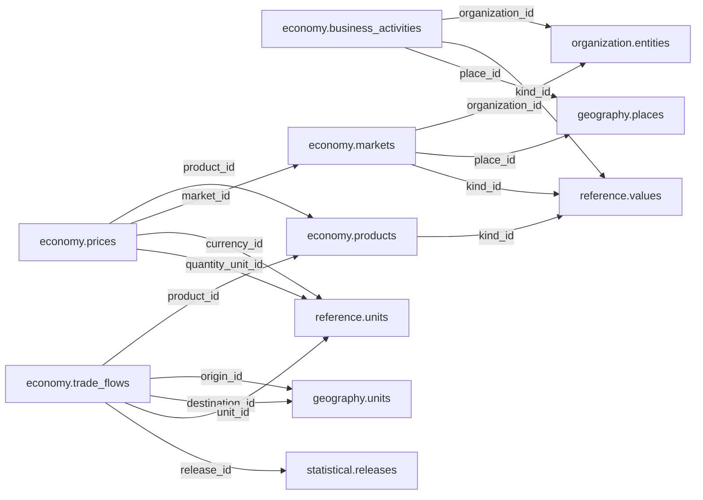

# economy — Phase 02

> **DEFERRED AND UNAPPROVED.** Retained for complete inventory only. Moving this proposal here does not approve it, start planning, or authorize table redesign or implementation. Older review/approval wording below is historical; this status controls.

See [Phase 02](README.md) and [the catalogue](../../README.md). References to the former Person/Organization, Political/Electoral and Participation names in the retained proposal mean historical inputs now organized under Official, Politics and Accountability. Direct domain-to-Legal links in this deferred material are not current contracts; any future review must follow Reference mediation.

## Retained proposal — unchanged design

# economy schema — review and approval proposal

> **PROPOSED — USER REVIEW REQUIRED.** This is the review authority for whether the schema should exist and which tables/columns it owns. No SQL or migration is authorized.

## Purpose and ownership

**Target:** Main. **Purpose:** Market activity, products, prices and trade. This separate schema is a proposal based on distinct lifecycle, vocabulary and queries; merging or rejection remains open. Related owners: agriculture,organization,geography.

## Current implementation and gaps

The active manifest has 30 manifest migrations and 49 distinct CREATE TABLE declarations (49 distinct current table names) in schemas `audit`, `auth`, `engine`, `filesystem`, `geography`, `legal`, `objects`, `reference`. Generated Dryv has 124 entities (digest `e0087da9cf5b00e91f283a5501c368c7696bdd841ea30629231dc9c590f7c1ee`). Counts describe current artifacts, not target design; SQL and Dryv diverge.

- SQL declarations: None found.
- Dryv entities: None found.

The inventory does not establish live database state and may miss ALTER-only changes. Before implementation, reconcile migrations, Dryv, generated output and callers.

## Proposed relationship map

> All nodes and edges are proposals. Main schemas may use local cross-schema foreign keys; no edge crosses the Main/Operations database boundary.

## Proposed table and column review

All tables and fields are hypothetical. Every proposed business column is listed; UUIDv7 `id` is a candidate default and remains open. Record every existing field disposition: KEEP / REMOVE / RENAME / MOVE / MERGE / SPLIT / DERIVE / ADD.

### `economy.products` — Market product identity

- **Example:** Maize grain grade
- **Profile:** entity; planning envelope below.

| Column | Proposed type | Meaning | Nullable | Default | Relationship | Units / validation | Proposed disposition |
|---|---|---|---|---|---|---|---|
| `id` | `uuid` | Proposed stable identity | No | Rust UUIDv7 candidate | Primary key | UUIDv7 candidate; unique and immutable after publication | ADD (proposed target field; pending user approval) |
| `code` | `text` | Stable product identity | No | — | — | Nonblank when required; enforce domain-specific length, normalization and controlled vocabulary | ADD (proposed target field; pending user approval) |
| `name` | `text` | Product label | No | — | — | Nonblank when required; enforce domain-specific length, normalization and controlled vocabulary | ADD (proposed target field; pending user approval) |
| `kind_id` | `uuid` | Market classification | No | — | FK → `reference.values` | UUID syntax; FK target must exist when the relationship is required | ADD (proposed target field; pending user approval) |

- **FK action/cardinality:** Each non-null FK is many-to-one to its named target; nullable FKs are optional. Candidate delete/update behavior is RESTRICT/NO ACTION for accepted records; cascading canonical deletion is not proposed. Confirm uniqueness and exact behavior during review.
- **Constraints:** UNIQUE(code). Exact keys and cross-field checks remain for review.
- **Indexes:** primary key on `id`; candidate B-tree indexes on FK columns `kind_id` for joins and referenced-entity filters; add temporal/spatial indexes only where the stated query needs them and benchmarks support them.
- **Relationships:** resolve each FK target. Main allows cross-schema FKs. Main and Operations have no cross-database FK.
- **Evidence/time:** preserve exact source/version, observation/retrieval time, historical context and uncertainty where applicable. Approve the exact evidence path for this table.
- **Growth/storage estimate (illustrative planning envelope, not measured):** Low: initial 1,000, +200/year, peak 20/day; five-year 2,000 rows ≈ 2.0 MiB live row+index budget; Expected: initial 10,000, +2,000/year, peak 200/day; five-year 20,000 rows ≈ 19.5 MiB live row+index budget; High: initial 100,000, +20,000/year, peak 2,000/day; five-year 200,000 rows ≈ 195.3 MiB live row+index budget. Model: initial rows + annual accepted rows × 5; multiply by a per-row budget of 1 KiB including a coarse index allowance. Replace assumptions with actual samples, ingest rates and `pg_total_relation_size` before approval. Large object bytes are excluded; WAL, replicas, backups and S3 are budgeted separately.
- **Workload:** Interactive lookup by identity and approved foreign keys; batch scans for import/reconciliation. Peak-day figure above is a scenario assumption, not a service-level commitment.
- **Partitioning:** None proposed initially; decide from measured scale/query plans. Check late data and partition count.
- **Files:** originals, full-resolution geometry, arrays, media and large exports may be immutable S3 objects. Keep searchable identity, required facts, hashes, coverage, access and provenance in PostgreSQL; use manifests and selective reads.
- **Retention/risks/benchmark:** preserve accepted evidence and corrections. Review late arrivals, contention, index/partition growth and recovery. Benchmark joins, filters, spatial access, ingestion bursts, concurrent access and interrupted publication.
### `economy.markets` — Market site identity

- **Example:** Open air market
- **Profile:** entity; planning envelope below.

| Column | Proposed type | Meaning | Nullable | Default | Relationship | Units / validation | Proposed disposition |
|---|---|---|---|---|---|---|---|
| `id` | `uuid` | Proposed stable identity | No | Rust UUIDv7 candidate | Primary key | UUIDv7 candidate; unique and immutable after publication | ADD (proposed target field; pending user approval) |
| `organization_id` | `uuid` | Operator | Yes | — | FK → `organization.entities` | UUID syntax; FK target must exist when the relationship is required | ADD (proposed target field; pending user approval) |
| `place_id` | `uuid` | Market place | No | — | FK → `geography.places` | UUID syntax; FK target must exist when the relationship is required | ADD (proposed target field; pending user approval) |
| `name` | `text` | Market name | No | — | — | Nonblank when required; enforce domain-specific length, normalization and controlled vocabulary | ADD (proposed target field; pending user approval) |
| `kind_id` | `uuid` | Market type | No | — | FK → `reference.values` | UUID syntax; FK target must exist when the relationship is required | ADD (proposed target field; pending user approval) |

- **FK action/cardinality:** Each non-null FK is many-to-one to its named target; nullable FKs are optional. Candidate delete/update behavior is RESTRICT/NO ACTION for accepted records; cascading canonical deletion is not proposed. Confirm uniqueness and exact behavior during review.
- **Constraints:** Market may be informal and not an organization. Exact keys and cross-field checks remain for review.
- **Indexes:** primary key on `id`; candidate B-tree indexes on FK columns `organization_id`, `place_id`, `kind_id` for joins and referenced-entity filters; add temporal/spatial indexes only where the stated query needs them and benchmarks support them.
- **Relationships:** resolve each FK target. Main allows cross-schema FKs. Main and Operations have no cross-database FK.
- **Evidence/time:** preserve exact source/version, observation/retrieval time, historical context and uncertainty where applicable. Approve the exact evidence path for this table.
- **Growth/storage estimate (illustrative planning envelope, not measured):** Low: initial 1,000, +200/year, peak 20/day; five-year 2,000 rows ≈ 2.0 MiB live row+index budget; Expected: initial 10,000, +2,000/year, peak 200/day; five-year 20,000 rows ≈ 19.5 MiB live row+index budget; High: initial 100,000, +20,000/year, peak 2,000/day; five-year 200,000 rows ≈ 195.3 MiB live row+index budget. Model: initial rows + annual accepted rows × 5; multiply by a per-row budget of 1 KiB including a coarse index allowance. Replace assumptions with actual samples, ingest rates and `pg_total_relation_size` before approval. Large object bytes are excluded; WAL, replicas, backups and S3 are budgeted separately.
- **Workload:** Interactive lookup by identity and approved foreign keys; batch scans for import/reconciliation. Peak-day figure above is a scenario assumption, not a service-level commitment.
- **Partitioning:** None proposed initially; decide from measured scale/query plans. Check late data and partition count.
- **Files:** originals, full-resolution geometry, arrays, media and large exports may be immutable S3 objects. Keep searchable identity, required facts, hashes, coverage, access and provenance in PostgreSQL; use manifests and selective reads.
- **Retention/risks/benchmark:** preserve accepted evidence and corrections. Review late arrivals, contention, index/partition growth and recovery. Benchmark joins, filters, spatial access, ingestion bursts, concurrent access and interrupted publication.
### `economy.prices` — Observed market price

- **Example:** Price per kilogram
- **Profile:** series; planning envelope below.

| Column | Proposed type | Meaning | Nullable | Default | Relationship | Units / validation | Proposed disposition |
|---|---|---|---|---|---|---|---|
| `id` | `uuid` | Proposed stable identity | No | Rust UUIDv7 candidate | Primary key | UUIDv7 candidate; unique and immutable after publication | ADD (proposed target field; pending user approval) |
| `product_id` | `uuid` | Product | No | — | FK → `economy.products` | UUID syntax; FK target must exist when the relationship is required | ADD (proposed target field; pending user approval) |
| `market_id` | `uuid` | Market | No | — | FK → `economy.markets` | UUID syntax; FK target must exist when the relationship is required | ADD (proposed target field; pending user approval) |
| `observed_at` | `timestamptz` | Price time | No | — | — | Type checked; domain constraints and units must be approved for this field | ADD (proposed target field; pending user approval) |
| `amount` | `numeric` | Price value | No | — | — | Type checked; domain constraints and units must be approved for this field | ADD (proposed target field; pending user approval) |
| `currency_id` | `uuid` | Currency | No | — | FK → `reference.units` | UUID syntax; FK target must exist when the relationship is required | ADD (proposed target field; pending user approval) |
| `quantity` | `numeric` | Quoted quantity | No | — | — | Type checked; domain constraints and units must be approved for this field | ADD (proposed target field; pending user approval) |
| `quantity_unit_id` | `uuid` | Product unit | No | — | FK → `reference.units` | UUID syntax; FK target must exist when the relationship is required | ADD (proposed target field; pending user approval) |
| `source_key` | `text` | Publisher identity | Yes | — | — | Nonblank when required; enforce domain-specific length, normalization and controlled vocabulary | ADD (proposed target field; pending user approval) |

- **FK action/cardinality:** Each non-null FK is many-to-one to its named target; nullable FKs are optional. Candidate delete/update behavior is RESTRICT/NO ACTION for accepted records; cascading canonical deletion is not proposed. Confirm uniqueness and exact behavior during review.
- **Constraints:** amount >=0, quantity >0; partition by observation time only after volume review. Exact keys and cross-field checks remain for review.
- **Indexes:** primary key on `id`; candidate B-tree indexes on FK columns `product_id`, `market_id`, `currency_id`, `quantity_unit_id` for joins and referenced-entity filters; add temporal/spatial indexes only where the stated query needs them and benchmarks support them.
- **Relationships:** resolve each FK target. Main allows cross-schema FKs. Main and Operations have no cross-database FK.
- **Evidence/time:** preserve exact source/version, observation/retrieval time, historical context and uncertainty where applicable. Approve the exact evidence path for this table.
- **Growth/storage estimate (illustrative planning envelope, not measured):** Low: initial 100,000, +100,000/year, peak 5,000/day; five-year 600,000 rows ≈ 1,171.9 MiB live row+index budget; Expected: initial 1,000,000, +1,000,000/year, peak 50,000/day; five-year 6,000,000 rows ≈ 11,718.8 MiB live row+index budget; High: initial 10,000,000, +10,000,000/year, peak 500,000/day; five-year 60,000,000 rows ≈ 117,187.5 MiB live row+index budget. Model: initial rows + annual accepted rows × 5; multiply by a per-row budget of 2 KiB including a coarse index allowance. Replace assumptions with actual samples, ingest rates and `pg_total_relation_size` before approval. Large object bytes are excluded; WAL, replicas, backups and S3 are budgeted separately.
- **Workload:** Interactive lookup by identity and approved foreign keys; batch scans for import/reconciliation. Peak-day figure above is a scenario assumption, not a service-level commitment.
- **Partitioning:** No partition approved. Benchmark first; time range is a candidate for append-heavy observations, and keys must include partition columns. Releases are normally unpartitioned unless measured need appears. Check late data and partition count.
- **Files:** originals, full-resolution geometry, arrays, media and large exports may be immutable S3 objects. Keep searchable identity, required facts, hashes, coverage, access and provenance in PostgreSQL; use manifests and selective reads.
- **Retention/risks/benchmark:** preserve accepted evidence and corrections. Review late arrivals, contention, index/partition growth and recovery. Benchmark joins, filters, spatial access, ingestion bursts, concurrent access and interrupted publication.
### `economy.trade_flows` — Published trade flow

- **Example:** Cross border grain movement
- **Profile:** series; planning envelope below.

| Column | Proposed type | Meaning | Nullable | Default | Relationship | Units / validation | Proposed disposition |
|---|---|---|---|---|---|---|---|
| `id` | `uuid` | Proposed stable identity | No | Rust UUIDv7 candidate | Primary key | UUIDv7 candidate; unique and immutable after publication | ADD (proposed target field; pending user approval) |
| `product_id` | `uuid` | Product | No | — | FK → `economy.products` | UUID syntax; FK target must exist when the relationship is required | ADD (proposed target field; pending user approval) |
| `origin_id` | `uuid` | Origin | No | — | FK → `geography.units` | UUID syntax; FK target must exist when the relationship is required | ADD (proposed target field; pending user approval) |
| `destination_id` | `uuid` | Destination | No | — | FK → `geography.units` | UUID syntax; FK target must exist when the relationship is required | ADD (proposed target field; pending user approval) |
| `period_start` | `date` | Period | No | — | — | Type checked; domain constraints and units must be approved for this field | ADD (proposed target field; pending user approval) |
| `period_end` | `date` | Period | No | — | — | Type checked; domain constraints and units must be approved for this field | ADD (proposed target field; pending user approval) |
| `quantity` | `numeric` | Trade amount | No | — | — | Type checked; domain constraints and units must be approved for this field | ADD (proposed target field; pending user approval) |
| `unit_id` | `uuid` | Measure | No | — | FK → `reference.units` | UUID syntax; FK target must exist when the relationship is required | ADD (proposed target field; pending user approval) |
| `release_id` | `uuid` | Source vintage | No | — | FK → `statistical.releases` | UUID syntax; FK target must exist when the relationship is required | ADD (proposed target field; pending user approval) |

- **FK action/cardinality:** Each non-null FK is many-to-one to its named target; nullable FKs are optional. Candidate delete/update behavior is RESTRICT/NO ACTION for accepted records; cascading canonical deletion is not proposed. Confirm uniqueness and exact behavior during review.
- **Constraints:** Origin != destination; broad flow table likely partition candidate. Exact keys and cross-field checks remain for review.
- **Indexes:** primary key on `id`; candidate B-tree indexes on FK columns `product_id`, `origin_id`, `destination_id`, `unit_id`, `release_id` for joins and referenced-entity filters; add temporal/spatial indexes only where the stated query needs them and benchmarks support them.
- **Relationships:** resolve each FK target. Main allows cross-schema FKs. Main and Operations have no cross-database FK.
- **Evidence/time:** preserve exact source/version, observation/retrieval time, historical context and uncertainty where applicable. Approve the exact evidence path for this table.
- **Growth/storage estimate (illustrative planning envelope, not measured):** Low: initial 100,000, +100,000/year, peak 5,000/day; five-year 600,000 rows ≈ 1,171.9 MiB live row+index budget; Expected: initial 1,000,000, +1,000,000/year, peak 50,000/day; five-year 6,000,000 rows ≈ 11,718.8 MiB live row+index budget; High: initial 10,000,000, +10,000,000/year, peak 500,000/day; five-year 60,000,000 rows ≈ 117,187.5 MiB live row+index budget. Model: initial rows + annual accepted rows × 5; multiply by a per-row budget of 2 KiB including a coarse index allowance. Replace assumptions with actual samples, ingest rates and `pg_total_relation_size` before approval. Large object bytes are excluded; WAL, replicas, backups and S3 are budgeted separately.
- **Workload:** Interactive lookup by identity and approved foreign keys; batch scans for import/reconciliation. Peak-day figure above is a scenario assumption, not a service-level commitment.
- **Partitioning:** No partition approved. Benchmark first; time range is a candidate for append-heavy observations, and keys must include partition columns. Releases are normally unpartitioned unless measured need appears. Check late data and partition count.
- **Files:** originals, full-resolution geometry, arrays, media and large exports may be immutable S3 objects. Keep searchable identity, required facts, hashes, coverage, access and provenance in PostgreSQL; use manifests and selective reads.
- **Retention/risks/benchmark:** preserve accepted evidence and corrections. Review late arrivals, contention, index/partition growth and recovery. Benchmark joins, filters, spatial access, ingestion bursts, concurrent access and interrupted publication.
### `economy.business_activities` — Published economic activity classification

- **Example:** Business activity category
- **Profile:** relation; planning envelope below.

| Column | Proposed type | Meaning | Nullable | Default | Relationship | Units / validation | Proposed disposition |
|---|---|---|---|---|---|---|---|
| `id` | `uuid` | Proposed stable identity | No | Rust UUIDv7 candidate | Primary key | UUIDv7 candidate; unique and immutable after publication | ADD (proposed target field; pending user approval) |
| `organization_id` | `uuid` | Business | No | — | FK → `organization.entities` | UUID syntax; FK target must exist when the relationship is required | ADD (proposed target field; pending user approval) |
| `kind_id` | `uuid` | Activity | No | — | FK → `reference.values` | UUID syntax; FK target must exist when the relationship is required | ADD (proposed target field; pending user approval) |
| `place_id` | `uuid` | Location | Yes | — | FK → `geography.places` | UUID syntax; FK target must exist when the relationship is required | ADD (proposed target field; pending user approval) |
| `active_during` | `daterange` | Reported interval | Yes | — | — | Type checked; domain constraints and units must be approved for this field | ADD (proposed target field; pending user approval) |

- **FK action/cardinality:** Each non-null FK is many-to-one to its named target; nullable FKs are optional. Candidate delete/update behavior is RESTRICT/NO ACTION for accepted records; cascading canonical deletion is not proposed. Confirm uniqueness and exact behavior during review.
- **Constraints:** Does not duplicate business identity or private product listing. Exact keys and cross-field checks remain for review.
- **Indexes:** primary key on `id`; candidate B-tree indexes on FK columns `organization_id`, `kind_id`, `place_id` for joins and referenced-entity filters; add temporal/spatial indexes only where the stated query needs them and benchmarks support them.
- **Relationships:** resolve each FK target. Main allows cross-schema FKs. Main and Operations have no cross-database FK.
- **Evidence/time:** preserve exact source/version, observation/retrieval time, historical context and uncertainty where applicable. Approve the exact evidence path for this table.
- **Growth/storage estimate (illustrative planning envelope, not measured):** Low: initial 1,000, +2,000/year, peak 100/day; five-year 11,000 rows ≈ 10.7 MiB live row+index budget; Expected: initial 10,000, +20,000/year, peak 1,000/day; five-year 110,000 rows ≈ 107.4 MiB live row+index budget; High: initial 100,000, +200,000/year, peak 10,000/day; five-year 1,100,000 rows ≈ 1,074.2 MiB live row+index budget. Model: initial rows + annual accepted rows × 5; multiply by a per-row budget of 1 KiB including a coarse index allowance. Replace assumptions with actual samples, ingest rates and `pg_total_relation_size` before approval. Large object bytes are excluded; WAL, replicas, backups and S3 are budgeted separately.
- **Workload:** Interactive lookup by identity and approved foreign keys; batch scans for import/reconciliation. Peak-day figure above is a scenario assumption, not a service-level commitment.
- **Partitioning:** None proposed initially; decide from measured scale/query plans. Check late data and partition count.
- **Files:** originals, full-resolution geometry, arrays, media and large exports may be immutable S3 objects. Keep searchable identity, required facts, hashes, coverage, access and provenance in PostgreSQL; use manifests and selective reads.
- **Retention/risks/benchmark:** preserve accepted evidence and corrections. Review late arrivals, contention, index/partition growth and recovery. Benchmark joins, filters, spatial access, ingestion bursts, concurrent access and interrupted publication.

## Queries, lifecycle, capacity and approval

**Representative query:** How did this product price change across places and periods?

Lifecycle: preserve source bytes; extract into candidate revisions; validate; review or use approved deterministic checks; atomically publish; serve. Corrections create explicit versions/supersession. Preserve disagreement and uncertainty.

Capacity is unmeasured. Use low/expected/high input scenarios, explicit formulas and workload benchmarks; do not assume sizes or universal partitions.

**Status:** NOT REVIEWED. Schema existence, tables, columns, relationships, partitioning and S3 choices require user approval. Feedback: none. Approval reference/date/revision: none. Implementation authorization: not granted. Material changes reopen approval.

Earlier schema proposal preserved for history; superseded and not an approval

---
id: DOC-EXP-ECONOMY-20261111
name: Economy domain expansion brief
type: documentation
tags: [system-expansion, hypothetical, schema-design, economy]
extra: {status: hypothetical, approval: not_approved, implementation: not_authorized, recorded_on: 2026-11-11}
---

# Economy — products, markets, prices and production

> **Status: HYPOTHETICAL DOMAIN BRIEF.** Candidate Economy responsibilities and tables are not approved for SQL. See the [system-expansion proposal](../../../guides/advancement-and-system-expansion.md).

## 1. Purpose and exploration areas

Economy connects goods/services, production, exchange and prices to Geography, Agriculture, History, Statistical, Finance and Procurement.

## 2. Domain ownership

Candidate ownership: product concepts/specifications, market identity as an economic venue, source price quotes, trade/exchange facts and economic production operations.

## 3. Exclusions

Agriculture owns farm/harvest events. Finance owns budgets, accounting, debt and public transactions. Procurement owns tender/bid/award/contract process. Statistical owns official indices and comparable series. Geography owns physical market place. Organization owns businesses and legal identities.

## 4. Existing schema and table inventory

No Economy SQL schema or Dryv contract group is currently present in the active tree. Existing finance/procurement/statistical contracts and earlier redesign documents cover adjacent concepts but do not implement an Economy domain. This is a new proposal.

## 5. Candidate tables

| Candidate | Responsibility |
|---|---|
| `products` | Goods/services identities and versioned classification links. |
| `markets` | Economic market identity linked to a geographic place or organized exchange. |
| `prices` | Individual sourced quote with amount, currency, quantity/unit, type, place and observation time. |
| `trades` | Documented exchange/movement with parties, products, quantities and terms. |
| `operations` | Economic production activity such as mining, manufacturing, fishing, tourism or retail. |
| `production` | Output fact linked to an operation, product, quantity, period and source. |

Some operation/production concepts may be domain-specific and should not be generalized prematurely.

## 6. Primary and foreign-key relationships

Prices link to product, currency/unit classifications and market/geographic place plus source capture/version. Trade parties link to Organization or Person with typed roles. Production can link to Economy product and an originating Agriculture/Civic domain record where applicable; avoid generic polymorphic references.

## 7. Cross-domain relationships

A local market price belongs to Economy; an official consumer/producer price index belongs to Statistical. Agriculture harvest quantity remains in Agriculture; Economy may link to sales/market records. Public spending/tenders remain Finance/Procurement facts even when they affect markets.

## 8. Geographic responsibilities

Markets and extraction/production sites link to geographic places and areas; trade routes may reference Geography/Civic networks. Price context must distinguish market location from product origin, seller jurisdiction and consumer area.

## 9. Temporal responsibilities

Preserve quote observation time, valid market/product classification versions, trade date/period, currency validity and release/retrieval time. Historical prices retain source currency and quantity unit; corrected quotes are versioned/evidenced.

## 10. Evidence and provenance

Every quote/trade/production fact needs source artifact/version or documented collection method, locator, collection/observation time, currency/unit, attribution/license and uncertainty. Do not normalize away the source-reported value.

## 11. Acquisition categories

Static seed: product/currency/unit classifications. Pattern seed: generally not an economic fact source. Collected: market surveys, trade publications and administrative series. Derived: converted/inflation-adjusted prices and aggregates with pinned rates/index releases and formulas.

## 12. Derived data

Derived real prices must pin exchange rate, deflator/price index, base period, formula and source release. Statistical owns index series; Economy can present a derived comparison linked to it. Trade/production totals record coverage and aggregation assumptions.

## 13. Example queries

- How did the source-reported price of a staple change at this market, preserving units and currency?
- Which price comparisons are converted to a common currency and what exchange rates were used?
- Which producers and routes are linked to a documented commodity flow?

## 14. UI/API requirements

Charts expose nominal and derived series distinctly, allow currency/unit/market filters only when supported, and link to source details. Do not rank market affordability without a defined basket and methodology.

## 15. Integrity constraints to investigate

Monetary precision/currency, quantity-unit compatibility, price type, duplicate source observation, effective product classification, market identity changes and reproducible conversion/deflation.

## 16. Technical standards to evaluate

UN CPC for products (pin release; the currently surfaced Version 3.0 work is draft/revision activity), FAOSTAT product/measure definitions, SDMX for statistical exchange, and source-specific commodity vocabularies. Do not treat classifications as product identity or copy them wholesale.

## 17. Open questions

Should products and services share one model? How represent informal markets and price collection? Do trade/production deserve separate schemas? Where do currency historical conversions live? How are trade data, policy restrictions and confidential business records exposed?

## 18. Review and approval status

Hypothetical; not reviewed or approved. Reconcile with Finance, Procurement, Agriculture, Statistical, Organization and Source before downstream schema planning.

