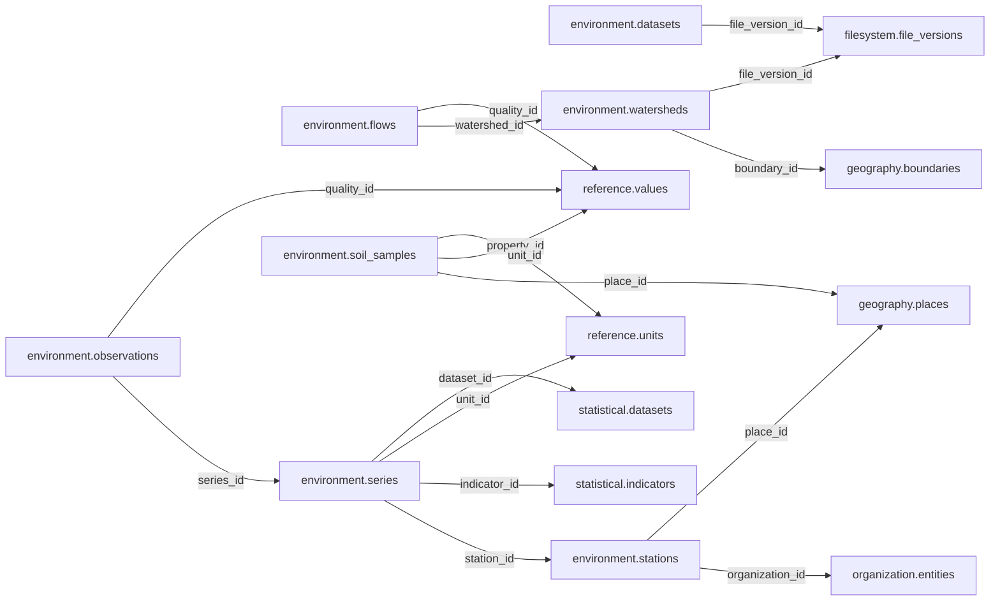

# environment — Phase 02

> **DEFERRED AND UNAPPROVED.** Retained for complete inventory only. Moving this proposal here does not approve it, start planning, or authorize table redesign or implementation. Older review/approval wording below is historical; this status controls.

See [Phase 02](README.md) and [the catalogue](../README.md). References to the former Person/Organization, Political/Electoral and Participation names in the retained proposal mean historical inputs now organized under Official, Politics and Accountability. Direct domain-to-Legal links in this deferred material are not current contracts; any future review must follow Reference mediation.

## Retained proposal — unchanged design

# environment schema — review and approval proposal

> **PROPOSED — USER REVIEW REQUIRED.** This is the review authority for whether the schema should exist and which tables/columns it owns. No SQL or migration is authorized.

## Purpose and ownership

**Target:** Main. **Purpose:** Climate, weather, hydrology and environmental measurement. This separate schema is a proposal based on distinct lifecycle, vocabulary and queries; merging or rejection remains open. Related owners: geography,biology,agriculture,statistics.

## Current implementation and gaps

The active manifest has 30 manifest migrations and 49 distinct CREATE TABLE declarations (49 distinct current table names) in schemas `audit`, `auth`, `engine`, `filesystem`, `geography`, `legal`, `objects`, `reference`. Generated Dryv has 124 entities (digest `e0087da9cf5b00e91f283a5501c368c7696bdd841ea30629231dc9c590f7c1ee`). Counts describe current artifacts, not target design; SQL and Dryv diverge.

- SQL declarations: None found.
- Dryv entities: None found.

The inventory does not establish live database state and may miss ALTER-only changes. Before implementation, reconcile migrations, Dryv, generated output and callers.

## Proposed relationship map

> All nodes and edges are proposals. Main schemas may use local cross-schema foreign keys; no edge crosses the Main/Operations database boundary.

## Proposed table and column review

All tables and fields are hypothetical. Every proposed business column is listed; UUIDv7 `id` is a candidate default and remains open. Record every existing field disposition: KEEP / REMOVE / RENAME / MOVE / MERGE / SPLIT / DERIVE / ADD.

### `environment.stations` — Stable monitoring station

- **Example:** Rain gauge
- **Profile:** entity; planning envelope below.

| Column | Proposed type | Meaning | Nullable | Default | Relationship | Units / validation | Proposed disposition |
|---|---|---|---|---|---|---|---|
| `id` | `uuid` | Proposed stable identity | No | Rust UUIDv7 candidate | Primary key | UUIDv7 candidate; unique and immutable after publication | ADD (proposed target field; pending user approval) |
| `code` | `text` | Station ID | No | — | — | Nonblank when required; enforce domain-specific length, normalization and controlled vocabulary | ADD (proposed target field; pending user approval) |
| `organization_id` | `uuid` | Operator | No | — | FK → `organization.entities` | UUID syntax; FK target must exist when the relationship is required | ADD (proposed target field; pending user approval) |
| `place_id` | `uuid` | Location | Yes | — | FK → `geography.places` | UUID syntax; FK target must exist when the relationship is required | ADD (proposed target field; pending user approval) |
| `installed_on` | `date` | Install | Yes | — | — | Type checked; domain constraints and units must be approved for this field | ADD (proposed target field; pending user approval) |
| `closed_on` | `date` | Closure | Yes | — | — | Type checked; domain constraints and units must be approved for this field | ADD (proposed target field; pending user approval) |

- **FK action/cardinality:** Each non-null FK is many-to-one to its named target; nullable FKs are optional. Candidate delete/update behavior is RESTRICT/NO ACTION for accepted records; cascading canonical deletion is not proposed. Confirm uniqueness and exact behavior during review.
- **Constraints:** UNIQUE(operator,code); closure >= install. Exact keys and cross-field checks remain for review.
- **Indexes:** primary key on `id`; candidate B-tree indexes on FK columns `organization_id`, `place_id` for joins and referenced-entity filters; add temporal/spatial indexes only where the stated query needs them and benchmarks support them.
- **Relationships:** resolve each FK target. Main allows cross-schema FKs. Main and Operations have no cross-database FK.
- **Evidence/time:** preserve exact source/version, observation/retrieval time, historical context and uncertainty where applicable. Approve the exact evidence path for this table.
- **Growth/storage estimate (illustrative planning envelope, not measured):** Low: initial 1,000, +200/year, peak 20/day; five-year 2,000 rows ≈ 2.0 MiB live row+index budget; Expected: initial 10,000, +2,000/year, peak 200/day; five-year 20,000 rows ≈ 19.5 MiB live row+index budget; High: initial 100,000, +20,000/year, peak 2,000/day; five-year 200,000 rows ≈ 195.3 MiB live row+index budget. Model: initial rows + annual accepted rows × 5; multiply by a per-row budget of 1 KiB including a coarse index allowance. Replace assumptions with actual samples, ingest rates and `pg_total_relation_size` before approval. Large object bytes are excluded; WAL, replicas, backups and S3 are budgeted separately.
- **Workload:** Interactive lookup by identity and approved foreign keys; batch scans for import/reconciliation. Peak-day figure above is a scenario assumption, not a service-level commitment.
- **Partitioning:** None proposed initially; decide from measured scale/query plans. Check late data and partition count.
- **Files:** originals, full-resolution geometry, arrays, media and large exports may be immutable S3 objects. Keep searchable identity, required facts, hashes, coverage, access and provenance in PostgreSQL; use manifests and selective reads.
- **Retention/risks/benchmark:** preserve accepted evidence and corrections. Review late arrivals, contention, index/partition growth and recovery. Benchmark joins, filters, spatial access, ingestion bursts, concurrent access and interrupted publication.
### `environment.series` — Typed environmental data stream

- **Example:** Daily rainfall series
- **Profile:** catalog; planning envelope below.

| Column | Proposed type | Meaning | Nullable | Default | Relationship | Units / validation | Proposed disposition |
|---|---|---|---|---|---|---|---|
| `id` | `uuid` | Proposed stable identity | No | Rust UUIDv7 candidate | Primary key | UUIDv7 candidate; unique and immutable after publication | ADD (proposed target field; pending user approval) |
| `station_id` | `uuid` | Station | Yes | — | FK → `environment.stations` | UUID syntax; FK target must exist when the relationship is required | ADD (proposed target field; pending user approval) |
| `indicator_id` | `uuid` | Measure | No | — | FK → `statistical.indicators` | UUID syntax; FK target must exist when the relationship is required | ADD (proposed target field; pending user approval) |
| `geometry` | `geometry(Geometry,4326)` | Spatial coverage | Yes | — | — | Type checked; domain constraints and units must be approved for this field | ADD (proposed target field; pending user approval) |
| `unit_id` | `uuid` | Unit | No | — | FK → `reference.units` | UUID syntax; FK target must exist when the relationship is required | ADD (proposed target field; pending user approval) |
| `resolution` | `interval` | Sampling interval | Yes | — | — | Type checked; domain constraints and units must be approved for this field | ADD (proposed target field; pending user approval) |
| `dataset_id` | `uuid` | Publisher release | Yes | — | FK → `statistical.datasets` | UUID syntax; FK target must exist when the relationship is required | ADD (proposed target field; pending user approval) |

- **FK action/cardinality:** Each non-null FK is many-to-one to its named target; nullable FKs are optional. Candidate delete/update behavior is RESTRICT/NO ACTION for accepted records; cascading canonical deletion is not proposed. Confirm uniqueness and exact behavior during review.
- **Constraints:** Exactly one station, spatial coverage or dataset scope. Exact keys and cross-field checks remain for review.
- **Indexes:** primary key on `id`; candidate B-tree indexes on FK columns `station_id`, `indicator_id`, `unit_id`, `dataset_id` for joins and referenced-entity filters; add temporal/spatial indexes only where the stated query needs them and benchmarks support them.
- **Relationships:** resolve each FK target. Main allows cross-schema FKs. Main and Operations have no cross-database FK.
- **Evidence/time:** preserve exact source/version, observation/retrieval time, historical context and uncertainty where applicable. Approve the exact evidence path for this table.
- **Growth/storage estimate (illustrative planning envelope, not measured):** Low: initial 100, +100/year, peak 5/day; five-year 600 rows ≈ 0.6 MiB live row+index budget; Expected: initial 1,000, +500/year, peak 25/day; five-year 3,500 rows ≈ 3.4 MiB live row+index budget; High: initial 10,000, +5,000/year, peak 250/day; five-year 35,000 rows ≈ 34.2 MiB live row+index budget. Model: initial rows + annual accepted rows × 5; multiply by a per-row budget of 1 KiB including a coarse index allowance. Replace assumptions with actual samples, ingest rates and `pg_total_relation_size` before approval. Large object bytes are excluded; WAL, replicas, backups and S3 are budgeted separately.
- **Workload:** Interactive lookup by identity and approved foreign keys; batch scans for import/reconciliation. Peak-day figure above is a scenario assumption, not a service-level commitment.
- **Partitioning:** None proposed initially; decide from measured scale/query plans. Check late data and partition count.
- **Files:** originals, full-resolution geometry, arrays, media and large exports may be immutable S3 objects. Keep searchable identity, required facts, hashes, coverage, access and provenance in PostgreSQL; use manifests and selective reads.
- **Retention/risks/benchmark:** preserve accepted evidence and corrections. Review late arrivals, contention, index/partition growth and recovery. Benchmark joins, filters, spatial access, ingestion bursts, concurrent access and interrupted publication.
### `environment.observations` — Accepted values with source identity

- **Example:** Hourly temperature
- **Profile:** series; planning envelope below.

| Column | Proposed type | Meaning | Nullable | Default | Relationship | Units / validation | Proposed disposition |
|---|---|---|---|---|---|---|---|
| `id` | `uuid` | Proposed stable identity | No | Rust UUIDv7 candidate | Primary key | UUIDv7 candidate; unique and immutable after publication | ADD (proposed target field; pending user approval) |
| `series_id` | `uuid` | Series | No | — | FK → `environment.series` | UUID syntax; FK target must exist when the relationship is required | ADD (proposed target field; pending user approval) |
| `observed_at` | `timestamptz` | Measure time | No | — | — | Type checked; domain constraints and units must be approved for this field | ADD (proposed target field; pending user approval) |
| `value` | `numeric` | Value | No | — | — | Type checked; domain constraints and units must be approved for this field | ADD (proposed target field; pending user approval) |
| `quality_id` | `uuid` | Quality flag | No | — | FK → `reference.values` | UUID syntax; FK target must exist when the relationship is required | ADD (proposed target field; pending user approval) |
| `uncertainty` | `numeric` | Error | Yes | — | — | Type checked; domain constraints and units must be approved for this field | ADD (proposed target field; pending user approval) |
| `source_key` | `text` | Upstream row identity | Yes | — | — | Nonblank when required; enforce domain-specific length, normalization and controlled vocabulary | ADD (proposed target field; pending user approval) |

- **FK action/cardinality:** Each non-null FK is many-to-one to its named target; nullable FKs are optional. Candidate delete/update behavior is RESTRICT/NO ACTION for accepted records; cascading canonical deletion is not proposed. Confirm uniqueness and exact behavior during review.
- **Constraints:** Unique source key when supplied; time partition candidate; late arrival tracked. Exact keys and cross-field checks remain for review.
- **Indexes:** primary key on `id`; candidate B-tree indexes on FK columns `series_id`, `quality_id` for joins and referenced-entity filters; add temporal/spatial indexes only where the stated query needs them and benchmarks support them.
- **Relationships:** resolve each FK target. Main allows cross-schema FKs. Main and Operations have no cross-database FK.
- **Evidence/time:** preserve exact source/version, observation/retrieval time, historical context and uncertainty where applicable. Approve the exact evidence path for this table.
- **Growth/storage estimate (illustrative planning envelope, not measured):** Low: initial 100,000, +100,000/year, peak 5,000/day; five-year 600,000 rows ≈ 1,171.9 MiB live row+index budget; Expected: initial 1,000,000, +1,000,000/year, peak 50,000/day; five-year 6,000,000 rows ≈ 11,718.8 MiB live row+index budget; High: initial 10,000,000, +10,000,000/year, peak 500,000/day; five-year 60,000,000 rows ≈ 117,187.5 MiB live row+index budget. Model: initial rows + annual accepted rows × 5; multiply by a per-row budget of 2 KiB including a coarse index allowance. Replace assumptions with actual samples, ingest rates and `pg_total_relation_size` before approval. Large object bytes are excluded; WAL, replicas, backups and S3 are budgeted separately.
- **Workload:** Interactive lookup by identity and approved foreign keys; batch scans for import/reconciliation. Peak-day figure above is a scenario assumption, not a service-level commitment.
- **Partitioning:** No partition approved. Benchmark first; time range is a candidate for append-heavy observations, and keys must include partition columns. Releases are normally unpartitioned unless measured need appears. Check late data and partition count.
- **Files:** originals, full-resolution geometry, arrays, media and large exports may be immutable S3 objects. Keep searchable identity, required facts, hashes, coverage, access and provenance in PostgreSQL; use manifests and selective reads.
- **Retention/risks/benchmark:** preserve accepted evidence and corrections. Review late arrivals, contention, index/partition growth and recovery. Benchmark joins, filters, spatial access, ingestion bursts, concurrent access and interrupted publication.
### `environment.datasets` — Chunked environment arrays and manifests

- **Example:** Climate Zarr
- **Profile:** release; planning envelope below.

| Column | Proposed type | Meaning | Nullable | Default | Relationship | Units / validation | Proposed disposition |
|---|---|---|---|---|---|---|---|
| `id` | `uuid` | Proposed stable identity | No | Rust UUIDv7 candidate | Primary key | UUIDv7 candidate; unique and immutable after publication | ADD (proposed target field; pending user approval) |
| `title` | `text` | Dataset | No | — | — | Nonblank when required; enforce domain-specific length, normalization and controlled vocabulary | ADD (proposed target field; pending user approval) |
| `file_version_id` | `uuid` | Immutable data/manifest | No | — | FK → `filesystem.file_versions` | UUID syntax; FK target must exist when the relationship is required | ADD (proposed target field; pending user approval) |
| `coverage` | `geometry(Geometry,4326)` | Spatial extent | No | — | — | Type checked; domain constraints and units must be approved for this field | ADD (proposed target field; pending user approval) |
| `time_start` | `timestamptz` | Start | Yes | — | — | Type checked; domain constraints and units must be approved for this field | ADD (proposed target field; pending user approval) |
| `time_end` | `timestamptz` | End | Yes | — | — | Type checked; domain constraints and units must be approved for this field | ADD (proposed target field; pending user approval) |
| `format` | `text` | NetCDF, Zarr, GeoParquet or COG | No | — | — | Nonblank when required; enforce domain-specific length, normalization and controlled vocabulary | ADD (proposed target field; pending user approval) |
| `resolution` | `text` | Spatial/time grid | No | — | — | Nonblank when required; enforce domain-specific length, normalization and controlled vocabulary | ADD (proposed target field; pending user approval) |

- **FK action/cardinality:** Each non-null FK is many-to-one to its named target; nullable FKs are optional. Candidate delete/update behavior is RESTRICT/NO ACTION for accepted records; cascading canonical deletion is not proposed. Confirm uniqueness and exact behavior during review.
- **Constraints:** End >= start; chunks and CRS documented. Exact keys and cross-field checks remain for review.
- **Indexes:** primary key on `id`; candidate B-tree indexes on FK columns `file_version_id` for joins and referenced-entity filters; add temporal/spatial indexes only where the stated query needs them and benchmarks support them.
- **Relationships:** resolve each FK target. Main allows cross-schema FKs. Main and Operations have no cross-database FK.
- **Evidence/time:** preserve exact source/version, observation/retrieval time, historical context and uncertainty where applicable. Approve the exact evidence path for this table.
- **Growth/storage estimate (illustrative planning envelope, not measured):** Low: initial 100, +20/year, peak 10/day; five-year 200 rows ≈ 0.4 MiB live row+index budget; Expected: initial 1,000, +200/year, peak 100/day; five-year 2,000 rows ≈ 3.9 MiB live row+index budget; High: initial 10,000, +2,000/year, peak 1,000/day; five-year 20,000 rows ≈ 39.1 MiB live row+index budget. Model: initial rows + annual accepted rows × 5; multiply by a per-row budget of 2 KiB including a coarse index allowance. Replace assumptions with actual samples, ingest rates and `pg_total_relation_size` before approval. Large object bytes are excluded; WAL, replicas, backups and S3 are budgeted separately.
- **Workload:** Interactive lookup by identity and approved foreign keys; batch scans for import/reconciliation. Peak-day figure above is a scenario assumption, not a service-level commitment.
- **Partitioning:** No partition approved. Benchmark first; time range is a candidate for append-heavy observations, and keys must include partition columns. Releases are normally unpartitioned unless measured need appears. Check late data and partition count.
- **Files:** originals, full-resolution geometry, arrays, media and large exports may be immutable S3 objects. Keep searchable identity, required facts, hashes, coverage, access and provenance in PostgreSQL; use manifests and selective reads.
- **Retention/risks/benchmark:** preserve accepted evidence and corrections. Review late arrivals, contention, index/partition growth and recovery. Benchmark joins, filters, spatial access, ingestion bursts, concurrent access and interrupted publication.
### `environment.watersheds` — Catchments and hydrological identity

- **Example:** Catchment
- **Profile:** geometry; planning envelope below.

| Column | Proposed type | Meaning | Nullable | Default | Relationship | Units / validation | Proposed disposition |
|---|---|---|---|---|---|---|---|
| `id` | `uuid` | Proposed stable identity | No | Rust UUIDv7 candidate | Primary key | UUIDv7 candidate; unique and immutable after publication | ADD (proposed target field; pending user approval) |
| `code` | `text` | Hydrological identity | No | — | — | Nonblank when required; enforce domain-specific length, normalization and controlled vocabulary | ADD (proposed target field; pending user approval) |
| `name` | `text` | Name | No | — | — | Nonblank when required; enforce domain-specific length, normalization and controlled vocabulary | ADD (proposed target field; pending user approval) |
| `boundary_id` | `uuid` | Political context | Yes | — | FK → `geography.boundaries` | UUID syntax; FK target must exist when the relationship is required | ADD (proposed target field; pending user approval) |
| `file_version_id` | `uuid` | Full geometry | Yes | — | FK → `filesystem.file_versions` | UUID syntax; FK target must exist when the relationship is required | ADD (proposed target field; pending user approval) |
| `geometry` | `geometry(MultiPolygon,4326)` | Curated outline | Yes | — | — | Type checked; domain constraints and units must be approved for this field | ADD (proposed target field; pending user approval) |

- **FK action/cardinality:** Each non-null FK is many-to-one to its named target; nullable FKs are optional. Candidate delete/update behavior is RESTRICT/NO ACTION for accepted records; cascading canonical deletion is not proposed. Confirm uniqueness and exact behavior during review.
- **Constraints:** Geometry validity; cross-border watersheds allowed. Exact keys and cross-field checks remain for review.
- **Indexes:** primary key on `id`; candidate B-tree indexes on FK columns `boundary_id`, `file_version_id` for joins and referenced-entity filters; add temporal/spatial indexes only where the stated query needs them and benchmarks support them.
- **Relationships:** resolve each FK target. Main allows cross-schema FKs. Main and Operations have no cross-database FK.
- **Evidence/time:** preserve exact source/version, observation/retrieval time, historical context and uncertainty where applicable. Approve the exact evidence path for this table.
- **Growth/storage estimate (illustrative planning envelope, not measured):** Low: initial 100, +20/year, peak 10/day; five-year 200 rows ≈ 0.8 MiB live row+index budget; Expected: initial 1,000, +200/year, peak 100/day; five-year 2,000 rows ≈ 7.8 MiB live row+index budget; High: initial 10,000, +2,000/year, peak 1,000/day; five-year 20,000 rows ≈ 78.1 MiB live row+index budget. Model: initial rows + annual accepted rows × 5; multiply by a per-row budget of 4 KiB including a coarse index allowance. Replace assumptions with actual samples, ingest rates and `pg_total_relation_size` before approval. Large object bytes are excluded; WAL, replicas, backups and S3 are budgeted separately.
- **Workload:** Interactive lookup by identity and approved foreign keys; batch scans for import/reconciliation. Peak-day figure above is a scenario assumption, not a service-level commitment.
- **Partitioning:** No partition approved. Benchmark first; time range is a candidate for append-heavy observations, and keys must include partition columns. Releases are normally unpartitioned unless measured need appears. Check late data and partition count.
- **Files:** originals, full-resolution geometry, arrays, media and large exports may be immutable S3 objects. Keep searchable identity, required facts, hashes, coverage, access and provenance in PostgreSQL; use manifests and selective reads.
- **Retention/risks/benchmark:** preserve accepted evidence and corrections. Review late arrivals, contention, index/partition growth and recovery. Benchmark joins, filters, spatial access, ingestion bursts, concurrent access and interrupted publication.
### `environment.flows` — Observed hydrological series

- **Example:** River discharge
- **Profile:** series; planning envelope below.

| Column | Proposed type | Meaning | Nullable | Default | Relationship | Units / validation | Proposed disposition |
|---|---|---|---|---|---|---|---|
| `id` | `uuid` | Proposed stable identity | No | Rust UUIDv7 candidate | Primary key | UUIDv7 candidate; unique and immutable after publication | ADD (proposed target field; pending user approval) |
| `watershed_id` | `uuid` | Catchment | No | — | FK → `environment.watersheds` | UUID syntax; FK target must exist when the relationship is required | ADD (proposed target field; pending user approval) |
| `observed_at` | `timestamptz` | Time | No | — | — | Type checked; domain constraints and units must be approved for this field | ADD (proposed target field; pending user approval) |
| `flow_m3_s` | `numeric` | Flow rate | No | — | — | Type checked; domain constraints and units must be approved for this field | ADD (proposed target field; pending user approval) |
| `quality_id` | `uuid` | Quality | No | — | FK → `reference.values` | UUID syntax; FK target must exist when the relationship is required | ADD (proposed target field; pending user approval) |
| `source_key` | `text` | Source identity | Yes | — | — | Nonblank when required; enforce domain-specific length, normalization and controlled vocabulary | ADD (proposed target field; pending user approval) |

- **FK action/cardinality:** Each non-null FK is many-to-one to its named target; nullable FKs are optional. Candidate delete/update behavior is RESTRICT/NO ACTION for accepted records; cascading canonical deletion is not proposed. Confirm uniqueness and exact behavior during review.
- **Constraints:** Unit and range validation; time partition after volume benchmark. Exact keys and cross-field checks remain for review.
- **Indexes:** primary key on `id`; candidate B-tree indexes on FK columns `watershed_id`, `quality_id` for joins and referenced-entity filters; add temporal/spatial indexes only where the stated query needs them and benchmarks support them.
- **Relationships:** resolve each FK target. Main allows cross-schema FKs. Main and Operations have no cross-database FK.
- **Evidence/time:** preserve exact source/version, observation/retrieval time, historical context and uncertainty where applicable. Approve the exact evidence path for this table.
- **Growth/storage estimate (illustrative planning envelope, not measured):** Low: initial 100,000, +100,000/year, peak 5,000/day; five-year 600,000 rows ≈ 1,171.9 MiB live row+index budget; Expected: initial 1,000,000, +1,000,000/year, peak 50,000/day; five-year 6,000,000 rows ≈ 11,718.8 MiB live row+index budget; High: initial 10,000,000, +10,000,000/year, peak 500,000/day; five-year 60,000,000 rows ≈ 117,187.5 MiB live row+index budget. Model: initial rows + annual accepted rows × 5; multiply by a per-row budget of 2 KiB including a coarse index allowance. Replace assumptions with actual samples, ingest rates and `pg_total_relation_size` before approval. Large object bytes are excluded; WAL, replicas, backups and S3 are budgeted separately.
- **Workload:** Interactive lookup by identity and approved foreign keys; batch scans for import/reconciliation. Peak-day figure above is a scenario assumption, not a service-level commitment.
- **Partitioning:** No partition approved. Benchmark first; time range is a candidate for append-heavy observations, and keys must include partition columns. Releases are normally unpartitioned unless measured need appears. Check late data and partition count.
- **Files:** originals, full-resolution geometry, arrays, media and large exports may be immutable S3 objects. Keep searchable identity, required facts, hashes, coverage, access and provenance in PostgreSQL; use manifests and selective reads.
- **Retention/risks/benchmark:** preserve accepted evidence and corrections. Review late arrivals, contention, index/partition growth and recovery. Benchmark joins, filters, spatial access, ingestion bursts, concurrent access and interrupted publication.
### `environment.soil_samples` — Published soil measurements

- **Example:** Soil acidity
- **Profile:** fact; planning envelope below.

| Column | Proposed type | Meaning | Nullable | Default | Relationship | Units / validation | Proposed disposition |
|---|---|---|---|---|---|---|---|
| `id` | `uuid` | Proposed stable identity | No | Rust UUIDv7 candidate | Primary key | UUIDv7 candidate; unique and immutable after publication | ADD (proposed target field; pending user approval) |
| `place_id` | `uuid` | Sampling location | No | — | FK → `geography.places` | UUID syntax; FK target must exist when the relationship is required | ADD (proposed target field; pending user approval) |
| `collected_at` | `timestamptz` | Collection time | No | — | — | Type checked; domain constraints and units must be approved for this field | ADD (proposed target field; pending user approval) |
| `depth_cm` | `numeric` | Depth | Yes | — | — | Type checked; domain constraints and units must be approved for this field | ADD (proposed target field; pending user approval) |
| `property_id` | `uuid` | Soil property | No | — | FK → `reference.values` | UUID syntax; FK target must exist when the relationship is required | ADD (proposed target field; pending user approval) |
| `value` | `numeric` | Result | No | — | — | Type checked; domain constraints and units must be approved for this field | ADD (proposed target field; pending user approval) |
| `unit_id` | `uuid` | Unit | No | — | FK → `reference.units` | UUID syntax; FK target must exist when the relationship is required | ADD (proposed target field; pending user approval) |
| `method` | `text` | Measurement method | No | — | — | Nonblank when required; enforce domain-specific length, normalization and controlled vocabulary | ADD (proposed target field; pending user approval) |

- **FK action/cardinality:** Each non-null FK is many-to-one to its named target; nullable FKs are optional. Candidate delete/update behavior is RESTRICT/NO ACTION for accepted records; cascading canonical deletion is not proposed. Confirm uniqueness and exact behavior during review.
- **Constraints:** Depth nonnegative; preserve original unit/method. Exact keys and cross-field checks remain for review.
- **Indexes:** primary key on `id`; candidate B-tree indexes on FK columns `place_id`, `property_id`, `unit_id` for joins and referenced-entity filters; add temporal/spatial indexes only where the stated query needs them and benchmarks support them.
- **Relationships:** resolve each FK target. Main allows cross-schema FKs. Main and Operations have no cross-database FK.
- **Evidence/time:** preserve exact source/version, observation/retrieval time, historical context and uncertainty where applicable. Approve the exact evidence path for this table.
- **Growth/storage estimate (illustrative planning envelope, not measured):** Low: initial 10,000, +2,000/year, peak 100/day; five-year 20,000 rows ≈ 39.1 MiB live row+index budget; Expected: initial 100,000, +20,000/year, peak 1,000/day; five-year 200,000 rows ≈ 390.6 MiB live row+index budget; High: initial 1,000,000, +200,000/year, peak 10,000/day; five-year 2,000,000 rows ≈ 3,906.2 MiB live row+index budget. Model: initial rows + annual accepted rows × 5; multiply by a per-row budget of 2 KiB including a coarse index allowance. Replace assumptions with actual samples, ingest rates and `pg_total_relation_size` before approval. Large object bytes are excluded; WAL, replicas, backups and S3 are budgeted separately.
- **Workload:** Interactive lookup by identity and approved foreign keys; batch scans for import/reconciliation. Peak-day figure above is a scenario assumption, not a service-level commitment.
- **Partitioning:** None proposed initially; decide from measured scale/query plans. Check late data and partition count.
- **Files:** originals, full-resolution geometry, arrays, media and large exports may be immutable S3 objects. Keep searchable identity, required facts, hashes, coverage, access and provenance in PostgreSQL; use manifests and selective reads.
- **Retention/risks/benchmark:** preserve accepted evidence and corrections. Review late arrivals, contention, index/partition growth and recovery. Benchmark joins, filters, spatial access, ingestion bursts, concurrent access and interrupted publication.

## Queries, lifecycle, capacity and approval

**Representative query:** What was measured for this location, coverage and period?

Lifecycle: preserve source bytes; extract into candidate revisions; validate; review or use approved deterministic checks; atomically publish; serve. Corrections create explicit versions/supersession. Preserve disagreement and uncertainty.

Capacity is unmeasured. Use low/expected/high input scenarios, explicit formulas and workload benchmarks; do not assume sizes or universal partitions.

**Status:** NOT REVIEWED. Schema existence, tables, columns, relationships, partitioning and S3 choices require user approval. Feedback: none. Approval reference/date/revision: none. Implementation authorization: not granted. Material changes reopen approval.

Earlier schema proposal preserved for history; superseded and not an approval

---
id: DOC-EXP-ENVIRONMENT-20261111
name: Environment domain expansion brief
type: documentation
tags: [system-expansion, hypothetical, schema-design, environment]
extra: {status: hypothetical, approval: not_approved, implementation: not_authorized, recorded_on: 2026-11-11}
---

# Environment — observations, monitoring and environmental products

> **Status: HYPOTHETICAL DOMAIN BRIEF.** No Environment SQL is approved. This proposal is subordinate to the [system-expansion proposal](../../guides/advancement-and-system-expansion.md).

## 1. Purpose and exploration areas

Environment preserves monitored environmental conditions and model products, supporting Geography and Nature, History, Statistical analysis and Civic risk/service exploration.

## 2. Domain ownership

Candidate ownership: environmental monitoring stations/sensors, raw readings, calibration/deployment facts, environmental surveys and model/scenario metadata tied to original datasets.

## 3. Exclusions

Geography owns station place and geometry. Filesystem owns source and derived bytes. Statistical owns published/derived comparable series and indicators. Civic owns constructed infrastructure identity. Biology owns taxa and occurrences.

## 4. Existing schema and table inventory

No Environment schema is present in active SQL migrations or current listed Dryv domain contracts. This is a new hypothetical domain. Existing Statistical design owns datasets and observations but needs reconciliation to distinguish raw readings from aggregated series.

## 5. Candidate tables

| Candidate | Responsibility |
|---|---|
| `stations` | Monitoring site identity, operator and station history. |
| `sensors` | Instrument identity, measurement capability and deployment/calibration intervals. |
| `readings` | Original timestamped measurement with quantity, unit, status/quality and sensor FK. |
| `surveys` | Structured sampling campaign for environmental conditions. |
| `models` | Model/method identity, version, scenario and configuration references. |
| `products` | Dataset releases or model outputs with temporal/spatial coverage and file-version linkage. |

High-volume gridded products may remain filesystem assets indexed by metadata rather than row-per-cell database records.

## 6. Primary and foreign-key relationships

Readings should FK to sensor and, through a deployment, station; sensor deployment must be time-consistent. Stations link to Geography places. Products pin filesystem file versions, source evidence, model version and explicit coverage. Statistical derivations link back to Environment inputs through typed relationships.

## 7. Cross-domain relationships

Raw sensor readings belong only to Environment. Statistical may contain a summarized series derived from readings, with method and input lineage, but must not duplicate the raw stream. Environmental assets can link to Biology surveys, Civic infrastructure, Agriculture fields and Geography features.

## 8. Geographic responsibilities

Retain sensor coordinates/geometry through Geography place identity or a sourced deployment representation. Gridded products specify CRS, bounds, resolution, coordinate axes, nodata and spatial coverage. Uncertain locations remain uncertain.

## 9. Temporal responsibilities

A reading's observation instant/interval, sensor deployment interval, calibration period, model run period and dataset validity are different facts. Preserve source publication and Mzizi retrieval times separately. Avoid a universal `valid_from/to` pair.

## 10. Evidence and provenance

Preserve raw readings/files where available, source release, station/instrument identifiers, calibration, transformation, quality flags, model/version, inputs and uncertainty. Distinguish measured, interpolated, reanalysis, forecast and scenario values.

## 11. Acquisition categories

Static seed: measurement vocabularies. Pattern seed: only approved expected monitoring inventories. Collected: station feeds and published environmental files. Derived: aggregates, interpolations and indices with reproducible recipes. Record actual row lineage.

## 12. Derived data

Environment can host source-native transformations and model outputs. Statistical owns comparable time series and indicators; Geography owns spatial representations. Derivation records pin exact inputs, method, software/config and output asset.

## 13. Example queries

- What rainfall was observed at this station during a period, with quality flags?
- Which temperature grids cover this historical boundary edition?
- What sensor and method support the drought exposure shown for this place?

## 14. UI/API requirements

Expose time-series, station maps and raster/vector layer capabilities only when resolution, coverage, licensing and data quality are known. Provide missing-data and uncertainty states.

## 15. Integrity constraints to investigate

Unit compatibility, timestamp/calendar semantics, sensor deployment overlap, calibration validity, duplicate source readings, station identifier changes, null/nodata meaning, model input pinning and temporal coverage consistency.

## 16. Technical standards to evaluate

NetCDF/Zarr and CF conventions; OGC SensorThings and EDR; STAC; GeoTIFF/Cloud Optimized GeoTIFF; PostGIS for curated vectors. Evaluate interoperability per product rather than requiring one format for all data.

## 17. Open questions

Which observations belong in domain tables versus immutable data assets? How to model telemetry volume? Are sensor and model records separate domains? Which environmental products are valuable first? What access controls protect sensitive monitoring locations?

## 18. Review and approval status

Hypothetical; not reviewed or approved. Reconcile with Statistical, Geography, Biology, files and data-engine contracts before schema planning.

