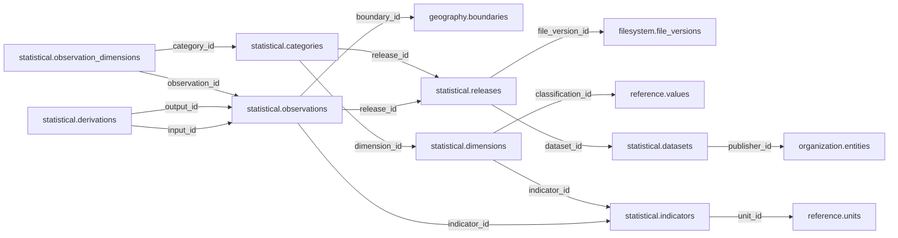

# statistical — Phase 02

> **DEFERRED AND UNAPPROVED.** Retained for complete inventory only. Moving this proposal here does not approve it, start planning, or authorize table redesign or implementation. Older review/approval wording below is historical; this status controls.

See [Phase 02](README.md) and [the catalogue](../README.md). References to the former Person/Organization, Political/Electoral and Participation names in the retained proposal mean historical inputs now organized under Official, Politics and Accountability. Direct domain-to-Legal links in this deferred material are not current contracts; any future review must follow Reference mediation.

## Retained proposal — unchanged design

# statistical schema — review and approval proposal

> **PROPOSED — USER REVIEW REQUIRED.** This is the review authority for whether the schema should exist and which tables/columns it owns. No SQL or migration is authorized.

## Purpose and ownership

**Target:** Main. **Purpose:** Published statistical releases and observations. This separate schema is a proposal based on distinct lifecycle, vocabulary and queries; merging or rejection remains open. Related owners: geography,reference,source.

## Current implementation and gaps

The active manifest has 30 manifest migrations and 49 distinct CREATE TABLE declarations (49 distinct current table names) in schemas `audit`, `auth`, `engine`, `filesystem`, `geography`, `legal`, `objects`, `reference`. Generated Dryv has 124 entities (digest `e0087da9cf5b00e91f283a5501c368c7696bdd841ea30629231dc9c590f7c1ee`). Counts describe current artifacts, not target design; SQL and Dryv diverge.

- SQL declarations: None found.
- Dryv entities: `statistical.dimensions` (statistics.Dimension), `statistical.dimension_members` (statistics.DimensionMember), `statistical.indicators` (statistics.Indicator), `statistical.categories` (statistics.IndicatorCategory), `statistical.fields` (statistics.IndicatorColumn), `statistical.observations` (statistics.Observation), `statistical.observation_derivations` (statistics.ObservationDerivation), `statistical.observation_dimensions` (statistics.ObservationDimension), `statistical.periods` (statistics.Period), `statistical.datasets` (statistics.StatisticsTable), `statistical.vintages` (statistics.Vintage)

The inventory does not establish live database state and may miss ALTER-only changes. Before implementation, reconcile migrations, Dryv, generated output and callers.

## Proposed relationship map

> All nodes and edges are proposals. Main schemas may use local cross-schema foreign keys; no edge crosses the Main/Operations database boundary.

## Proposed table and column review

All tables and fields are hypothetical. Every proposed business column is listed; UUIDv7 `id` is a candidate default and remains open. Record every existing field disposition: KEEP / REMOVE / RENAME / MOVE / MERGE / SPLIT / DERIVE / ADD.

### `statistical.datasets` — Publisher dataset identity

- **Example:** Census dataset
- **Profile:** catalog; planning envelope below.

| Column | Proposed type | Meaning | Nullable | Default | Relationship | Units / validation | Proposed disposition |
|---|---|---|---|---|---|---|---|
| `id` | `uuid` | Proposed stable identity | No | Rust UUIDv7 candidate | Primary key | UUIDv7 candidate; unique and immutable after publication | KEEP (candidate match to current SQL/Dryv field; confirm meaning) |
| `publisher_id` | `uuid` | Publisher | No | — | FK → `organization.entities` | UUID syntax; FK target must exist when the relationship is required | ADD (proposed target field; pending user approval) |
| `code` | `text` | Publisher code | No | — | — | Nonblank when required; enforce domain-specific length, normalization and controlled vocabulary | KEEP (candidate match to current SQL/Dryv field; confirm meaning) |
| `title` | `text` | Dataset name | No | — | — | Nonblank when required; enforce domain-specific length, normalization and controlled vocabulary | KEEP (candidate match to current SQL/Dryv field; confirm meaning) |

- **Current SQL/Dryv fields without a proposed same-name column:** `collector`, `created_at`, `geo_unit_id`, `indicator_id`, `is_current`, `jurisdiction_id`, `methodology`, `publisher_institution_id`, `updated_at`, `valid_from`, `valid_from_precision`, `valid_to`, `valid_to_precision`, `version`. **Disposition:** unresolved per field; propose KEEP, REMOVE, RENAME, MOVE, MERGE, SPLIT or DERIVE in review. Do not drop these fields until the user resolves each one.
- **FK action/cardinality:** Each non-null FK is many-to-one to its named target; nullable FKs are optional. Candidate delete/update behavior is RESTRICT/NO ACTION for accepted records; cascading canonical deletion is not proposed. Confirm uniqueness and exact behavior during review.
- **Constraints:** UNIQUE(publisher_id,code). Exact keys and cross-field checks remain for review.
- **Indexes:** primary key on `id`; candidate B-tree indexes on FK columns `publisher_id` for joins and referenced-entity filters; add temporal/spatial indexes only where the stated query needs them and benchmarks support them.
- **Relationships:** resolve each FK target. Main allows cross-schema FKs. Main and Operations have no cross-database FK.
- **Evidence/time:** preserve exact source/version, observation/retrieval time, historical context and uncertainty where applicable. Approve the exact evidence path for this table.
- **Growth/storage estimate (illustrative planning envelope, not measured):** Low: initial 100, +100/year, peak 5/day; five-year 600 rows ≈ 0.6 MiB live row+index budget; Expected: initial 1,000, +500/year, peak 25/day; five-year 3,500 rows ≈ 3.4 MiB live row+index budget; High: initial 10,000, +5,000/year, peak 250/day; five-year 35,000 rows ≈ 34.2 MiB live row+index budget. Model: initial rows + annual accepted rows × 5; multiply by a per-row budget of 1 KiB including a coarse index allowance. Replace assumptions with actual samples, ingest rates and `pg_total_relation_size` before approval. Large object bytes are excluded; WAL, replicas, backups and S3 are budgeted separately.
- **Workload:** Interactive lookup by identity and approved foreign keys; batch scans for import/reconciliation. Peak-day figure above is a scenario assumption, not a service-level commitment.
- **Partitioning:** None proposed initially; decide from measured scale/query plans. Check late data and partition count.
- **Files:** originals, full-resolution geometry, arrays, media and large exports may be immutable S3 objects. Keep searchable identity, required facts, hashes, coverage, access and provenance in PostgreSQL; use manifests and selective reads.
- **Retention/risks/benchmark:** preserve accepted evidence and corrections. Review late arrivals, contention, index/partition growth and recovery. Benchmark joins, filters, spatial access, ingestion bursts, concurrent access and interrupted publication.
### `statistical.releases` — Immutable published vintages

- **Example:** Corrected census release
- **Profile:** release; planning envelope below.

| Column | Proposed type | Meaning | Nullable | Default | Relationship | Units / validation | Proposed disposition |
|---|---|---|---|---|---|---|---|
| `id` | `uuid` | Proposed stable identity | No | Rust UUIDv7 candidate | Primary key | UUIDv7 candidate; unique and immutable after publication | ADD (proposed target field; pending user approval) |
| `dataset_id` | `uuid` | Dataset | No | — | FK → `statistical.datasets` | UUID syntax; FK target must exist when the relationship is required | ADD (proposed target field; pending user approval) |
| `edition` | `text` | Release ID | No | — | — | Nonblank when required; enforce domain-specific length, normalization and controlled vocabulary | ADD (proposed target field; pending user approval) |
| `released_on` | `date` | Publisher date | Yes | — | — | Type checked; domain constraints and units must be approved for this field | ADD (proposed target field; pending user approval) |
| `file_version_id` | `uuid` | Exact source release | No | — | FK → `filesystem.file_versions` | UUID syntax; FK target must exist when the relationship is required | ADD (proposed target field; pending user approval) |

- **FK action/cardinality:** Each non-null FK is many-to-one to its named target; nullable FKs are optional. Candidate delete/update behavior is RESTRICT/NO ACTION for accepted records; cascading canonical deletion is not proposed. Confirm uniqueness and exact behavior during review.
- **Constraints:** UNIQUE(dataset_id,edition). Exact keys and cross-field checks remain for review.
- **Indexes:** primary key on `id`; candidate B-tree indexes on FK columns `dataset_id`, `file_version_id` for joins and referenced-entity filters; add temporal/spatial indexes only where the stated query needs them and benchmarks support them.
- **Relationships:** resolve each FK target. Main allows cross-schema FKs. Main and Operations have no cross-database FK.
- **Evidence/time:** preserve exact source/version, observation/retrieval time, historical context and uncertainty where applicable. Approve the exact evidence path for this table.
- **Growth/storage estimate (illustrative planning envelope, not measured):** Low: initial 100, +20/year, peak 10/day; five-year 200 rows ≈ 0.4 MiB live row+index budget; Expected: initial 1,000, +200/year, peak 100/day; five-year 2,000 rows ≈ 3.9 MiB live row+index budget; High: initial 10,000, +2,000/year, peak 1,000/day; five-year 20,000 rows ≈ 39.1 MiB live row+index budget. Model: initial rows + annual accepted rows × 5; multiply by a per-row budget of 2 KiB including a coarse index allowance. Replace assumptions with actual samples, ingest rates and `pg_total_relation_size` before approval. Large object bytes are excluded; WAL, replicas, backups and S3 are budgeted separately.
- **Workload:** Interactive lookup by identity and approved foreign keys; batch scans for import/reconciliation. Peak-day figure above is a scenario assumption, not a service-level commitment.
- **Partitioning:** No partition approved. Benchmark first; time range is a candidate for append-heavy observations, and keys must include partition columns. Releases are normally unpartitioned unless measured need appears. Check late data and partition count.
- **Files:** originals, full-resolution geometry, arrays, media and large exports may be immutable S3 objects. Keep searchable identity, required facts, hashes, coverage, access and provenance in PostgreSQL; use manifests and selective reads.
- **Retention/risks/benchmark:** preserve accepted evidence and corrections. Review late arrivals, contention, index/partition growth and recovery. Benchmark joins, filters, spatial access, ingestion bursts, concurrent access and interrupted publication.
### `statistical.indicators` — Measure meaning and unit

- **Example:** Population total
- **Profile:** catalog; planning envelope below.

| Column | Proposed type | Meaning | Nullable | Default | Relationship | Units / validation | Proposed disposition |
|---|---|---|---|---|---|---|---|
| `id` | `uuid` | Proposed stable identity | No | Rust UUIDv7 candidate | Primary key | UUIDv7 candidate; unique and immutable after publication | KEEP (candidate match to current SQL/Dryv field; confirm meaning) |
| `code` | `text` | Stable code | No | — | — | Nonblank when required; enforce domain-specific length, normalization and controlled vocabulary | KEEP (candidate match to current SQL/Dryv field; confirm meaning) |
| `title` | `text` | Meaning | No | — | — | Nonblank when required; enforce domain-specific length, normalization and controlled vocabulary | ADD (proposed target field; pending user approval) |
| `unit_id` | `uuid` | Unit | No | — | FK → `reference.units` | UUID syntax; FK target must exist when the relationship is required | ADD (proposed target field; pending user approval) |
| `method` | `text` | Definition/method | No | — | — | Nonblank when required; enforce domain-specific length, normalization and controlled vocabulary | ADD (proposed target field; pending user approval) |

- **Current SQL/Dryv fields without a proposed same-name column:** `category_id`, `created_at`, `definition`, `is_current`, `name`, `parent_id`, `unit_of_measure`, `updated_at`, `valid_from`, `valid_from_precision`, `valid_to`, `valid_to_precision`, `version`. **Disposition:** unresolved per field; propose KEEP, REMOVE, RENAME, MOVE, MERGE, SPLIT or DERIVE in review. Do not drop these fields until the user resolves each one.
- **FK action/cardinality:** Each non-null FK is many-to-one to its named target; nullable FKs are optional. Candidate delete/update behavior is RESTRICT/NO ACTION for accepted records; cascading canonical deletion is not proposed. Confirm uniqueness and exact behavior during review.
- **Constraints:** UNIQUE(code). Exact keys and cross-field checks remain for review.
- **Indexes:** primary key on `id`; candidate B-tree indexes on FK columns `unit_id` for joins and referenced-entity filters; add temporal/spatial indexes only where the stated query needs them and benchmarks support them.
- **Relationships:** resolve each FK target. Main allows cross-schema FKs. Main and Operations have no cross-database FK.
- **Evidence/time:** preserve exact source/version, observation/retrieval time, historical context and uncertainty where applicable. Approve the exact evidence path for this table.
- **Growth/storage estimate (illustrative planning envelope, not measured):** Low: initial 100, +100/year, peak 5/day; five-year 600 rows ≈ 0.6 MiB live row+index budget; Expected: initial 1,000, +500/year, peak 25/day; five-year 3,500 rows ≈ 3.4 MiB live row+index budget; High: initial 10,000, +5,000/year, peak 250/day; five-year 35,000 rows ≈ 34.2 MiB live row+index budget. Model: initial rows + annual accepted rows × 5; multiply by a per-row budget of 1 KiB including a coarse index allowance. Replace assumptions with actual samples, ingest rates and `pg_total_relation_size` before approval. Large object bytes are excluded; WAL, replicas, backups and S3 are budgeted separately.
- **Workload:** Interactive lookup by identity and approved foreign keys; batch scans for import/reconciliation. Peak-day figure above is a scenario assumption, not a service-level commitment.
- **Partitioning:** None proposed initially; decide from measured scale/query plans. Check late data and partition count.
- **Files:** originals, full-resolution geometry, arrays, media and large exports may be immutable S3 objects. Keep searchable identity, required facts, hashes, coverage, access and provenance in PostgreSQL; use manifests and selective reads.
- **Retention/risks/benchmark:** preserve accepted evidence and corrections. Review late arrivals, contention, index/partition growth and recovery. Benchmark joins, filters, spatial access, ingestion bursts, concurrent access and interrupted publication.
### `statistical.dimensions` — Breakdown dimensions

- **Example:** Sex dimension
- **Profile:** catalog; planning envelope below.

| Column | Proposed type | Meaning | Nullable | Default | Relationship | Units / validation | Proposed disposition |
|---|---|---|---|---|---|---|---|
| `id` | `uuid` | Proposed stable identity | No | Rust UUIDv7 candidate | Primary key | UUIDv7 candidate; unique and immutable after publication | KEEP (candidate match to current SQL/Dryv field; confirm meaning) |
| `indicator_id` | `uuid` | Indicator | No | — | FK → `statistical.indicators` | UUID syntax; FK target must exist when the relationship is required | ADD (proposed target field; pending user approval) |
| `code` | `text` | Dimension | No | — | — | Nonblank when required; enforce domain-specific length, normalization and controlled vocabulary | KEEP (candidate match to current SQL/Dryv field; confirm meaning) |
| `classification_id` | `uuid` | Classification | No | — | FK → `reference.values` | UUID syntax; FK target must exist when the relationship is required | ADD (proposed target field; pending user approval) |

- **Current SQL/Dryv fields without a proposed same-name column:** `created_at`, `description`, `is_current`, `name`, `updated_at`, `valid_from`, `valid_from_precision`, `valid_to`, `valid_to_precision`, `version`. **Disposition:** unresolved per field; propose KEEP, REMOVE, RENAME, MOVE, MERGE, SPLIT or DERIVE in review. Do not drop these fields until the user resolves each one.
- **FK action/cardinality:** Each non-null FK is many-to-one to its named target; nullable FKs are optional. Candidate delete/update behavior is RESTRICT/NO ACTION for accepted records; cascading canonical deletion is not proposed. Confirm uniqueness and exact behavior during review.
- **Constraints:** UNIQUE(indicator_id,code). Exact keys and cross-field checks remain for review.
- **Indexes:** primary key on `id`; candidate B-tree indexes on FK columns `indicator_id`, `classification_id` for joins and referenced-entity filters; add temporal/spatial indexes only where the stated query needs them and benchmarks support them.
- **Relationships:** resolve each FK target. Main allows cross-schema FKs. Main and Operations have no cross-database FK.
- **Evidence/time:** preserve exact source/version, observation/retrieval time, historical context and uncertainty where applicable. Approve the exact evidence path for this table.
- **Growth/storage estimate (illustrative planning envelope, not measured):** Low: initial 100, +100/year, peak 5/day; five-year 600 rows ≈ 0.6 MiB live row+index budget; Expected: initial 1,000, +500/year, peak 25/day; five-year 3,500 rows ≈ 3.4 MiB live row+index budget; High: initial 10,000, +5,000/year, peak 250/day; five-year 35,000 rows ≈ 34.2 MiB live row+index budget. Model: initial rows + annual accepted rows × 5; multiply by a per-row budget of 1 KiB including a coarse index allowance. Replace assumptions with actual samples, ingest rates and `pg_total_relation_size` before approval. Large object bytes are excluded; WAL, replicas, backups and S3 are budgeted separately.
- **Workload:** Interactive lookup by identity and approved foreign keys; batch scans for import/reconciliation. Peak-day figure above is a scenario assumption, not a service-level commitment.
- **Partitioning:** None proposed initially; decide from measured scale/query plans. Check late data and partition count.
- **Files:** originals, full-resolution geometry, arrays, media and large exports may be immutable S3 objects. Keep searchable identity, required facts, hashes, coverage, access and provenance in PostgreSQL; use manifests and selective reads.
- **Retention/risks/benchmark:** preserve accepted evidence and corrections. Review late arrivals, contention, index/partition growth and recovery. Benchmark joins, filters, spatial access, ingestion bursts, concurrent access and interrupted publication.
### `statistical.categories` — Versioned dimension members

- **Example:** Age range
- **Profile:** catalog; planning envelope below.

| Column | Proposed type | Meaning | Nullable | Default | Relationship | Units / validation | Proposed disposition |
|---|---|---|---|---|---|---|---|
| `id` | `uuid` | Proposed stable identity | No | Rust UUIDv7 candidate | Primary key | UUIDv7 candidate; unique and immutable after publication | KEEP (candidate match to current SQL/Dryv field; confirm meaning) |
| `dimension_id` | `uuid` | Dimension | No | — | FK → `statistical.dimensions` | UUID syntax; FK target must exist when the relationship is required | ADD (proposed target field; pending user approval) |
| `code` | `text` | Member | No | — | — | Nonblank when required; enforce domain-specific length, normalization and controlled vocabulary | KEEP (candidate match to current SQL/Dryv field; confirm meaning) |
| `label` | `text` | Publisher label | No | — | — | Nonblank when required; enforce domain-specific length, normalization and controlled vocabulary | KEEP (candidate match to current SQL/Dryv field; confirm meaning) |
| `release_id` | `uuid` | Release | No | — | FK → `statistical.releases` | UUID syntax; FK target must exist when the relationship is required | ADD (proposed target field; pending user approval) |

- **Current SQL/Dryv fields without a proposed same-name column:** `created_at`, `is_current`, `parent_id`, `updated_at`, `valid_from`, `valid_from_precision`, `valid_to`, `valid_to_precision`, `version`. **Disposition:** unresolved per field; propose KEEP, REMOVE, RENAME, MOVE, MERGE, SPLIT or DERIVE in review. Do not drop these fields until the user resolves each one.
- **FK action/cardinality:** Each non-null FK is many-to-one to its named target; nullable FKs are optional. Candidate delete/update behavior is RESTRICT/NO ACTION for accepted records; cascading canonical deletion is not proposed. Confirm uniqueness and exact behavior during review.
- **Constraints:** UNIQUE(dimension_id,release_id,code). Exact keys and cross-field checks remain for review.
- **Indexes:** primary key on `id`; candidate B-tree indexes on FK columns `dimension_id`, `release_id` for joins and referenced-entity filters; add temporal/spatial indexes only where the stated query needs them and benchmarks support them.
- **Relationships:** resolve each FK target. Main allows cross-schema FKs. Main and Operations have no cross-database FK.
- **Evidence/time:** preserve exact source/version, observation/retrieval time, historical context and uncertainty where applicable. Approve the exact evidence path for this table.
- **Growth/storage estimate (illustrative planning envelope, not measured):** Low: initial 100, +100/year, peak 5/day; five-year 600 rows ≈ 0.6 MiB live row+index budget; Expected: initial 1,000, +500/year, peak 25/day; five-year 3,500 rows ≈ 3.4 MiB live row+index budget; High: initial 10,000, +5,000/year, peak 250/day; five-year 35,000 rows ≈ 34.2 MiB live row+index budget. Model: initial rows + annual accepted rows × 5; multiply by a per-row budget of 1 KiB including a coarse index allowance. Replace assumptions with actual samples, ingest rates and `pg_total_relation_size` before approval. Large object bytes are excluded; WAL, replicas, backups and S3 are budgeted separately.
- **Workload:** Interactive lookup by identity and approved foreign keys; batch scans for import/reconciliation. Peak-day figure above is a scenario assumption, not a service-level commitment.
- **Partitioning:** None proposed initially; decide from measured scale/query plans. Check late data and partition count.
- **Files:** originals, full-resolution geometry, arrays, media and large exports may be immutable S3 objects. Keep searchable identity, required facts, hashes, coverage, access and provenance in PostgreSQL; use manifests and selective reads.
- **Retention/risks/benchmark:** preserve accepted evidence and corrections. Review late arrivals, contention, index/partition growth and recovery. Benchmark joins, filters, spatial access, ingestion bursts, concurrent access and interrupted publication.
### `statistical.observations` — Published statistic for a defined cell

- **Example:** Population by area
- **Profile:** series; planning envelope below.

| Column | Proposed type | Meaning | Nullable | Default | Relationship | Units / validation | Proposed disposition |
|---|---|---|---|---|---|---|---|
| `id` | `uuid` | Proposed stable identity | No | Rust UUIDv7 candidate | Primary key | UUIDv7 candidate; unique and immutable after publication | KEEP (candidate match to current SQL/Dryv field; confirm meaning) |
| `release_id` | `uuid` | Vintage | No | — | FK → `statistical.releases` | UUID syntax; FK target must exist when the relationship is required | ADD (proposed target field; pending user approval) |
| `indicator_id` | `uuid` | Meaning | No | — | FK → `statistical.indicators` | UUID syntax; FK target must exist when the relationship is required | KEEP (candidate match to current SQL/Dryv field; confirm meaning) |
| `boundary_id` | `uuid` | Exact boundary release | Yes | — | FK → `geography.boundaries` | UUID syntax; FK target must exist when the relationship is required | ADD (proposed target field; pending user approval) |
| `period_start` | `date` | Start | No | — | — | Type checked; domain constraints and units must be approved for this field | ADD (proposed target field; pending user approval) |
| `period_end` | `date` | End | No | — | — | Type checked; domain constraints and units must be approved for this field | ADD (proposed target field; pending user approval) |
| `value` | `numeric` | Reported number | No | — | — | Type checked; domain constraints and units must be approved for this field | ADD (proposed target field; pending user approval) |
| `missing_reason` | `text` | Reason unavailable | Yes | — | — | Nonblank when required; enforce domain-specific length, normalization and controlled vocabulary | ADD (proposed target field; pending user approval) |
| `uncertainty` | `numeric` | Reported uncertainty | Yes | — | — | Type checked; domain constraints and units must be approved for this field | ADD (proposed target field; pending user approval) |

- **Current SQL/Dryv fields without a proposed same-name column:** `column_id`, `confidence_level`, `created_at`, `denominator_observation_id`, `denominator_value`, `estimate_kind`, `geo_unit_id`, `is_current`, `margin_of_error`, `measure_type`, `numeric_value`, `period_id`, `release_label`, `standard_error`, `table_id`, `text_value`, `updated_at`, `valid_from`, `valid_from_precision`, `valid_to`, `valid_to_precision`, `version`, `vintage_id`. **Disposition:** unresolved per field; propose KEEP, REMOVE, RENAME, MOVE, MERGE, SPLIT or DERIVE in review. Do not drop these fields until the user resolves each one.
- **FK action/cardinality:** Each non-null FK is many-to-one to its named target; nullable FKs are optional. Candidate delete/update behavior is RESTRICT/NO ACTION for accepted records; cascading canonical deletion is not proposed. Confirm uniqueness and exact behavior during review.
- **Constraints:** Missing differs from zero; large fact table partition candidate only after PK/volume review. Exact keys and cross-field checks remain for review.
- **Indexes:** primary key on `id`; candidate B-tree indexes on FK columns `release_id`, `indicator_id`, `boundary_id` for joins and referenced-entity filters; add temporal/spatial indexes only where the stated query needs them and benchmarks support them.
- **Relationships:** resolve each FK target. Main allows cross-schema FKs. Main and Operations have no cross-database FK.
- **Evidence/time:** preserve exact source/version, observation/retrieval time, historical context and uncertainty where applicable. Approve the exact evidence path for this table.
- **Growth/storage estimate (illustrative planning envelope, not measured):** Low: initial 100,000, +100,000/year, peak 5,000/day; five-year 600,000 rows ≈ 1,171.9 MiB live row+index budget; Expected: initial 1,000,000, +1,000,000/year, peak 50,000/day; five-year 6,000,000 rows ≈ 11,718.8 MiB live row+index budget; High: initial 10,000,000, +10,000,000/year, peak 500,000/day; five-year 60,000,000 rows ≈ 117,187.5 MiB live row+index budget. Model: initial rows + annual accepted rows × 5; multiply by a per-row budget of 2 KiB including a coarse index allowance. Replace assumptions with actual samples, ingest rates and `pg_total_relation_size` before approval. Large object bytes are excluded; WAL, replicas, backups and S3 are budgeted separately.
- **Workload:** Interactive lookup by identity and approved foreign keys; batch scans for import/reconciliation. Peak-day figure above is a scenario assumption, not a service-level commitment.
- **Partitioning:** No partition approved. Benchmark first; time range is a candidate for append-heavy observations, and keys must include partition columns. Releases are normally unpartitioned unless measured need appears. Check late data and partition count.
- **Files:** originals, full-resolution geometry, arrays, media and large exports may be immutable S3 objects. Keep searchable identity, required facts, hashes, coverage, access and provenance in PostgreSQL; use manifests and selective reads.
- **Retention/risks/benchmark:** preserve accepted evidence and corrections. Review late arrivals, contention, index/partition growth and recovery. Benchmark joins, filters, spatial access, ingestion bursts, concurrent access and interrupted publication.
### `statistical.observation_dimensions` — Typed dimension memberships

- **Example:** Age-band observation
- **Profile:** relation; planning envelope below.

| Column | Proposed type | Meaning | Nullable | Default | Relationship | Units / validation | Proposed disposition |
|---|---|---|---|---|---|---|---|
| `id` | `uuid` | Proposed stable identity | No | Rust UUIDv7 candidate | Primary key | UUIDv7 candidate; unique and immutable after publication | KEEP (candidate match to current SQL/Dryv field; confirm meaning) |
| `observation_id` | `uuid` | Cell | No | — | FK → `statistical.observations` | UUID syntax; FK target must exist when the relationship is required | KEEP (candidate match to current SQL/Dryv field; confirm meaning) |
| `category_id` | `uuid` | Dimension member | No | — | FK → `statistical.categories` | UUID syntax; FK target must exist when the relationship is required | ADD (proposed target field; pending user approval) |

- **Current SQL/Dryv fields without a proposed same-name column:** `created_at`, `dimension_id`, `is_current`, `member_id`, `updated_at`, `valid_from`, `valid_from_precision`, `valid_to`, `valid_to_precision`, `version`. **Disposition:** unresolved per field; propose KEEP, REMOVE, RENAME, MOVE, MERGE, SPLIT or DERIVE in review. Do not drop these fields until the user resolves each one.
- **FK action/cardinality:** Each non-null FK is many-to-one to its named target; nullable FKs are optional. Candidate delete/update behavior is RESTRICT/NO ACTION for accepted records; cascading canonical deletion is not proposed. Confirm uniqueness and exact behavior during review.
- **Constraints:** Unique pair; enforce matching dimension via composite key. Exact keys and cross-field checks remain for review.
- **Indexes:** primary key on `id`; candidate B-tree indexes on FK columns `observation_id`, `category_id` for joins and referenced-entity filters; add temporal/spatial indexes only where the stated query needs them and benchmarks support them.
- **Relationships:** resolve each FK target. Main allows cross-schema FKs. Main and Operations have no cross-database FK.
- **Evidence/time:** preserve exact source/version, observation/retrieval time, historical context and uncertainty where applicable. Approve the exact evidence path for this table.
- **Growth/storage estimate (illustrative planning envelope, not measured):** Low: initial 1,000, +2,000/year, peak 100/day; five-year 11,000 rows ≈ 10.7 MiB live row+index budget; Expected: initial 10,000, +20,000/year, peak 1,000/day; five-year 110,000 rows ≈ 107.4 MiB live row+index budget; High: initial 100,000, +200,000/year, peak 10,000/day; five-year 1,100,000 rows ≈ 1,074.2 MiB live row+index budget. Model: initial rows + annual accepted rows × 5; multiply by a per-row budget of 1 KiB including a coarse index allowance. Replace assumptions with actual samples, ingest rates and `pg_total_relation_size` before approval. Large object bytes are excluded; WAL, replicas, backups and S3 are budgeted separately.
- **Workload:** Interactive lookup by identity and approved foreign keys; batch scans for import/reconciliation. Peak-day figure above is a scenario assumption, not a service-level commitment.
- **Partitioning:** None proposed initially; decide from measured scale/query plans. Check late data and partition count.
- **Files:** originals, full-resolution geometry, arrays, media and large exports may be immutable S3 objects. Keep searchable identity, required facts, hashes, coverage, access and provenance in PostgreSQL; use manifests and selective reads.
- **Retention/risks/benchmark:** preserve accepted evidence and corrections. Review late arrivals, contention, index/partition growth and recovery. Benchmark joins, filters, spatial access, ingestion bursts, concurrent access and interrupted publication.
### `statistical.derivations` — Input lineage for derived statistics

- **Example:** Aggregated population estimate
- **Profile:** relation; planning envelope below.

| Column | Proposed type | Meaning | Nullable | Default | Relationship | Units / validation | Proposed disposition |
|---|---|---|---|---|---|---|---|
| `id` | `uuid` | Proposed stable identity | No | Rust UUIDv7 candidate | Primary key | UUIDv7 candidate; unique and immutable after publication | ADD (proposed target field; pending user approval) |
| `output_id` | `uuid` | Derived value | No | — | FK → `statistical.observations` | UUID syntax; FK target must exist when the relationship is required | ADD (proposed target field; pending user approval) |
| `input_id` | `uuid` | Input | No | — | FK → `statistical.observations` | UUID syntax; FK target must exist when the relationship is required | ADD (proposed target field; pending user approval) |
| `method` | `text` | Versioned method | No | — | — | Nonblank when required; enforce domain-specific length, normalization and controlled vocabulary | ADD (proposed target field; pending user approval) |
| `contribution` | `numeric` | Contribution factor | Yes | — | — | Type checked; domain constraints and units must be approved for this field | ADD (proposed target field; pending user approval) |

- **FK action/cardinality:** Each non-null FK is many-to-one to its named target; nullable FKs are optional. Candidate delete/update behavior is RESTRICT/NO ACTION for accepted records; cascading canonical deletion is not proposed. Confirm uniqueness and exact behavior during review.
- **Constraints:** Acyclic, no self-edge. Exact keys and cross-field checks remain for review.
- **Indexes:** primary key on `id`; candidate B-tree indexes on FK columns `output_id`, `input_id` for joins and referenced-entity filters; add temporal/spatial indexes only where the stated query needs them and benchmarks support them.
- **Relationships:** resolve each FK target. Main allows cross-schema FKs. Main and Operations have no cross-database FK.
- **Evidence/time:** preserve exact source/version, observation/retrieval time, historical context and uncertainty where applicable. Approve the exact evidence path for this table.
- **Growth/storage estimate (illustrative planning envelope, not measured):** Low: initial 1,000, +2,000/year, peak 100/day; five-year 11,000 rows ≈ 10.7 MiB live row+index budget; Expected: initial 10,000, +20,000/year, peak 1,000/day; five-year 110,000 rows ≈ 107.4 MiB live row+index budget; High: initial 100,000, +200,000/year, peak 10,000/day; five-year 1,100,000 rows ≈ 1,074.2 MiB live row+index budget. Model: initial rows + annual accepted rows × 5; multiply by a per-row budget of 1 KiB including a coarse index allowance. Replace assumptions with actual samples, ingest rates and `pg_total_relation_size` before approval. Large object bytes are excluded; WAL, replicas, backups and S3 are budgeted separately.
- **Workload:** Interactive lookup by identity and approved foreign keys; batch scans for import/reconciliation. Peak-day figure above is a scenario assumption, not a service-level commitment.
- **Partitioning:** None proposed initially; decide from measured scale/query plans. Check late data and partition count.
- **Files:** originals, full-resolution geometry, arrays, media and large exports may be immutable S3 objects. Keep searchable identity, required facts, hashes, coverage, access and provenance in PostgreSQL; use manifests and selective reads.
- **Retention/risks/benchmark:** preserve accepted evidence and corrections. Review late arrivals, contention, index/partition growth and recovery. Benchmark joins, filters, spatial access, ingestion bursts, concurrent access and interrupted publication.

## Queries, lifecycle, capacity and approval

**Representative query:** What does this published measure mean for the specified area/time/vintage?

Lifecycle: preserve source bytes; extract into candidate revisions; validate; review or use approved deterministic checks; atomically publish; serve. Corrections create explicit versions/supersession. Preserve disagreement and uncertainty.

Capacity is unmeasured. Use low/expected/high input scenarios, explicit formulas and workload benchmarks; do not assume sizes or universal partitions.

**Status:** NOT REVIEWED. Schema existence, tables, columns, relationships, partitioning and S3 choices require user approval. Feedback: none. Approval reference/date/revision: none. Implementation authorization: not granted. Material changes reopen approval.

Earlier schema proposal preserved for history; superseded and not an approval

---
id: DOC-C08A7452EB19
name: Statistical domain schema redesign
type: documentation
tags: [improvements, schema-redesign, statistical, data, planning]
extra: {status: planning_only}
---

> **11 November 2026 precedence:** the connected foundation update at the end of this document supersedes conflicting jurisdiction, compatibility and cross-domain assumptions in the historical proposal below. Detailed table names remain design candidates; task 03 is prepared for design work, not a claim of completed implementation.

# Statistical — understandable but powerful measures, dimensions, periods and vintages

**PLANNING ONLY. The user's priority is clarity, understandability and **more statistical power**, not merely fewer tables.**

## User goal, current complexity and principles

Redesign `statistical` so an ordinary researcher and an API can explain exactly what a number means: which indicator and unit, measurement definition, reporting unit, geographical scope, period, source/publisher, population breakdown, release/vintage, uncertainty and method. Make KNBS, election statistics, government budgets and other African datasets comparable **only when definitions and time/geography actually align**.

Avoid two failures: (1) one giant generic row with ambiguous `value` and JSON dimensions; (2) dozens of obscure tables with overlapping names that cannot be queried without undocumented joins. The existing dimensions and observation derivation tables preserve important power and should not be discarded without analysis.

## Complete current table inventory (11)

| Existing table | Semantics to verify; potential improvement |
|---|---|
| `statistical.periods` | Canonical period identity, date precision, type and jurisdiction; compare with fiscal years. |
| `statistical.categories` | Indicator classification/taxonomy; clarify relation to `reference` schemes. |
| `statistical.indicators` | Measurable quantity definition, unit, aggregation/denominator and time methodology. |
| `statistical.fields` | Dataset column or table-specific field mapping; distinguish this from dimensions and values. |
| `statistical.datasets` | Source table/release/dataset description and publisher; entity name `statistics_table` can be confusing. |
| `statistical.observations` | Measured value by indicator, period, geography, vintage, breakdown and form of estimate. |
| `statistical.dimensions` | Breakdown definitions, e.g. sex, age group, place of residence, religion, employment category. |
| `statistical.dimension_members` | Hierarchical allowed member definitions, sourced codes, valid dates and scheme. |
| `statistical.observation_dimensions` | Exact FK junction between an observation and a dimension member; enforce compatible dimension. |
| `statistical.observation_derivations` | Formula/result dependency and upstream observation lineage. |
| `statistical.vintages` | Dated release, edition/supersession and historical published estimates. |

The initial migration does not contain the five later dimension/vintage tables; `1794300000000-statistics-dimensions.ts` creates them and extends observations. A full **current column-by-column** audit must extract entity metadata and live DDL, including numeric precision, `denominator_observation_id`, `denominator_value`, `margin_of_error`, `standard_error`, `measure_type`, `estimate_kind`, `release_label`, `vintage_id`, `geo_unit_id` and every FK. These are examples to verify, not an approved new layout.

## Candidate design: simple readable query contract

Conceptually: **What is measured** (`indicator`) × **where** (`geography`) × **when** (`period`) × **for which population/breakdown** (dimension members) × **which publication/edition** (`dataset/vintage`) → **observation** (`value, unit, estimate kind and uncertainty`).

Each term should have an unambiguous description. Make `datasets` a source/publication identity, `fields` the external table's actual columns, and `indicators` reusable semantic measures only when that matches the real data. A dimension member must belong to a known dimension and cannot freely mix arbitrary classification UUIDs. Preserve legal or public reporting jurisdiction as distinct from an observation's physical/geographic measurement unit.

## Real FKs, strong constraints and query integrity

Require `observations.indicator_id`→`indicators`, `period_id`→`periods`, `geo_unit_id`→`geography.units` where geographic, `dataset/table_id`→`datasets`, `vintage_id`→`vintages`, `denominator_observation_id`→`observations` where used, and the appropriate dimension junction FKs. Enforce one compatible member per dimension for each observation if the measurement definition requires it, and uniqueness by complete semantic key including release/edition.

Do not inherit country-wide numerical values to constituent counties; a nationwide **scope** can include counties without implying numerical disaggregation. Distinguish additive counts from percentages, proportions, means, indexes, projections and confidence intervals. A derived turnout rate must use the correct denominator and preserve the source version. Older source publications may be valid as earlier vintages, not simply outdated errors.

## Four data classes and generation methods

- **1A:** indicator definitions, dimension vocabularies, official period conventions, known source datasets.
- **1B:** expected series/county/year/dimension combinations, not manufactured numeric observations.
- **2A:** official KNBS/World Bank/IEBC/agency datasets from APIs, CSV, XLSX, reports and approved web sources.
- **2B:** computed ratios, trends, rollups, projections/standardizations with versioned formulas and compatible inputs.

Keep expected coverage separate from observed values. Re-evaluate stale derived outputs only when upstream values/formulas/geo definitions change, and preserve their versions and differences. Every table needs documented class eligibility and each row real lineage.

## SQL/API test cases before table compression

Find a county's census population for a named year and breakdown, distinguishing historical official census vs later projection vintage. Compare two county series from compatible definitions. Report expected indicator/geography/period cells missing values. Explain the calculation and source inputs for a derivative. Reconcile official county summations to a national total only where the statistical method and reporting sets justify it. Return valid zero as zero, and unknown/missing as missing—not the same.

## Column/migration risks and open decisions

Audit `fields` vs `datasets` and `categories` vs `reference.classifications` first. Review whether small explicit `units`/`methodologies` tables are justified, and which lookup values need a real schema-specific FK. Preserve datasets, releases, data methods, imported original values and derived results. Do not replace rich multidimensional relations with a blob of JSON merely to shorten schema.

**Unresolved:**

1. Distinguish data column, indicator, series and observation identity: keep existing table split or simplify?
2. Which units, denominator types and aggregation methods need enforceable lookup tables?
3. Date/period precision, source vintage, revisions and time-varying geographic boundaries?
4. Which dimensions are global versus jurisdiction-specific, and how are allowed members constrained?
5. Quality checks for impossible values, double counting, incomplete geographic series and incompatible methodology?
6. Which derived calculations can run in SQL procedures vs independent pipeline packages?
7. How should dashboards display missingness, uncertainty, revisions and confidence?

**References:** [Master register](../../guides/mzizi-data-schema-storage-and-pipelines-redesign.md) · [Reference](../phase-01/reference.md) · [Geography](../phase-01/geography.md) · [Data classification](../../guides/data-categories-and-patterns.md).

## Human review — editable user notes and design sign-off

**Review status:** `NOT REVIEWED` — AI-authored proposals in this document are not final approval.

**In my own words, what this schema should represent and exclude:**

> _My understanding and questions:_

**Tables/columns I want to keep, rename, move, merge, split, remove or add (and why):**

> _My proposed changes and alternative names:_

**Hard foreign keys, geographical and legal scope, pattern generation, classification and evidence I want changed or explained:**

> _My technical feedback, disagreements and alternatives:_

**Real data and queries I want to use to validate this design:**

> _My examples and expected results:_

**Unresolved decisions I want to discuss further:**

> _My remaining questions:_

**Final user decision:** `NOT DECIDED` / `NEEDS CHANGES` / `DESIGN VALIDATED BY USER` / `APPROVED FOR TASK PLANNING`.

**Approval reference and date:** _None. Only record explicit later user authorization. Even design validation does not authorize code, migration or Taskcode task creation._

## Mandatory per-table temporal, rigid-column and deletion review (2026-11-07)

**USER REQUIREMENT; planning only.** Examine every existing/proposed field and expressly record **KEEP / REMOVE / DERIVE / MOVE / RENAME / ADD** for `valid_from`, `valid_to`, `valid_from_precision`, `valid_to_precision`, `is_current`, `status`, `version`, `created_at`, `updated_at` and other copied/rigid flags. These fields are **opt-in by justified meaning**, not blanket schema conventions. Assess `deleted_at` only for recoverable soft deletion where appropriate. The full policy and migration/approval checklist is in [schema redesign README](../README.md).

**Domain-specific guidance:** Observations already reference reporting periods and release vintages; generic validity windows and is_current may duplicate period/vintage/source editions. Dimension membership and indicator definitions need dates only if definitions genuinely change. Preserve all official revisions and derived-input lineage; soft-delete belongs to optional import drafts, not published observations.

**OPEN for human review:** exact per-table/column disposition, derived status and as-of queries, pattern/legal links, justified precision, recoverable deletion versus domain lifecycle, history/identity preservation and hard-FK impact. No code or migration is authorized.

## 2026-11-07 census/publication calendars and statistical freshness

**Planning only:** Distinguish a **census enumeration event**, planned release, actual publication of preliminary tables and later revised statistical vintages. `reference` can define jurisdiction/source-specific census/reporting schedules and release watch policies; `activity` can record announced and actual milestones. The published statistical figures, indicator meanings, observed geography, periods and release versions remain canonical in `statistical`, not duplicated into the event.

A verified official KNBS or equivalent provider release should trigger focused dataset/vintage/distribution refresh, provenance capture, dimensional validation and recomputation of affected derived measures. A predicted release date merely creates a due check; it must not generate made-up population figures. A newly downloaded file is not necessarily a new vintage or verified observation.

**Hotness granularity:** A historical census observation can be a cold fact but have an event-driven recheck if the publisher issues corrections. A rapidly updated projection series may be warm/hot by release policy. Field groups like measured value, classification/methodology, data release/vintage and source availability have different verification clocks; avoid per-observation copies of every monitoring timestamp or a meaningless `is_current` flag. Link verification history to canonical observation identity, vintage, field group and supporting source with enforceable relationships.

**Column semantics:** `statistical.periods.starts_on/ends_on` already expresses a reporting period. Do not add universal `valid_from/to/precision` to every observation. Distinguish `released_on`, `reported_period_id`, `verified_at`, `computed_at` as separate concepts only if their owning table/workflow needs them. Exact physical fields, aggregation rules and appropriate hotness thresholds remain **OPEN**.

## 2026-11-11 — Connected foundation direction (controlling for task 03)

The accepted model preserves shared observations/releases/units/time/provenance while requiring domain-specific meaning and typed relationships. Reject a design that stores values but cannot explain census population versus a revised estimate, a language-use survey or an approximate historical population estimate. Record who is counted, definition, method, reference period/date, spatial/boundary coverage, release/revision and uncertainty. Country context is not observation coverage.

Unknown boundary coverage remains explicit. No silent summation of overlapping areas/incompatible definitions, no national value copied to counties, no missing-as-zero. Language and community identities differ from distributions and territorial rights. An analytics capability describes supported filters, aggregation and presentation based on actual data; a topic label cannot authorize arbitrary calculations. Task 03 owns foundation contracts and these semantic test cases; task 04 owns the final statistical domain model. Future land/goods/prices/inflation/history work reuses place/time/evidence without being implemented here.

Read [the connected foundation](../../guides/connected-reference-geography-legal-foundation.md) for the decisions, candidate models, query examples, proof cases and primary research sources. Fresh construction in `mzizi_new` has no legacy database ID/data compatibility requirement; existing S3 evidence remains protected. This update records accepted direction and design deliverables, not final DDL or broad implementation authorization.

## 2026-11-11 — System-expansion alignment

Statistical owns published comparable series, indices and reproducible derivations. Raw Environment readings, Agriculture harvests, Economy prices, Finance transactions and Electoral results remain owned by their source domains. See the [system-expansion proposal](../../guides/advancement-and-system-expansion.md). This alignment note does not approve proposed schemas, tables or implementation.

