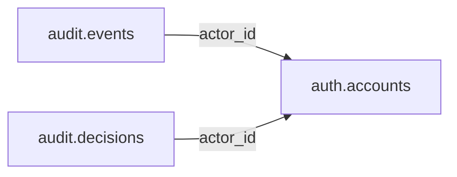

# audit — Operational

> **Operational scope agreed; table and column proposals remain unapproved.** No implementation is authorized by this documentation reorganization.

[Folder index](README.md) · [Full catalogue and relocation inventory](../README.md)

## Agreed responsibility — 12 November 2026

Operational and security events only; never official civic data or public accountability findings.

Audit records operational and security events only: actor actions, access events and workflow diagnostics/decision trails. It is not official civic data, not a public accountability finding, and not a substitute for source evidence. Accepted oversight findings and public participation records belong in Phase 01 Accountability; candidate moderation and review workflow belong in Staging. Preserve minimum durable attribution with accepted records so operational retention does not erase civic provenance.

## Retained table proposals and review context

The following dictionaries preserve the earlier proposal inputs, adjusted for the agreed ownership above. They remain unapproved. Earlier inventories retain their measured names; collapsed historical sections do not override the 12 November decisions.

## Retained audit proposal

> **PROPOSED — USER REVIEW REQUIRED.** Schema assignment is agreed; proposed tables and columns still require review. No SQL or migration is authorized.

## Purpose and ownership

**Target:** Operations. **Purpose:** Security and operational decision history. Schema placement follows the 12 November scope decision; individual table/column designs remain proposals. Related owners follow the agreed responsibility section above.

## Current implementation and gaps

The active manifest has 30 manifest migrations and 49 distinct CREATE TABLE declarations (49 distinct current table names) in schemas `audit`, `auth`, `engine`, `filesystem`, `geography`, `legal`, `objects`, `reference`. Generated Dryv has 124 entities (digest `e0087da9cf5b00e91f283a5501c368c7696bdd841ea30629231dc9c590f7c1ee`). Counts describe current artifacts, not target design; SQL and Dryv diverge.

- SQL declarations: `audit.comments` (audit/0001_audit.sql), `audit.evidence` (audit/0001_audit.sql), `audit.decisions` (audit/0001_audit.sql)
- Dryv entities: `audit.comments` (audit.Comment), `audit.evidence` (audit.EvidenceReference), `audit.decisions` (audit.ReviewDecision)

The inventory does not establish live database state and may miss ALTER-only changes. Before implementation, reconcile migrations, Dryv, generated output and callers.

## Proposed relationship map

> All nodes and edges are proposals. Main schemas may use local cross-schema foreign keys; no edge crosses the Main/Operations database boundary.

## Proposed table and column review

All tables and fields are hypothetical. Every proposed business column is listed; UUIDv7 `id` is a candidate default and remains open. Record every existing field disposition: KEEP / REMOVE / RENAME / MOVE / MERGE / SPLIT / DERIVE / ADD.

### `audit.events` — Immutable attributable operational action

- **Example:** Permission change
- **Profile:** series; planning envelope below.

| Column | Proposed type | Meaning | Nullable | Default | Relationship | Units / validation | Proposed disposition |
|---|---|---|---|---|---|---|---|
| `id` | `uuid` | Proposed stable identity | No | Rust UUIDv7 candidate | Primary key | UUIDv7 candidate; unique and immutable after publication | ADD (proposed target field; pending user approval) |
| `actor_id` | `uuid` | Actor | Yes | — | FK → `auth.accounts` | UUID syntax; FK target must exist when the relationship is required | ADD (proposed target field; pending user approval) |
| `action` | `text` | Named operation | No | — | — | Nonblank when required; enforce domain-specific length, normalization and controlled vocabulary | ADD (proposed target field; pending user approval) |
| `target_kind` | `text` | Allowlisted operational contract | No | — | — | Nonblank when required; enforce domain-specific length, normalization and controlled vocabulary | ADD (proposed target field; pending user approval) |
| `target_id` | `uuid` | Target | Yes | — | — | UUID syntax; FK target must exist when the relationship is required | ADD (proposed target field; pending user approval) |
| `recorded_at` | `timestamptz` | Time | No | — | — | Type checked; domain constraints and units must be approved for this field | ADD (proposed target field; pending user approval) |
| `details` | `jsonb` | Redacted structured details | No | — | — | Type checked; domain constraints and units must be approved for this field | ADD (proposed target field; pending user approval) |

- **FK action/cardinality:** Each non-null FK is many-to-one to its named target; nullable FKs are optional. Candidate delete/update behavior is RESTRICT/NO ACTION for accepted records; cascading canonical deletion is not proposed. Confirm uniqueness and exact behavior during review.
- **Constraints:** Partition by recorded_at when volume merits; no secrets/raw payload. Exact keys and cross-field checks remain for review.
- **Indexes:** primary key on `id`; candidate B-tree indexes on FK columns `actor_id` for joins and referenced-entity filters; add temporal/spatial indexes only where the stated query needs them and benchmarks support them.
- **Relationships:** resolve each FK target. Main allows cross-schema FKs. Main and Operations have no cross-database FK.
- **Evidence/time:** preserve exact source/version, observation/retrieval time, historical context and uncertainty where applicable. Approve the exact evidence path for this table.
- **Growth/storage estimate (illustrative planning envelope, not measured):** Low: initial 100,000, +100,000/year, peak 5,000/day; five-year 600,000 rows ≈ 1,171.9 MiB live row+index budget; Expected: initial 1,000,000, +1,000,000/year, peak 50,000/day; five-year 6,000,000 rows ≈ 11,718.8 MiB live row+index budget; High: initial 10,000,000, +10,000,000/year, peak 500,000/day; five-year 60,000,000 rows ≈ 117,187.5 MiB live row+index budget. Model: initial rows + annual accepted rows × 5; multiply by a per-row budget of 2 KiB including a coarse index allowance. Replace assumptions with actual samples, ingest rates and `pg_total_relation_size` before approval. Large object bytes are excluded; WAL, replicas, backups and S3 are budgeted separately.
- **Workload:** Interactive lookup by identity and approved foreign keys; batch scans for import/reconciliation. Peak-day figure above is a scenario assumption, not a service-level commitment.
- **Partitioning:** No partition approved. Benchmark first; time range is a candidate for append-heavy observations, and keys must include partition columns. Releases are normally unpartitioned unless measured need appears. Check late data and partition count.
- **Files:** originals, full-resolution geometry, arrays, media and large exports may be immutable S3 objects. Keep searchable identity, required facts, hashes, coverage, access and provenance in PostgreSQL; use manifests and selective reads.
- **Retention/risks/benchmark:** preserve accepted evidence and corrections. Review late arrivals, contention, index/partition growth and recovery. Benchmark joins, filters, spatial access, ingestion bursts, concurrent access and interrupted publication.
### `audit.decisions` — Operational review decision identity

- **Example:** Candidate review record
- **Profile:** entity; planning envelope below.

| Column | Proposed type | Meaning | Nullable | Default | Relationship | Units / validation | Proposed disposition |
|---|---|---|---|---|---|---|---|
| `id` | `uuid` | Proposed stable identity | No | Rust UUIDv7 candidate | Primary key | UUIDv7 candidate; unique and immutable after publication | KEEP (candidate match to current SQL/Dryv field; confirm meaning) |
| `actor_id` | `uuid` | Reviewer | No | — | FK → `auth.accounts` | UUID syntax; FK target must exist when the relationship is required | ADD (proposed target field; pending user approval) |
| `decision` | `text` | Typed decision | No | — | — | Nonblank when required; enforce domain-specific length, normalization and controlled vocabulary | KEEP (candidate match to current SQL/Dryv field; confirm meaning) |
| `reason` | `text` | Rationale | No | — | — | Nonblank when required; enforce domain-specific length, normalization and controlled vocabulary | ADD (proposed target field; pending user approval) |
| `decided_at` | `timestamptz` | Time | No | — | — | Type checked; domain constraints and units must be approved for this field | ADD (proposed target field; pending user approval) |
| `request_hash` | `text` | Reviewed input digest | No | — | — | Nonblank when required; enforce domain-specific length, normalization and controlled vocabulary | ADD (proposed target field; pending user approval) |

- **Current SQL/Dryv fields without a proposed same-name column:** `created_at`, `proposed_state`, `rationale`, `reviewer_id`, `target_id`, `target_kind`, `updated_at`, `version`. **Disposition:** unresolved per field; propose KEEP, REMOVE, RENAME, MOVE, MERGE, SPLIT or DERIVE in review. Do not drop these fields until the user resolves each one.
- **FK action/cardinality:** Each non-null FK is many-to-one to its named target; nullable FKs are optional. Candidate delete/update behavior is RESTRICT/NO ACTION for accepted records; cascading canonical deletion is not proposed. Confirm uniqueness and exact behavior during review.
- **Constraints:** Append-only and linked to target via typed contract. Exact keys and cross-field checks remain for review.
- **Indexes:** primary key on `id`; candidate B-tree indexes on FK columns `actor_id` for joins and referenced-entity filters; add temporal/spatial indexes only where the stated query needs them and benchmarks support them.
- **Relationships:** resolve each FK target. Main allows cross-schema FKs. Main and Operations have no cross-database FK.
- **Evidence/time:** preserve exact source/version, observation/retrieval time, historical context and uncertainty where applicable. Approve the exact evidence path for this table.
- **Growth/storage estimate (illustrative planning envelope, not measured):** Low: initial 1,000, +200/year, peak 20/day; five-year 2,000 rows ≈ 2.0 MiB live row+index budget; Expected: initial 10,000, +2,000/year, peak 200/day; five-year 20,000 rows ≈ 19.5 MiB live row+index budget; High: initial 100,000, +20,000/year, peak 2,000/day; five-year 200,000 rows ≈ 195.3 MiB live row+index budget. Model: initial rows + annual accepted rows × 5; multiply by a per-row budget of 1 KiB including a coarse index allowance. Replace assumptions with actual samples, ingest rates and `pg_total_relation_size` before approval. Large object bytes are excluded; WAL, replicas, backups and S3 are budgeted separately.
- **Workload:** Interactive lookup by identity and approved foreign keys; batch scans for import/reconciliation. Peak-day figure above is a scenario assumption, not a service-level commitment.
- **Partitioning:** None proposed initially; decide from measured scale/query plans. Check late data and partition count.
- **Files:** originals, full-resolution geometry, arrays, media and large exports may be immutable S3 objects. Keep searchable identity, required facts, hashes, coverage, access and provenance in PostgreSQL; use manifests and selective reads.
- **Retention/risks/benchmark:** preserve accepted evidence and corrections. Review late arrivals, contention, index/partition growth and recovery. Benchmark joins, filters, spatial access, ingestion bursts, concurrent access and interrupted publication.

## Queries, lifecycle, capacity and approval

**Representative query:** Who changed access or reviewed a candidate?

Lifecycle: preserve source bytes; extract into candidate revisions; validate; review or use approved deterministic checks; atomically publish; serve. Corrections create explicit versions/supersession. Preserve disagreement and uncertainty.

Capacity is unmeasured. Use low/expected/high input scenarios, explicit formulas and workload benchmarks; do not assume sizes or universal partitions.

**Status:** NOT REVIEWED. Schema assignment follows the handoff; tables, columns, relationships, partitioning and S3 choices still require user approval. Feedback: none. Approval reference/date/revision: none. Implementation authorization: not granted. Material changes reopen approval.

Earlier schema proposal preserved for history; superseded and not an approval

---
id: DOC-A9C753E14D60
name: Audit records and accountable operational decisions redesign
type: documentation
tags: [improvements, schema-redesign, audit, provenance, planning]
extra: {status: planning_only}
---

# Audit — accountable decisions, immutable actions and review evidence

**PLANNING ONLY. User requirement: keep system audit separate from public/officer participation and separate in concept from the engine's current execution state.**

## Why audit must remain distinguishable

The existing `audit` schema has three tables. It currently mixes reviewer decisions with some commenting/evidence patterns. The user wants `participation` separately for public feedback and official participation and simpler ``engine` for running pipelines and review workflow. Audit should record **what action/decision occurred, who or what performed it, on which record version, when, with what justification and what prior state**. It is not a generic place for public comments, and it should not become the canonical source of real-world government actions.

An `engine` worker's attempt, retry or processing status is operational; the **decision to approve/reject a claim or correction** and changes to policy must remain auditable. The decision may be tracked operationally in the engine, with an immutable audit record; keep one authoritative decision outcome and a clear link between it and the audit trail. Evidence files stay in `filesystem`, provenance sources in `source`, and account actor identities in `auth`.

## Current tables and selective restructuring

| Existing table | Existing role; redesign review |
|---|---|
| `audit.comments` | Review/research comments; split public participation from internal record review comments only if semantically justified. |
| `audit.evidence` | Evidence references associated with a review; compare `source.attributions`/`verifications` and file citations; avoid duplicating the evidence identity. |
| `audit.decisions` | Review decisions/approval outcomes; preserve actor, original target, policy, version and reason with immutable history. |

**Potential** `audit.events` or `audit.actions` could represent general system mutations, access grants, pattern approvals, migration decisions, or other verifiable actions. Evaluate append-only audit requirements and volume before adding a huge global log. A review comment attached to a claim is not automatically an end-user participation statement. Resist moving all three existing tables blindly into `engine`.

## Hard foreign keys and generic targets

Known actor: FK to `auth.accounts` (or explicit service/agent actor identity); decision/review source: FK to `engine.claims` / `engine.candidates` / `engine.pattern_versions` where applicable; evidence FK to `source.captures`/`filesystem.versions`; affected domain row (person/institution/contract/law) should be addressed through typed FK associations or a rigorously enforced shared canonical record registry. A text `target_kind` and bare UUID do **not** enforce the existence of that row. Auditing an old version may require a stable canonical identity plus version pointer; snapshot meaningful before/after values and source reason, rather than rejoining a now-changed row and claiming it was always so.

Do not build global cross-schema cascading deletes on append-only audit evidence. Retention, legal hold and privacy must be designed, especially where individual user accounts are deleted or contributions retracted.

## Four acquisition classes and traceability

The domain's operational records are primarily **automatically generated observations of actual actions** by trusted system/users, plus carefully defined **static policy/decision-type classifications**. Pattern definitions can prescribe expected review actions, but cannot generate the fact that an approval took place. Derived reports may aggregate audit outcomes/correction metrics without rewriting the original records. Table comments should clearly state which of the standard seeded-static, seeded-pattern, auto-collected or derived classes truly apply and avoid categorizing audit events as seeded facts.

## Query and retention examples

Show which user/service promoted a conflicting person ID and the old→new identity resolution; which pattern version was approved before generating offices; what source assessment permitted a crawler run; why a procurement county link was corrected, on what evidence; whether a claim was reviewed versus auto-accepted under policy; who granted access to a restricted research record.

Operational review dashboards may show filtered engine workflow status, while audit queries remain append-only actor/date/subject oriented. Avoid publishing internal audit notes or secrets in the public API.

## Migration questions and risks

Audit the exact three current TypeORM entity fields and their generic target references, source/evidence overlap, existing reviewer flows and API users. Determine which `audit.comments` are internal versus public-facing; never move a private correction discussion into published `participation` without user permission. Ensure unique decision chain, actor FK, target reference integrity, time and immutability. Consider partitioning high-volume append-only events only when necessary.

**Explicitly open:** new general audit.events table; how operational engine decisions map to append-only audits; reliable target FK design; audit retention/PII/legal hold; service agent identities; which review comments are participation; indexed query patterns and read permissions; timeline of policy/version changes.

**References:** [Master register](../../guides/mzizi-data-schema-storage-and-pipelines-redesign.md) · [Engine](engine.md) · [Participation](../phase-01/accountability.md) · [Auth](auth.md) · [Source](../phase-01/source.md).

**Status: audit remains separate as a concern; exact physical tables not approved.**

## Human review — editable user notes and design sign-off

**Review status:** `NOT REVIEWED` — AI-authored proposals in this document are not final approval.

**In my own words, what this schema should represent and exclude:**

> _My understanding and questions:_

**Tables/columns I want to keep, rename, move, merge, split, remove or add (and why):**

> _My proposed changes and alternative names:_

**Hard foreign keys, geographical and legal scope, pattern generation, classification and evidence I want changed or explained:**

> _My technical feedback, disagreements and alternatives:_

**Real data and queries I want to use to validate this design:**

> _My examples and expected results:_

**Unresolved decisions I want to discuss further:**

> _My remaining questions:_

**Final user decision:** `NOT DECIDED` / `NEEDS CHANGES` / `DESIGN VALIDATED BY USER` / `APPROVED FOR TASK PLANNING`.

**Approval reference and date:** _None. Only record explicit later user authorization. Even design validation does not authorize code, migration or Taskcode task creation._

## Mandatory per-table temporal, rigid-column and deletion review (2026-11-07)

**USER REQUIREMENT; planning only.** Examine every existing/proposed field and expressly record **KEEP / REMOVE / DERIVE / MOVE / RENAME / ADD** for `valid_from`, `valid_to`, `valid_from_precision`, `valid_to_precision`, `is_current`, `status`, `version`, `created_at`, `updated_at` and other copied/rigid flags. These fields are **opt-in by justified meaning**, not blanket schema conventions. Assess `deleted_at` only for recoverable soft deletion where appropriate. The full policy and migration/approval checklist is in [schema redesign README](../README.md).

**Domain-specific guidance:** Audits and accountable decisions are immutable time-stamped events rather than indefinitely valid entities. Keep recorded_at/decided_at and versioned correction events where necessary; no is_current toggling of history or blanket soft deletion. Distinguish public participation withdrawal from permanent audit evidence.

**OPEN for human review:** exact per-table/column disposition, derived status and as-of queries, pattern/legal links, justified precision, recoverable deletion versus domain lifecycle, history/identity preservation and hard-FK impact. No code or migration is authorized.

## 2026-11-07 accountability for event-triggered updates (planning)

Admin-created activities, approved source announcements, schedule-rule changes, ad-hoc refresh requests, agent monitoring authorizations and canonical value promotions require durable actor/decision lineage. **Do not treat engine verification attempts or source downloads as official decisions.** An admin may submit a proposal without approving it, and an unchanged successful recheck need not be a canonical edit. The audit model should show who authorized a monitor, who approved an activity, source evidence, which event/rule caused a job, whether a candidate was rejected/promoted, and old/new canonical version when modified. Retain history and privacy-safe access to internal audit events. Final FK actor/target links, retention and whether audit consumes engine job outcomes remain OPEN.

## 2026-11-11 — System-expansion alignment

Reviews of disputed historical, biodiversity and heritage claims should be append-only audit decisions linked to evidence and versioned domain records. See the [system-expansion proposal](../../guides/advancement-and-system-expansion.md). This alignment note does not approve proposed schemas, tables or implementation.

