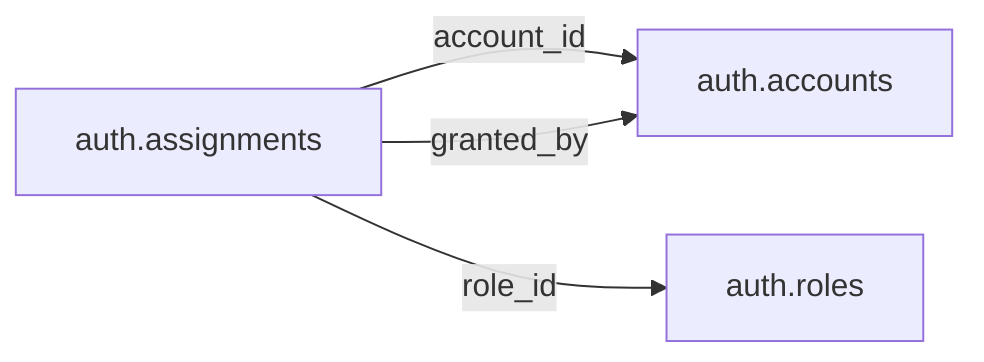

# auth — Operational

> **Operational scope agreed; table and column proposals remain unapproved.** No implementation is authorized by this documentation reorganization.

[Folder index](README.md) · [Full catalogue and relocation inventory](../README.md)

## Agreed responsibility — 12 November 2026

Accounts, authentication, roles, permissions and service identities.

Auth contains accounts, authentication, roles, permissions and service identities in the separate Operations database. An account is not an Official person and a permission grant is not government authority. Any publication attribution crossing into the civic database uses a durable, minimal snapshot/reference rather than a cross-database foreign key.

## Retained table proposals and review context

The following dictionaries preserve the earlier proposal inputs, adjusted for the agreed ownership above. They remain unapproved. Earlier inventories retain their measured names; collapsed historical sections do not override the 12 November decisions.

## Retained auth proposal

> **PROPOSED — USER REVIEW REQUIRED.** Schema assignment is agreed; proposed tables and columns still require review. No SQL or migration is authorized.

## Purpose and ownership

**Target:** Operations. **Purpose:** System accounts, authentication, permissions and actor identity. Schema placement follows the 12 November scope decision; individual table/column designs remain proposals. Related owners follow the agreed responsibility section above.

## Current implementation and gaps

The active manifest has 30 manifest migrations and 49 distinct CREATE TABLE declarations (49 distinct current table names) in schemas `audit`, `auth`, `engine`, `filesystem`, `geography`, `legal`, `objects`, `reference`. Generated Dryv has 124 entities (digest `e0087da9cf5b00e91f283a5501c368c7696bdd841ea30629231dc9c590f7c1ee`). Counts describe current artifacts, not target design; SQL and Dryv diverge.

- SQL declarations: `auth.accounts` (auth/0001_auth.sql), `auth.identities` (auth/0001_auth.sql), `auth.permissions` (auth/0001_auth.sql), `auth.roles` (auth/0001_auth.sql), `auth.role_permissions` (auth/0001_auth.sql), `auth.institutions` (auth/0001_auth.sql), `auth.scope_targets` (auth/0001_auth.sql), `auth.governed_tables` (auth/0001_auth.sql), `auth.role_assignments` (auth/0001_auth.sql)
- Dryv entities: None found.

The inventory does not establish live database state and may miss ALTER-only changes. Before implementation, reconcile migrations, Dryv, generated output and callers.

## Proposed relationship map

> All nodes and edges are proposals. Main schemas may use local cross-schema foreign keys; no edge crosses the Main/Operations database boundary.

## Proposed table and column review

All tables and fields are hypothetical. Every proposed business column is listed; UUIDv7 `id` is a candidate default and remains open. Record every existing field disposition: KEEP / REMOVE / RENAME / MOVE / MERGE / SPLIT / DERIVE / ADD.

### `auth.accounts` — Login principal

- **Example:** Research user
- **Profile:** entity; planning envelope below.

| Column | Proposed type | Meaning | Nullable | Default | Relationship | Units / validation | Proposed disposition |
|---|---|---|---|---|---|---|---|
| `id` | `uuid` | Proposed stable identity | No | Rust UUIDv7 candidate | Primary key | UUIDv7 candidate; unique and immutable after publication | KEEP (candidate match to current SQL/Dryv field; confirm meaning) |
| `subject_id` | `uuid` | Stable operational principal | No | — | — | UUID syntax; FK target must exist when the relationship is required | ADD (proposed target field; pending user approval) |
| `email` | `text` | Normalized login identity | No | — | — | Nonblank when required; enforce domain-specific length, normalization and controlled vocabulary | ADD (proposed target field; pending user approval) |
| `state` | `text` | Enabled suspended disabled | No | — | — | Nonblank when required; enforce domain-specific length, normalization and controlled vocabulary | ADD (proposed target field; pending user approval) |
| `created_at` | `timestamptz` | Creation | No | — | — | Type checked; domain constraints and units must be approved for this field | KEEP (candidate match to current SQL/Dryv field; confirm meaning) |

- **Current SQL/Dryv fields without a proposed same-name column:** `display_name`, `status`. **Disposition:** unresolved per field; propose KEEP, REMOVE, RENAME, MOVE, MERGE, SPLIT or DERIVE in review. Do not drop these fields until the user resolves each one.
- **FK action/cardinality:** Each non-null FK is many-to-one to its named target; nullable FKs are optional. Candidate delete/update behavior is RESTRICT/NO ACTION for accepted records; cascading canonical deletion is not proposed. Confirm uniqueness and exact behavior during review.
- **Constraints:** UNIQUE normalized identity; no public person identity inference. Exact keys and cross-field checks remain for review.
- **Indexes:** primary key on `id` for joins and referenced-entity filters; add temporal/spatial indexes only where the stated query needs them and benchmarks support them.
- **Relationships:** resolve each FK target. Main allows cross-schema FKs. Main and Operations have no cross-database FK.
- **Evidence/time:** preserve exact source/version, observation/retrieval time, historical context and uncertainty where applicable. Approve the exact evidence path for this table.
- **Growth/storage estimate (illustrative planning envelope, not measured):** Low: initial 1,000, +200/year, peak 20/day; five-year 2,000 rows ≈ 2.0 MiB live row+index budget; Expected: initial 10,000, +2,000/year, peak 200/day; five-year 20,000 rows ≈ 19.5 MiB live row+index budget; High: initial 100,000, +20,000/year, peak 2,000/day; five-year 200,000 rows ≈ 195.3 MiB live row+index budget. Model: initial rows + annual accepted rows × 5; multiply by a per-row budget of 1 KiB including a coarse index allowance. Replace assumptions with actual samples, ingest rates and `pg_total_relation_size` before approval. Large object bytes are excluded; WAL, replicas, backups and S3 are budgeted separately.
- **Workload:** Interactive lookup by identity and approved foreign keys; batch scans for import/reconciliation. Peak-day figure above is a scenario assumption, not a service-level commitment.
- **Partitioning:** None proposed initially; decide from measured scale/query plans. Check late data and partition count.
- **Files:** originals, full-resolution geometry, arrays, media and large exports may be immutable S3 objects. Keep searchable identity, required facts, hashes, coverage, access and provenance in PostgreSQL; use manifests and selective reads.
- **Retention/risks/benchmark:** preserve accepted evidence and corrections. Review late arrivals, contention, index/partition growth and recovery. Benchmark joins, filters, spatial access, ingestion bursts, concurrent access and interrupted publication.
### `auth.roles` — Permission bundles

- **Example:** Reviewer role
- **Profile:** catalog; planning envelope below.

| Column | Proposed type | Meaning | Nullable | Default | Relationship | Units / validation | Proposed disposition |
|---|---|---|---|---|---|---|---|
| `id` | `uuid` | Proposed stable identity | No | Rust UUIDv7 candidate | Primary key | UUIDv7 candidate; unique and immutable after publication | KEEP (candidate match to current SQL/Dryv field; confirm meaning) |
| `code` | `text` | Role code | No | — | — | Nonblank when required; enforce domain-specific length, normalization and controlled vocabulary | KEEP (candidate match to current SQL/Dryv field; confirm meaning) |
| `title` | `text` | Meaning | No | — | — | Nonblank when required; enforce domain-specific length, normalization and controlled vocabulary | ADD (proposed target field; pending user approval) |
| `policy_version` | `text` | Version | No | — | — | Nonblank when required; enforce domain-specific length, normalization and controlled vocabulary | ADD (proposed target field; pending user approval) |

- **Current SQL/Dryv fields without a proposed same-name column:** `name`. **Disposition:** unresolved per field; propose KEEP, REMOVE, RENAME, MOVE, MERGE, SPLIT or DERIVE in review. Do not drop these fields until the user resolves each one.
- **FK action/cardinality:** Each non-null FK is many-to-one to its named target; nullable FKs are optional. Candidate delete/update behavior is RESTRICT/NO ACTION for accepted records; cascading canonical deletion is not proposed. Confirm uniqueness and exact behavior during review.
- **Constraints:** UNIQUE(code). Exact keys and cross-field checks remain for review.
- **Indexes:** primary key on `id` for joins and referenced-entity filters; add temporal/spatial indexes only where the stated query needs them and benchmarks support them.
- **Relationships:** resolve each FK target. Main allows cross-schema FKs. Main and Operations have no cross-database FK.
- **Evidence/time:** preserve exact source/version, observation/retrieval time, historical context and uncertainty where applicable. Approve the exact evidence path for this table.
- **Growth/storage estimate (illustrative planning envelope, not measured):** Low: initial 100, +100/year, peak 5/day; five-year 600 rows ≈ 0.6 MiB live row+index budget; Expected: initial 1,000, +500/year, peak 25/day; five-year 3,500 rows ≈ 3.4 MiB live row+index budget; High: initial 10,000, +5,000/year, peak 250/day; five-year 35,000 rows ≈ 34.2 MiB live row+index budget. Model: initial rows + annual accepted rows × 5; multiply by a per-row budget of 1 KiB including a coarse index allowance. Replace assumptions with actual samples, ingest rates and `pg_total_relation_size` before approval. Large object bytes are excluded; WAL, replicas, backups and S3 are budgeted separately.
- **Workload:** Interactive lookup by identity and approved foreign keys; batch scans for import/reconciliation. Peak-day figure above is a scenario assumption, not a service-level commitment.
- **Partitioning:** None proposed initially; decide from measured scale/query plans. Check late data and partition count.
- **Files:** originals, full-resolution geometry, arrays, media and large exports may be immutable S3 objects. Keep searchable identity, required facts, hashes, coverage, access and provenance in PostgreSQL; use manifests and selective reads.
- **Retention/risks/benchmark:** preserve accepted evidence and corrections. Review late arrivals, contention, index/partition growth and recovery. Benchmark joins, filters, spatial access, ingestion bursts, concurrent access and interrupted publication.
### `auth.permissions` — Named action permissions

- **Example:** candidate.review
- **Profile:** catalog; planning envelope below.

| Column | Proposed type | Meaning | Nullable | Default | Relationship | Units / validation | Proposed disposition |
|---|---|---|---|---|---|---|---|
| `id` | `uuid` | Proposed stable identity | No | Rust UUIDv7 candidate | Primary key | UUIDv7 candidate; unique and immutable after publication | ADD (proposed target field; pending user approval) |
| `namespace` | `text` | Contract namespace | No | — | — | Nonblank when required; enforce domain-specific length, normalization and controlled vocabulary | KEEP (candidate match to current SQL/Dryv field; confirm meaning) |
| `action` | `text` | Action | No | — | — | Nonblank when required; enforce domain-specific length, normalization and controlled vocabulary | KEEP (candidate match to current SQL/Dryv field; confirm meaning) |

- **FK action/cardinality:** Each non-null FK is many-to-one to its named target; nullable FKs are optional. Candidate delete/update behavior is RESTRICT/NO ACTION for accepted records; cascading canonical deletion is not proposed. Confirm uniqueness and exact behavior during review.
- **Constraints:** UNIQUE(namespace,action). Exact keys and cross-field checks remain for review.
- **Indexes:** primary key on `id` for joins and referenced-entity filters; add temporal/spatial indexes only where the stated query needs them and benchmarks support them.
- **Relationships:** resolve each FK target. Main allows cross-schema FKs. Main and Operations have no cross-database FK.
- **Evidence/time:** preserve exact source/version, observation/retrieval time, historical context and uncertainty where applicable. Approve the exact evidence path for this table.
- **Growth/storage estimate (illustrative planning envelope, not measured):** Low: initial 100, +100/year, peak 5/day; five-year 600 rows ≈ 0.6 MiB live row+index budget; Expected: initial 1,000, +500/year, peak 25/day; five-year 3,500 rows ≈ 3.4 MiB live row+index budget; High: initial 10,000, +5,000/year, peak 250/day; five-year 35,000 rows ≈ 34.2 MiB live row+index budget. Model: initial rows + annual accepted rows × 5; multiply by a per-row budget of 1 KiB including a coarse index allowance. Replace assumptions with actual samples, ingest rates and `pg_total_relation_size` before approval. Large object bytes are excluded; WAL, replicas, backups and S3 are budgeted separately.
- **Workload:** Interactive lookup by identity and approved foreign keys; batch scans for import/reconciliation. Peak-day figure above is a scenario assumption, not a service-level commitment.
- **Partitioning:** None proposed initially; decide from measured scale/query plans. Check late data and partition count.
- **Files:** originals, full-resolution geometry, arrays, media and large exports may be immutable S3 objects. Keep searchable identity, required facts, hashes, coverage, access and provenance in PostgreSQL; use manifests and selective reads.
- **Retention/risks/benchmark:** preserve accepted evidence and corrections. Review late arrivals, contention, index/partition growth and recovery. Benchmark joins, filters, spatial access, ingestion bursts, concurrent access and interrupted publication.
### `auth.assignments` — Scoped role grants

- **Example:** Reviewer scoped to Kenya
- **Profile:** relation; planning envelope below.

| Column | Proposed type | Meaning | Nullable | Default | Relationship | Units / validation | Proposed disposition |
|---|---|---|---|---|---|---|---|
| `id` | `uuid` | Proposed stable identity | No | Rust UUIDv7 candidate | Primary key | UUIDv7 candidate; unique and immutable after publication | ADD (proposed target field; pending user approval) |
| `account_id` | `uuid` | Account | No | — | FK → `auth.accounts` | UUID syntax; FK target must exist when the relationship is required | ADD (proposed target field; pending user approval) |
| `role_id` | `uuid` | Role | No | — | FK → `auth.roles` | UUID syntax; FK target must exist when the relationship is required | ADD (proposed target field; pending user approval) |
| `scope_kind` | `text` | Declared scope | No | — | — | Nonblank when required; enforce domain-specific length, normalization and controlled vocabulary | ADD (proposed target field; pending user approval) |
| `scope_id` | `uuid` | Scope identity | Yes | — | — | UUID syntax; FK target must exist when the relationship is required | ADD (proposed target field; pending user approval) |
| `granted_by` | `uuid` | Actor | No | — | FK → `auth.accounts` | Type checked; domain constraints and units must be approved for this field | ADD (proposed target field; pending user approval) |
| `granted_at` | `timestamptz` | Grant | No | — | — | Type checked; domain constraints and units must be approved for this field | ADD (proposed target field; pending user approval) |
| `revoked_at` | `timestamptz` | Revocation | Yes | — | — | Type checked; domain constraints and units must be approved for this field | ADD (proposed target field; pending user approval) |

- **FK action/cardinality:** Each non-null FK is many-to-one to its named target; nullable FKs are optional. Candidate delete/update behavior is RESTRICT/NO ACTION for accepted records; cascading canonical deletion is not proposed. Confirm uniqueness and exact behavior during review.
- **Constraints:** Revocation >= grant; scope vocabulary allowlisted; audit grant changes. Exact keys and cross-field checks remain for review.
- **Indexes:** primary key on `id`; candidate B-tree indexes on FK columns `account_id`, `role_id`, `granted_by` for joins and referenced-entity filters; add temporal/spatial indexes only where the stated query needs them and benchmarks support them.
- **Relationships:** resolve each FK target. Main allows cross-schema FKs. Main and Operations have no cross-database FK.
- **Evidence/time:** preserve exact source/version, observation/retrieval time, historical context and uncertainty where applicable. Approve the exact evidence path for this table.
- **Growth/storage estimate (illustrative planning envelope, not measured):** Low: initial 1,000, +2,000/year, peak 100/day; five-year 11,000 rows ≈ 10.7 MiB live row+index budget; Expected: initial 10,000, +20,000/year, peak 1,000/day; five-year 110,000 rows ≈ 107.4 MiB live row+index budget; High: initial 100,000, +200,000/year, peak 10,000/day; five-year 1,100,000 rows ≈ 1,074.2 MiB live row+index budget. Model: initial rows + annual accepted rows × 5; multiply by a per-row budget of 1 KiB including a coarse index allowance. Replace assumptions with actual samples, ingest rates and `pg_total_relation_size` before approval. Large object bytes are excluded; WAL, replicas, backups and S3 are budgeted separately.
- **Workload:** Interactive lookup by identity and approved foreign keys; batch scans for import/reconciliation. Peak-day figure above is a scenario assumption, not a service-level commitment.
- **Partitioning:** None proposed initially; decide from measured scale/query plans. Check late data and partition count.
- **Files:** originals, full-resolution geometry, arrays, media and large exports may be immutable S3 objects. Keep searchable identity, required facts, hashes, coverage, access and provenance in PostgreSQL; use manifests and selective reads.
- **Retention/risks/benchmark:** preserve accepted evidence and corrections. Review late arrivals, contention, index/partition growth and recovery. Benchmark joins, filters, spatial access, ingestion bursts, concurrent access and interrupted publication.

## Queries, lifecycle, capacity and approval

**Representative query:** Which authenticated actor may perform this operation?

Lifecycle: preserve source bytes; extract into candidate revisions; validate; review or use approved deterministic checks; atomically publish; serve. Corrections create explicit versions/supersession. Preserve disagreement and uncertainty.

Capacity is unmeasured. Use low/expected/high input scenarios, explicit formulas and workload benchmarks; do not assume sizes or universal partitions.

**Status:** NOT REVIEWED. Schema assignment follows the handoff; tables, columns, relationships, partitioning and S3 choices still require user approval. Feedback: none. Approval reference/date/revision: none. Implementation authorization: not granted. Material changes reopen approval.

Earlier schema proposal preserved for history; superseded and not an approval

---
id: DOC-86A3B019F5C2
name: Authentication and access control schema redesign
type: documentation
tags: [improvements, schema-redesign, auth, rbac, planning]
extra: {status: implemented_in_mzizi_new}
---

# Auth — unified accounts, authentication, roles and permissions

## Status and policy (read this first)

| When | Instruction | Effect on this document |
|---|---|---|
| Before 2026-11-08 (**former policy**) | Plan only; preserve account/role/grant IDs and login continuity; migrate `identity`/`access` to `auth` after approval. | Recorded in the "Earlier planning record" at the end of this file. Kept as history, not deleted. |
| 2026-11-08 (**current policy**, `DEC-CLEAN-REWRITE-MZIZI-NEW`) | Clean rewrite in a disposable database `mzizi_new`: no legacy IDs, data migration, dual writes, compatibility views or old API compatibility; task `TSK-1AC8F3754DAE` authorized to design and build. | The design below is implemented in `.docs/_archives/2026-11-08-rewrite-snapshot/source/backend/engine/database/rewrite/` and proven by `test/rewrite-auth.test.ts`. The old `identity`/`access` objects are reference material only. |

Where the earlier record and the implemented design disagree (for example "preserve IDs", "migration strategy", "unresolved decisions"), the implemented design governs. The decisions that had been open are answered in "Resolved questions".

## Implemented design (small on purpose)

An earlier build of this slice had 19 tables (delegation ceilings, field groups, an operations registry, MFA flags, invitations, decision log). The user judged it too much, so it was dropped and rebuilt in `mzizi_new` with nine tables. Files: `.docs/_archives/2026-11-08-rewrite-snapshot/source/backend/engine/database/rewrite/0001_auth.sql` (tables) and `0002_auth_functions.sql` (checks, helpers, seeds). Rebuild with `bun src/rewrite.ts reset`; checks in `test/rewrite-auth.test.ts` (18 tests).

### The idea in four lines

1. **Namespaced permissions:** `namespace.action`, e.g. `electoral.edit`. The namespace matches a data schema; actions are fixed: `read, edit, review, publish, export, delete`.
2. **Roles** bundle permissions. Roles are rows, so they are dynamic. `auth.create_role('electoral_manager', ..., ['electoral.*'])`.
3. **Scoped grants:** an account holds a role either platform-wide, or scoped to one record `(schema.table, id)` of an allowed target table, which also covers everything below it (children via the table's parent column).
4. **Governed tables** say how records link to a scope target: `electoral.results` belongs to an institution, while a country-scoped record links to its country. Grants match only through that one link.

### Tables (schema `auth`)

| Table | Columns | Notes |
|---|---|---|
| `accounts` | `id`, `display_name`, `status` (active/suspended/closed), `created_at` | Never deleted. Not a person record. |
| `identities` | `id`, `account_id` FK, `issuer`, `subject`; unique `(issuer, subject)` | OIDC login. Subject is opaque, never assumed to be a UUID. No sessions table. |
| `permissions` | PK `(namespace, action)` | Created by `auth.register_namespace`. |
| `roles` | `id`, `code` unique, `name` | |
| `role_permissions` | PK `(role_id, namespace, action)`, FKs to roles and permissions | |
| `institutions` | `id`, `code` unique, `name`, `parent_id` self FK, `country_code` | Owners of data (IEBC, a county and its departments). A scope target. Cycles rejected. |
| `scope_targets` | PK `table_name`, `parent_column` | Allow-list of tables a grant may point at. Registered by `auth.register_scope_target`, which checks the table, `id` and parent column exist. Seeded with `auth.institutions`. |
| `governed_tables` | PK `table_name`, `namespace`, `link_table` FK, `link_column` | One link per data table. Registered by `auth.register_governed_table`, which checks columns and namespace. |
| `role_assignments` | `id`, `account_id` FK, `role_id` FK, `scope_table` FK (null = platform-wide), `scope_id`, `expires_at` (null = no end), `granted_by` FK, `revoked_at`, `created_at` | Scope table and id are both set or both null. A trigger checks the scope record exists. Grants cannot be edited, extended or deleted; only revoked. |

A generic `(table, id)` pair cannot carry a foreign key, so integrity comes from three guards: `scope_table` is an FK to the allow-list; a trigger checks the id exists in that table; and registration refuses tables or columns that do not exist (build the table first, then register it).

### How the examples work

- **Manage all electoral data for a country:** role with `electoral.*` + country scope. It works for registered electoral tables linked to that country; narrower units remain separately scoped where needed.
- **Manage all data in a geo unit:** a role with every namespace + scope `(geography.units, id)`; sub-units are covered.
- **IEBC official vs county official:** `electoral.results` is registered with link `auth.institutions` via its steward column. A grant on IEBC matches; a country scope does not, because country is not the table's steward link.
- **Membership alone grants nothing:** only role assignments do.

### Functions

- `auth.resolve_identity(issuer, subject)` → account id and `ok` / `unknown_identity` / `account_not_active`.
- `auth.can(account, 'electoral.edit', 'schema.table', record_id)` → `{allowed, reason, assignment_id}`. Needs an active account and a live (unrevoked, unexpired) grant whose role holds the permission; platform-wide grants allow, scoped grants need the record's link to be the scope record or below it. Reasons: `account_not_active`, `table_not_governed`, `namespace_mismatch`, `no_grant`, `out_of_scope`, `record_not_found`. Default deny.
- `auth.can_link(account, permission, table, link_id)` for creating a record (no row yet); `auth.can_change(..., new_link_id)` for updates that may move ownership: the existing and the proposed owner must both allow it.
- `auth.can_platform(account, permission)` for permissions not tied to a record (`pipeline.read`, `auth.edit`).
- `auth.allowed_links(account, permission, table)` → link ids (with descendants) or "all", joined in list queries so filtering happens before pagination and totals.
- `auth.grant_role(grantor, account, role, scope_table, scope_id, expires_at)` and `auth.revoke_grant(actor, id)`: only accounts with platform-wide `auth.edit` (the admin role).
- `auth.bootstrap_admin(issuer, subject, name)`: first administrator, run by the database engine.

### Backend

`source/backend/api/src/auth/`: `createIdentityVerifier` (issuer, signature, expiry, opaque subject), `PgAccessAuthority` (wraps the functions above), `DatabaseAuthGuard` (maps each contract policy to a platform permission, e.g. promote → `pipeline.publish`, then 401/403), `installDatabaseAuth`. `main.ts` uses it when `AUTH_DATABASE_URL` is set; otherwise the legacy roles-claim guard runs until other domains are rewritten. Use cases touching governed records call `can` / `canChange` with the table and record id.

### Deferred until needed

Invitations and verified memberships; delegation of access management with limits (today only admins grant); field-group restrictions; MFA and separation-of-duties flags; a registry of enforced operations; an access change log and decision log; token revocation timestamps and multiple providers; service-account ownership; account anonymization; account-to-person link (`person_id`) once the person schema exists. Admin screens and the review workbench switch to database auth are also later.

### Current-to-target design map (reference only; nothing is migrated)

| Old | New |
|---|---|
| `identity.accounts` (`issuer`, `subject`, `status`) | `accounts` + `identities` |
| `identity.grants` (role enum, legacy scope identifier, validity, `is_current`) | `role_assignments` with a real scope pointer and optional expiry; `is_current` and precision columns dropped |
| `access.roles/permissions/role_permissions` | same names; permissions are `namespace.action` |
| `access.account_permissions` view | `auth.can*` and `auth.allowed_links` functions |
| JWT `roles` claim | ignored in database mode |

## Earlier planning record (superseded, kept for history)

**HISTORICAL PLANNING TEXT (superseded by the implemented design above).** The user's requested direction was `identity` + `access` → a simpler `auth` schema.

## Domain boundaries

The platform's login/authentication identity is not a real-world identity record. A real governor or researcher lives in `person.individuals` whether or not they have a MZIZI login. `auth.accounts` identify actors who can access MZIZI services; `auth` governs credentials/session identities, roles, permissions and grants. Historical/public records of the person's office or political membership must not be mixed into login tables.

Preserve separation from `audit` (who did what), `engine` (who started/reviewed a pipeline) and `participation` (who submitted public feedback or official consultation). These connect through hard foreign keys to authorized actors or relevant person identity, without duplicating user profiles.

## Current tables, view and candidate target

| Existing object | Intended disposition and questions |
|---|---|
| `identity.accounts` | Candidate `auth.accounts` — stable account ID, associated person ID when applicable, login identity and status. |
| `identity.grants` | Candidate `auth.grants` — individual account/resource capability grants; distinguish roles from exceptions. |
| `access.roles` | Candidate `auth.roles` — role identity, scope, status and membership semantics. |
| `access.permissions` | Candidate `auth.permissions` — precise action/resource permission vocabulary, not just UI labels. |
| `access.role_permissions` | Candidate `auth.role_permissions` — enforce each role/permission via real FK. |
| `access.account_permissions` | Existing view; evaluate recalculation under new auth schema and direct grants/roles. |
| **Potential** `account_roles` | Add only if current identity.grants cannot accurately handle user role assignments/scopes. |
| **Potential** `sessions`/`tokens` | Only if actual authentication implementation requires persisted session/revocation data. |

The source of truth for existing fields is current TypeORM `identity` entities plus the access-control migration; older docs may omit `access` altogether. Inventory all columns, enums, composite uniqueness and views before choosing exact target SQL.

## FK and RBAC requirements

All role grants, role permissions, account role assignments and session/actor references must use hard FKs. Cross-domain actor references in `audit` and `engine` should FK to `auth.accounts` where events were performed by authenticated accounts; distinguish service actors and external reviewers if needed. Optional links to `person.individuals` must be evidence-backed and permission-controlled; an account is not a replacement for a person row. Domain- or country-scoped access may need a scope junction (resource, organization or country) but a generic FK-less target pair should not be the default.

Roles should be explainable (reviewer, data curator, pipeline operator, admin, public user) and separate from data-source truth verification. A person can be granted a temporary reviewer role without becoming a government official; a public official can submit participation content without elevated database privileges.

## Data classification and generation

Mostly **1A static seeded** permission/action vocabulary and default role definitions, plus **2A automatically collected** actor grant/session lifecycle from actual authorized operations. **1B pattern** applies only to repeatable initial role/permission templates, not fabricated user accounts. **2B derived** effective permissions can be a view/query rather than materialized copied grants. Account and security metadata are sensitive and should not be published merely because most crawled source files are public.

## Query and migration examples

Show which actor approved a source or canonical correction at a historical time; inspect which permissions a reviewer had when granting an approval; report the effective capabilities of a pipeline operator with scope; revoke a role without destroying the audit trail; link a public contributor to a person profile only when explicitly appropriate and authorized.

Migration strategy: preserve account/role/grant IDs and login continuity; map `identity` and `access` names to `auth`, update backend guards, API, worker review checks and audit FK; rebuild `account_permissions` view, document table/column comments and run authorization tests **only after approval**. No indiscriminate permission escalation.

## Explicitly unresolved decisions

1. What exactly is `identity.grants` modeling today versus role assignments?
2. Are RBAC roles global, organizational, country-scoped, geographic-unit-scoped or project scoped?
3. Which session/token storage is actually necessary?
4. How to represent service/agent actors separately from human accounts?
5. Which public participation roles require authentication versus anonymous submissions?
6. How to preserve audit identity when an account is retired/deleted?

**References:** [Master register](../../guides/mzizi-data-schema-storage-and-pipelines-redesign.md) · [Audit](audit.md) · [Participation](../mzizi-db/phase-01/accountability.md) · [Engine](engine.md).

**Status: auth consolidation direction recorded; exact table/column design not approved.**

## Human review — editable user notes and design sign-off

**Review status:** `NOT REVIEWED` — AI-authored proposals in this document are not final approval.

**In my own words, what this schema should represent and exclude:**

> _My understanding and questions:_

**Tables/columns I want to keep, rename, move, merge, split, remove or add (and why):**

> _My proposed changes and alternative names:_

**Hard foreign keys, geographical and legal scope, pattern generation, classification and evidence I want changed or explained:**

> _My technical feedback, disagreements and alternatives:_

**Real data and queries I want to use to validate this design:**

> _My examples and expected results:_

**Unresolved decisions I want to discuss further:**

> _My remaining questions:_

**Final user decision:** `NOT DECIDED` / `NEEDS CHANGES` / `DESIGN VALIDATED BY USER` / `APPROVED FOR TASK PLANNING`.

**Approval reference and date:** _None. Only record explicit later user authorization. Even design validation does not authorize code, migration or Taskcode task creation._

## Mandatory per-table temporal, rigid-column and deletion review (2026-11-07)

**USER REQUIREMENT; planning only.** Examine every existing/proposed field and expressly record **KEEP / REMOVE / DERIVE / MOVE / RENAME / ADD** for `valid_from`, `valid_to`, `valid_from_precision`, `valid_to_precision`, `is_current`, `status`, `version`, `created_at`, `updated_at` and other copied/rigid flags. These fields are **opt-in by justified meaning**, not blanket schema conventions. Assess `deleted_at` only for recoverable soft deletion where appropriate. The full policy and migration/approval checklist is in [schema redesign README](../README.md).

**Domain-specific guidance:** Accounts have registration/deactivation states; grants or scoped roles may truly expire, while permission definitions usually do not. Expiring/revoking access differs from is_current. User erasure/anonymization requires deliberate retention/audit/FK policy and is not satisfied by simply adding deleted_at.

**OPEN for human review:** exact per-table/column disposition, derived status and as-of queries, pattern/legal links, justified precision, recoverable deletion versus domain lifecycle, history/identity preservation and hard-FK impact. No code or migration is authorized.

## 2026-11-07 admin-initiated activities and rechecks — permissions only (planning)

The user wants an authenticated administrator to enter a sourced event/announcement or request a research/refresh job. `auth` should govern **who may** submit a proposed activity, approve source-backed event verification, trigger a scoped one-time job, author or activate recurring watcher/schedule policies, and approve a canonical update. These **must not be one universal admin privilege**. Review roles, country/geographic scope, source access and authentication strength. Human input enters as a sourced candidate, not automatically verified truth; service/agent identities need their own accountable actor contract. Record actions in `audit`, execute via `engine`. No account or permission migration authorized.

## 2026-11-08 — Agreed scoped RBAC direction and design deliverables

The user accepted the proposed direction and requested documentation and clarification of task TSK-1AC8F3754DAE. This approves recording and planning the design, not application code, database migrations, provisioning or deployment. Exact table/column specifications and implementation still await the user's subsequent go-ahead. This dated direction refines the older open questions above; it does not retroactively approve every earlier alternative.

### Current implementation and concrete reasons to redesign

Inspected repository models already give identity.accounts and identity.grants UUID primary keys; access.roles and access.permissions have code primary keys, and access.role_permissions has a composite primary key. Missing keys must be demonstrated by an audit, not presumed. Accounts have a unique issuer/subject pair, but token-verifier.ts currently requires a UUID subject and uses it directly as actorId. roles.ts hard-codes four role names and permission bundles. AuthGuard checks route policies without resource scope and permits unmatched routes. The access.account_permissions view considers account status and legacy scope/validity; database staging review uses separate role/scope checks. reviewRun checks a permission without constraining its initial selection to the grant scope. These separate paths must be reconciled under one authorization contract. The web review workbench already supports OIDC authorization code with PKCE, but its UI recognizes reviewer/admin names rather than dynamic capabilities. These are source-code findings, not a live database audit.

### Accepted product and authorization direction

- An authenticated admin platform must support platform administrators and institution-scoped officials, with users, institutions, invitations, memberships, role bundles, scoped assignments, review/publication permissions and audit visibility.
- Keep OIDC authentication with an external identity provider; Mzizi owns stable accounts, verified affiliation and authorization. Plan MFA for privileged administration and document session/revocation integration rather than implementing password storage by default.
- Platform admins verify the first institutional administrator. That administrator may invite colleagues and assign approved roles within a delegated ceiling. An institutional email domain alone never creates privileges. Custom institution-defined role bundles can be a later extension within the same ceiling.
- Separate edit, review, publish, archive/delete, export, pipeline execution and access-management capabilities. Direct publication is an explicitly delegated permission for designated datasets/field groups, not an automatic consequence of official status. Authorization to publish does not itself establish evidence quality or truth.
- Support field groups and multiple data stewards, with explicit publication authority. The creator/uploader is not automatically the owning institution. Affiliation with an institution is not sufficient to edit everything associated with it.
- Dynamic roles and assignments are data-managed. Permission codes must correspond to implemented, enforced operations: inserting a permission row cannot create new application behavior.
- Deny access unless an active account has an applicable active grant. Explicit public-read policies remain possible. Platform administration and scoped institutional administration are separate capabilities.

### Candidate tables and columns to specify precisely

The following is a design starting point, not final DDL or a mandate to create every table. The task must resolve exact SQL types, nullability, defaults, checks, unique constraints, indexes, FK/delete behavior and comments for every retained column. Use UUID primary keys for independently referenced identities where justified; join tables may use composite primary keys. Preserve stable existing IDs during migration.

| Candidate object | Candidate columns / relationships to evaluate | Required integrity and meaning |
|---|---|---|
| auth.accounts | id, actor_kind, status, person_id, created_at, disabled_at | Stable accountable human/service actor; optional person FK must not turn a public profile into a login account. A service actor must not fabricate a person. |
| auth.login_identities | id, account_id, issuer, subject, linked_at | Account FK and unique issuer/subject; resolve this pair to internal account ID; never assume subject is UUID. Linking/unlinking requires verified account control. |
| auth.roles | id, code, name, description, managing_institution_id, protected | Dynamic named bundle; distinguish platform-managed and institutional roles; mutable labels do not change stable identity. |
| auth.permissions | id or stable code PK, code, resource_type, action, field_group | Catalog of enforceable capabilities; unique operation identity and recognized binding to API/worker policy. |
| auth.role_permissions | role_id, permission_id | Composite PK, hard FKs, no duplicate capability membership. |
| auth.memberships | id, account_id, institution_id, verified_by, verified_at, starts_at, ends_at, revoked_at | Verified affiliation with lifecycle and actor/institution FKs. Membership alone confers no editing authority. |
| auth.invitations | id, institution_id, invited_by, intended_identity, token_digest, expires_at, accepted_at | Bounded invitation/acceptance flow; no plaintext invitation secret, no automatic privilege from email matching. Link accepted membership/assignment through reviewed constraints. |
| auth.role_assignments | id, account_id, role_id, scope_id, membership_id, granted_by, starts_at, expires_at, revoked_at, revocation_reason | Exact effective grant; timestamps have operational meaning. Any membership-bound grant becomes ineffective when that membership ends. |
| auth.scopes and typed scope bindings | id, scope_kind; typed country, geo-unit, institution, dataset and specific-resource FKs as needed | Avoid FK-less resource_kind/resource_id pairs. Explicit global scope, never accidental global authority from null. Define exactly-one-kind checks and scope intersection/composition. |
| auth.delegations, if needed | id, delegator_id, delegate_id, scope_id, permitted_role/permission bindings, expires_at, revoked_at | Authority to grant is separate from authority to edit; recipient cannot exceed permission, field, scope, duration or further-delegation ceilings. |
| auth.sessions, only if required | id, account_id, provider/session reference, created_at, expires_at, revoked_at | Persist only necessary server session/revocation state; specify logout and account-disable behavior. |

Known account-to-person, account-to-institution, actor-to-audit and scope-to-resource relationships require real cross-schema FKs. Resource ownership/stewardship is a domain relationship, not something to invent entirely inside auth. The later domain-schema tasks must resolve its precise typed representation and dataset identities. Define the auth-side contract now and mark external target decisions explicitly; do not prematurely create a universal resource registry or redesign later domains to satisfy a generic UUID reference.

### How accounts, people and resources connect

A login resolves issuer + subject -> login identity -> stable account. An account may have a separately controlled link to person.individuals. Verified membership connects the account to a real institution. A role assignment connects that account to a permission bundle and explicit scope; a delegation bounds who can issue that assignment. Resource metadata supplies authoritative country, geographic placement, dataset, steward/owner and workflow state. None of those facts may be trusted merely because a request body or token claims them.

An IEBC editor may edit designated Kenyan electoral datasets managed by IEBC, but not party biographies or all Kenyan records. A Nairobi County editor may edit county-stewarded data, but not IEBC-managed election results merely because they concern Nairobi. A resource with several stewards must identify which actions each steward can perform and who may publish. Examples must include permitted and denied reads, edits, field changes, review, publication, bulk exports and invitations.

Scope dimensions combine explicitly. A single assignment requiring Kenya AND electoral domain AND IEBC stewardship cannot be accidentally satisfied by unrelated grants for separate dimensions. Independent complete grants can supply alternative valid access paths; permission from one grant must not be combined with broader scope from another. Design field-group matching and ownership transitions with the same rule. Geographic descendants are included only where the assignment explicitly requests inheritance. A country scope does not mean authority over all country-level data.

### Dynamic scope and enforcement contract

Derive effective scope from existing resource identities and validated relationships, not copied county names or a list of IDs embedded in long-lived tokens. Hierarchy changes, ownership transfers, membership expiry, role edits, suspension and revocation must invalidate cached decisions or be re-evaluated within a documented bound; sensitive writes recheck authorization against current resource state within the mutation transaction. Newly linked descendants may enter an explicitly inherited scope, so record changes that broaden access and require an approval policy for reparenting or stewardship transfers. Historical audit must retain the decision basis even after current grants change.

One backend policy contract should accept actor, action, resource, proposed field changes and operation context, then return allow/deny plus the supporting assignment, scope, membership/delegation and policy version. API, workers, import/review/promotion, files, list/search queries, exports and bulk actions must enforce that contract. Filter unauthorized rows before pagination and totals; recheck changed fields and both old and proposed owner/scope to prevent moving a record into an editable scope or escalating access by editing its ownership. Batch jobs must not inherit blanket authority from a triggerer's role name. Specify behavior when permissions change during a long-running job.

The admin UI consumes effective capabilities from the backend and offers an explain-access view, but hiding a button is not enforcement. Login/account status checks, correct issuer/audience validation, provider identity mapping, strong authentication for privileged actions and explicit public-route registration belong in the design. If database RLS is considered, evaluate transaction connection context and worker coverage; it is not assumed necessary or sufficient before an explicit design decision.

### Required final design package and approval boundary

Update this existing auth document with the full current-to-target table inventory and exact column dictionaries, annotated relationship diagram, sample permissions and bounded roles, grant/deny examples, admin/mobile/API flows, delegation and membership lifecycle, audit explanation, migration mapping and focused verification matrix. Explain every table in plain language and how people, accounts, institutions and resources remain distinct while linking correctly. Demonstrate cross-county denial, IEBC/county ownership separation, expired/revoked membership, non-UUID provider subjects, self-escalation denial, unauthorized field updates, role/scope changes, multi-steward conflicts and concurrent ownership change. Prefer explainable scoped RBAC with explicit attributes/relationships over unrestricted user-authored policy code.

Return the completed design for user review. No migrations, schema/contract/code edits, account creation, identity-provider deployment, live resource changes or implementation of later milestones are authorized by this documentation update.

## 2026-11-11 — System-expansion alignment

Geographic or cultural sensitivity in biodiversity and heritage may require scoped access, but contextual place proximity must not be treated as authorization. See the [system-expansion proposal](../../guides/advancement-and-system-expansion.md). This alignment note does not approve proposed schemas, tables or implementation.

## 2026-11-12 — Operational design accepted and approved

**Approval status:** ACCEPTED AND APPROVED by the user on 12 November 2026. **Implementation status:** Dryv contract authoring is authorized on `develop` for this schema. See [DEC-OPERATIONAL-DATABASE-20261112](https://github.com/alidantech-org/mzizi.africa/blob/develop/.docs/decisions/DEC-OPERATIONAL-DATABASE-20261112.md) for the complete approval record and cross-schema rules.

This approved inventory supersedes earlier candidate-table lists, draft definitions and statements in this document that the design is not reviewed, not approved or awaiting user approval. Historical analysis remains context only. The table names and column names below are the approved baseline; implementation must define their precise types, nullability, defaults, keys, relationships, constraints and indexes under the repository's contract-authoring rules. The author may resolve those engineering details without requesting individual approval, but must not silently add, remove or rename approved tables or columns.

## auth — 11 approved tables

**Responsibility:** Accounts, login identities, roles, permissions, memberships, invitations, explicit scopes, assignments and bounded delegation.

### `auth.accounts`

`id`, `actor_kind`, `display_name`, `status`, `person_ref_id`, `created_at`, `disabled_at`, `last_authenticated_at`

### `auth.login_identities`

`id`, `account_id`, `issuer`, `subject`, `linked_at`, `unlinked_at`, `last_authenticated_at`

### `auth.roles`

`id`, `code`, `title`, `description`, `managing_institution_ref_id`, `protected`, `policy_version`, `created_at`, `retired_at`

### `auth.permissions`

`id`, `code`, `resource_type`, `action`, `field_group`, `description`, `is_active`

### `auth.role_permissions`

`role_id`, `permission_id`, `granted_by`, `granted_at`

### `auth.memberships`

`id`, `account_id`, `institution_ref_id`, `status`, `verified_by`, `verified_at`, `starts_at`, `ends_at`, `revoked_by`, `revoked_at`

### `auth.invitations`

`id`, `institution_ref_id`, `invited_by`, `intended_email`, `token_digest`, `expires_at`, `accepted_account_id`, `accepted_at`, `revoked_at`, `created_at`

### `auth.scopes`

`id`, `is_global`, `institution_ref_id`, `country_ref_id`, `geographic_unit_ref_id`, `dataset_ref_id`, `field_group`, `include_descendants`, `scope_hash`, `created_at`

### `auth.role_assignments`

`id`, `account_id`, `role_id`, `scope_id`, `membership_id`, `delegation_id`, `granted_by`, `starts_at`, `expires_at`, `revoked_by`, `revoked_at`, `revocation_reason`, `created_at`

### `auth.delegations`

`id`, `delegator_account_id`, `delegate_account_id`, `scope_id`, `starts_at`, `expires_at`, `revoked_by`, `revoked_at`, `created_at`

### `auth.delegation_roles`

`delegation_id`, `role_id`

**Boundary:** This approval authorizes Operational Dryv contracts only. It does not authorize migrations, database provisioning, seed/data migration or deployment. It does not approve any Main `mzizi` Phase 01 schema; those will be reviewed individually later. Phase 02 remains deferred.
