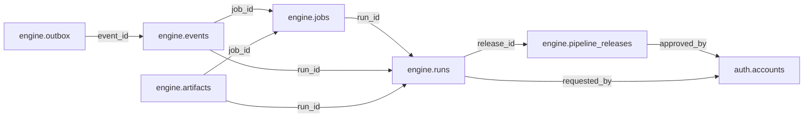

# engine — Operational

> **Operational scope agreed; table and column proposals remain unapproved.** No implementation is authorized by this documentation reorganization.

[Folder index](README.md) · [Full catalogue and relocation inventory](../README.md)

## Agreed responsibility — 12 November 2026

Pipeline definitions/releases, jobs, runs, attempts, checkpoints and delivery coordination.

Keep pipeline definitions and immutable releases, jobs, runs, attempts, checkpoints, retries and delivery coordination in Operations. Execution success does not establish a civic fact. Operations may refer to pinned civic identities/releases through versioned service contracts, never cross-database foreign keys. The retained outbox/artifact proposals support retryable work; acceptance, evidence validation and publication remain explicit gates.

## Retained table proposals and review context

The following dictionaries preserve the earlier proposal inputs, adjusted for the agreed ownership above. They remain unapproved. Earlier inventories retain their measured names; collapsed historical sections do not override the 12 November decisions.

## Retained engine proposal

> **PROPOSED — USER REVIEW REQUIRED.** Schema assignment is agreed; proposed tables and columns still require review. No SQL or migration is authorized.

## Purpose and ownership

**Target:** Operations. **Purpose:** Durable pipeline execution and operational requests. Schema placement follows the 12 November scope decision; individual table/column designs remain proposals. Related owners follow the agreed responsibility section above.

## Current implementation and gaps

The active manifest has 30 manifest migrations and 49 distinct CREATE TABLE declarations (49 distinct current table names) in schemas `audit`, `auth`, `engine`, `filesystem`, `geography`, `legal`, `objects`, `reference`. Generated Dryv has 124 entities (digest `e0087da9cf5b00e91f283a5501c368c7696bdd841ea30629231dc9c590f7c1ee`). Counts describe current artifacts, not target design; SQL and Dryv diverge.

- SQL declarations: `engine.runs` (engine/0001_engine.sql), `engine.jobs` (engine/0001_engine.sql), `engine.events` (engine/0001_engine.sql), `engine.outbox` (engine/0001_engine.sql), `engine.pipeline_releases` (engine/0002_temporal_pipeline_outbox.sql), `engine.pipeline_commands` (engine/0002_temporal_pipeline_outbox.sql), `engine.pipeline_reviews` (engine/0002_temporal_pipeline_outbox.sql)
- Dryv entities: None found.

The inventory does not establish live database state and may miss ALTER-only changes. Before implementation, reconcile migrations, Dryv, generated output and callers.

## Proposed relationship map

> All nodes and edges are proposals. Main schemas may use local cross-schema foreign keys; no edge crosses the Main/Operations database boundary.

## Proposed table and column review

All tables and fields are hypothetical. Every proposed business column is listed; UUIDv7 `id` is a candidate default and remains open. Record every existing field disposition: KEEP / REMOVE / RENAME / MOVE / MERGE / SPLIT / DERIVE / ADD.

### `engine.pipeline_releases` — Immutable pipeline definitions

- **Example:** PDF extraction release
- **Profile:** release; planning envelope below.

| Column | Proposed type | Meaning | Nullable | Default | Relationship | Units / validation | Proposed disposition |
|---|---|---|---|---|---|---|---|
| `id` | `uuid` | Proposed stable identity | No | Rust UUIDv7 candidate | Primary key | UUIDv7 candidate; unique and immutable after publication | KEEP (candidate match to current SQL/Dryv field; confirm meaning) |
| `pipeline_id` | `text` | Stable pipeline | No | — | — | UUID syntax; FK target must exist when the relationship is required | ADD (proposed target field; pending user approval) |
| `version` | `text` | Release | No | — | — | Nonblank when required; enforce domain-specific length, normalization and controlled vocabulary | KEEP (candidate match to current SQL/Dryv field; confirm meaning) |
| `manifest_hash` | `text` | Exact manifest | No | — | — | Nonblank when required; enforce domain-specific length, normalization and controlled vocabulary | KEEP (candidate match to current SQL/Dryv field; confirm meaning) |
| `approved_by` | `uuid` | Approver | No | — | FK → `auth.accounts` | Type checked; domain constraints and units must be approved for this field | ADD (proposed target field; pending user approval) |
| `released_at` | `timestamptz` | Release | No | — | — | Type checked; domain constraints and units must be approved for this field | ADD (proposed target field; pending user approval) |

- **Current SQL/Dryv fields without a proposed same-name column:** `activated_at`, `created_at`, `created_by`, `manifest`, `manifest_id`, `status`. **Disposition:** unresolved per field; propose KEEP, REMOVE, RENAME, MOVE, MERGE, SPLIT or DERIVE in review. Do not drop these fields until the user resolves each one.
- **FK action/cardinality:** Each non-null FK is many-to-one to its named target; nullable FKs are optional. Candidate delete/update behavior is RESTRICT/NO ACTION for accepted records; cascading canonical deletion is not proposed. Confirm uniqueness and exact behavior during review.
- **Constraints:** Unique pipeline/version; immutable. Exact keys and cross-field checks remain for review.
- **Indexes:** primary key on `id`; candidate B-tree indexes on FK columns `approved_by` for joins and referenced-entity filters; add temporal/spatial indexes only where the stated query needs them and benchmarks support them.
- **Relationships:** resolve each FK target. Main allows cross-schema FKs. Main and Operations have no cross-database FK.
- **Evidence/time:** preserve exact source/version, observation/retrieval time, historical context and uncertainty where applicable. Approve the exact evidence path for this table.
- **Growth/storage estimate (illustrative planning envelope, not measured):** Low: initial 100, +20/year, peak 10/day; five-year 200 rows ≈ 0.4 MiB live row+index budget; Expected: initial 1,000, +200/year, peak 100/day; five-year 2,000 rows ≈ 3.9 MiB live row+index budget; High: initial 10,000, +2,000/year, peak 1,000/day; five-year 20,000 rows ≈ 39.1 MiB live row+index budget. Model: initial rows + annual accepted rows × 5; multiply by a per-row budget of 2 KiB including a coarse index allowance. Replace assumptions with actual samples, ingest rates and `pg_total_relation_size` before approval. Large object bytes are excluded; WAL, replicas, backups and S3 are budgeted separately.
- **Workload:** Interactive lookup by identity and approved foreign keys; batch scans for import/reconciliation. Peak-day figure above is a scenario assumption, not a service-level commitment.
- **Partitioning:** No partition approved. Benchmark first; time range is a candidate for append-heavy observations, and keys must include partition columns. Releases are normally unpartitioned unless measured need appears. Check late data and partition count.
- **Files:** originals, full-resolution geometry, arrays, media and large exports may be immutable S3 objects. Keep searchable identity, required facts, hashes, coverage, access and provenance in PostgreSQL; use manifests and selective reads.
- **Retention/risks/benchmark:** preserve accepted evidence and corrections. Review late arrivals, contention, index/partition growth and recovery. Benchmark joins, filters, spatial access, ingestion bursts, concurrent access and interrupted publication.
### `engine.runs` — Pipeline invocation

- **Example:** Extract official report
- **Profile:** entity; planning envelope below.

| Column | Proposed type | Meaning | Nullable | Default | Relationship | Units / validation | Proposed disposition |
|---|---|---|---|---|---|---|---|
| `id` | `uuid` | Proposed stable identity | No | Rust UUIDv7 candidate | Primary key | UUIDv7 candidate; unique and immutable after publication | KEEP (candidate match to current SQL/Dryv field; confirm meaning) |
| `release_id` | `uuid` | Release | No | — | FK → `engine.pipeline_releases` | UUID syntax; FK target must exist when the relationship is required | ADD (proposed target field; pending user approval) |
| `requested_by` | `uuid` | Actor | No | — | FK → `auth.accounts` | Type checked; domain constraints and units must be approved for this field | KEEP (candidate match to current SQL/Dryv field; confirm meaning) |
| `idempotency_key` | `text` | Request identity | No | — | — | Nonblank when required; enforce domain-specific length, normalization and controlled vocabulary | ADD (proposed target field; pending user approval) |
| `request_hash` | `text` | Inputs digest | No | — | — | Nonblank when required; enforce domain-specific length, normalization and controlled vocabulary | ADD (proposed target field; pending user approval) |
| `status` | `text` | Queued running succeeded failed cancelled | No | — | — | Nonblank when required; enforce domain-specific length, normalization and controlled vocabulary | KEEP (candidate match to current SQL/Dryv field; confirm meaning) |
| `submitted_at` | `timestamptz` | Submission | No | — | — | Type checked; domain constraints and units must be approved for this field | ADD (proposed target field; pending user approval) |
| `finished_at` | `timestamptz` | Completion | Yes | — | — | Type checked; domain constraints and units must be approved for this field | KEEP (candidate match to current SQL/Dryv field; confirm meaning) |

- **Current SQL/Dryv fields without a proposed same-name column:** `created_at`, `name`. **Disposition:** unresolved per field; propose KEEP, REMOVE, RENAME, MOVE, MERGE, SPLIT or DERIVE in review. Do not drop these fields until the user resolves each one.
- **FK action/cardinality:** Each non-null FK is many-to-one to its named target; nullable FKs are optional. Candidate delete/update behavior is RESTRICT/NO ACTION for accepted records; cascading canonical deletion is not proposed. Confirm uniqueness and exact behavior during review.
- **Constraints:** Unique idempotency; request hash conflict check. Exact keys and cross-field checks remain for review.
- **Indexes:** primary key on `id`; candidate B-tree indexes on FK columns `release_id`, `requested_by` for joins and referenced-entity filters; add temporal/spatial indexes only where the stated query needs them and benchmarks support them.
- **Relationships:** resolve each FK target. Main allows cross-schema FKs. Main and Operations have no cross-database FK.
- **Evidence/time:** preserve exact source/version, observation/retrieval time, historical context and uncertainty where applicable. Approve the exact evidence path for this table.
- **Growth/storage estimate (illustrative planning envelope, not measured):** Low: initial 1,000, +200/year, peak 20/day; five-year 2,000 rows ≈ 2.0 MiB live row+index budget; Expected: initial 10,000, +2,000/year, peak 200/day; five-year 20,000 rows ≈ 19.5 MiB live row+index budget; High: initial 100,000, +20,000/year, peak 2,000/day; five-year 200,000 rows ≈ 195.3 MiB live row+index budget. Model: initial rows + annual accepted rows × 5; multiply by a per-row budget of 1 KiB including a coarse index allowance. Replace assumptions with actual samples, ingest rates and `pg_total_relation_size` before approval. Large object bytes are excluded; WAL, replicas, backups and S3 are budgeted separately.
- **Workload:** Interactive lookup by identity and approved foreign keys; batch scans for import/reconciliation. Peak-day figure above is a scenario assumption, not a service-level commitment.
- **Partitioning:** None proposed initially; decide from measured scale/query plans. Check late data and partition count.
- **Files:** originals, full-resolution geometry, arrays, media and large exports may be immutable S3 objects. Keep searchable identity, required facts, hashes, coverage, access and provenance in PostgreSQL; use manifests and selective reads.
- **Retention/risks/benchmark:** preserve accepted evidence and corrections. Review late arrivals, contention, index/partition growth and recovery. Benchmark joins, filters, spatial access, ingestion bursts, concurrent access and interrupted publication.
### `engine.jobs` — Retryable unit of execution

- **Example:** OCR job
- **Profile:** series; planning envelope below.

| Column | Proposed type | Meaning | Nullable | Default | Relationship | Units / validation | Proposed disposition |
|---|---|---|---|---|---|---|---|
| `id` | `uuid` | Proposed stable identity | No | Rust UUIDv7 candidate | Primary key | UUIDv7 candidate; unique and immutable after publication | KEEP (candidate match to current SQL/Dryv field; confirm meaning) |
| `run_id` | `uuid` | Run | No | — | FK → `engine.runs` | UUID syntax; FK target must exist when the relationship is required | KEEP (candidate match to current SQL/Dryv field; confirm meaning) |
| `kind` | `text` | Capability | No | — | — | Nonblank when required; enforce domain-specific length, normalization and controlled vocabulary | KEEP (candidate match to current SQL/Dryv field; confirm meaning) |
| `input_ref` | `text` | Versioned S3/contract ref | No | — | — | Nonblank when required; enforce domain-specific length, normalization and controlled vocabulary | ADD (proposed target field; pending user approval) |
| `status` | `text` | Queue state | No | — | — | Nonblank when required; enforce domain-specific length, normalization and controlled vocabulary | KEEP (candidate match to current SQL/Dryv field; confirm meaning) |
| `attempts` | `integer` | Count | No | — | — | Type checked; domain constraints and units must be approved for this field | KEEP (candidate match to current SQL/Dryv field; confirm meaning) |
| `next_attempt_at` | `timestamptz` | Retry | No | — | — | Type checked; domain constraints and units must be approved for this field | ADD (proposed target field; pending user approval) |
| `lease_owner` | `text` | Worker | Yes | — | — | Nonblank when required; enforce domain-specific length, normalization and controlled vocabulary | ADD (proposed target field; pending user approval) |
| `lease_until` | `timestamptz` | Lease | Yes | — | — | Type checked; domain constraints and units must be approved for this field | ADD (proposed target field; pending user approval) |
| `fence` | `bigint` | Monotonic token | No | — | — | Type checked; domain constraints and units must be approved for this field | ADD (proposed target field; pending user approval) |

- **Current SQL/Dryv fields without a proposed same-name column:** `created_at`, `error`, `finished_at`, `idempotency_key`, `input`, `max_attempts`, `requested_by`, `result`, `started_at`. **Disposition:** unresolved per field; propose KEEP, REMOVE, RENAME, MOVE, MERGE, SPLIT or DERIVE in review. Do not drop these fields until the user resolves each one.
- **FK action/cardinality:** Each non-null FK is many-to-one to its named target; nullable FKs are optional. Candidate delete/update behavior is RESTRICT/NO ACTION for accepted records; cascading canonical deletion is not proposed. Confirm uniqueness and exact behavior during review.
- **Constraints:** Claim with SKIP LOCKED only; bounded attempts; partition/archive by age. Exact keys and cross-field checks remain for review.
- **Indexes:** primary key on `id`; candidate B-tree indexes on FK columns `run_id` for joins and referenced-entity filters; add temporal/spatial indexes only where the stated query needs them and benchmarks support them.
- **Relationships:** resolve each FK target. Main allows cross-schema FKs. Main and Operations have no cross-database FK.
- **Evidence/time:** preserve exact source/version, observation/retrieval time, historical context and uncertainty where applicable. Approve the exact evidence path for this table.
- **Growth/storage estimate (illustrative planning envelope, not measured):** Low: initial 100,000, +100,000/year, peak 5,000/day; five-year 600,000 rows ≈ 1,171.9 MiB live row+index budget; Expected: initial 1,000,000, +1,000,000/year, peak 50,000/day; five-year 6,000,000 rows ≈ 11,718.8 MiB live row+index budget; High: initial 10,000,000, +10,000,000/year, peak 500,000/day; five-year 60,000,000 rows ≈ 117,187.5 MiB live row+index budget. Model: initial rows + annual accepted rows × 5; multiply by a per-row budget of 2 KiB including a coarse index allowance. Replace assumptions with actual samples, ingest rates and `pg_total_relation_size` before approval. Large object bytes are excluded; WAL, replicas, backups and S3 are budgeted separately.
- **Workload:** Interactive lookup by identity and approved foreign keys; batch scans for import/reconciliation. Peak-day figure above is a scenario assumption, not a service-level commitment.
- **Partitioning:** No partition approved. Benchmark first; time range is a candidate for append-heavy observations, and keys must include partition columns. Releases are normally unpartitioned unless measured need appears. Check late data and partition count.
- **Files:** originals, full-resolution geometry, arrays, media and large exports may be immutable S3 objects. Keep searchable identity, required facts, hashes, coverage, access and provenance in PostgreSQL; use manifests and selective reads.
- **Retention/risks/benchmark:** preserve accepted evidence and corrections. Review late arrivals, contention, index/partition growth and recovery. Benchmark joins, filters, spatial access, ingestion bursts, concurrent access and interrupted publication.
### `engine.events` — Operational execution history

- **Example:** OCR retry event
- **Profile:** series; planning envelope below.

| Column | Proposed type | Meaning | Nullable | Default | Relationship | Units / validation | Proposed disposition |
|---|---|---|---|---|---|---|---|
| `id` | `uuid` | Proposed stable identity | No | Rust UUIDv7 candidate | Primary key | UUIDv7 candidate; unique and immutable after publication | ADD (proposed target field; pending user approval) |
| `run_id` | `uuid` | Run | No | — | FK → `engine.runs` | UUID syntax; FK target must exist when the relationship is required | KEEP (candidate match to current SQL/Dryv field; confirm meaning) |
| `job_id` | `uuid` | Job | Yes | — | FK → `engine.jobs` | UUID syntax; FK target must exist when the relationship is required | KEEP (candidate match to current SQL/Dryv field; confirm meaning) |
| `sequence` | `bigint` | Ordered event | No | — | — | Type checked; domain constraints and units must be approved for this field | ADD (proposed target field; pending user approval) |
| `kind` | `text` | Event type | No | — | — | Nonblank when required; enforce domain-specific length, normalization and controlled vocabulary | KEEP (candidate match to current SQL/Dryv field; confirm meaning) |
| `occurred_at` | `timestamptz` | Time | No | — | — | Type checked; domain constraints and units must be approved for this field | ADD (proposed target field; pending user approval) |
| `payload` | `jsonb` | Bounded operational details | No | — | — | Type checked; domain constraints and units must be approved for this field | ADD (proposed target field; pending user approval) |

- **Current SQL/Dryv fields without a proposed same-name column:** `created_at`, `data`, `seq`. **Disposition:** unresolved per field; propose KEEP, REMOVE, RENAME, MOVE, MERGE, SPLIT or DERIVE in review. Do not drop these fields until the user resolves each one.
- **FK action/cardinality:** Each non-null FK is many-to-one to its named target; nullable FKs are optional. Candidate delete/update behavior is RESTRICT/NO ACTION for accepted records; cascading canonical deletion is not proposed. Confirm uniqueness and exact behavior during review.
- **Constraints:** High volume; partition by occurred_at; never store secrets/raw large payload. Exact keys and cross-field checks remain for review.
- **Indexes:** primary key on `id`; candidate B-tree indexes on FK columns `run_id`, `job_id` for joins and referenced-entity filters; add temporal/spatial indexes only where the stated query needs them and benchmarks support them.
- **Relationships:** resolve each FK target. Main allows cross-schema FKs. Main and Operations have no cross-database FK.
- **Evidence/time:** preserve exact source/version, observation/retrieval time, historical context and uncertainty where applicable. Approve the exact evidence path for this table.
- **Growth/storage estimate (illustrative planning envelope, not measured):** Low: initial 100,000, +100,000/year, peak 5,000/day; five-year 600,000 rows ≈ 1,171.9 MiB live row+index budget; Expected: initial 1,000,000, +1,000,000/year, peak 50,000/day; five-year 6,000,000 rows ≈ 11,718.8 MiB live row+index budget; High: initial 10,000,000, +10,000,000/year, peak 500,000/day; five-year 60,000,000 rows ≈ 117,187.5 MiB live row+index budget. Model: initial rows + annual accepted rows × 5; multiply by a per-row budget of 2 KiB including a coarse index allowance. Replace assumptions with actual samples, ingest rates and `pg_total_relation_size` before approval. Large object bytes are excluded; WAL, replicas, backups and S3 are budgeted separately.
- **Workload:** Interactive lookup by identity and approved foreign keys; batch scans for import/reconciliation. Peak-day figure above is a scenario assumption, not a service-level commitment.
- **Partitioning:** No partition approved. Benchmark first; time range is a candidate for append-heavy observations, and keys must include partition columns. Releases are normally unpartitioned unless measured need appears. Check late data and partition count.
- **Files:** originals, full-resolution geometry, arrays, media and large exports may be immutable S3 objects. Keep searchable identity, required facts, hashes, coverage, access and provenance in PostgreSQL; use manifests and selective reads.
- **Retention/risks/benchmark:** preserve accepted evidence and corrections. Review late arrivals, contention, index/partition growth and recovery. Benchmark joins, filters, spatial access, ingestion bursts, concurrent access and interrupted publication.
### `engine.outbox` — Durable delivery obligations

- **Example:** Notify API
- **Profile:** series; planning envelope below.

| Column | Proposed type | Meaning | Nullable | Default | Relationship | Units / validation | Proposed disposition |
|---|---|---|---|---|---|---|---|
| `id` | `uuid` | Proposed stable identity | No | Rust UUIDv7 candidate | Primary key | UUIDv7 candidate; unique and immutable after publication | KEEP (candidate match to current SQL/Dryv field; confirm meaning) |
| `event_id` | `uuid` | Event | No | — | FK → `engine.events` | UUID syntax; FK target must exist when the relationship is required | ADD (proposed target field; pending user approval) |
| `target` | `text` | Destination | No | — | — | Nonblank when required; enforce domain-specific length, normalization and controlled vocabulary | KEEP (candidate match to current SQL/Dryv field; confirm meaning) |
| `status` | `text` | pending delivered dead | No | — | — | Nonblank when required; enforce domain-specific length, normalization and controlled vocabulary | KEEP (candidate match to current SQL/Dryv field; confirm meaning) |
| `attempts` | `integer` | Retry count | No | — | — | Type checked; domain constraints and units must be approved for this field | KEEP (candidate match to current SQL/Dryv field; confirm meaning) |
| `next_attempt_at` | `timestamptz` | Retry schedule | No | — | — | Type checked; domain constraints and units must be approved for this field | KEEP (candidate match to current SQL/Dryv field; confirm meaning) |

- **Current SQL/Dryv fields without a proposed same-name column:** `delivered_at`, `event_seq`, `last_error`. **Disposition:** unresolved per field; propose KEEP, REMOVE, RENAME, MOVE, MERGE, SPLIT or DERIVE in review. Do not drop these fields until the user resolves each one.
- **FK action/cardinality:** Each non-null FK is many-to-one to its named target; nullable FKs are optional. Candidate delete/update behavior is RESTRICT/NO ACTION for accepted records; cascading canonical deletion is not proposed. Confirm uniqueness and exact behavior during review.
- **Constraints:** UNIQUE(event,target); claim SKIP LOCKED; trim delivered event history by policy. Exact keys and cross-field checks remain for review.
- **Indexes:** primary key on `id`; candidate B-tree indexes on FK columns `event_id` for joins and referenced-entity filters; add temporal/spatial indexes only where the stated query needs them and benchmarks support them.
- **Relationships:** resolve each FK target. Main allows cross-schema FKs. Main and Operations have no cross-database FK.
- **Evidence/time:** preserve exact source/version, observation/retrieval time, historical context and uncertainty where applicable. Approve the exact evidence path for this table.
- **Growth/storage estimate (illustrative planning envelope, not measured):** Low: initial 100,000, +100,000/year, peak 5,000/day; five-year 600,000 rows ≈ 1,171.9 MiB live row+index budget; Expected: initial 1,000,000, +1,000,000/year, peak 50,000/day; five-year 6,000,000 rows ≈ 11,718.8 MiB live row+index budget; High: initial 10,000,000, +10,000,000/year, peak 500,000/day; five-year 60,000,000 rows ≈ 117,187.5 MiB live row+index budget. Model: initial rows + annual accepted rows × 5; multiply by a per-row budget of 2 KiB including a coarse index allowance. Replace assumptions with actual samples, ingest rates and `pg_total_relation_size` before approval. Large object bytes are excluded; WAL, replicas, backups and S3 are budgeted separately.
- **Workload:** Interactive lookup by identity and approved foreign keys; batch scans for import/reconciliation. Peak-day figure above is a scenario assumption, not a service-level commitment.
- **Partitioning:** No partition approved. Benchmark first; time range is a candidate for append-heavy observations, and keys must include partition columns. Releases are normally unpartitioned unless measured need appears. Check late data and partition count.
- **Files:** originals, full-resolution geometry, arrays, media and large exports may be immutable S3 objects. Keep searchable identity, required facts, hashes, coverage, access and provenance in PostgreSQL; use manifests and selective reads.
- **Retention/risks/benchmark:** preserve accepted evidence and corrections. Review late arrivals, contention, index/partition growth and recovery. Benchmark joins, filters, spatial access, ingestion bursts, concurrent access and interrupted publication.
### `engine.artifacts` — Temporary operational object references

- **Example:** Temporary OCR text
- **Profile:** relation; planning envelope below.

| Column | Proposed type | Meaning | Nullable | Default | Relationship | Units / validation | Proposed disposition |
|---|---|---|---|---|---|---|---|
| `id` | `uuid` | Proposed stable identity | No | Rust UUIDv7 candidate | Primary key | UUIDv7 candidate; unique and immutable after publication | ADD (proposed target field; pending user approval) |
| `run_id` | `uuid` | Run | No | — | FK → `engine.runs` | UUID syntax; FK target must exist when the relationship is required | ADD (proposed target field; pending user approval) |
| `job_id` | `uuid` | Job | Yes | — | FK → `engine.jobs` | UUID syntax; FK target must exist when the relationship is required | ADD (proposed target field; pending user approval) |
| `object_key` | `text` | Restricted S3 reference | No | — | — | Nonblank when required; enforce domain-specific length, normalization and controlled vocabulary | ADD (proposed target field; pending user approval) |
| `sha256` | `text` | Hash | No | — | — | Nonblank when required; enforce domain-specific length, normalization and controlled vocabulary | ADD (proposed target field; pending user approval) |
| `expires_at` | `timestamptz` | Expiry | Yes | — | — | Type checked; domain constraints and units must be approved for this field | ADD (proposed target field; pending user approval) |
| `role` | `text` | intermediate log debug candidate | No | — | — | Nonblank when required; enforce domain-specific length, normalization and controlled vocabulary | ADD (proposed target field; pending user approval) |

- **FK action/cardinality:** Each non-null FK is many-to-one to its named target; nullable FKs are optional. Candidate delete/update behavior is RESTRICT/NO ACTION for accepted records; cascading canonical deletion is not proposed. Confirm uniqueness and exact behavior during review.
- **Constraints:** Operational object lifecycle; published Main objects separately registered. Exact keys and cross-field checks remain for review.
- **Indexes:** primary key on `id`; candidate B-tree indexes on FK columns `run_id`, `job_id` for joins and referenced-entity filters; add temporal/spatial indexes only where the stated query needs them and benchmarks support them.
- **Relationships:** resolve each FK target. Main allows cross-schema FKs. Main and Operations have no cross-database FK.
- **Evidence/time:** preserve exact source/version, observation/retrieval time, historical context and uncertainty where applicable. Approve the exact evidence path for this table.
- **Growth/storage estimate (illustrative planning envelope, not measured):** Low: initial 1,000, +2,000/year, peak 100/day; five-year 11,000 rows ≈ 10.7 MiB live row+index budget; Expected: initial 10,000, +20,000/year, peak 1,000/day; five-year 110,000 rows ≈ 107.4 MiB live row+index budget; High: initial 100,000, +200,000/year, peak 10,000/day; five-year 1,100,000 rows ≈ 1,074.2 MiB live row+index budget. Model: initial rows + annual accepted rows × 5; multiply by a per-row budget of 1 KiB including a coarse index allowance. Replace assumptions with actual samples, ingest rates and `pg_total_relation_size` before approval. Large object bytes are excluded; WAL, replicas, backups and S3 are budgeted separately.
- **Workload:** Interactive lookup by identity and approved foreign keys; batch scans for import/reconciliation. Peak-day figure above is a scenario assumption, not a service-level commitment.
- **Partitioning:** None proposed initially; decide from measured scale/query plans. Check late data and partition count.
- **Files:** originals, full-resolution geometry, arrays, media and large exports may be immutable S3 objects. Keep searchable identity, required facts, hashes, coverage, access and provenance in PostgreSQL; use manifests and selective reads.
- **Retention/risks/benchmark:** preserve accepted evidence and corrections. Review late arrivals, contention, index/partition growth and recovery. Benchmark joins, filters, spatial access, ingestion bursts, concurrent access and interrupted publication.

## Queries, lifecycle, capacity and approval

**Representative query:** What work is running, retryable and attributable?

Lifecycle: preserve source bytes; extract into candidate revisions; validate; review or use approved deterministic checks; atomically publish; serve. Corrections create explicit versions/supersession. Preserve disagreement and uncertainty.

Capacity is unmeasured. Use low/expected/high input scenarios, explicit formulas and workload benchmarks; do not assume sizes or universal partitions.

**Status:** NOT REVIEWED. Schema assignment follows the handoff; tables, columns, relationships, partitioning and S3 choices still require user approval. Feedback: none. Approval reference/date/revision: none. Implementation authorization: not granted. Material changes reopen approval.

Earlier schema proposal preserved for history; superseded and not an approval

---
id: DOC-E5386C01A9B4
name: Engine staging pipeline processing and pattern runtime redesign
type: documentation
tags: [improvements, schema-redesign, engine, staging, pipelines, patterns, planning]
extra: {status: planning_only, architecture_choice: open}
---

# Engine — pipelines, runs, staging, generation, quality and controlled promotion

**PLANNING ONLY.** The user wants `engine`/`staging` simplified, with all pipeline runs, decisions and processing concerns easy to understand, auditable and scalable. Exact runtime packages/services and final engine table set are **not decided**, and Taskcode tasks will be directed by the user individually later.

## User request: independent pipelines, one coherent operational model

Instead of a monolithic data engine, build independently runnable **data pipelines** (e.g. governance leadership, procurement, legal sources, statistics, website Markdown extraction) that can work simultaneously toward one shared coverage goal or different goals. Reuse standalone packages for agent/AI, scraping, web rendering, extraction, file access, normalization, validation, entity matching, dedup, generation and promotion. Pipeline execution is not the same as the canonical data domain. The `engine` schema is the proposed operational control center; `source` preserves evidence, `filesystem` manages logical file/object references, `audit` records immutable decisions, and domain tables store canonical data.

The user requests explanation of how architecture/code will look and has **not** approved one central queue, microservices, Python-only workers, or directory layout. A later separate database is a *future* possibility, not a current requirement.

## Current migration-owned tables: 13 existing operating records

| Current table | Ownership and redesign question |
|---|---|
| `engine.migrations` | TypeORM migration-history bookkeeping; do not mix with business pipeline jobs. |
| `engine.jobs` | Existing queued work, input hashing/generation, retries, concurrent `SKIP LOCKED` claims. |
| `engine.match_candidates` | Proposed same-identity pair/merge suggestions; strict evidence and confidence review. |
| `engine.match_clusters` | Possible candidate clusters; cannot auto-merge different persons/organizations solely by names. |
| `engine.gaps` | Known missing coverage/research targets with source/geo context. |
| `engine.gap_attempts` | Attempts to resolve gaps, work status and provenance. |
| `engine.claims` | Candidate field-level claims/correction suggestions, with conflict state. |
| `engine.claim_standings` | Comparing/reconciling competing claims; audit the actual status model. |
| `engine.quality_findings` | Reproducible quality/integrity problems, fingerprint and review status. |
| `staging.runs` | Existing stage/import run context; evaluate overlap with `engine.jobs` and pipeline-level runs. |
| `staging.candidates` | Validated/unvalidated candidate records, natural keys, payload hashes and origin. |
| `staging.issues` | Candidate/integrity/extraction errors and quarantine statuses. |
| `staging.promotions` | Result of promoting approved candidate data into canonical domain rows. |

`access` and `identity` data move toward `auth`, **not engine**. `audit` remains a separate accountable-actor/decision concern; engine may FK to audit or vice versa. Avoid merging all operational logs into one opaque JSON table. A job, a run, a candidate, a correction proposal, a verified record and an audit decision have different lifecycles.

## Proposed concepts for evaluation — not approved tables

| Candidate | Why it might improve clarity |
|---|---|
| `pipelines` | Registered workflow identity, domain objective and allowed start/retry semantics. |
| `pipeline_versions` | Version of pipeline DAG/config/tool requirements and structured input/output contract. |
| `runs` | A pipeline or declared shared goal instance, owner, scope, status, timestamps, input version and summary. |
| `jobs` | Individually schedulable step or fan-out unit with idempotent key, dependencies, lock/lease/retries and output. |
| `dependencies` | Explicit job/pipeline input dependencies; maybe a table or validated JSON DAG if truly immutable. |
| `candidates`, `issues`, `promotions` | Possibly relocate from staging while preserving identity and review history; don't create duplicates. |
| `patterns` and `pattern_versions` | Central registry for domain-specific pattern definitions and approved versions. |
| `generations` and `generation_outputs` | Sync/dry-run previews, actual produced expected/canonical rows and provenance. |
| `reviews` and `decisions` | Workflow state (not duplicate the immutable approval action in `audit`). |
| `artifacts`/`outputs` | Durable pointers to `filesystem.versions` and `source.captures` rather than copied bytes. |
| `metrics`/`coverage` | Derived dashboard views as needed; consider computed read views rather than hot counters. |

The exact schema may preserve `staging` physically if that makes transactions and access control clearer. **The user suggests a simpler shared `engine`, but consolidation is subject to per-table analysis.**

## Workflows and SQL/foreign-key boundaries

A goal "verify leadership for 47 counties" expands to independently claimable jobs; procurement and statistics may run concurrently. Each job has stable pipeline/version/input keys, dependencies, source policy, resource quota, attempt count, error type and output artifact FKs. A job must be retryable and idempotent; two workers may not silently promote conflicting canonical edits. The system needs bounded concurrency, dependency-aware resumption, cancellation/pause, source rate limits, extraction caching and human review states.

Use hard FKs `jobs.run_id`, `issues.candidate_id`, `promotion.candidate_id`, `generation.pattern_version_id`, `generation_outputs.generation_id`, `capture.file_version_id`, `audit actor`, and other structurally known targets. Generic target-record links (e.g., one candidate for any domain table) need a type-safe strategy: explicit typed associations or a constrained canonical record registry; a bare schema/table name and UUID alone is not enforceable. Preserve source tool/extractor/AI model/prompt version and method without duplicating authoritative provenance.

## Data classification and patterns across everything

**1A static** records can be seeded deliberately with documented IDs/evidence. **1B pattern** runs generate expected entities from approved, jurisdiction-scoped, versioned rules; **2A collected** pipelines acquire and extract external evidence into staged candidates; **2B derived** pipelines recompute formulas/dependency outputs only when inputs or tool versions change.

Every table must document its eligible class in PostgreSQL and Markdown; record-level lineage must identify the actual class, inputs, pattern, capture, versions and reviewer. Patterns may be mostly DB-managed, with approved versioned CSV/YAML/JSON or site-structure bundles in `filesystem`. Support admin viewing, editing, approving, dry-running and click-to-generate/synchronize, without bypassing established permission or review gates. Pattern changes should generate a diff of expected/adopted/retired/conflicted rows—not automatically delete historical office holders.

## Hashing, correction and change-aware execution

Use distinct hashes for immutable S3 bytes, semantic Markdown content, DOM subsections/site manifests, normalized candidate payloads, pipeline input/tool configuration, and derived outputs. Recheck old URLs according to refresh policy; seeing one URL previously does not make it immutable. Cached extraction results can be reused only when input and extractor/template versions remain compatible. Propagate invalidation through declared dependencies.

Existing `engine/database/src/claims.ts` only permits narrowly scoped annotation fills, not general overwrites. Design a reviewed correction path that separates mistaken fact, real-world historical change, pattern expectation revision and duplicate-identity merge. Protect source evidence and valid time, track corrected assertion versions and audit. Review policies differ by field sensitivity, data class and evidence quality.

## Candidate runtime/package architecture (not chosen)

- **Option A:** one Python/Bun runtime with pluggable pipeline modules; easy start, weaker failure isolation.
- **Option B — assistant lean:** modular reusable packages, independently runnable workers, a common durable PostgreSQL orchestration/queue and strong service contracts; not yet user-approved.
- **Option C:** independently deployed microservices with queue/events and more infrastructure.
- **Option D:** hybrid split by expensive render/AI extraction workloads if real volumes justify it.

See [independent pipelines](../../guides/independent-data-pipelines.md) for flow, code examples and tradeoffs. Database `engine` ownership is not synonymous with where scraper/agent/extractor packages physically run.

## Example queries and design proof cases

- Show all pipeline runs supporting a Kenya national-scoped source update and all its county jobs, with independent progress.
- Resume just three failed counties without re-downloading the unchanged other 44 county artifacts.
- Compare generated office expectations before and after a revised legal rule, preserving verified occupants.
- Re-extract a Markdown section on tool update despite unchanged raw HTML; avoid repeated extraction of unrelated pages.
- Show why a proposed supplier identity merge was rejected and which original source records it affected.
- Track an official-source crawl blocked by collection policy without fabricating a capture.
- Run a legal publications pipeline while procurement imports run, avoiding shared resource and canonical conflicts.

## Open decisions and migration approach

1. Exact pipeline process/package/service boundaries and language choices.
2. Job/run/dependency granularity, separate goal object, concurrency quotas, budgets and worker/resource lease semantics.
3. Whether to physically merge `staging` and `engine`; avoid collisions with current `engine.migrations`.
4. Central pattern registry + per-domain rules; DB functions vs workers for deterministic generation.
5. FK strategy for generic candidates/claims/attributions and canonical target versions.
6. Reviewer privileges, immutable `audit` event link, correction policies and AI agent accountability.
7. Status taxonomy, metrics, log retention, observability, distributed task locking and outage recovery.
8. Data acquisition schedules, site revalidation rules and dependency invalidation.
9. When a future independent engine database becomes justified given today’s desired cross-schema FK guarantees.

Audit all migration-created tables and live rows, TypeORM/engine writer paths and source contracts first. Preserve job/candidate/promotion IDs and history. Implementation tasks, new packages, database moves and tests require **subsequent user direction and approval**.

**References:** [Master register](../../guides/mzizi-data-schema-storage-and-pipelines-redesign.md) · [Pattern classes](../../guides/data-categories-and-patterns.md) · [Pipelines](../../guides/independent-data-pipelines.md) · [Audit](audit.md).

**Status: future architecture under discussion, not ready for implementation.**

## Human review — editable user notes and design sign-off

**Review status:** `NOT REVIEWED` — AI-authored proposals in this document are not final approval.

**In my own words, what this schema should represent and exclude:**

> _My understanding and questions:_

**Tables/columns I want to keep, rename, move, merge, split, remove or add (and why):**

> _My proposed changes and alternative names:_

**Hard foreign keys, geographical and legal scope, pattern generation, classification and evidence I want changed or explained:**

> _My technical feedback, disagreements and alternatives:_

**Real data and queries I want to use to validate this design:**

> _My examples and expected results:_

**Unresolved decisions I want to discuss further:**

> _My remaining questions:_

**Final user decision:** `NOT DECIDED` / `NEEDS CHANGES` / `DESIGN VALIDATED BY USER` / `APPROVED FOR TASK PLANNING`.

**Approval reference and date:** _None. Only record explicit later user authorization. Even design validation does not authorize code, migration or Taskcode task creation._

## Related source redesign planning

See [source redesign and adaptive website intelligence](../../source-redesign/README.md) for the consolidated planning-only review of unknown-site discovery, link/URL deduplication, optional YAML structures, semantic retrieval/ML, incremental processing, the dedicated vector index alternatives and the shared pattern-schema option. **No source/website collapse, new pattern schema or target table set has been approved.**

## 2026-11-07 refinement: reference-owned pattern/watch definitions, engine-owned work

**User lean (not approved DDL):** Instead of defining independent pattern tables in every domain or necessarily creating a new `pattern` schema, investigate `reference` as the home for shared **long-lived pattern and watcher definitions**. `engine` remains the home for execution, retries, gaps and claims. The pattern is established by real jurisdiction/geography/legal records; a generated canonical record may activate further *preapproved* pattern applications.

**Engine runtime concepts to evaluate:** a versioned pattern application/run, generated-output reconcile result, dependency invalidation, one pending research job per deduplicated gap/trigger, watcher evaluation log, source capability selection, claim/quality/review and eventual controlled update. Much of this already exists in `engine.jobs`, `engine.gaps`, `gap_attempts`, `claims`, `claim_standings`, `staging.candidates` and `promotions`; reuse before adding tables.

**Watcher manifests mostly DB-managed:** `reference` definition and file version; engine compiles approved conditions from validated Dryv/table metadata and runs field/relationship/coverage/freshness/conflict checks. A rule can trigger on established row creation, missing FK relation, upstream source change, legal amendment, geo unit change or age of verification. Unknown/not-applicable/known-absent/verified/conflicted states prevent endless retries. Pipeline tools produce candidates with evidence; policy-controlled reviewer promotion fills real domain fields/relationships and preserves history.

**Core neutrality defect observed in repository:** `.docs/_archives/2026-11-08-rewrite-snapshot/source/backend/engine/data/src/mzizi_data/reinforcement.py` hardcodes a `RULES` dictionary naming `knbs`, `iebc`, `orpp`, `kenya_law`; `gapclose.py` has `orpp_refill` and Kenya-specific party code values; `.docs/_archives/2026-11-08-rewrite-snapshot/source/backend/engine/database/src/patterns.ts` defaults to `ke`, knows county numbers and uses `ke-office-patterns.json`. Their generic orchestration behavior should become context-free; country facts and official adapter choices should be loaded via source/jurisdiction manifests and registered tools. Dedicated IEBC/KNBS adapters can still exist as **plugins**, just not as conditions hardcoded into the universal watcher. No tests/code/refactor are authorized yet.

**Dependency safety:** a directed acyclic prerequisite graph, bounded fan-out, stable natural keys and input-version hashes, dry-run/preview/diff before apply, non-destructive sync, independent legal/geo applicability tests and transaction-controlled promotion. Source changes trigger re-evaluation of **affected** rows, not a whole-database rescan. The chosen generated-output hard-FK mechanism remains OPEN.

Full discussion: [Data classes and pattern graph](../../guides/data-categories-and-patterns.md). **No tasks or runtime changes authorized.**

## Mandatory per-table temporal, rigid-column and deletion review (2026-11-07)

**USER REQUIREMENT; planning only.** Examine every existing/proposed field and expressly record **KEEP / REMOVE / DERIVE / MOVE / RENAME / ADD** for `valid_from`, `valid_to`, `valid_from_precision`, `valid_to_precision`, `is_current`, `status`, `version`, `created_at`, `updated_at` and other copied/rigid flags. These fields are **opt-in by justified meaning**, not blanket schema conventions. Assess `deleted_at` only for recoverable soft deletion where appropriate. The full policy and migration/approval checklist is in [schema redesign README](../README.md).

**Domain-specific guidance:** Jobs, runs, gaps, candidates, attempts, claims and quality findings need created/queued/started/completed/rechecked timestamps and explicit workflow state, not real-world validity or is_current by convention. Approved patterns may have applicability periods in reference; their engine executions do not inherit them as event validity. Operational retention/cleanup should be planned independently of public history.

**OPEN for human review:** exact per-table/column disposition, derived status and as-of queries, pattern/legal links, justified precision, recoverable deletion versus domain lifecycle, history/identity preservation and hard-FK impact. No code or migration is authorized.

## 2026-11-07 proposal: evidence-backed freshness, scheduled/event/manual triggers

**USER IDEA:** An engine should continuously identify facts that require revalidation, react to meaningful scheduled or actual `activity` changes, and accept authorized ad-hoc agent/admin research requests. This expands—not replaces—the existing shared patterns and fill-in-the-gaps watcher design. All schema proposals remain OPEN.

### Distinguish freshness from canonical modification

- `last_checked_at`: an attempt was made; a failed request may legitimately update this but does **not** confirm accuracy.
- `last_verified_at`: evidence satisfying the applicable verifier policy reaffirmed the particular fact or relationship; it may advance without any domain row update.
- `last_source_seen_at`: a source/webpage was seen or revalidated; this is not independent fact verification.
- `last_changed_at`: a detected or accepted fact change **with precisely documented meaning**; do not conflate source HTML change, source claim change and accepted canonical mutation.
- `next_check_at`: computed or scheduled follow-up from applicable rule, risk and observed outcomes.

**These are semantic metadata concepts, not five automatically required columns on each domain row.** Favor centralized verification histories linked to a **field group, relationship or relevant canonical record/version**, with row-level exceptions where necessary. A broad `table was refreshed` watermark is not proof that every field or row was verified.

### Candidate responsibilities (avoid premature tables)

| Owner | Candidate responsibility | Existing structure to inspect |
|---|---|---|
| `reference` | `freshness_policies`, schedule/pattern/watch definitions and versions | Existing reference classes and approved pattern planning |
| `activity` | Schedule instances, sourced official announcements/real-world occurrences, rescheduling and cancellations | `calendar.events`/`links` |
| `engine` | Due-check evaluation, triggering/dedup, `verification_checks` / `refresh_requests` / schedule firings if needed, workers, gaps and candidates | `engine.jobs`, `gaps`, `gap_attempts`, `claims`, `quality_findings`, `staging` |
| `source` | Verified claim evidence, captures, source observability, review and provenance | `source.verifications`/`captures`/`attributions` |
| `audit` / `auth` | Actor identity, permissions, human submissions, review decisions and correction history | Current account/role and audit entities |

### Event-driven + periodic + manual scheduling in one control plane

Accepted input types: (1) a scheduled due window or legal reporting deadline, (2) an approved announcement or verified occurrence, (3) a new/changed official-source page or Markdown section, (4) a canonical/legal/pattern or geographic dependency change, (5) an authorized admin request or agent-directed monitoring instruction, (6) a previously unresolved coverage gap that becomes due.

Proposed flow: **receive trigger → resolve immutable rule/policy version → evaluate jurisdiction/geo/temporal scope → identify affected domain rows and field groups → deduplicate `(rule_version, subject, target_field_group, cause/evidence_version, due_window)` → enforce source permissions and source-host admission → run bounded verification → record checks and source evidence → unchanged / new candidate / contradiction / unknown / inaccessible / deferred → review/promotion as applicable → next_check/retry.**

**Avoid runaway loops:** trigger provenance and dependency graph, depth/fan-out limits, trigger ID ancestry, cooldown/debounce, bounded retries, one job lease per dedup key, stop on proven unchanged result, and no event notification loop just because `last_verified_at` advances. One authoritative engine scheduler/lease/admission system must govern all third-party crawlers/agents; do not let each external tool launch an independent refresh scheduler.

### Hotness is granular and adaptive, not just a table flag

Start with classifications such as `hot` (active leadership/elections/tenders), `warm` (contacts/current budgets), `cold` (stable historical definitions), and `event-driven` (official releases and disputed/historic facts). **Exact cadences are NOT approved.** The same table can have hot office-holder relationships and cold party identity fields. Evaluate scope at table default → field group/relationship → exceptional record. Factors: age since successful verification, expected change rate, source confidence/availability, severity of stale information, official calendar/event signals, observed content-tree change, source access budgets and review priority.

A new source fetch should not change a canonical fact just because it is new; a check can result in verified **unchanged** with an updated verification event. A stale indicator is **not a claim of falsity**. A scheduled event passing its planned date is not proof that it occurred. Keep data quality/research state separate from real-world entity lifecycle and workflow status.

### Manual submission and agent-driven monitoring

An authorized admin can: (a) propose activity with evidence, (b) request re-verification without claiming a change, (c) approve a verified event according to RBAC, or (d) configure a scoped recurring monitor under approved capabilities/budgets. Agent tasks such as "watch these approved official sites for announcements about this institution" must become a persisted, bounded rule/monitor with source policy and an execution audit; not an unbounded conversational instruction. Human/agent action has account/service identity and traceable decision/validation.

**Research outcomes:** successful no-change verification; supported new canonical candidate; conflicting evidence requiring review; missing relationship; source unavailable; publisher-reported withdrawal; deliberate known-absence or not-applicable; canceled/overdue event schedule. Do not falsely advance `last_verified_at` when only a failed check or a source download occurred.

**Unresolved design decisions:** whether the verification ledger physically lives under `engine` or `source`; how to enforce hard FK lineage for generic field-group checks; table/field-group policy registry representation; schedule-rule recurrence and timezone/legal exceptions; scheduler dedup keys; what source events are trusted to auto-trigger; cost/volume retention; which updates bypass human review. **No code/migration/task authorization.**

## 2026-11-11 — System-expansion alignment

Spatial/environmental transformations and domain acquisitions remain engine jobs with pinned inputs, methods and outputs; engine execution does not own canonical domain facts. See the [system-expansion proposal](../../guides/advancement-and-system-expansion.md). This alignment note does not approve proposed schemas, tables or implementation.

## 2026-11-12 — Operational design accepted and approved

**Approval status:** ACCEPTED AND APPROVED by the user on 12 November 2026. **Implementation status:** Dryv contract authoring is authorized on `develop` for this schema. See [DEC-OPERATIONAL-DATABASE-20261112](../../../decisions/DEC-OPERATIONAL-DATABASE-20261112.md) for the complete approval record and cross-schema rules.

This approved inventory supersedes earlier candidate-table lists, draft definitions and statements in this document that the design is not reviewed, not approved or awaiting user approval. Historical analysis remains context only. The table names and column names below are the approved baseline; implementation must define their precise types, nullability, defaults, keys, relationships, constraints and indexes under the repository's contract-authoring rules. The author may resolve those engineering details without requesting individual approval, but must not silently add, remove or rename approved tables or columns.

## engine — 10 approved tables

**Responsibility:** Pipeline identity/releases, runs, schedulable jobs, dependencies, attempts, checkpoints, execution events, outbox delivery and artifacts.

### `engine.pipelines`

`id`, `code`, `title`, `description`, `owner_account_id`, `enabled`, `created_at`, `retired_at`

### `engine.pipeline_releases`

`id`, `pipeline_id`, `version`, `manifest_hash`, `manifest_object_key`, `contract_version`, `approved_by`, `released_at`

### `engine.runs`

`id`, `release_id`, `requested_by`, `trigger_kind`, `trigger_ref`, `idempotency_key`, `request_hash`, `status`, `submitted_at`, `started_at`, `finished_at`, `cancelled_at`, `summary`

### `engine.jobs`

`id`, `run_id`, `kind`, `input_ref`, `status`, `attempt_count`, `max_attempts`, `next_attempt_at`, `lease_owner`, `lease_until`, `fence`, `created_at`, `started_at`, `finished_at`

### `engine.job_dependencies`

`job_id`, `depends_on_job_id`, `dependency_kind`, `created_at`

### `engine.job_attempts`

`id`, `job_id`, `attempt_number`, `worker_identity`, `started_at`, `finished_at`, `status`, `error_code`, `error_summary`, `input_hash`, `output_hash`

### `engine.checkpoints`

`id`, `job_id`, `sequence`, `checkpoint_key`, `state_hash`, `artifact_id`, `saved_at`

### `engine.events`

`id`, `run_id`, `job_id`, `sequence`, `kind`, `actor_id`, `occurred_at`, `payload`

### `engine.outbox`

`id`, `event_id`, `destination`, `status`, `attempts`, `next_attempt_at`, `delivered_at`, `last_error`, `idempotency_key`

### `engine.artifacts`

`id`, `run_id`, `job_id`, `object_key`, `sha256`, `size_bytes`, `media_type`, `role`, `access_classification`, `created_at`, `expires_at`

**Boundary:** This approval authorizes Operational Dryv contracts only. It does not authorize migrations, database provisioning, seed/data migration or deployment. It does not approve any Main `mzizi` Phase 01 schema; those will be reviewed individually later. Phase 02 remains deferred.
