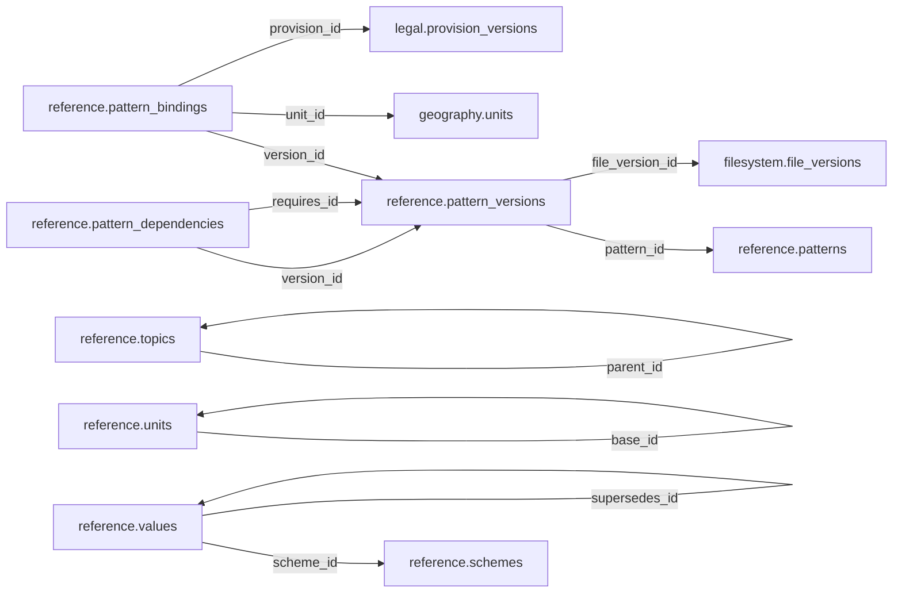

# reference — Phase 01

> **Phase 01 civic accountability scope agreed; table and column proposals remain unapproved.** No implementation is authorized by this documentation reorganization.

[Folder index](README.md) · [Full catalogue and relocation inventory](../README.md)

## Agreed responsibility — 12 November 2026

Shared definitions and classifications; the only schema that links to Legal on behalf of domain records.

Domain records link to Reference; **Reference is the only schema that links to Legal**. Reference mediates legal foundations for Governance, Geography and all other domain schemas. This supersedes earlier proposals for direct domain-to-Legal foreign keys. Reference does not replace actual Official identities or geographic units.

A typed, versioned `reference.legal_bases` interface is a **proposal for review**, not an approved table: it would identify an exact Legal instrument/provision version, the kind of legal relationship, applicability and supporting evidence. Domain legal-basis associations would target this interface. Existing `reference.pattern_bindings.provision_id` proposals already illustrate Reference-owned links to Legal; they are not sufficient justification to turn every mandate into a pattern. Final bridge columns, cardinality and constraints remain open. Distinguish cited authority from a finding of compliance; preserve multiple or disputed bases and their effective dates.

## Retained table proposals and review context

The following dictionaries preserve the earlier proposal inputs, adjusted for the agreed ownership above. They remain unapproved. Earlier inventories retain their measured names; collapsed historical sections do not override the 12 November decisions.

## Retained reference proposal

> **PROPOSED — USER REVIEW REQUIRED.** Schema assignment is agreed; proposed tables and columns still require review. No SQL or migration is authorized.

## Purpose and ownership

**Target:** Main. **Purpose:** Handbook definitions, shared classifications and patterns. Schema placement follows the 12 November scope decision; individual table/column designs remain proposals. Related owners follow the agreed responsibility section above.

## Current implementation and gaps

The active manifest has 30 manifest migrations and 49 distinct CREATE TABLE declarations (49 distinct current table names) in schemas `audit`, `auth`, `engine`, `filesystem`, `geography`, `legal`, `objects`, `reference`. Generated Dryv has 124 entities (digest `e0087da9cf5b00e91f283a5501c368c7696bdd841ea30629231dc9c590f7c1ee`). Counts describe current artifacts, not target design; SQL and Dryv diverge.

- SQL declarations: `reference.countries` (reference/0001_reference.sql), `reference.schemes` (reference/0001_reference.sql), `reference.values` (reference/0001_reference.sql), `reference.value_labels` (reference/0001_reference.sql), `reference.value_relations` (reference/0001_reference.sql), `reference.value_applicability` (reference/0001_reference.sql), `reference.topics` (reference/0001_reference.sql), `reference.patterns` (reference/0001_reference.sql), `reference.pattern_versions` (reference/0001_reference.sql), `reference.pattern_dependencies` (reference/0001_reference.sql), `reference.pattern_bindings` (reference/0002_pattern_contracts.sql)
- Dryv entities: `reference.classifications` (reference.ClassificationRecord), `reference.jurisdictions` (reference.Jurisdiction)

The inventory does not establish live database state and may miss ALTER-only changes. Before implementation, reconcile migrations, Dryv, generated output and callers.

## Proposed relationship map

> All nodes and edges are proposals. Main schemas may use local cross-schema foreign keys; no edge crosses the Main/Operations database boundary.

## Proposed table and column review

All tables and fields are hypothetical. Every proposed business column is listed; UUIDv7 `id` is a candidate default and remains open. Record every existing field disposition: KEEP / REMOVE / RENAME / MOVE / MERGE / SPLIT / DERIVE / ADD.

### `reference.schemes` — Controlled vocabulary identity

- **Example:** Geographic levels
- **Profile:** catalog; planning envelope below.

| Column | Proposed type | Meaning | Nullable | Default | Relationship | Units / validation | Proposed disposition |
|---|---|---|---|---|---|---|---|
| `id` | `uuid` | Proposed stable identity | No | Rust UUIDv7 candidate | Primary key | UUIDv7 candidate; unique and immutable after publication | KEEP (candidate match to current SQL/Dryv field; confirm meaning) |
| `code` | `text` | Stable code | No | — | — | Nonblank when required; enforce domain-specific length, normalization and controlled vocabulary | KEEP (candidate match to current SQL/Dryv field; confirm meaning) |
| `title` | `text` | Meaning and scope | No | — | — | Nonblank when required; enforce domain-specific length, normalization and controlled vocabulary | ADD (proposed target field; pending user approval) |
| `owner_snapshot` | `text` | Stewardship owner | No | — | — | Nonblank when required; enforce domain-specific length, normalization and controlled vocabulary | ADD (proposed target field; pending user approval) |

- **Current SQL/Dryv fields without a proposed same-name column:** `country_id`, `created_at`, `description`, `name`, `owner`. **Disposition:** unresolved per field; propose KEEP, REMOVE, RENAME, MOVE, MERGE, SPLIT or DERIVE in review. Do not drop these fields until the user resolves each one.
- **FK action/cardinality:** Each non-null FK is many-to-one to its named target; nullable FKs are optional. Candidate delete/update behavior is RESTRICT/NO ACTION for accepted records; cascading canonical deletion is not proposed. Confirm uniqueness and exact behavior during review.
- **Constraints:** UNIQUE(code); no uncontrolled table-specific enum duplication. Exact keys and cross-field checks remain for review.
- **Indexes:** primary key on `id` for joins and referenced-entity filters; add temporal/spatial indexes only where the stated query needs them and benchmarks support them.
- **Relationships:** resolve each FK target. Main allows cross-schema FKs. Main and Operations have no cross-database FK.
- **Evidence/time:** preserve exact source/version, observation/retrieval time, historical context and uncertainty where applicable. Approve the exact evidence path for this table.
- **Growth/storage estimate (illustrative planning envelope, not measured):** Low: initial 100, +100/year, peak 5/day; five-year 600 rows ≈ 0.6 MiB live row+index budget; Expected: initial 1,000, +500/year, peak 25/day; five-year 3,500 rows ≈ 3.4 MiB live row+index budget; High: initial 10,000, +5,000/year, peak 250/day; five-year 35,000 rows ≈ 34.2 MiB live row+index budget. Model: initial rows + annual accepted rows × 5; multiply by a per-row budget of 1 KiB including a coarse index allowance. Replace assumptions with actual samples, ingest rates and `pg_total_relation_size` before approval. Large object bytes are excluded; WAL, replicas, backups and S3 are budgeted separately.
- **Workload:** Interactive lookup by identity and approved foreign keys; batch scans for import/reconciliation. Peak-day figure above is a scenario assumption, not a service-level commitment.
- **Partitioning:** None proposed initially; decide from measured scale/query plans. Check late data and partition count.
- **Files:** originals, full-resolution geometry, arrays, media and large exports may be immutable S3 objects. Keep searchable identity, required facts, hashes, coverage, access and provenance in PostgreSQL; use manifests and selective reads.
- **Retention/risks/benchmark:** preserve accepted evidence and corrections. Review late arrivals, contention, index/partition growth and recovery. Benchmark joins, filters, spatial access, ingestion bursts, concurrent access and interrupted publication.
### `reference.values` — Versioned classification members

- **Example:** County classification
- **Profile:** catalog; planning envelope below.

| Column | Proposed type | Meaning | Nullable | Default | Relationship | Units / validation | Proposed disposition |
|---|---|---|---|---|---|---|---|
| `id` | `uuid` | Proposed stable identity | No | Rust UUIDv7 candidate | Primary key | UUIDv7 candidate; unique and immutable after publication | KEEP (candidate match to current SQL/Dryv field; confirm meaning) |
| `scheme_id` | `uuid` | Vocabulary | No | — | FK → `reference.schemes` | UUID syntax; FK target must exist when the relationship is required | KEEP (candidate match to current SQL/Dryv field; confirm meaning) |
| `code` | `text` | Member code | No | — | — | Nonblank when required; enforce domain-specific length, normalization and controlled vocabulary | KEEP (candidate match to current SQL/Dryv field; confirm meaning) |
| `label` | `text` | Display label | No | — | — | Nonblank when required; enforce domain-specific length, normalization and controlled vocabulary | KEEP (candidate match to current SQL/Dryv field; confirm meaning) |
| `supersedes_id` | `uuid` | Replaced meaning | Yes | — | FK → `reference.values` | UUID syntax; FK target must exist when the relationship is required | ADD (proposed target field; pending user approval) |

- **Current SQL/Dryv fields without a proposed same-name column:** `created_at`, `description`, `retired_at`, `superseded_by_id`. **Disposition:** unresolved per field; propose KEEP, REMOVE, RENAME, MOVE, MERGE, SPLIT or DERIVE in review. Do not drop these fields until the user resolves each one.
- **FK action/cardinality:** Each non-null FK is many-to-one to its named target; nullable FKs are optional. Candidate delete/update behavior is RESTRICT/NO ACTION for accepted records; cascading canonical deletion is not proposed. Confirm uniqueness and exact behavior during review.
- **Constraints:** UNIQUE(scheme,code,publication); references not silently deleted. Exact keys and cross-field checks remain for review.
- **Indexes:** primary key on `id`; candidate B-tree indexes on FK columns `scheme_id`, `supersedes_id` for joins and referenced-entity filters; add temporal/spatial indexes only where the stated query needs them and benchmarks support them.
- **Relationships:** resolve each FK target. Main allows cross-schema FKs. Main and Operations have no cross-database FK.
- **Evidence/time:** preserve exact source/version, observation/retrieval time, historical context and uncertainty where applicable. Approve the exact evidence path for this table.
- **Growth/storage estimate (illustrative planning envelope, not measured):** Low: initial 100, +100/year, peak 5/day; five-year 600 rows ≈ 0.6 MiB live row+index budget; Expected: initial 1,000, +500/year, peak 25/day; five-year 3,500 rows ≈ 3.4 MiB live row+index budget; High: initial 10,000, +5,000/year, peak 250/day; five-year 35,000 rows ≈ 34.2 MiB live row+index budget. Model: initial rows + annual accepted rows × 5; multiply by a per-row budget of 1 KiB including a coarse index allowance. Replace assumptions with actual samples, ingest rates and `pg_total_relation_size` before approval. Large object bytes are excluded; WAL, replicas, backups and S3 are budgeted separately.
- **Workload:** Interactive lookup by identity and approved foreign keys; batch scans for import/reconciliation. Peak-day figure above is a scenario assumption, not a service-level commitment.
- **Partitioning:** None proposed initially; decide from measured scale/query plans. Check late data and partition count.
- **Files:** originals, full-resolution geometry, arrays, media and large exports may be immutable S3 objects. Keep searchable identity, required facts, hashes, coverage, access and provenance in PostgreSQL; use manifests and selective reads.
- **Retention/risks/benchmark:** preserve accepted evidence and corrections. Review late arrivals, contention, index/partition growth and recovery. Benchmark joins, filters, spatial access, ingestion bursts, concurrent access and interrupted publication.
### `reference.units` — Physical and statistical units

- **Example:** mm rainfall
- **Profile:** catalog; planning envelope below.

| Column | Proposed type | Meaning | Nullable | Default | Relationship | Units / validation | Proposed disposition |
|---|---|---|---|---|---|---|---|
| `id` | `uuid` | Proposed stable identity | No | Rust UUIDv7 candidate | Primary key | UUIDv7 candidate; unique and immutable after publication | ADD (proposed target field; pending user approval) |
| `code` | `text` | Unit code | No | — | — | Nonblank when required; enforce domain-specific length, normalization and controlled vocabulary | ADD (proposed target field; pending user approval) |
| `symbol` | `text` | Display | No | — | — | Nonblank when required; enforce domain-specific length, normalization and controlled vocabulary | ADD (proposed target field; pending user approval) |
| `quantity` | `text` | Dimension | No | — | — | Nonblank when required; enforce domain-specific length, normalization and controlled vocabulary | ADD (proposed target field; pending user approval) |
| `scale` | `numeric` | To base unit | No | — | — | Type checked; domain constraints and units must be approved for this field | ADD (proposed target field; pending user approval) |
| `offset` | `numeric` | Conversion offset | No | — | — | Type checked; domain constraints and units must be approved for this field | ADD (proposed target field; pending user approval) |
| `base_id` | `uuid` | Base unit | Yes | — | FK → `reference.units` | UUID syntax; FK target must exist when the relationship is required | ADD (proposed target field; pending user approval) |

- **FK action/cardinality:** Each non-null FK is many-to-one to its named target; nullable FKs are optional. Candidate delete/update behavior is RESTRICT/NO ACTION for accepted records; cascading canonical deletion is not proposed. Confirm uniqueness and exact behavior during review.
- **Constraints:** scale >0; conversion graph valid. Exact keys and cross-field checks remain for review.
- **Indexes:** primary key on `id`; candidate B-tree indexes on FK columns `base_id` for joins and referenced-entity filters; add temporal/spatial indexes only where the stated query needs them and benchmarks support them.
- **Relationships:** resolve each FK target. Main allows cross-schema FKs. Main and Operations have no cross-database FK.
- **Evidence/time:** preserve exact source/version, observation/retrieval time, historical context and uncertainty where applicable. Approve the exact evidence path for this table.
- **Growth/storage estimate (illustrative planning envelope, not measured):** Low: initial 100, +100/year, peak 5/day; five-year 600 rows ≈ 0.6 MiB live row+index budget; Expected: initial 1,000, +500/year, peak 25/day; five-year 3,500 rows ≈ 3.4 MiB live row+index budget; High: initial 10,000, +5,000/year, peak 250/day; five-year 35,000 rows ≈ 34.2 MiB live row+index budget. Model: initial rows + annual accepted rows × 5; multiply by a per-row budget of 1 KiB including a coarse index allowance. Replace assumptions with actual samples, ingest rates and `pg_total_relation_size` before approval. Large object bytes are excluded; WAL, replicas, backups and S3 are budgeted separately.
- **Workload:** Interactive lookup by identity and approved foreign keys; batch scans for import/reconciliation. Peak-day figure above is a scenario assumption, not a service-level commitment.
- **Partitioning:** None proposed initially; decide from measured scale/query plans. Check late data and partition count.
- **Files:** originals, full-resolution geometry, arrays, media and large exports may be immutable S3 objects. Keep searchable identity, required facts, hashes, coverage, access and provenance in PostgreSQL; use manifests and selective reads.
- **Retention/risks/benchmark:** preserve accepted evidence and corrections. Review late arrivals, contention, index/partition growth and recovery. Benchmark joins, filters, spatial access, ingestion bursts, concurrent access and interrupted publication.
### `reference.topics` — Cross-domain discovery topics

- **Example:** Climate topic
- **Profile:** catalog; planning envelope below.

| Column | Proposed type | Meaning | Nullable | Default | Relationship | Units / validation | Proposed disposition |
|---|---|---|---|---|---|---|---|
| `id` | `uuid` | Proposed stable identity | No | Rust UUIDv7 candidate | Primary key | UUIDv7 candidate; unique and immutable after publication | KEEP (candidate match to current SQL/Dryv field; confirm meaning) |
| `code` | `text` | Topic | No | — | — | Nonblank when required; enforce domain-specific length, normalization and controlled vocabulary | KEEP (candidate match to current SQL/Dryv field; confirm meaning) |
| `label` | `text` | Human label | No | — | — | Nonblank when required; enforce domain-specific length, normalization and controlled vocabulary | ADD (proposed target field; pending user approval) |
| `parent_id` | `uuid` | Parent topic | Yes | — | FK → `reference.topics` | UUID syntax; FK target must exist when the relationship is required | KEEP (candidate match to current SQL/Dryv field; confirm meaning) |

- **Current SQL/Dryv fields without a proposed same-name column:** `description`, `name`. **Disposition:** unresolved per field; propose KEEP, REMOVE, RENAME, MOVE, MERGE, SPLIT or DERIVE in review. Do not drop these fields until the user resolves each one.
- **FK action/cardinality:** Each non-null FK is many-to-one to its named target; nullable FKs are optional. Candidate delete/update behavior is RESTRICT/NO ACTION for accepted records; cascading canonical deletion is not proposed. Confirm uniqueness and exact behavior during review.
- **Constraints:** A topic navigates domains, does not own entities. Exact keys and cross-field checks remain for review.
- **Indexes:** primary key on `id`; candidate B-tree indexes on FK columns `parent_id` for joins and referenced-entity filters; add temporal/spatial indexes only where the stated query needs them and benchmarks support them.
- **Relationships:** resolve each FK target. Main allows cross-schema FKs. Main and Operations have no cross-database FK.
- **Evidence/time:** preserve exact source/version, observation/retrieval time, historical context and uncertainty where applicable. Approve the exact evidence path for this table.
- **Growth/storage estimate (illustrative planning envelope, not measured):** Low: initial 100, +100/year, peak 5/day; five-year 600 rows ≈ 0.6 MiB live row+index budget; Expected: initial 1,000, +500/year, peak 25/day; five-year 3,500 rows ≈ 3.4 MiB live row+index budget; High: initial 10,000, +5,000/year, peak 250/day; five-year 35,000 rows ≈ 34.2 MiB live row+index budget. Model: initial rows + annual accepted rows × 5; multiply by a per-row budget of 1 KiB including a coarse index allowance. Replace assumptions with actual samples, ingest rates and `pg_total_relation_size` before approval. Large object bytes are excluded; WAL, replicas, backups and S3 are budgeted separately.
- **Workload:** Interactive lookup by identity and approved foreign keys; batch scans for import/reconciliation. Peak-day figure above is a scenario assumption, not a service-level commitment.
- **Partitioning:** None proposed initially; decide from measured scale/query plans. Check late data and partition count.
- **Files:** originals, full-resolution geometry, arrays, media and large exports may be immutable S3 objects. Keep searchable identity, required facts, hashes, coverage, access and provenance in PostgreSQL; use manifests and selective reads.
- **Retention/risks/benchmark:** preserve accepted evidence and corrections. Review late arrivals, contention, index/partition growth and recovery. Benchmark joins, filters, spatial access, ingestion bursts, concurrent access and interrupted publication.
### `reference.patterns` — Pattern identity

- **Example:** Expected office structure
- **Profile:** catalog; planning envelope below.

| Column | Proposed type | Meaning | Nullable | Default | Relationship | Units / validation | Proposed disposition |
|---|---|---|---|---|---|---|---|
| `id` | `uuid` | Proposed stable identity | No | Rust UUIDv7 candidate | Primary key | UUIDv7 candidate; unique and immutable after publication | KEEP (candidate match to current SQL/Dryv field; confirm meaning) |
| `code` | `text` | Stable identity | No | — | — | Nonblank when required; enforce domain-specific length, normalization and controlled vocabulary | KEEP (candidate match to current SQL/Dryv field; confirm meaning) |
| `title` | `text` | Purpose | No | — | — | Nonblank when required; enforce domain-specific length, normalization and controlled vocabulary | ADD (proposed target field; pending user approval) |

- **Current SQL/Dryv fields without a proposed same-name column:** `description`, `name`, `owner_account_id`. **Disposition:** unresolved per field; propose KEEP, REMOVE, RENAME, MOVE, MERGE, SPLIT or DERIVE in review. Do not drop these fields until the user resolves each one.
- **FK action/cardinality:** Each non-null FK is many-to-one to its named target; nullable FKs are optional. Candidate delete/update behavior is RESTRICT/NO ACTION for accepted records; cascading canonical deletion is not proposed. Confirm uniqueness and exact behavior during review.
- **Constraints:** UNIQUE(code). Exact keys and cross-field checks remain for review.
- **Indexes:** primary key on `id` for joins and referenced-entity filters; add temporal/spatial indexes only where the stated query needs them and benchmarks support them.
- **Relationships:** resolve each FK target. Main allows cross-schema FKs. Main and Operations have no cross-database FK.
- **Evidence/time:** preserve exact source/version, observation/retrieval time, historical context and uncertainty where applicable. Approve the exact evidence path for this table.
- **Growth/storage estimate (illustrative planning envelope, not measured):** Low: initial 100, +100/year, peak 5/day; five-year 600 rows ≈ 0.6 MiB live row+index budget; Expected: initial 1,000, +500/year, peak 25/day; five-year 3,500 rows ≈ 3.4 MiB live row+index budget; High: initial 10,000, +5,000/year, peak 250/day; five-year 35,000 rows ≈ 34.2 MiB live row+index budget. Model: initial rows + annual accepted rows × 5; multiply by a per-row budget of 1 KiB including a coarse index allowance. Replace assumptions with actual samples, ingest rates and `pg_total_relation_size` before approval. Large object bytes are excluded; WAL, replicas, backups and S3 are budgeted separately.
- **Workload:** Interactive lookup by identity and approved foreign keys; batch scans for import/reconciliation. Peak-day figure above is a scenario assumption, not a service-level commitment.
- **Partitioning:** None proposed initially; decide from measured scale/query plans. Check late data and partition count.
- **Files:** originals, full-resolution geometry, arrays, media and large exports may be immutable S3 objects. Keep searchable identity, required facts, hashes, coverage, access and provenance in PostgreSQL; use manifests and selective reads.
- **Retention/risks/benchmark:** preserve accepted evidence and corrections. Review late arrivals, contention, index/partition growth and recovery. Benchmark joins, filters, spatial access, ingestion bursts, concurrent access and interrupted publication.
### `reference.pattern_versions` — Immutable pattern release

- **Example:** Reviewed template
- **Profile:** release; planning envelope below.

| Column | Proposed type | Meaning | Nullable | Default | Relationship | Units / validation | Proposed disposition |
|---|---|---|---|---|---|---|---|
| `id` | `uuid` | Proposed stable identity | No | Rust UUIDv7 candidate | Primary key | UUIDv7 candidate; unique and immutable after publication | KEEP (candidate match to current SQL/Dryv field; confirm meaning) |
| `pattern_id` | `uuid` | Pattern | No | — | FK → `reference.patterns` | UUID syntax; FK target must exist when the relationship is required | KEEP (candidate match to current SQL/Dryv field; confirm meaning) |
| `edition` | `integer` | Release number | No | — | — | Type checked; domain constraints and units must be approved for this field | ADD (proposed target field; pending user approval) |
| `file_version_id` | `uuid` | Definition artifact | No | — | FK → `filesystem.file_versions` | UUID syntax; FK target must exist when the relationship is required | KEEP (candidate match to current SQL/Dryv field; confirm meaning) |
| `digest` | `text` | Exact contract hash | No | — | — | Nonblank when required; enforce domain-specific length, normalization and controlled vocabulary | ADD (proposed target field; pending user approval) |

- **Current SQL/Dryv fields without a proposed same-name column:** `activated_at`, `capability`, `capability_version`, `input_hash`, `max_outputs`, `retired_at`, `reviewed_at`, `reviewed_by`, `schema_version`, `version`. **Disposition:** unresolved per field; propose KEEP, REMOVE, RENAME, MOVE, MERGE, SPLIT or DERIVE in review. Do not drop these fields until the user resolves each one.
- **FK action/cardinality:** Each non-null FK is many-to-one to its named target; nullable FKs are optional. Candidate delete/update behavior is RESTRICT/NO ACTION for accepted records; cascading canonical deletion is not proposed. Confirm uniqueness and exact behavior during review.
- **Constraints:** UNIQUE(pattern,edition). Exact keys and cross-field checks remain for review.
- **Indexes:** primary key on `id`; candidate B-tree indexes on FK columns `pattern_id`, `file_version_id` for joins and referenced-entity filters; add temporal/spatial indexes only where the stated query needs them and benchmarks support them.
- **Relationships:** resolve each FK target. Main allows cross-schema FKs. Main and Operations have no cross-database FK.
- **Evidence/time:** preserve exact source/version, observation/retrieval time, historical context and uncertainty where applicable. Approve the exact evidence path for this table.
- **Growth/storage estimate (illustrative planning envelope, not measured):** Low: initial 100, +20/year, peak 10/day; five-year 200 rows ≈ 0.4 MiB live row+index budget; Expected: initial 1,000, +200/year, peak 100/day; five-year 2,000 rows ≈ 3.9 MiB live row+index budget; High: initial 10,000, +2,000/year, peak 1,000/day; five-year 20,000 rows ≈ 39.1 MiB live row+index budget. Model: initial rows + annual accepted rows × 5; multiply by a per-row budget of 2 KiB including a coarse index allowance. Replace assumptions with actual samples, ingest rates and `pg_total_relation_size` before approval. Large object bytes are excluded; WAL, replicas, backups and S3 are budgeted separately.
- **Workload:** Interactive lookup by identity and approved foreign keys; batch scans for import/reconciliation. Peak-day figure above is a scenario assumption, not a service-level commitment.
- **Partitioning:** No partition approved. Benchmark first; time range is a candidate for append-heavy observations, and keys must include partition columns. Releases are normally unpartitioned unless measured need appears. Check late data and partition count.
- **Files:** originals, full-resolution geometry, arrays, media and large exports may be immutable S3 objects. Keep searchable identity, required facts, hashes, coverage, access and provenance in PostgreSQL; use manifests and selective reads.
- **Retention/risks/benchmark:** preserve accepted evidence and corrections. Review late arrivals, contention, index/partition growth and recovery. Benchmark joins, filters, spatial access, ingestion bursts, concurrent access and interrupted publication.
### `reference.pattern_bindings` — Approved applicability

- **Example:** County pattern application
- **Profile:** relation; planning envelope below.

| Column | Proposed type | Meaning | Nullable | Default | Relationship | Units / validation | Proposed disposition |
|---|---|---|---|---|---|---|---|
| `id` | `uuid` | Proposed stable identity | No | Rust UUIDv7 candidate | Primary key | UUIDv7 candidate; unique and immutable after publication | KEEP (candidate match to current SQL/Dryv field; confirm meaning) |
| `version_id` | `uuid` | Version | No | — | FK → `reference.pattern_versions` | UUID syntax; FK target must exist when the relationship is required | KEEP (candidate match to current SQL/Dryv field; confirm meaning) |
| `unit_id` | `uuid` | Area | No | — | FK → `geography.units` | UUID syntax; FK target must exist when the relationship is required | ADD (proposed target field; pending user approval) |
| `provision_id` | `uuid` | Authority | Yes | — | FK → `legal.provision_versions` | UUID syntax; FK target must exist when the relationship is required | ADD (proposed target field; pending user approval) |
| `effective` | `daterange` | Applicability | No | — | — | Type checked; domain constraints and units must be approved for this field | ADD (proposed target field; pending user approval) |

- **Current SQL/Dryv fields without a proposed same-name column:** `country_id`, `geo_unit_id`, `period`, `prerequisite_contract`, `target_contract`. **Disposition:** unresolved per field; propose KEEP, REMOVE, RENAME, MOVE, MERGE, SPLIT or DERIVE in review. Do not drop these fields until the user resolves each one.
- **FK action/cardinality:** Each non-null FK is many-to-one to its named target; nullable FKs are optional. Candidate delete/update behavior is RESTRICT/NO ACTION for accepted records; cascading canonical deletion is not proposed. Confirm uniqueness and exact behavior during review.
- **Constraints:** UNIQUE(version,area,publication). Exact keys and cross-field checks remain for review.
- **Indexes:** primary key on `id`; candidate B-tree indexes on FK columns `version_id`, `unit_id`, `provision_id` for joins and referenced-entity filters; add temporal/spatial indexes only where the stated query needs them and benchmarks support them.
- **Relationships:** resolve each FK target. Main allows cross-schema FKs. Main and Operations have no cross-database FK.
- **Evidence/time:** preserve exact source/version, observation/retrieval time, historical context and uncertainty where applicable. Approve the exact evidence path for this table.
- **Growth/storage estimate (illustrative planning envelope, not measured):** Low: initial 1,000, +2,000/year, peak 100/day; five-year 11,000 rows ≈ 10.7 MiB live row+index budget; Expected: initial 10,000, +20,000/year, peak 1,000/day; five-year 110,000 rows ≈ 107.4 MiB live row+index budget; High: initial 100,000, +200,000/year, peak 10,000/day; five-year 1,100,000 rows ≈ 1,074.2 MiB live row+index budget. Model: initial rows + annual accepted rows × 5; multiply by a per-row budget of 1 KiB including a coarse index allowance. Replace assumptions with actual samples, ingest rates and `pg_total_relation_size` before approval. Large object bytes are excluded; WAL, replicas, backups and S3 are budgeted separately.
- **Workload:** Interactive lookup by identity and approved foreign keys; batch scans for import/reconciliation. Peak-day figure above is a scenario assumption, not a service-level commitment.
- **Partitioning:** None proposed initially; decide from measured scale/query plans. Check late data and partition count.
- **Files:** originals, full-resolution geometry, arrays, media and large exports may be immutable S3 objects. Keep searchable identity, required facts, hashes, coverage, access and provenance in PostgreSQL; use manifests and selective reads.
- **Retention/risks/benchmark:** preserve accepted evidence and corrections. Review late arrivals, contention, index/partition growth and recovery. Benchmark joins, filters, spatial access, ingestion bursts, concurrent access and interrupted publication.
### `reference.pattern_dependencies` — Pinned release dependency

- **Example:** Shared pattern dependency
- **Profile:** relation; planning envelope below.

| Column | Proposed type | Meaning | Nullable | Default | Relationship | Units / validation | Proposed disposition |
|---|---|---|---|---|---|---|---|
| `id` | `uuid` | Proposed stable identity | No | Rust UUIDv7 candidate | Primary key | UUIDv7 candidate; unique and immutable after publication | ADD (proposed target field; pending user approval) |
| `version_id` | `uuid` | Consumer | No | — | FK → `reference.pattern_versions` | UUID syntax; FK target must exist when the relationship is required | ADD (proposed target field; pending user approval) |
| `requires_id` | `uuid` | Dependency | No | — | FK → `reference.pattern_versions` | UUID syntax; FK target must exist when the relationship is required | ADD (proposed target field; pending user approval) |

- **Current SQL/Dryv fields without a proposed same-name column:** `downstream_version_id`, `upstream_version_id`. **Disposition:** unresolved per field; propose KEEP, REMOVE, RENAME, MOVE, MERGE, SPLIT or DERIVE in review. Do not drop these fields until the user resolves each one.
- **FK action/cardinality:** Each non-null FK is many-to-one to its named target; nullable FKs are optional. Candidate delete/update behavior is RESTRICT/NO ACTION for accepted records; cascading canonical deletion is not proposed. Confirm uniqueness and exact behavior during review.
- **Constraints:** Unique pair, acyclic. Exact keys and cross-field checks remain for review.
- **Indexes:** primary key on `id`; candidate B-tree indexes on FK columns `version_id`, `requires_id` for joins and referenced-entity filters; add temporal/spatial indexes only where the stated query needs them and benchmarks support them.
- **Relationships:** resolve each FK target. Main allows cross-schema FKs. Main and Operations have no cross-database FK.
- **Evidence/time:** preserve exact source/version, observation/retrieval time, historical context and uncertainty where applicable. Approve the exact evidence path for this table.
- **Growth/storage estimate (illustrative planning envelope, not measured):** Low: initial 1,000, +2,000/year, peak 100/day; five-year 11,000 rows ≈ 10.7 MiB live row+index budget; Expected: initial 10,000, +20,000/year, peak 1,000/day; five-year 110,000 rows ≈ 107.4 MiB live row+index budget; High: initial 100,000, +200,000/year, peak 10,000/day; five-year 1,100,000 rows ≈ 1,074.2 MiB live row+index budget. Model: initial rows + annual accepted rows × 5; multiply by a per-row budget of 1 KiB including a coarse index allowance. Replace assumptions with actual samples, ingest rates and `pg_total_relation_size` before approval. Large object bytes are excluded; WAL, replicas, backups and S3 are budgeted separately.
- **Workload:** Interactive lookup by identity and approved foreign keys; batch scans for import/reconciliation. Peak-day figure above is a scenario assumption, not a service-level commitment.
- **Partitioning:** None proposed initially; decide from measured scale/query plans. Check late data and partition count.
- **Files:** originals, full-resolution geometry, arrays, media and large exports may be immutable S3 objects. Keep searchable identity, required facts, hashes, coverage, access and provenance in PostgreSQL; use manifests and selective reads.
- **Retention/risks/benchmark:** preserve accepted evidence and corrections. Review late arrivals, contention, index/partition growth and recovery. Benchmark joins, filters, spatial access, ingestion bursts, concurrent access and interrupted publication.

## Queries, lifecycle, capacity and approval

**Representative query:** What does this value mean and which approved release defines it?

Lifecycle: preserve source bytes; extract into candidate revisions; validate; review or use approved deterministic checks; atomically publish; serve. Corrections create explicit versions/supersession. Preserve disagreement and uncertainty.

Capacity is unmeasured. Use low/expected/high input scenarios, explicit formulas and workload benchmarks; do not assume sizes or universal partitions.

**Status:** NOT REVIEWED. Schema assignment follows the handoff; tables, columns, relationships, partitioning and S3 choices still require user approval. Feedback: none. Approval reference/date/revision: none. Implementation authorization: not granted. Material changes reopen approval.

Earlier schema proposal preserved for history; superseded and not an approval

---
id: DOC-BE3021A75C4D
name: Reference and jurisdiction redesign
type: documentation
tags: [improvements, schema-redesign, reference, planning]
extra: {status: planning_only, implementation: not_approved}
---

> **11 November 2026 precedence:** the connected foundation update at the end of this document supersedes conflicting jurisdiction, compatibility and cross-domain assumptions in the historical proposal below. Detailed table names remain design candidates; task 03 is prepared for design work, not a claim of completed implementation.

The task-03 [connected foundation proposal](../../guides/connected-reference-geography-legal-foundation.md) records the proposed table dictionary, FK order, pattern/version contract and design fixtures. Its proposals require review before migration.

# Reference and jurisdiction redesign

**Planning only. Not approved for code changes or Taskcode task creation.** The user will direct the order of final design review and later tasks. All physical table/column changes below are proposals, not authorized migrations.

## 1. Current domain, user intent and boundaries

The current reference schema has two tables, classifications and jurisdictions. Many domains refer to classification IDs via generic type_id/level_id or kind_id columns. The user's concern is that reference types and jurisdictions have become **confusing and difficult to query**, while their identifiers are used everywhere. The redesign should distinguish *territorial/legal jurisdiction identity*, *controlled vocabularies*, *real domain relationships*, and *mere descriptive labels*. Do not blindly merge reference into geography: jurisdiction establishes a legal/administrative context, and geographical units represent territory; link them with real constraints.

**User requirements:** every lookup must be traceable and queryable with real FKs; ensure that the selected classification belongs to the expected scheme, not merely that its UUID exists. Improve naming, comments and semantics; avoid a generic bucket that hides domain behavior.

## 2. Current database table and column inventory

These **real migration-declared** table/column names are from `.docs/_archives/2026-11-08-rewrite-snapshot/source/backend/engine/database/migrations/1793607856459-initial.ts` and relevant subsequent CREATE-table migrations. They form the **baseline**, not a certified live/current column audit: later ALTER migrations, current TypeORM entities and deployed schema may add/remove/rename fields. Compare against `source/backend/api/src/modules/`, Dryv and PostgreSQL before finalizing any column decision. This document deliberately does not invent exact types/FKs not yet checked against live metadata.

| Existing table | Columns declared at initial CREATE TABLE (baseline) |
|---|---|
| `reference.classifications` | `id`, `code`, `created_at`, `is_current`, `jurisdiction_id`, `label`, `legal_basis`, `order`, `scheme`, `updated_at`, `valid_from`, `valid_from_precision`, `valid_to`, `valid_to_precision`, `version` |
| `reference.jurisdictions` | `id`, `code`, `created_at`, `is_current`, `kind`, `name`, `updated_at`, `valid_from`, `valid_from_precision`, `valid_to`, `valid_to_precision`, `version` |

## 3. Potential target table responsibilities — **proposals only**

| Candidate | Recommendation and tradeoff |
|---|---|
| `jurisdictions` | Retain stable identity for jurisdiction/legal authority, with code, type, temporal validity and a designated/typed link to root territorial unit. Final home **open**. |
| `schemes` | Consider explicit classification schemes (e.g. office-kind, admin level, legal instrument kind) with jurisdiction and period applicability. |
| `values` | Consider values with unique (scheme, code), label, ordering, valid time, optional parent, deprecation/supersession. |
| Domain-specific lookups | Retain/introduce for definitions with behavior, such as legal processes or governance office rules; not everything belongs in `reference.values`. |

**Alternative:** Keep one `classifications` table but make scheme/scope/type validation strict using composite keys/FKs. Compare complexity and existing data conversion before choosing.

## 4. Strong relationships, geography, law and query design

Every reference ID must resolve to a real row in PostgreSQL. A `geography.units.jurisdiction_id` must reference the chosen jurisdiction table; `geography.units.level_id` must resolve to an appropriate level of that jurisdiction and period. Consider composite FK involving scheme ID where type enforcement needs to be declarative. Generic `classification_id` fields should be renamed only where the intended dimension is clear; avoid global "type" that means different things in every domain.

Do not define an all-purpose polymorphic target_kind + target_id relation as an escape hatch for poor classification design. A `reference` value is not a substitute for a real `governance.institutions` or `organization.entities` reference.

## 5. Four-class acquisition, patterns and traceability

Mostly **seeded/static** curated jurisdiction and vocabulary definitions, with some **seeded/pattern** structural expectations (e.g. country-specific administrative level sequences). Automated collection may suggest new classification values, but should not silently change approved vocabularies. Derived reports can count coverage by controlled category. Document allowed acquisition classes in per-table comments; row-level lineage and curator/source evidence remain separate.

For all retained/new tables, add concise PostgreSQL **schema/table/column comments**, plus a maintained Markdown/table registry describing each column's meaning, nullability decision, allowed acquisition classes and expected pattern/automated inputs. Record per-row origin via traceable lineage and real FKs where structurally possible. Do not treat a table's class eligibility as every row's origin.

## 6. Query scenarios the design must support

Find every allowed classification and meaning for a jurisdiction in a particular year; identify all records using a retired value; resolve an institution's jurisdiction/root geo unit; list the precise scheme of any type_id; identify a source reference that currently points to a nonexistent or wrong-scheme value.

## 7. Migration, preservation, integrity and compatibility

Audit every existing reference.classifications row, scheme, code, jurisdiction and FK usage before normalization. Map old IDs to stable new IDs without breaking dependent tables. Prefer semantic migration views/aliases only if needed and time-bounded. Add comments and indexes based on actual queries. Country-root vs jurisdiction identity requires historical test cases before any NOT NULL enforcement.

Global requirements: check live data, orphans, actual FK constraints, indexes and enum/lookup validity; reconcile every old→new table/column; preserve historical identities, evidence, versioning and record counts; update Dryv, API, ingestion and filesystem references with migrations only after explicit user approval. Never rewrite canonical facts to make a schema migration pass.

## 8. Decisions the user has not yet approved

1. Keep jurisdictions in reference, or move its identity under geography/legal while preserving stable references?
2. Separate schemes/values or enforce stronger constraints on current classifications?
3. How to represent global/universal vocabularies vs jurisdiction-specific variants and temporal changes?
4. Which domain-specific enums can become rows, and which tiny closed technical states remain enums?
5. Who approves new values when data pipelines discover unfamiliar categories?

## 9. Related planning resources and decision status

See [master register](../../guides/mzizi-data-schema-storage-and-pipelines-redesign.md), [schema review index](../README.md), [data classes/patterns](../../guides/data-categories-and-patterns.md), and [independent pipelines](../../guides/independent-data-pipelines.md). **Any preference noted here is a planning recommendation; the user decides the final schema/table/column specification and authorizes tasks one at a time.**

## Human review — editable user notes and design sign-off

**Review status:** `NOT REVIEWED` — AI-authored proposals in this document are not final approval.

**In my own words, what this schema should represent and exclude:**

> _My understanding and questions:_

**Tables/columns I want to keep, rename, move, merge, split, remove or add (and why):**

> _My proposed changes and alternative names:_

**Hard foreign keys, geographical and legal scope, pattern generation, classification and evidence I want changed or explained:**

> _My technical feedback, disagreements and alternatives:_

**Real data and queries I want to use to validate this design:**

> _My examples and expected results:_

**Unresolved decisions I want to discuss further:**

> _My remaining questions:_

**Final user decision:** `NOT DECIDED` / `NEEDS CHANGES` / `DESIGN VALIDATED BY USER` / `APPROVED FOR TASK PLANNING`.

**Approval reference and date:** _None. Only record explicit later user authorization. Even design validation does not authorize code, migration or Taskcode task creation._

## 2026-11-07 user-led revision: explore shared pattern definitions within reference

**Review status remains NOT REVIEWED / not approved for physical changes.** The user proposed keeping the cross-domain pattern registry in `reference`, **beside** jurisdiction identities and classifications, rather than assuming a new `pattern` schema or separate pattern managers in every domain.

This is a **user preference to investigate**, not confirmation that `reference` has the final capacity or semantic ownership for all patterns. In the candidate division: `reference` maintains stable definition identities, approved versions, applicability, categories/labels, links, validated target bindings and watch-rule definitions; `engine` owns run/job/evaluation/gap state; `geography`, `legal` and other domains own the real facts that establish/apply these rules. Filesystem holds approved large versioned manifests.

The **hierarchical/cascading input model** starts with existing `reference.jurisdictions` and verified `geography.units` / `legal.provisions`, producing canonical domain records whose existence and validity can enable later patterns. Model cross-pattern prerequisites as a versioned **DAG** (multiple inputs, no invalid cycles), not an uncontrolled generic string-target graph. A generated record may supply input to a *preapproved* subsequent pattern application, but must not silently create new executable rules.

**Candidate names for study only:** `reference.patterns`, `pattern_versions`, `pattern_dependencies`, `pattern_bindings`, `watch_rules` and `watch_versions`. Do **not** add all of them without a per-table justification; do **not** merge real legal provisions or geo units into `reference`. Categories/labels serve discovery, not referential integrity. Strong cross-schema FKs are still a user requirement; for dynamic targets compare typed association and properly enforced registry strategies. Validate rule language and Dryv table metadata rather than allowing arbitrary SQL/Python against user-selected table names.

**Human review questions added:** Does this scope overload `reference`? Which patterns are definitional (reference-owned) versus domain-specific legal/governance facts? What is the approved dependency-graph/target binding and lineage FK structure? Which watcher definitions belong beside patterns? What source/jurisdiction-specific rules can stay in versioned manifests without introducing country-specific core code?

Full detailed proposal: [Data classes and pattern graph](../../guides/data-categories-and-patterns.md). The former suggestion of a dedicated `pattern` schema is **an alternative, not a decision**.

## Mandatory per-table temporal, rigid-column and deletion review (2026-11-07)

**USER REQUIREMENT; planning only.** Examine every existing/proposed field and expressly record **KEEP / REMOVE / DERIVE / MOVE / RENAME / ADD** for `valid_from`, `valid_to`, `valid_from_precision`, `valid_to_precision`, `is_current`, `status`, `version`, `created_at`, `updated_at` and other copied/rigid flags. These fields are **opt-in by justified meaning**, not blanket schema conventions. Assess `deleted_at` only for recoverable soft deletion where appropriate. The full policy and migration/approval checklist is in [schema redesign README](../README.md).

**Domain-specific guidance:** Jurisdiction and classification identities should not inherit four validity/precision fields by template. Effective applicability belongs to genuinely versioned patterns, jurisdictions or classifications where justified. An authorized pattern can establish records; review whether those records need their own independent lifecycle. Do not soft-delete approved definitions as though they were drafts.

**OPEN for human review:** exact per-table/column disposition, derived status and as-of queries, pattern/legal links, justified precision, recoverable deletion versus domain lifecycle, history/identity preservation and hard-FK impact. No code or migration is authorized.

## 2026-11-07 planning extension: semantic schedules, freshness policies and monitored patterns

**USER IDEA, awaiting schema-by-schema approval:** Store durable, jurisdiction-aware schedule definitions and reusable freshness/watch rules near the shared `reference`-owned pattern definitions. The word "schedule" must not mean that a real event happened. A schedule definition says **when an event should be expected or investigated**, while `activity` records official announcements and actual occurrences, `engine` tracks execution, and `electoral`/`finance`/`statistical` retain their own canonical domain data. This direction is a **proposal**, not approval for `reference.schedules` or other named tables.

**Possible reference concepts to evaluate together:** (1) versioned `schedules` or `schedule_rules` for expected cycles, deadlines, predecessor-dependent timing, approved calendars and exceptions; (2) `freshness_policies` for monitored data/field groups and risk-driven verification cadence; (3) `watch_rules` with condition definitions, source-selection requirements, approved tool capabilities, and target data contracts; (4) versioned links between schedules, patterns, legal bases, jurisdictions and watchers. Add new tables **only if existing pattern/version structures cannot express the semantics cleanly**.

A rule should express: applicable jurisdiction and dated legal/pattern basis; what category of event is expected (election, census release, parliamentary hearing, budget deadline); whether its date is **computed, officially announced or dependent on another event**; required evidence; affected field groups, tables or relationships; when a watcher should trigger (before due date, after date, on new announcement, on verified occurrence); authorized pipeline and review policy. Rules are predominantly **database-managed**, with approved immutable manifest versions in `filesystem`. Source adapters and country terms such as IEBC/KNBS belong in jurisdiction/source-specific configurations, not a generic rule evaluator.

**Freshness classification is different from the four acquisition classes.** A row may be pattern-generated or manually seeded, while its holder/contact/source evidence is currently hot, warm, cold or event-triggered. Table-level defaults are useful, but **field group, relation, entity type and per-record overrides** may be necessary; avoid adding `hot` or `last_verified_at` columns to every canonical table. Distinguish **policy** (what should be monitored) from **execution** (when and with what evidence it was checked).

**Temporal semantics and meaningful names:** `schedule_starts_on`, `expected_on`, `deadline_at`, `announced_at` and `approved_on` illustrate different facts, not universal required fields. A recurrent `frequency` may be insufficient for legal-year offsets, parliamentary sitting calendars or changed election dates. Explicitly model legal exceptions, postponement and actual event linkage rather than deriving a fact of occurrence from a computed date.

**Open design questions for human review:** Should schedules belong to `reference` as pattern subtypes or have distinct tables? How should legally established timing, official announcement and administrative override rank? How does a scheduled item link by real FK to a future `activity` occurrence or a domain election/budget/census? What policy hierarchy governs cadence at field-group and row level? Which version of a schedule applied when an earlier event was planned? How to express jurisdiction scope, timezone, business/calendar dates and legal holidays without embedding Kenya-specific assumptions? How is one authoritative scheduler enforced?

**No DDL, engine changes or Taskcode tasks authorized.** See [activity](../phase-02/activity.md), [engine](../operational/engine.md), [schema-wide semantic naming](../README.md), and [data classes](../../guides/data-categories-and-patterns.md).

## 2026-11-11 — Connected foundation direction (controlling for task 03)

The accepted direction replaces the overloaded country/vocabulary/legal use of `jurisdictions`: modern country identities organize governance discovery, while actual territories belong to geography and legal authority/applicability is explicit. Do not retain `world` as a legal jurisdiction or make every county a new top-level context. Evaluate `countries`, `schemes`, `values`, semantic value relations, topics and reference-owned pattern/version definitions. Enforce scheme membership with database keys, not UUID existence alone. Global applicability, country-specific definition and historical applicability are separate.

Domain-specific office/power/selection definitions remain in governance and cite legal provisions. Reference is not a generic container for real organizations, languages' distribution or geographic units. Candidate names in the discussion are not final SQL. Capability discovery connects topics to registered handlers/contracts; its physical ownership must be decided, not assumed to require another schema. Follow the universal `code` rule; prefixes do not replace spatial relationships. Task 03 must specify bootstrap dependencies and real cross-schema keys.

Read [the connected foundation](../../guides/connected-reference-geography-legal-foundation.md) for the decisions, candidate models, query examples, proof cases and primary research sources. Fresh construction in `mzizi_new` has no legacy database ID/data compatibility requirement; existing S3 evidence remains protected. This update records accepted direction and design deliverables, not final DDL or broad implementation authorization.

## 2026-11-11 — System-expansion alignment

Expansion topics should bind to registered capabilities and shared meanings; Reference owns classifications/topics/patterns, not roads, species, products or observations. See the [system-expansion proposal](../../guides/advancement-and-system-expansion.md). This alignment note does not approve proposed schemas, tables or implementation.

