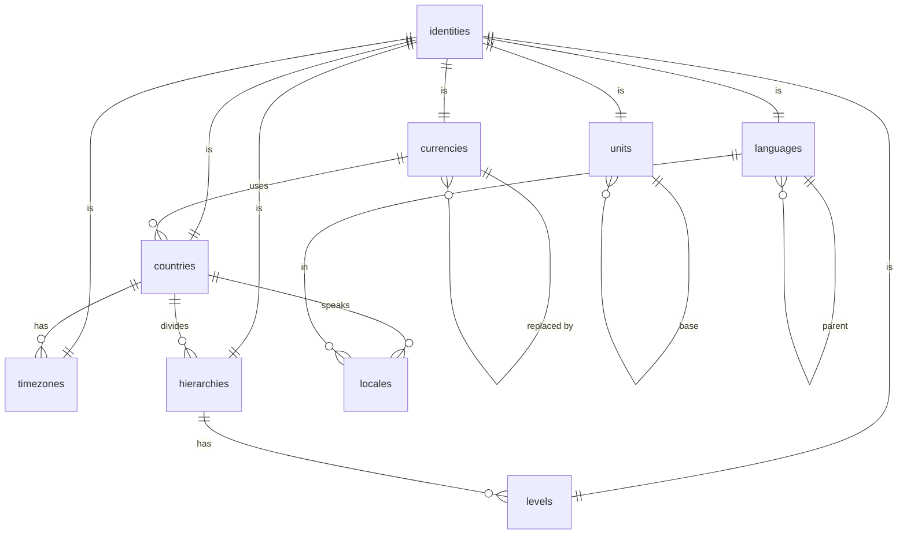
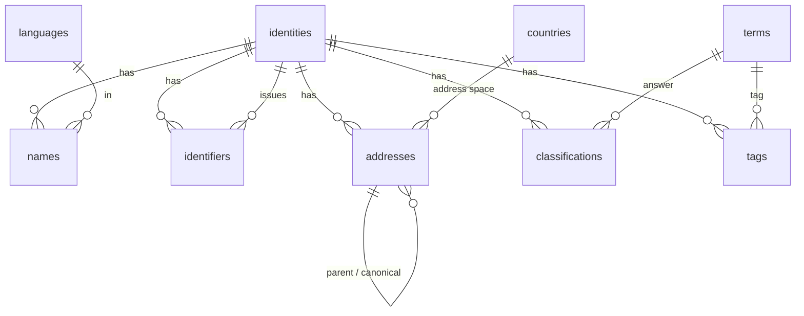
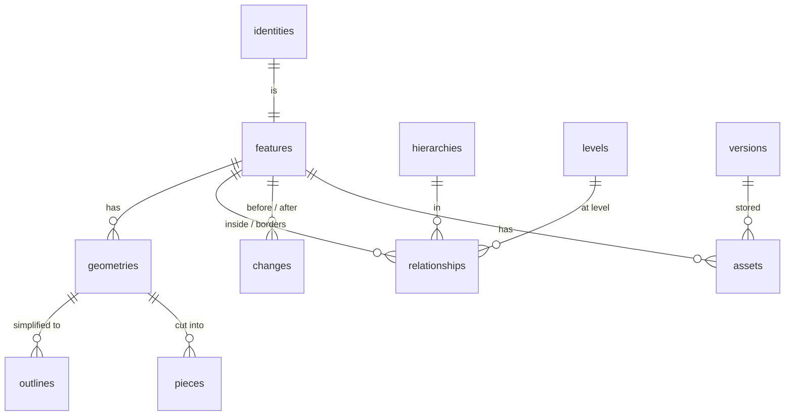
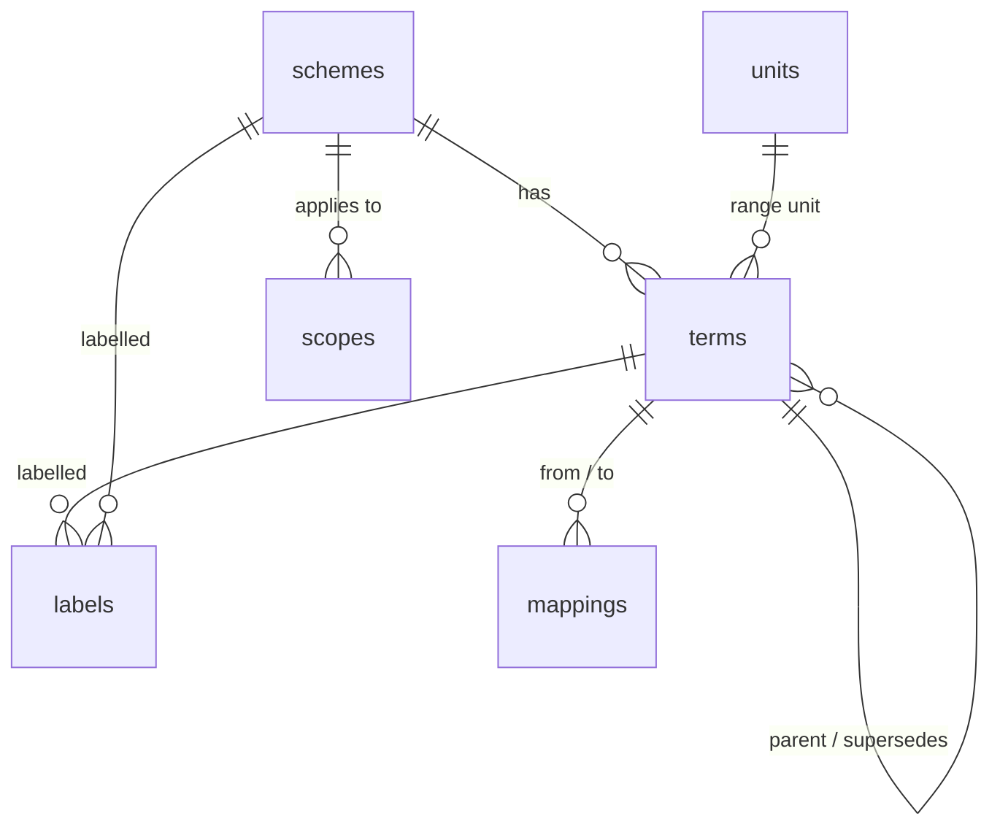
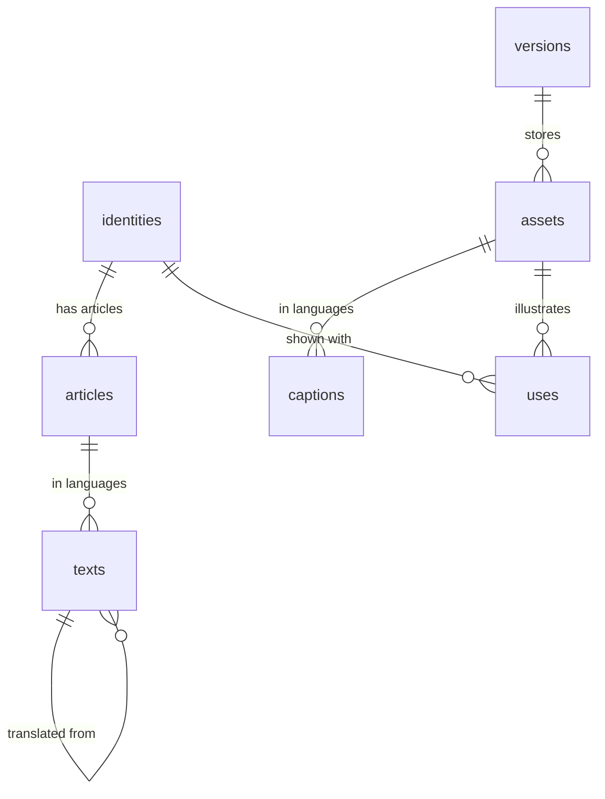
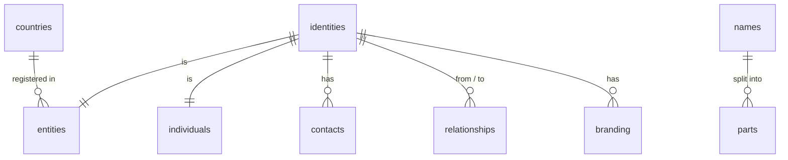
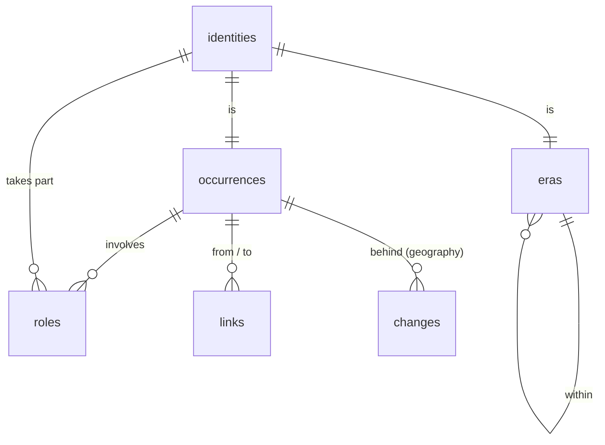
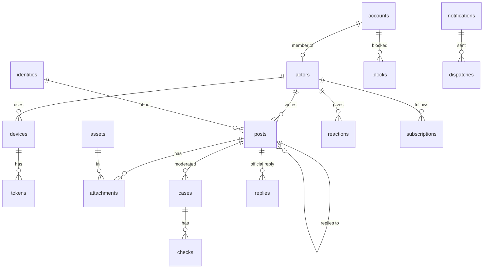
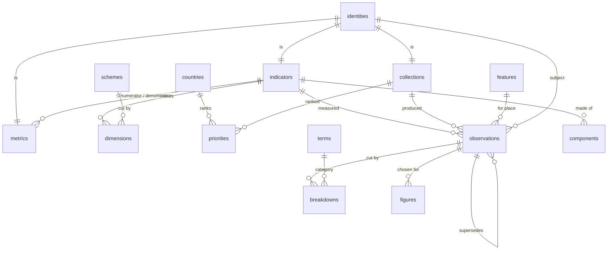

# Foundation redesign: identity, vocabulary, language and classification

**Status:** the owner approved this design direction on 2026-11-25 during the schema review (task TSK-D0EC3D8B6D47). The approval covers design only. None of it is implemented yet, and the Dryv contracts, SQL and API still match the old design. Items under [Pending discussion](#pending-discussion) are **not approved** and must not be built until they are settled.

This document records how Mzizi's core schemas fit together so that it can serve many countries, many government systems, many subject areas and many languages consistently, from statistics and governance to geography and community contributions. It replaces the foundation parts of the [reference design](../../_plan/.old/schema-redesign/mzizi-db/phase-01/reference.md) as they are reviewed.

## 1. Why the foundation changes

In the review of `dryv/contracts/schemas/postgres/reference.ts` on 2026-11-24 and 2026-11-25, these problems were found:

- `reference` mixes four unrelated jobs: country and language facts, the controlled vocabulary (`schemes`, `values`, `value_labels`, `value_relations`), a generation workflow (`patterns`, `templates`, `instances`) and interface wording (`copy`). It also imports governance, official, source and geography, so the schema everything depends on itself depends on everything.
- Nothing in the database checks that a column tagged with a scheme (for example `scheme:ref.sch.geo.feature.kind`) holds a value from that scheme. The check lived in seed validation, and seed is leaving the codebase (task TSK-6065C44E5476).
- Names are kept in five separate tables (`geography.names`, `official.names`, `legal.names`, `event.names`, `reference.language_names`). Each has its own language rules, and no shared way picks the right language.
- Six tables point at "any subject" with a text `subject_table` and a `subject_id` (`filesystem.media`, `source.verifications`, `source.slugs`, `event.subjects`, `legal.effects`, `civic.beneficiaries`). PostgreSQL can't enforce these links, so a trigger in migration 0002 checks them instead.
- Classification is done in five different ways: kind columns, `geography.classifications`, single `continentId` and `subregionId` columns on countries, fixed `sexId`, `ageGroupId`, `residenceId` and `ethnicityId` columns on `statistics.observations`, and a separate tags system in filesystem.
- `geography.levels` has no dates, so a country's earlier divisions (Kenya's provinces and districts before 2013) can't be represented.
- Product settings (`countries.subdomain`, `countries.isServed`) and interface wording sit among reference facts.
- `filesystem` mixes stored bytes with readable articles and media descriptions in one language.

## 2. Schema map

| Schema | Holds | Depends on |
|---|---|---|
| `identity` | Identities, names, identifiers, addresses, classifications, tags: everything about named things | `reference`, `vocabulary` |
| `reference` | True reference data only: countries, languages, locales, currencies, units, timezones, hierarchies and levels (how countries divide themselves) | `vocabulary` only |
| `vocabulary` | Schemes, scopes, terms, labels, mappings: every controlled meaning | Nothing except languages for labels |
| `product` | Apps, sites, releases, keys, messages | `reference` |
| `media` | Articles, texts, assets, captions, uses | `reference`, `filesystem` |
| `filesystem` | Folders, files, versions, extensions: bytes only | `reference` |
| `geography` | Features, geometries, outlines, relationships, changes | `reference`, `vocabulary` |
| `governance` | As today, **plus** patterns, templates and instances moved from reference | as today |

`reference.topics` and `reference.units` are removed as separate concepts (see [section 4](#4-vocabulary)). `reference.copy` moves to `product` (see [section 8](#8-product-schema)).

How languages and vocabulary depend on each other: languages are classified by terms (kind, family, script), and term labels are written in a language. Both are loaded in a fixed order: the special languages `und`, `mul`, `zxx` and `en` first, then the vocabulary schemes, then the rest.

## 3. Identity

### 3.1 The rule

Everything gets one language-neutral database identity first (tables keep their own `code` as well; see [section 21](#21-approved-shape-reference-and-identity)), and language-specific text is added after. An identity is a `code` (lowercase, dotted, as in [code rules](../../rules/code-columns.md)) plus a kind. It never carries display text. Text lives in `identity.names` (for identities) or `vocabulary.labels` (for terms).

### 3.2 `identity.identities`

Identity is its own schema (owner decision 2026-11-25). It was first placed in reference, but because every named thing in every schema now uses it, it belongs in its own schema. Reference keeps only true reference data.

```text
identity.identities (id, kind, code, created_at, updated_at, deleted_at)
```

Only **named things** become identities: things people look up, mention and link to by name. These are countries, languages, geography features, organisations (`official.entities`), people (`official.individuals`), institutions, offices, parties, legal instruments, events, hierarchies and levels. Articles and media are **not** identities; they belong to identities (section 22). Rows such as votes, observations, budget lines, results and captures are **not** identities.

Each extending table uses the identity id as its own primary key, and its kind is enforced with a fixed kind column plus a composite foreign key:

```text
identity.identities   id = 7f3a…, kind = 'feature', code = 'ke.nairobi'
geography.features     id = 7f3a… (same uuid), plus feature-only columns
identity.names        identity_id = 7f3a…, language = sw, text = 'Nairobi'
```

```sql
-- illustrative shape, not generated yet
kind text not null generated always as ('feature') stored,
foreign key (id, kind) references identity.identities (id, kind)
```

A feature row can therefore never point at an identity whose kind is "person".

### 3.3 Why one table and not names per schema

The owner's alternative was that each schema keeps its own identification and names. The combined design keeps each schema's own columns in its own tables, and shares only the identity anchor, names and identifiers:

- **No extra joins in normal reads.** The extending table's primary key equals the identity id, so a geography read joins `features` straight to `names`. `identities` is used for foreign keys and integrity, not in everyday reads.
- **No extra nullable columns.** `identities` holds only id, kind, code and timestamps. Feature, person and institution columns stay in their own schemas.
- **Real foreign keys for links to any named thing.** Example: a photo of Nairobi today is `subject_table = 'geography.features', subject_id = 7f3a…`, checked only by a trigger and impossible to join generically. With identities it becomes `media.uses.identity_id → identity.identities.id`: a real foreign key with real restrict or cascade. "Everything about Nairobi" (photos, laws that affect it, posts, addresses) is then one join per table, the same for any kind of thing.
- **One language-choosing function, one search pattern and one address system** for every named thing.

**Growth estimate (planning figures, not measurements):**

| Kind | Realistic size for Africa |
|---|---|
| Geography features (villages, rivers and roads included) | 1–30 million |
| People | 1–5 million |
| Organisations (if company registries are added) | 1–20 million |
| Laws, events, institutions, offices | under 5 million |
| **Identities total** | **tens of millions** |
| **Names** (a few languages each) | **about 100–300 million at the high end** |

Billions of rows would happen only if non-named rows were made identities, which the rule forbids.

**Scaling:** `identity.names` and `identity.identifiers` are **list-partitioned by kind**. Physically, feature names, person names and law names are stored separately, which keeps the strength of the per-schema idea (separate storage and indexes, partition pruning). Logically there is still one table.

Special name structures stay with their owner. For example, people's given and family names stay in `official` (on `individuals` or a small table there). `identity.names` holds only display forms.

### 3.4 `identity.names`

```text
identity.names (identity_id, kind, language_id, text, name_kind_term, script_term, country_id?,
                 from_year, to_year, is_default)
```

- Name kinds are terms: preferred, official, short, local, alternative, historical, abbreviation, transliteration, definition (a short definition, used for indicators and similar).
- Names have valid periods (Zaire before DR Congo; Kenya's provinces before counties).
- Script is recorded, so Amharic in Ge'ez can sit beside its Latin transliteration and Arabic can be marked right to left.
- At most one default name per identity, language and period.
- **Every identity has one default name.** Its language may be any language, `mul` (a form shared by languages, such as "Nairobi") or `en`. English is **not** forced (owner decision 2026-11-25). Other languages are added rows.
- Where a name came from is recorded by the `source` schema, not on the name row ([section 23](#23-provenance-lives-in-the-source-schema)).

`reference.language_names` merges into this table.

### 3.5 `identity.identifiers`

```text
identity.identifiers (identity_id, kind, scheme_term, value, issuer_id?, from_year, to_year)
```

This merges `geography.identifiers` and `official.identifiers`, list-partitioned by kind, and covers ISO, IEBC, Wikidata, registration numbers and similar codes. **Privacy:** personal identifiers such as national ID numbers are never stored here. Only public identifiers are allowed.

### 3.6 Readable addresses

Readable URL paths (today `source.slugs`) hang off identities, so every named thing gets one address system. Old addresses keep resolving through dated rows.

## 4. Vocabulary

### 4.1 Why a separate schema

Reference holds a few stable facts that everything points at. A vocabulary changes constantly: new schemes and terms, terms used in one country, mappings between them, retired terms. Keeping vocabulary in its own schema gives each its own rules and lets reference depend only on vocabulary.

### 4.2 Tables

| Table | Replaces | Role |
|---|---|---|
| `vocabulary.schemes` | `reference.schemes` | A controlled list (feature kind, institution arm, topic, unit, sex, age group). It records shape (flat, tree, graph), whether it is open or closed, global or country-specific, which identity kinds it applies to, whether a thing takes one answer or many, and its owner. |
| `vocabulary.terms` | `reference.values` | A member of one scheme: code, parent, the term it replaces, status, valid period, optional country, display hints (`icon_code`, `color_token`) and position. **No display text.** |
| `vocabulary.labels` | `reference.value_labels` and `values.label` | Every word for a term: language, label kind (preferred, alternative, short, plural, abbreviation, definition), optional country, script and source. |
| `vocabulary.mappings` | `reference.value_relations` | Links between terms: broader, narrower, exact match, close match, related. They may cross schemes and countries. Loops are prevented. |

Terms behave like identities without being rows in `identity.identities`. They have the same shape (code first, text in labels, one default label in any language, `mul` or `en`, never forced to English) and use the same language-choosing function. Terms are common words, while names are proper nouns with history and sources.

**Topics** become a tree-shaped `topic` scheme. Governance, politics and statistics point at topic terms. There is no topic table.

**Units, currencies and timezones** are real reference tables, not terms (see [section 14](#14-reference-tables-for-currencies-units-and-timezones)).

### 4.3 Global and country-specific terms

Terms are **global by default**. "County", "district" and "province" are global words that many countries use. They do not mean the same rank everywhere: Kenya's county is first-level and a US county is second-level. Rank is decided by the country's administrative system ([section 6](#6-administrative-systems)), not by the term.

A scheme or term gets a country only when it is genuinely local: traditional titles, Nyumba Kumi, a national budget classification. Labels can carry an optional country when the same language words a term differently in different countries.

### 4.4 Scheme enforcement in the database

A term column must hold a term from the right scheme. This is a **Mzizi project concern**, not a Dryv feature, and it is simple: Mzizi's own database code or application code verifies it (owner decision 2026-11-25). The exact check is chosen during implementation.

### 4.5 Ranges on terms

Numeric bands (age groups, income bands, settlement size classes, altitude zones) carry optional range columns on `vocabulary.terms` (agreed 2026-11-25):

```text
lower numeric, upper numeric, unit_id → reference.units, lower_inclusive boolean, upper_inclusive boolean
```

| Term | lower | upper | unit |
|---|---|---|---|
| age 0–4 | 0 | 5 (exclusive) | year |
| age 65+ | 65 | none | year |
| town (size class) | 2 000 | 100 000 | person |

Charts can sort bands, check they do not overlap, and combine smaller bands into larger ones ("15–64"). There is **no** general key-and-value attributes table.

### 4.6 Scheme rules and scopes

Each scheme declares its rules, and one small table says which kinds of identity it may classify (agreed 2026-11-25; to be re-checked as it is used):

```text
vocabulary.schemes   + shape (flat, tree), answers (one, many), dated (yes, no), open (yes, no)
vocabulary.scopes    (scheme, identity kind)
```

| Scheme | Applies to | Answers | Dated |
|---|---|---|---|
| office selection | office | one | yes |
| feature function | feature | many | yes |
| UN region | country | one (a tree, so its ancestors also apply) | yes |
| tag | any | many | no |

Mzizi's own code checks, on `identity.classifications`, that the identity's kind is in the scheme's scopes, and that a one-answer scheme has at most one live answer per period.

### 4.7 Label kinds

| Label kind | Use | Example (county) |
|---|---|---|
| preferred | Default text, one per language | en "County", sw "Kaunti" |
| plural | Counts and lists ("47 counties") | en "Counties", sw "Kaunti" |
| short | Chips and narrow screens | only where needed |
| abbreviation | Official short forms | "MCA" |
| alternative | Other words, used by search | |
| definition | Tooltip or explanation | "The first level of Kenya's devolved government…" |

Labels may carry an optional country. Labels have **no dates**: when a term's meaning changes, a new term supersedes the old one, so history lives in terms.

## 5. Classification, categories, tags and dimensions

**Status: partially agreed (2026-11-25).** The five concepts are the agreed direction; details are still under discussion.

There are five concepts, each used the same way in every schema:

| Concept | Meaning | How many | Dated and sourced | Stored in |
|---|---|---|---|---|
| **Kind** | What a thing *is* | Exactly 1 | No (a different kind means a different identity) | A term column on the table |
| **Category** | A broader group of kinds | Comes from the scheme tree | No | Nowhere extra: it is the kind's ancestors |
| **Classification** | An answer to a question about a thing | Many | Yes | `identity.classifications` |
| **Tag** | A loose editorial label | Many | No | `identity.tags`, using an open scheme |
| **Dimension** | How a statistic is broken down | 1 per dimension | Through its observation | `statistics.breakdowns` |

```text
identity.classifications (identity_id, term_id, from_year, to_year)
identity.tags            (identity_id, term_id)
statistics.breakdowns     (observation_id, term_id)   at most one term per dimension per observation
```

`identity.classifications` replaces `geography.classifications` and works for any identity. `identity.tags` replaces `filesystem.tags`, `taggings` and `content_tags` for identities. Files are not identities: tags on files are a plain PostgreSQL text array (or `jsonb` if structure is ever needed) on the file row, with no tag tables. Breakdowns replace the fixed dimension columns on `statistics.observations`, so a new dimension (disability, education) is data, not a schema change.

### 5.1 Examples

**Geography, Lake Victoria:**

```text
kind             → lake  (tree: natural feature > water body > lake)
classifications  → function: fishery, transport route   (sourced)
                   protection: Ramsar site, since 2006   (dated)
tags             → great lakes, tourism
```

**Governance, MCA seats:** kind = member of county assembly. An elected seat is classified selection: elected, seat basis: ward. A nominated seat has the same kind and is classified selection: nominated. President and governor are kinds in the office tree.

**Countries and regions, Kenya:**

```text
classifications → UN region: Africa > Sub-Saharan Africa > Eastern Africa   (tree, so all three apply)
memberships     → EAC since 2000; AU since 1963                             (real bodies, dated)
```

Statistical or geographic regions are **classifications**. Regional bodies (EAC, SADC, AU) are **organisations** (`official.entities`) with dated memberships. This keeps "a label someone applies" separate from "a body a country joined", and replaces `countries.continentId` and `subregionId`.

**Statistics, demographics:**

```text
Topic:       Demographics
Indicators:  Population, Population density, Median age
Dimensions:  Sex → female, male
             Age group → 0–4, 5–9, … (terms with numeric bounds)
             Residence → rural, urban
```

Population density is an **indicator**, not a dimension. Demographics is a **topic**. Sex, age group and residence are **dimensions**: each is a scheme and its categories are terms with labels in every language. Indicators are identities, so they have names in every language.

### 5.2 How the UI uses them

- **Kind and category: map legends and filter chips.** "Natural features ▸ Water bodies ▸ Lakes": choosing "Water bodies" selects a term and everything under it. Icons and colours come from the terms' display hints, so no screen keeps its own lookup table.
- **Classification: detail facts and faceted search.** "Protected: Ramsar site (since 2006, source …)", and filters such as "Function = market" or "Selection = elected".
- **Tags: related links, editorial collections and content discovery.**
- **Dimensions: chart controls.** "By sex" and "By age group" toggles appear from the dimensions present in the data, not from code.
- Every chip, legend and toggle text comes from labels in the reader's language. Codes such as `geo.kind.lake` never change.

## 6. Administrative systems

**Agreed 2026-11-25.** How a country divides itself is reference data; the places are identities and geography features. **Nothing about a place (Nairobi, Westlands) is stored in reference.**

```text
reference.hierarchies   one way a country divides itself, for a period
  ke.admin.1963   Kenya administrative, 1963–2013   (routing: no)
  ke.admin.2013   Kenya administrative, 2013–       (routing: yes)
  ke.electoral    Kenya electoral, 2013–

reference.levels        the ranks of one hierarchy
  ke.admin.1963: 1 province, 2 district, 3 division, 4 location, 5 sub-location
  ke.admin.2013: 1 county, 2 sub-county, 3 ward
  ke.electoral:  1 county, 2 constituency, 3 ward
```

The names follow the international "admin level" convention (ADM0–ADM4 in UN OCHA and geoBoundaries data).

**A place's level is recorded on its dated parent link** in `geography.relationships`, so parent and rank are stated in one row and can never disagree:

```text
geography.relationships
  Nairobi   inside Kenya    hierarchy ke.admin.1963  level province      1963–2013
  Nairobi   inside Kenya    hierarchy ke.admin.2013  level county        2013–
  Westlands inside Nairobi  hierarchy ke.electoral   level constituency  2013–
```

- Every place has a parent in each hierarchy it belongs to (at minimum the country), so every membership has a row.
- Hierarchies and levels are identities, with names in every language. A level's kind is a global term (`county`, `province`), and its depth gives its rank.
- A feature keeps one identity through every reform. Nairobi was a province and is now a county, and it is the same feature.
- **Cross-country comparison** uses "level N of each country's current hierarchy of a given kind". This lines up Kenya's counties, Tanzania's regions and Uganda's districts without pretending they are the same word.
- **Addresses and breadcrumbs** follow the hierarchy marked routing. Addresses from earlier hierarchies resolve through the dated links.
- This replaces today's `geography.levels` (which has no dates). There is no separate `geography.units` table.

## 7. Multilingual foundation

### 7.1 One home for each kind of text

| Kind of text | Lives in | Example |
|---|---|---|
| Proper name of a thing | `identity.names` | Nairobi, Jamhuri ya Kenya, Bunge la Kitaifa |
| Word for a term | `vocabulary.labels` | County, Kaunti, definitions |
| Interface wording | `product.messages` | Button text, page titles |
| Readable articles | `media.texts` | Explainers, blog posts |
| Media descriptions | `media.captions` | Photo title, alt text |
| Evidence and long source text | Its domain table, always with its original language | Law wording, Hansard, community posts |
| Translation of evidence | A separate row linked to the original, marked human or machine | `legal.translations` already works this way |

### 7.2 Rules for every schema

1. Domain tables have no free `name`, `label`, `title` or `description` display-text columns. Titles are names; descriptions are definition labels or media texts.
2. Every text row has a language from `reference.languages`. `und` means not known, `mul` means shared by several languages and `zxx` means no linguistic content. **A missing language never means English.**
3. Originals are never overwritten. A translation is a derivative that records its method and what it was translated from. Evidence is never silently translated and shown as the original.
4. Text that changes over time has a valid period.

### 7.3 Choosing the text to show

One database function or view, used by every API read:

```text
requested language (?lang) → the user's saved languages → the country's locales in order → mul → en → any available
```

It returns `{ text, language, isFallback, direction }`. Every displayed text in the API is one shared Dryv type, `LocalizedText`, so the UI can always mark a fallback ("shown in English") and set the text direction. No screen writes its own fallback logic.

### 7.4 Countries, languages and locales

`reference.locales` (country, language, status official/national/recognised/regional, order) replaces the single `countries.defaultLanguageId`. It drives the fallback chain, which languages a site offers, and number and date formatting. A locale is a language plus a country (sw-KE, fr-CD, en-NG).

`reference.countries` keeps only country facts (ISO codes, calling code, currency, recognition, established date). Reference may also hold other true reference lists such as currencies, units of measurement and timezones; whether currencies and units are reference tables or vocabulary schemes is decided with the term attributes design.

**Fixes:** unique ISO codes on countries and languages become partial unique indexes that skip soft-deleted rows, so a deleted row no longer blocks re-adding the code. `countries.subdomain` and `isServed` move to `product.releases`.

## 8. Product schema

| Table | Role |
|---|---|
| `product.apps` | web, app, dev |
| `product.sites` | Each public site or domain (mzizi.africa, ke.mzizi.africa): its app, default locale and status |
| `product.releases` | Which country is served on which app and since when, with the enabled languages and their order. Replaces `countries.isServed` and `subdomain`. |
| `product.keys` | Every interface text key declared in contracts (`web.home.title`), with a description and the placeholders it takes, so translators know the context |
| `product.messages` | The text for one key in one language, optionally for one country, with status (draft, reviewed, published) and who translated it. Replaces `reference.copy`. |

Interface keys are contracts-first: screens declare their keys, unknown keys are refused, and missing translations show as gaps. Feature flags and per-site settings may be added later.

## 9. Media schema

`filesystem` keeps only bytes: folders, files, versions and extensions, with no meaning and no language. Readable and visual material moves to a new `media` schema:

| Table | Role |
|---|---|
| `media.articles` | The article record: code, the identity it is for, and category, with no text. Not an identity itself. Replaces `filesystem.contents`. |
| `media.texts` | One row per language: title, summary, Markdown body, origin (original, human translation, machine translation), translated from, status |
| `media.assets` | A photo, logo, flag, video, audio or document scan, pointing at a filesystem version. Replaces `filesystem.media`. |
| `media.captions` | Per language: title, description, alt text |
| `media.uses` | Which identity an asset illustrates and why (Nairobi ← photo, purpose: skyline) |

Example, "How a bill becomes law": one article; an English original; a Swahili human translation; a French machine translation left as a draft. The UI offers English and Kiswahili and labels any published machine translation. An article may stay in one language only.

## 10. Patterns move to governance

`patterns`, `templates` and `instances` move from `reference` to `governance`. Fixes to make when they move:

- `instances` is unique on `(templateId, unitFeatureId)`, but `unitFeatureId` can be null and PostgreSQL treats nulls as distinct. A template that does not fan out could therefore produce duplicate instances. This needs a partial unique index for the null case, or `NULLS NOT DISTINCT`.
- `templates.institutionKindId` must be limited to its scheme, like its sibling columns.
- Templates fan out over a `reference.levels` row ([section 6](#6-administrative-systems)) instead of today's `geography.levels`.

## 11. Country columns and partitioning

A table gets its own `country_id` **only** if it is large, filtered by country in most reads, and a partitioning candidate. Everything else gets its country from its place. The agreed list is in [section 18](#18-country-columns-and-partitioning).

## 12. Descriptions in the database

Descriptions written in the contracts do not reach PostgreSQL today (the generated `schema.sql` has no `COMMENT ON`). Approved direction:

- Dryv, as a general-purpose system, may allow a description on anything (schemas, tables, columns, constraints) and emit it as `COMMENT ON` in SQL. This is a generic Dryv capability, recorded in [DRYV_GAPS](DRYV_GAPS.md) when requested.
- Descriptions are written **only where they add meaning**. Generation never fails because a description is missing.
- Mzizi-specific meanings, such as which scheme a column draws from, are written by Mzizi in its own contracts as descriptions, not as Dryv features.

## 13. Table names

Single-word table names that make sense are preferred: `identities`, `names`, `identifiers`, `addresses`, `locales`, `currencies`, `units`, `timezones`, `labels`, `mappings`, `terms`, `scopes`, `releases`, `keys`, `messages`, `breakdowns`, `articles`, `texts`, `captions`, `assets`, `uses`. Renames of existing two-word tables are in [section 19](#19-table-renames).

## 14. Reference tables for currencies, units and timezones

These are true reference data, so they are real tables with ordinary foreign keys, not vocabulary terms (agreed 2026-11-25):

```text
reference.currencies  code (ISO 4217, e.g. KES), minor units (2), symbol
reference.units       symbol, base unit, exact scale and offset
reference.timezones   IANA name (Africa/Nairobi)
```

A column pointing at a currency is `currency_id → reference.currencies`, a normal foreign key.

## 15. Column naming for terms

**Agreed 2026-11-25.** A column that points at a vocabulary term ends in **`_term`**, with no `_id`:

```text
civic.procurements:   category_term, nature_term, procedure_term, status_term, evaluation_term
governance.positions: role_term, method_term, basis_term
geography.features:   kind_term
```

Why `_term` and not `_id`:

- **`_id` always means a real table.** `feature_id` → `features`, `institution_id` → `institutions`, `currency_id` → `currencies`. A reader never has to guess.
- **`_term` always means `vocabulary.terms`.** It is a uuid foreign key to `vocabulary.terms.id`, and its scheme is recorded in the column's description and checked by Mzizi's own code. The ending is the marker; leaving out `id` keeps names short and stops anyone looking for a table called `feature_types`.
- A table can have many term columns. Each is named by its **meaning**, so the names explain the row.

**Meaning words**, used the same way in every schema:

| Word | Means | Example |
|---|---|---|
| `kind` | What a thing is | `kind_term` on features (lake, county), institutions, offices |
| `status` | Where it is in its life | `status_term` (draft, active, ended) |
| `role` | What part it plays | `role_term` on positions (chair, member) |
| `method` | How it was done | `method_term` (elected, nominated, appointed) |
| `basis` | The grounds for something | `basis_term` (ward seat, special interest seat) |
| `category` | An editorial group | `category_term` on articles |

A more specific word (for example `nature_term`, `procedure_term`) is used only when none of these fits. Existing names such as `featureTypeId` and `institutionKindId` become `kind_term`.

This rule must be explained in the codebase: in `dryv/contracts/schemas/README` or the shared contract helpers, in `.docs/rules/`, and in each such column's description.

## 16. Links to rows that are not named things

**Accepted with caution (2026-11-25); the owner will re-evaluate it during implementation.**

| Table today | Points at | Becomes |
|---|---|---|
| `filesystem.media` | Places, people, institutions | `media.uses` → `identity.identities` (real foreign key) |
| `source.slugs`, `source.links` | Named things | `identity.addresses` (to be confirmed in the source review) |
| `legal.effects` | Places, institutions, offices, laws | → `identity.identities` |
| `event.subjects` | Named things | → `identity.identities` |
| `civic.beneficiaries` | Organisations, places, groups | → `identity.identities` |
| `source.verifications` | Any row (observation, result, vote) | Stays in `source`, linked by subject (section 23) |

Only verification points at rows without names. Verification, like provenance, belongs to the `source` schema: it records which row was verified, against what and when, using a subject link (see [section 23](#23-provenance-lives-in-the-source-schema)). Domain rows carry no evidence columns. The 0002 "any subject" trigger is removed for the tables that now point at identities.

## 17. What moves where

| From | To |
|---|---|
| `reference.schemes`, `values`, `value_labels`, `value_relations` | `vocabulary.schemes`, `terms`, `labels`, `mappings` |
| `reference.topics` | A topic scheme in vocabulary |
| `reference.language_names`; `geography`, `official`, `legal`, `event` `.names` | `identity.names` |
| `geography.identifiers`, `official.identifiers` | `identity.identifiers` |
| `geography.classifications` | `identity.classifications` |
| `source.slugs`, `source.links` | `identity.addresses` |
| `filesystem.tags`, `taggings`, `content_tags` | `identity.tags`; file tags become an array on the file |
| `geography.levels` | `reference.hierarchies` and `reference.levels`; place levels on `geography.relationships` |
| `reference.patterns`, `templates`, `instances` | `governance` |
| `reference.copy` | `product.keys`, `product.messages` |
| `countries.isServed`, `subdomain` | `product.releases`, `product.sites` |
| `countries.defaultLanguageId` | `reference.locales` |
| `countries.continentId`, `subregionId` | `identity.classifications` (UN region scheme) |
| Currency scheme values | `reference.currencies` |
| (new) | `reference.timezones` |
| `filesystem.contents` | `media.articles`, `media.texts` |
| `filesystem.media` | `media.assets`, `media.captions`, `media.uses` |
| `observations.sexId`, `ageGroupId`, `residenceId`, `ethnicityId` | `statistics.breakdowns` |

## 18. Country columns and partitioning

| Table | `country_id` | Split by | Why |
|---|---|---|---|
| `identity.names`, `identity.identifiers` | no | identity kind | The largest tables, always read by kind |
| `statistics.observations` | yes | country | Large, read for one country |
| `politics.results` | yes | country | Every election at every level |
| `governance.votes`, `governance.speeches` | yes | country | Large, read for one parliament |
| `finance.flows` | yes | country | Read for one country and its years |
| `source.captures` | no | capture month | Grows with time; old months can be archived |
| `community.views`, notifications, deliveries | yes (views) | month | Very high writes, limited retention |
| `community.posts` | yes | country | Read for one country |
| Everything else | no | not split | Small or medium; country comes from its place |

**Identity kind is a typed enum, not a scheme.** `identity.identities.kind` (and the kind column copied onto names and identifiers for partitioning) is a fixed database enum (`country`, `language`, `feature`, `entity`, `individual`, `institution`, `office`, `party`, `instrument`, `event`, …). It is part of the schema design and changes only with a migration, because partitions and kind checks depend on it.

`geography.geometries` is not partitioned. Map speed is handled as described in [section 20](#20-map-geometry-and-tiles).

## 19. Table renames

| Today | New name | Note |
|---|---|---|
| `auth.login_identities` | `logins` | |
| `auth.role_assignments` | `grants` | Who holds which role |
| `auth.role_permissions` | `privileges` | What a role may do |
| `auth.delegation_roles` | kept for now | Checked in the auth review |
| `civic.project_features` | `sites` | The places a project touches |
| `filesystem.file_versions` | `versions` | |
| `filesystem.file_extensions` | `formats` | |
| `filesystem.content_tags` | removed | Tags move to identity |
| `finance.budget_versions` | `revisions` | Original and supplementary budgets |
| `finance.fiscal_periods` | `periods` | |
| `governance.authority_scopes` | `jurisdictions` | |
| `politics.manifesto_items` | `pledges` | |
| `politics.referendum_options` | `choices` | |
| `politics.option_results` | merged into `results` | A result is for exactly one candidate or one choice |

## 20. Map geometry and tiles

**Agreed 2026-11-25.** The full-detail geometry in `geography.geometries` is evidence and is never altered. Everything a map shows is prepared from it in advance:

1. **Outlines at a few zoom levels.** Simplified copies for about 3–4 zoom bands in `geography.outlines`. This removes today's simplification on every request.
2. **Shared borders simplified together.** Neighbouring places are simplified as one topology (PostGIS topology or TopoJSON), so no gaps or overlaps appear between them.
3. **A lookup table for "where am I?".** Polygons cut into small pieces with `ST_Subdivide`, with a spatial index, so point-in-polygon lookups stay fast even for long coastlines.
4. **Bounding boxes and centre points** precomputed on outlines, so a map can frame a place without reading its geometry.
5. **Cached prepared shapes.** GeoJSON or TopoJSON per place, mode and zoom, cached in Redis and in object storage behind a CDN. The cache clears only when a geometry changes.
6. **Vector tiles.** National and large maps use tiles: generated with `ST_AsMVT`, or prebuilt tile files in object storage. Reading a prebuilt tile does not touch the database.
7. **Smaller payloads.** Coordinates rounded to what a screen needs (5 decimals is about 1 m), and responses compressed.

**Files go through the filesystem.** Prepared shapes, TopoJSON files and tile files are stored as `filesystem` files and versions, like any other stored bytes. Geography records which file version holds which prepared output (for example a tile set for a hierarchy level and zoom range, or a TopoJSON for a place), the geometry revisions it was built from, and when it was built. When a source geometry changes, the outputs built from it are marked stale and rebuilt. As everywhere in the filesystem, the caller decides folders, names, access and retention. The exact table for this link is designed during the geography review.

## 21. Approved shape: `reference` and `identity`

**Approved by the owner on 2026-11-25.** Every table also has the usual base columns (`id`, `version`, `created_at`, `updated_at`, `deleted_at`). *Identity-backed* means the row's `id` is also an `identity.identities.id`, so it has names in any language through `identity.names`.

### 21.1 Decisions

- **One identity per real thing.** Kenya is one identity, extended by both `reference.countries` and `geography.features`. Names, addresses and media are never split between two records of the same country. The kind check allows `country` in both tables.
- **`code` stays on every table that has it today**, as well as on `identity.identities`. Codes join rows in CSV inputs and prepared data, so they are not removed for now.
- **Currencies, units, timezones, hierarchies and levels are identity-backed**, so their names are multilingual.
- **Language status:** official, national, recognised and regional status is per country and lives in `reference.locales`. Languages keep only `vitality_term`.
- **Address namespaces** come from the identity's kind plus an optional `section_term` where they differ (a person shown in a leaders section).

### 21.2 `reference`

**`reference.countries`** (existing; identity-backed)

| Column today | After | Change |
|---|---|---|
| `code` | `code` | Kept |
| `name`, `officialName` | removed | `identity.names` rows (kinds preferred and official) |
| `isoAlpha2`, `isoAlpha3`, `isoNumeric` | `iso_alpha2`, `iso_alpha3`, `iso_numeric` | Uniqueness skips deleted rows |
| `callingCode` | `calling_code` | |
| `continentId`, `subregionId` | removed | `identity.classifications` (UN region scheme) |
| `currencyId` | `currency_id` → `reference.currencies` | Real table instead of a term |
| `recognitionStatusId` | `recognition_term` | |
| `designationId` | `designation_term` | |
| `establishedOn` | `established_on` | |
| `defaultLanguageId` | removed | `reference.locales` |
| `subdomain`, `isServed` | removed | `product.sites`, `product.releases` |

**`reference.languages`** (existing; identity-backed)

| Column today | After | Change |
|---|---|---|
| `code` | `code` | Kept |
| `name` | removed | `identity.names` |
| `iso6391`, `iso6392`, `iso6393`, `glottocode` | same, snake case | Uniqueness skips deleted rows |
| `kindId`, `familyId`, `scriptId`, `directionId` | `kind_term`, `family_term`, `script_term`, `direction_term` | |
| `statusId` | `vitality_term` (living, endangered, extinct) | Per-country status moves to `locales` |
| `parentId` | `parent_id` | |

**`reference.units`** (existing; identity-backed)

| Column today | After | Change |
|---|---|---|
| `code`, `symbol`, `scale`, `offset`, `baseId` | `code`, `symbol`, `scale`, `offset`, `base_id` | |
| `quantity` (free text) | `quantity_term` | length, mass, currency, count |

**Tables leaving reference:** `language_names` → `identity.names`; `schemes`, `values`, `value_labels`, `value_relations` → `vocabulary.schemes`, `terms`, `labels`, `mappings`; `topics` → a topic scheme; `patterns`, `templates`, `instances` → `governance`; `copy` → `product.keys`, `product.messages`.

**New tables**

| Table | Columns | Notes |
|---|---|---|
| `locales` | `country_id`, `language_id`, `status_term` (official, national, recognised, regional), `position`, `from_year`, `to_year` | Dated: language status changes over time |
| `currencies` | identity-backed; `code`, `iso_code` (KES), `iso_numeric` (404), `minor_units`, `symbol`, `from_year`, `to_year`, `replaced_by_id` | Currencies end and are replaced |
| `timezones` | identity-backed; `code`, `iana_name` (Africa/Nairobi), `country_id` | Offsets come from IANA rules, not stored |
| `hierarchies` | identity-backed; `code`, `country_id`, `kind_term` (administrative, electoral, traditional, statistical), `from_year`, `to_year`, `is_routing` | At most one live routing hierarchy per country |
| `levels` | identity-backed; `code`, `hierarchy_id`, `depth`, `kind_term` | Unique per hierarchy and depth |



### 21.3 `identity`

| Table | Columns | Replaces |
|---|---|---|
| `identities` | `id`, `kind` (enum), `code` (unique), timestamps | New anchor |
| `names` | `identity_id`, `identity_kind` (enum, partition key), `language_id`, `text`, `kind_term` (preferred, official, short, local, alternative, historical, abbreviation, transliteration), `script_term`, `country_id` (optional), `from_year`, `to_year`, `is_default` | `geography.names`, `official.names`, `legal.names`, `event.names`, `reference.language_names` |
| `identifiers` | `identity_id`, `identity_kind`, `scheme_term`, `namespace`, `value`, `issuer_id` → identities, `from_year`, `to_year` | `geography.identifiers`, `official.identifiers` |
| `addresses` | `identity_id`, `country_id`, `segment`, `section_term` (optional), `parent_id`, `language_id` (optional), `canonical_id`, `from_year`, `to_year` | `source.slugs`, `source.links` |
| `classifications` | `identity_id`, `class_term`, `scheme_id` (copied for the one-answer check), `from_year`, `to_year` | `geography.classifications`, `countries.continentId`, `subregionId` |
| `tags` | `identity_id`, `tag_term` (key is both) | `filesystem.tags`, `taggings`, `content_tags` for identities |

- `names` and `identifiers` are list-partitioned by `identity_kind`; PostgreSQL requires the partition key in every unique key, for example `(identity_kind, scheme_term, namespace, value)`.
- At most one default name per identity, language and period.
- Personal identifiers such as national ID numbers are never stored.



## 22. Approved shape: `geography`, `filesystem`, `vocabulary`, `product` and `media`

**Approved by the owner on 2026-11-25.** Base columns and the rules of section 21 apply. Every table keeps its `code` where it has one.

### 22.1 Decisions

- **Time in geography:** year ranges (`from_year`, `to_year`) are the required period; exact dates (`established_on`, `ended_on`, `starts_on`, `ends_on`) are optional precision, and a rule keeps the two in agreement.
- **Coordinates:** every geometry is stored in EPSG:4326. The original coordinate system is recorded on the source artifact.
- **Vocabulary internals are enums:** scheme shape, scheme answers, term status, label kind and mapping kind are fixed enums, not terms, so vocabulary never depends on itself.
- **Reforms and history:** a reform such as Kenya's 2013 devolution will belong to a **new schema for historical events and activities**, still to be designed (see Pending discussion). `geography.changes` will point at it; it does not point at `event.events`.
- **Articles and media are not identities.** They are not named things in their own right; they **belong to** identities. A portrait is *for* a person, a skyline photo is *for* Nairobi, an explainer is *for* Parliament. The person, place or institution has the identity; the article or photo points at it. Articles and media therefore have no `identity.names`, classifications or tags of their own: their titles and captions are in `media.texts` and `media.captions`, and their grouping uses their own `category_term`.
- The product table of languages a release offers is named **`lang`**.

### 22.2 `geography`

| Table today | After | Changes |
|---|---|---|
| `features` | kept, identity-backed | `featureTypeId` → `kind_term`; a country's feature shares the country's one identity |
| `names`, `identifiers`, `classifications` | removed | → `identity.names`, `identity.identifiers`, `identity.classifications` |
| `levels` | removed | → `reference.hierarchies`, `reference.levels` |
| `geometries` | kept | `geometryRoleId` → `role_term` (outline, point, centreline); `basisId` → `basis_term` (surveyed, digitised, derived); `minZoom`, `maxZoom` move to `outlines`; `srid` removed (always 4326); adds a spatial index; full detail never altered |
| `relationships` | kept | `relationshipKindId` → `kind_term` (inside, borders, part of); `systemId` → `hierarchy_id`; adds `level_id` (the inner place's level) |
| `changes` | kept | `changeKindId` → `kind_term` (split, merge, rename, transfer); `transformationId` → `occurrence_id` → `history.occurrences`; free-text `explanation` → optional note with its language |
| `assets` | kept, widened | `kindId`, `purposeId` → `kind_term`, `purpose_term`; adds `hierarchy_id`, `level_id`, `built_at`, `stale_at` for prepared outputs (tile sets, TopoJSON); `layer`, `band`, `member` kept |
| — | `outlines` (new) | `feature_id`, `geometry_id`, `band` (zoom band 0–3), `tolerance`, `geometry`, `bbox`, `centroid`, `points`, `built_at`; unique per geometry and band |
| — | `pieces` (new) | `feature_id`, `geometry_id`, `geometry`: subdivided polygons with a spatial index for "where am I?" lookups |



### 22.3 `filesystem` (bytes only)

| Table today | After | Changes |
|---|---|---|
| `folders` | kept | `roleId` → `role_term` (raw, derived, public); `name` is a technical path segment |
| `files` | kept | adds `tags text[]` |
| `file_versions` | renamed `versions` | `fileExtensionId` → `format_id`; other columns kept |
| `file_extensions` | renamed `formats` | kept |
| `tags`, `taggings`, `content_tags` | removed | identity tags → `identity.tags`; file tags → the array on `files` |
| `media` | removed | → `media.assets`, `media.captions`, `media.uses` |
| `contents` | removed | → `media.articles`, `media.texts` |

### 22.4 `vocabulary`

| Table | Columns | Was |
|---|---|---|
| `schemes` | `code`, `shape` (enum: flat, tree, graph), `answers` (enum: one, many), `is_dated`, `is_open`, `country_id` (optional), `steward_id` → identities (optional) | `reference.schemes`; `title` → labels; `ownerSnapshot` → `steward_id` |
| `scopes` | `scheme_id`, `identity_kind` (enum), unique together | new |
| `terms` | `code`, `scheme_id`, `parent_id`, `supersedes_id`, `status` (enum: active, deprecated, retired), `position`, `icon_code`, `color_token`, `country_id` (optional), `lower`, `upper`, `unit_id`, `lower_inclusive`, `upper_inclusive` | `reference.values`; `label` removed |
| `labels` | exactly one of `term_id` or `scheme_id`; `language_id`, `kind` (enum: preferred, plural, short, abbreviation, alternative, definition), `text`, `country_id` (optional) | `reference.value_labels` |
| `mappings` | `from_id`, `to_id`, `kind` (enum: broader, narrower, exact, close, related); no loops in broader and narrower | `reference.value_relations` |



### 22.5 `product`

| Table | Columns | Was |
|---|---|---|
| `apps` | identity-backed; `code` (web, app, dev) | new |
| `sites` | `code`, `app_id`, `host`, `country_id` (optional), `locale_id` → `reference.locales`, `status` (enum: planned, live, retired) | `countries.subdomain` |
| `releases` | `app_id`, `country_id`, `status` (enum: preparing, live, paused, withdrawn), `from_on`, `to_on` | `countries.isServed` |
| `lang` | `release_id`, `language_id`, `position` | new: the languages a release offers, in order |
| `keys` | `code` (web.home.title), `app_id`, `description` (for translators), `placeholders text[]`, `max_length` | declared in contracts |
| `messages` | `key_id`, `language_id`, `country_id` (optional), `text`, `origin` (enum: original, human, machine), `status` (enum: draft, reviewed, published), `translator` | `reference.copy` |

### 22.6 `media`

Articles and assets are not identities; each **belongs to** an identity where it is about one.

| Table | Columns | Was |
|---|---|---|
| `articles` | `code`, `identity_id` → identities (what it is for; optional for general articles), `category_term`, `author_id` → identities (optional), `published_at` | `filesystem.contents` (its record part) |
| `texts` | `article_id`, `language_id`, `title`, `summary`, `body` (Markdown), `origin` (enum: original, human, machine), `translated_from_id`, `status` (enum: draft, reviewed, published); exactly one original per article, at most one live text per language | `filesystem.contents` (its text part) |
| `assets` | `code`, `kind_term` (photo, logo, flag, portrait, video, audio, scan), `version_id` → `filesystem.versions` **or** `external_url` + `platform_term`, `start_second`, `end_second`, `width`, `height`, `duration`, `licence_term`, `captured_on` | `filesystem.media` (file part); untyped `metadata` → typed columns |
| `captions` | `asset_id`, `language_id`, `title`, `description`, `alt_text`, `origin` (enum) | `filesystem.media` text columns |
| `uses` | `asset_id`, `identity_id`, `purpose_term` (portrait, logo, skyline, map), `position`, `from_year`, `to_year` | `filesystem.media` subject link and free-text `purpose` |

Examples: a portrait asset has one `uses` row pointing at the person's identity; the same photo of a parliament sitting can have `uses` rows for Parliament and for the Speaker. The explainer "How a bill becomes law" is an article whose `identity_id` is the National Assembly; a general blog post may have none.



## 23. Provenance lives in the source schema

**Rule, agreed 2026-11-25. This is a must for every schema, including the ones already approved.**

- **No domain table has a column saying where its rows came from.** Columns such as `source_citation_id`, `sourceCitationId`, `citation_id`, `verified_citation_id` and similar are removed everywhere: identity, reference, vocabulary, geography, media, official and every schema still to be discussed.
- **The `source` schema says where every row came from.** It holds the record of the source, citation or capture, and a **linking table** that connects it to the rows it supports.
- **The link uses subject columns** (`subject_table`, `subject_id`, the same kind of columns as today's `_subjects.ts`). It names the table and row, so it can point at any row in any schema, named or not, including a single observation, vote or result. **It has no foreign key**; that is accepted because it must reach every table.
- **The linking table is partitioned**, because every sourced row in the database gets at least one link and it will be the largest table in the system.
- What the link records (citation, capture, method, confidence, observed time, verification), how it is partitioned, and how a deleted row's links are handled are designed when the `source` schema is discussed.

## 24. Name casing across languages

**Rule, agreed 2026-11-25.**

| Where | Casing | Example |
|---|---|---|
| Dryv contracts (`dryv/contracts`, everything authored) | camelCase | `registrationCountryId`, `kindTerm` |
| Generated SQL and the database | snake_case | `registration_country_id`, `kind_term` |
| Python (engine, packages) | snake_case | `registration_country_id` |
| TypeScript and Dart: generated SDKs, the NestJS API, the web app and the Flutter app | camelCase | `registrationCountryId` |

- Contracts are always authored in camelCase. The SQL generator turns them into snake_case; TypeScript and Dart keep camelCase; Python uses snake_case.
- **Column names in this document's tables are written as they appear in SQL** (snake_case). The same column is camelCase in the contracts and in TypeScript and Dart.
- A change that is **only casing** (for example `registrationCountryId` in the contract and `registration_country_id` in SQL) is **not a rename**. It is the same column. Only a change of words (for example `featureTypeId` → `kindTerm` / `kind_term`) is a rename.
- The `_term` ending agreed in section 15 is written `Term` in camelCase: `kindTerm`, `statusTerm`.

## 25. Approved shape: `official`

**Approved by the owner on 2026-11-25.** Column names are in SQL casing (section 24). Base columns and sections 21–24 apply; no table has a citation column (section 23). Every table keeps its `code`.

### 25.1 Decisions

- **Name parts:** a new `official.parts` table holds people's name parts; display names stay in `identity.names`.
- **Contacts and privacy:** `visibility_term` allows only *public* and *official business*. Private personal contacts (a politician's personal phone) are **never stored**. This closes the old open item on contact access.
- **Branding:** images (logo, flag, portrait, photograph) move to `media.assets` and `media.uses`. Words and colours stay in `official.branding`, which keeps its name.
- **Personal relationships:** kinship and associate links are stored **only for public figures**, always with a basis and a source link in the `source` schema, and shown only when their status is verified.
- **Entity time:** entities require `from_year` and `to_year` under the agreed time rule; `registered_on` and `dissolved_on` are optional exact dates kept in agreement with the years.

### 25.2 Tables

| Table today | After | Changes |
|---|---|---|
| `entities` | kept, identity-backed | `kind_id` → `kind_term` (company, NGO, regional bloc, union); `registration_country_id` unchanged (a fact, not a partition key); adds required `from_year`, `to_year`; `registered_on`, `dissolved_on` optional; `source_citation_id` removed |
| `individuals` | kept, identity-backed | `birth_date`, `death_date` optional; adds `birth_year`, `death_year`; `source_citation_id` removed |
| `names` | removed | → `identity.names` |
| `identifiers` | removed | → `identity.identifiers`; `issuer_entity_id` → `issuer_id`; uniqueness with empty issuer or namespace uses `NULLS NOT DISTINCT` |
| `contacts` | kept, widened | `entity_id` + `individual_id` → `identity_id` (offices, institutions and parties can have contacts); `kind_id` → `kind_term` (phone, email, website, postal address, social account); `visibility_id` → `visibility_term` (public, official business only); adds `from_year`, `to_year`; `source_citation_id` removed |
| `relationships` | kept, simplified | `from_entity_id`, `from_individual_id`, `to_entity_id`, `to_individual_id` → `from_id`, `to_id` → identities; `kind_id` → `kind_term` (kinship, business, political); `evidence_basis_id`, `evidence_status_id` → `basis_term`, `status_term`; `share_percentage`, `confidence`, `starts_on`, `ends_on` kept; adds years; `source_citation_id` removed |
| `branding` | kept, narrowed | `entity_id` + `individual_id` → `identity_id`; `kind_id` → `kind_term` (slogan, motto, colours, symbol); `value` → `text` with `language_id`; adds `colors text[]` (hex values, used by charts) and years; images move to media; `source_citation_id` removed |
| — | `parts` (new) | `name_id` → `identity.names`, `part` (enum: prefix, given, middle, family, suffix), `position`, `text` |

No partitioning and no `country_id` columns are needed in `official`.



## 26. Removed: `accountability`

**Owner decision 2026-11-25.** The old `accountability` schema (a read-only set of derived indicator shapes with no tables) is removed. Its contract file `dryv/contracts/schemas/postgres/accountability.ts` was deleted, along with its import in `dryv/contracts/apps/pgsql/index.ts` and its checks in `dryv/tools/audit-main-domain-contracts.ts`. Any accountability views needed later are designed as API reads in the app contracts, not as a database schema.

## 27. Approved shape: `history`, `event` and `auth`

**Approved by the owner on 2026-11-25.** Column names are in SQL casing (section 24). Base columns and sections 21–24 apply; no table has a citation column (section 23). Every table keeps its `code`.

### 27.1 History and event are always separate

| | `event` | `history` |
|---|---|---|
| What it records | Planned and recurring civic happenings: public holidays, parliamentary sittings, budget deadlines, election timetables, seasons | What happened and mattered: independence in 1963, the 2010 constitution, devolution in 2013, wars, treaties, disasters, boundary reforms |
| Shape | Precise details and pre-planning: calendars, recurrence rules, planned and actual dates, times, timezones, venues, schedules, postponements | Significance: eras, causes and effects, who and what was involved, often uncertain or approximate dates |
| Time | Exact dates and times | Years required, dates optional, with a precision (day, month, year, decade, circa) |
| Looks | Forward as well as back | Back |

**How to choose:** if a thing is planned, scheduled or recurring and its exact dates and arrangements matter, it is an `event` (and each instance an `event.occurrences` row). If it is recorded because of its historical significance, consequences or place in a period, it is a `history.occurrences` row. One real happening can have both: the 2013 general election has an `event.occurrences` row (polling day, timetable) and may have a `history.occurrences` row (its significance as the first election under devolution), linked by identity relationships where needed.

### 27.2 `history` (new)

| Table | Columns | Notes |
|---|---|---|
| `occurrences` | identity-backed; `code`, `kind_term` (independence, reform, war, treaty, disaster, founding), `from_year`, `to_year`, `starts_on`, `ends_on` (optional), `precision` (enum: day, month, year, decade, circa), `country_id` (optional) | Named through `identity.names` ("Kenya's independence", "Uhuru"). Named `occurrences`, not `events`, to keep it distinct from the `event` schema |
| `eras` | identity-backed; `code`, `kind_term` (colonial, post-independence, presidency), `from_year`, `to_year`, `country_id` (optional), `parent_id` | Named periods; an era can sit inside another |
| `roles` | `occurrence_id`, `identity_id`, `role_term` (leader, signatory, affected place, venue, opponent) | People, organisations and places involved |
| `links` | `from_id`, `to_id`, `kind` (enum: part of, caused, led to, followed, replaced) | Between history occurrences |

`geography.changes` points at `history.occurrences` (the reform behind a split or merge); governance and legal may point at it later.



### 27.3 `event` (the civic calendar)

| Table today | After | Changes |
|---|---|---|
| `calendars` | kept | `calendar_kind_id` → `kind_term`; `description` removed; `source_citation_id` removed |
| `events` | kept, identity-backed | `event_kind_id` → `kind_term`; `scope_level_kind_id` → `level_id` → `reference.levels`; `scope_feature_id` → `feature_id`; `organiser_entity_id` → `organiser_id` → identities; `basis_provision_id` kept; `source_citation_id` removed |
| `names` | removed | → `identity.names` |
| `rules` | kept | `rule_kind_id` → `kind_term`; `adjustment_id` → `adjustment_term`; recurrence columns kept; `source_citation_id` removed |
| `occurrences` | kept | `status_id`, `knowledge_id`, `format_id` → `status_term`, `knowledge_term`, `format_term`; `timezone` → `timezone_id` → `reference.timezones`; `venue_feature_id`, `venue_note` removed (covered by `venues`); `organiser_entity_id` → `organiser_id`; `source_citation_id` removed |
| `changes` | kept | `change_kind_id`, `reason_id` → `kind_term`, `reason_term`; `authority_entity_id` → `authority_id`; `explanation` → optional note with its language; `source_citation_id` removed |
| `subjects` | kept | subject link → `identity_id`; `role_id` → `role_term` |
| `participants` | kept | `entity_id` + `individual_id` → `identity_id`; `role_id` → `role_term` |
| `schedules` | kept | `schedule_kind_id`, `status_id` → `kind_term`, `status_term`; `issuer_entity_id` → `issuer_id`; `source_citation_id` removed |
| `items` | kept | `note` → optional note with its language |
| `seasons` | kept | `season_kind_id` → `kind_term`; `scope_feature_id` → `feature_id`; `description` removed; `source_citation_id` removed |
| `venues` | kept | `role_id` → `role_term`; `note` → optional note with its language |

No partitioning in `event`.

### 27.4 `auth` (platform accounts and access)

Decisions:

- **Role text is allowed.** Role titles and descriptions are internal admin text and stay as plain English columns: a deliberate exception to the no-display-text rule.
- **`delegation_roles` is kept and renamed `allowances`** (agent's choice, delegated by the owner). It is the security ceiling of a delegation: the roles a delegate may receive through it. `grants.delegation_id` records which delegation a grant came from, but without allowances a delegator could pass on any role they hold.
- **`scopes.dataset_ref_id` is removed.**
- **Accounts and contributions:** see 27.5.

| Table today | After | Changes |
|---|---|---|
| `accounts` | kept | `actor_kind` → enum (person, service, agent); `person_ref_id` → `individual_id` → `official.individuals` (only when the account belongs to a known public person); `display_name`, `status`, `disabled_at`, `last_authenticated_at` kept |
| `login_identities` | renamed `logins` | `issuer`, `subject` kept |
| `roles` | kept | `managing_institution_ref_id` → `institution_id` (real foreign key); `title`, `description` kept as English text |
| `permissions` | kept | `resource_type`, `action`, `field_group` → enums generated from the contracts |
| `role_permissions` | renamed `privileges` | |
| `role_assignments` | renamed `grants` | `scope_id`, `membership_id`, `delegation_id` kept |
| `memberships` | kept | `institution_ref_id` → `institution_id`; verification columns kept |
| `invitations` | kept | `institution_ref_id` → `institution_id`; only the token digest is stored |
| `scopes` | kept | `institution_ref_id`, `country_ref_id`, `geographic_unit_ref_id` → `institution_id`, `country_id`, `feature_id` (real foreign keys); `dataset_ref_id` removed; `include_descendants`, `scope_hash` kept |
| `delegations` | kept | |
| `delegation_roles` | renamed `allowances` | the roles a delegation may hand on |

Auth keeps revoke and expiry history instead of soft delete and versions. No partitioning.

### 27.5 Direction for contributions (to design in the `community` review)

Owner direction, 2026-11-25:

- **Only signed-in, authenticated people can contribute.** Posts, comments, reviews, articles, information and media come from real people with an `auth.accounts` sign-in, to avoid pseudonymous and fake content.
- **Nothing is published straight away.** Every contribution is published only after human review or after passing automated content filtering (including AI filtering).
- **People who post bad content are blocked.**
- Contributed articles and media use the `media` schema shapes (belonging to identities); contributions stay distinct from curated, sourced knowledge.
- How `auth.accounts` and `community.actors` divide (sign-in versus public profile), the review and filtering workflow, and blocking are designed when `community` is discussed.

## 28. Approved shape: `community`, and sign-up in `auth`

**Approved by the owner on 2026-11-25.** Column names are in SQL casing (section 24). Base columns and sections 21–24 apply; no table has a citation column (section 23).

### 28.1 Decisions

- **Visitors** can read, save preferences and places, and are counted in views without signing in.
- **Every contribution needs a signed-in account:** posts, comments, reviews, **reactions**, media and articles.
- **Nothing is published until it passes human review or automated filtering** (including AI); people who post bad content are blocked.
- **Members are not identities.** There can be millions of ordinary users; they are not public figures and their usernames are not multilingual names. Their public profile lives on `community.actors`.
- **Members can write full articles** in `media.articles` (with a `contributor_id` → `community.actors`) and attach media to posts; both go through the same review flow before publishing.
- **Sign-up is by email or phone with a one-time code (OTP)** and stays simple at the start (28.4).

### 28.2 Usernames

A member's `handle` follows these rules:

- 3 to 30 characters.
- Lowercase letters `a–z`, digits `0–9`, dot `.` and underscore `_` only.
- Starts with a letter; does not end with `.` or `_`.
- No two dots or underscores in a row (`a..b`, `a__b`, `a._b` are refused).
- Unique ignoring case; stored lowercase.
- A reserved list (for example `admin`, `mzizi`, `support`, `help`, `api`, `official`, `moderator`) cannot be taken; the list lives in the contracts.
- `display_name` is free text shown beside the handle.

### 28.3 `community` tables

| Table today | After | Changes |
|---|---|---|
| `actors` | kept | `kind` → enum (visitor, member); a member must have `account_id`; adds `handle`, `display_name`, `avatar_id` → `media.assets`; `country_id`, `language_id`, seen times kept |
| `devices` | kept | `platform` → enum; `fingerprint_hash`, `app_version`, `attestation`, seen times kept |
| `tokens` | kept | push tokens; `provider` → enum; token stored encrypted |
| `consents` | kept | `purpose_id` → `purpose_term`; `text_version` → `key_id` → `product.keys` plus a version |
| `preferences` | kept | `theme` → enum; `home_feature_id` kept |
| `places` | kept | `suggestion_id` → `suggestion_term`; `label` is the member's own text |
| `reactions` | kept | sign-in required; subject link → exactly one of `post_id`, `identity_id`, `article_id`; `kind_id` → `kind_term` |
| `views` | kept | subject link → exactly one of `identity_id`, `article_id`, `post_id`; partitioned by month with limited retention |
| `proofs` | kept | untyped `signals` → typed columns (`attestation_ok`, `travel_ok`, `header_agrees`); `check` → enum |
| `posts` | kept, widened | all contributions: `kind_term` (comment, review, report, question); `addressee_feature_id` → `identity_id` (what it is about); adds `rating` for reviews; `parent_interaction_id` → `parent_id`; `state` → enum (draft, pending, published, rejected, removed); partitioned by country |
| `cases` | kept | moderation of one `post_id`; untyped `filter_results` → `checks`; `decision_id` → `decision_term`; `reason` internal text |
| `subscriptions` | kept | subject link → `identity_id`; `kind_id` → `kind_term` |
| `notifications` | kept | `copy_key` → `key_id` → `product.keys`; untyped `payload` → typed optional `identity_id`, `post_id`, `occurrence_id`; partitioned by month |
| `deliveries` | renamed `dispatches` | avoids the clash with `civic.deliveries`; `state` → enum; partitioned by month |
| `replies` | kept | official response to a post: `post_id`; `respondent_entity_id` + `respondent_individual_id` → `respondent_id` → identities; `content_id` → `body` with `language_id`; `status_id` → `status_term` |
| — | `checks` (new) | `case_id`, `checker` (enum: ai, rules, human), `verdict` (enum: pass, flag, fail), `score`, `category_term` (spam, hate, misinformation), `checked_at` |
| — | `blocks` (new) | `account_id`, `reason_term`, `case_id`, `from_on`, `to_on` (empty means permanent), `decided_by` → accounts |
| — | `attachments` (new) | `post_id`, `asset_id` → `media.assets` |

The old note that "no email or phone is collected" no longer holds: members sign up with an email or phone (28.4). Visitors remain anonymous, and personal data stays minimised.



### 28.4 Sign-up and sign-in in `auth`

Members sign up and sign in with an **email address or a phone number and a one-time code**. No passwords at the start. `auth` is extended:

| Table | Change |
|---|---|
| `auth.logins` | adds `kind` (enum: email, phone, oidc); `value` (email stored lowercase, phone in E.164 such as `+254712345678`); `verified_at`. `issuer` and `subject` stay for `oidc` logins. Unique per kind and value among live logins |
| `auth.codes` (new) | `login_id` (or the email or phone being verified for a new sign-up), `purpose` (enum: signup, signin, change), `digest` (only a hash of the code is stored), `channel` (enum: email, sms), `expires_at` (short, for example 10 minutes), `attempts` (limited, for example 5), `consumed_at`, `created_at` |

Rules: codes are single use and expire quickly; repeated requests and failed attempts are rate-limited per login, device and network address; a verified login creates or opens the account and its member actor; a blocked account cannot sign in or contribute. Email and SMS sending use providers configured outside the database.

## 29. Approved shape: `statistics`

**Approved by the owner on 2026-11-25.** Column names are in SQL casing (section 24). Base columns and sections 21–24 apply; no table has a citation column (section 23). Every table keeps its `code`. This section is written for the people who will build the database, the API queries and the frontend.

### 29.1 What the design must handle

Breakdowns (sex, age group, residence), revisions (preliminary then final census), several publishers of the same figure (KNBS and the World Bank), status (provisional, estimated, suppressed, missing), uncertainty (survey margins of error), scale (values published in thousands), frequency (decennial census, monthly inflation), boundary reforms (districts before 2013, counties after), derived figures (rates per 1,000) and composite indices.

The model follows the idea of the international **SDMX** standard used by UN agencies, the IMF, the World Bank and national statistics offices: every figure is one **observation** identified by a fixed set of **dimensions**, each taking its values from a **code list** (here, a vocabulary scheme), plus **attributes** such as status and unit.

### 29.2 Decisions

- **Collections** (census 2019, KDHS 2022, World Development Indicators) are a statistics concept, separate from the `source` schema's records of the publications themselves.
- **Which figure to show is configurable per country** (`statistics.priorities`): for example, Kenya ranks KNBS first, Nigeria ranks NBS first, and the World Bank, which covers all countries, ranks after them.
- **Calculated totals are stored**, always flagged `basis = aggregated`, and only where the indicator's `aggregation` allows it.
- **`figures` is a prepared table** refreshed after every load (not a materialized view), so it can be refreshed per country and per indicator.
- The names `dimensions`, `collections`, `cell` and `figures` are approved.

### 29.3 Tables

| Table | Holds | Columns |
|---|---|---|
| `indicators` (kept, identity-backed) | The concept measured ("Population", "Net primary enrolment rate") | `code`, `kind_term` (count, rate, ratio, index, share), `unit_id` → `reference.units`, `decimals`, `frequency` (enum: monthly, quarterly, annual, intercensal, decennial), `topic_term`, `aggregation` (enum: sum, mean, weighted, none), `higher_is_better`, `role_term`, `is_derived` |
| `dimensions` (new) | Which breakdowns an indicator allows, in order | `indicator_id`, `scheme_id`, `position`, `is_required` |
| `collections` (new, identity-backed) | The programme that produced figures | `code`, `kind_term` (census, survey, administrative, model, compilation), `steward_id` → identities (KNBS, NBS, World Bank), `from_year`, `to_year` |
| `priorities` (new) | Per-country order of trust for choosing the figure to show | `country_id`, exactly one of `steward_id` or `collection_id`, `position` |
| `observations` (kept) | One figure | `indicator_id`, `feature_id`, `subject_id` → identities (optional), `country_id` (partition key), `from_year`, `to_year`, `starts_on`, `ends_on` (optional), `value` (in the indicator's base unit), `lower`, `upper`, `status` (enum: final, provisional, revised, estimated, projected, suppressed, missing), `basis` (enum: measured, estimated, projected, modelled, aggregated), `collection_id`, `revision`, `supersedes_id`, `cell` |
| `breakdowns` (new) | The categories cutting one observation | `observation_id`, `country_id`, `term_id`, `scheme_id`; at most one term per scheme per observation |
| `metrics` (kept, identity-backed) | Figures calculated from indicators | `code`, `numerator_id`, `denominator_id`, `per_factor`, `unit_id`, `higher_is_better`, `is_rankable`, `level_term`, `topic_term` |
| `components` (kept) | Parts of a composite index | `indicator_id`, `component_id`, `weight`, `transform_term`, `position` |
| `figures` (new, prepared) | The one value to show per indicator or metric, place, subject, period and cell | identifying columns as on observations, `value`, `lower`, `upper`, `status`, `basis`, `observation_id`, `refreshed_at`; partitioned by country |

Changes from today: `indicators.name` and `description` move to `identity.names` (a short definition is a name of kind `definition`) and a methodology article in `media`; `topic_id`, `measure_kind_id`, `role_id` become term columns; `observations.period_from` and `period_to` become years plus optional dates; `estimated` becomes `basis`; `sex_id`, `age_group_id`, `residence_id`, `ethnicity_id` become `breakdowns`; `language_id` becomes `subject_id`; `source_citation_id` is removed everywhere.



### 29.4 How it works

1. **Loading a figure.** "Nairobi, female, aged 15–19, 2019 census: 242,148" becomes one observation (indicator population, feature Nairobi, 2019–2019, value 242148, status final, basis measured, collection ke-census-2019, revision 1, `cell` = fingerprint of `sex.female` and `age.15-19`), two `breakdowns` rows (sex → female, age group → 15–19) and a source link to the census table it came from.
2. **Breakdowns versus subject.** Breakdowns are **categories** (terms: female, urban, 15–19). The subject is a **thing** (an identity: the Swahili language for "speakers of Swahili").
3. **Uniqueness.** One row per indicator, place, subject, period, `cell`, collection and revision. `cell` is a fingerprint of the sorted breakdown term codes, so the check is one index lookup; `breakdowns` keep the real foreign keys. An observation with no breakdowns has the empty cell (the total).
4. **Revisions.** A corrected or final figure is a new row with a higher `revision` and `supersedes_id`; nothing is overwritten.
5. **Choosing the figure to show.** For each indicator, place, subject, period and cell, `figures` takes the observation from the highest-ranked steward or collection in that country's `priorities`, then the latest revision, then final before provisional. Other observations remain available ("other sources say…").
6. **Totals.** A national figure is shown when published, or built from lower levels when `aggregation` allows (sum for counts, weighted mean for rates) and stored with `basis = aggregated`. Rates are never summed.
7. **Boundary reforms.** Figures stay on the place they were published for. Comparing across a reform uses `geography.changes` and `history.occurrences` and is always flagged as re-mapped.
8. **Comparing countries.** Indicators carry international codes (SDG, World Bank WDI) in `identity.identifiers`; places align by hierarchy level.
9. **Missing and suppressed.** A figure can exist with no value and status `missing` or `suppressed`, so the UI can say why there is no number.

### 29.5 Rules for queries

- **Screens read `figures`, never raw `observations`.** Raw observations are for "other sources", revision history and evidence views.
- Every `figures` read filters by `country_id` first (partition pruning), then indicator, place and period; the main index is (country, indicator, feature, period).
- Metrics are computed when `figures` is refreshed and stored there; no read computes a ratio.
- Breakdown toggles come from `dimensions` for the indicator, filtered to the schemes that actually have figures for the place.
- Responses are cached in Redis by country, indicator, place, period, cell **and language**, and invalidated when that country's `figures` are refreshed.
- One place-page read returns the headline figures for a place in one call (the place summary in the app contracts).

### 29.6 Rules for the frontend

- Show the value with the indicator's `decimals` and unit, formatted for the reader's locale (decimal and thousands separators from `reference.locales`).
- Show `lower` and `upper` as an uncertainty band or "±" where present.
- Always show `status` when it is not `final` (provisional, estimated, projected) and say why there is no number when it is `missing` or `suppressed`.
- Mark aggregated and re-mapped figures as such.
- Breakdown toggles, legends and chips come from term labels; age bands sort by their ranges.
- Every displayed text is a `LocalizedText` and a fallback is marked (section 7.3).

### 29.7 Multilingual support for statistics text

Checked on 2026-11-25; every piece of statistics text has a multilingual home:

| Text | Where it lives | Multilingual through |
|---|---|---|
| Indicator, metric and collection names | `identity.names` | names per language |
| Short indicator definitions | `identity.names`, kind `definition` | names per language (the name kinds gain `definition`) |
| Methodology and notes on an indicator | `media.articles` and `media.texts` for the indicator's identity | texts per language |
| Dimension names (sex, age group) | `vocabulary.labels` on the scheme | labels per language |
| Category names (female, 15–19, urban), plural and short forms | `vocabulary.labels` on the term | labels per language |
| Unit names (person, kilometre) | `identity.names` (units are identity-backed) | names per language; `symbol` stays language-neutral |
| Place names | `identity.names` | names per language |
| Footnotes on a figure from its publication | the `source` link, in the publication's language | kept in the original language; a translation is a marked derivative |

**Added logic, because one gap was found: enum values have no labels.** `status`, `basis`, `frequency` and `aggregation` are enums, and enums carry no text. Every enum value that a screen displays gets an interface key in `product.keys`, named `enum.<schema>.<column>.<value>` (for example `enum.statistics.status.provisional`), with its wording in `product.messages` per language. The keys are generated from the contracts, so a new enum value cannot appear without a key, and a missing translation shows up as a gap. This rule applies to every schema's displayed enums, not only statistics.

**Composed text:** chart titles and period labels are composed by the frontend from these parts (indicator name + breakdown labels; "2019", "Q1 2024", "FY 2023/24" from the years, dates and `frequency`) using interface keys, never stored as fixed English strings.

## Pending discussion

1. **Source links.** The design of the `source` linking table (section 23): what it records, its partition key, and cleanup when a row is deleted.
2. **Articles for several identities.** `media.articles.identity_id` holds one owner. Whether an article can be for several identities (an explainer about devolution and every county) is to be decided.

## Related

- [Database architecture](DATABASE_ARCHITECTURE.md)
- [Subject references](SUBJECT_REFERENCES.md)
- [Context and localisation](CONTEXT_AND_LOCALISATION.md)
- [Periods](PERIODS.md)
- [Dryv gaps](DRYV_GAPS.md)
- [Code column rules](../../rules/code-columns.md)
- Wave task: schema review TSK-D0EC3D8B6D47
