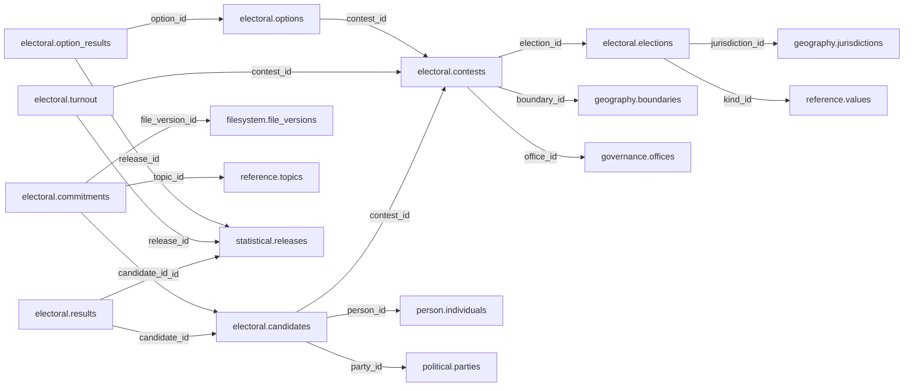

# electoral schema — review and approval proposal

> **PROPOSED — USER REVIEW REQUIRED.** This is the review authority for whether the schema should exist and which tables/columns it owns. No SQL or migration is authorized.

## Purpose and ownership

**Target:** Main. **Purpose:** Elections, contests, candidates and official outcomes. This separate schema is a proposal based on distinct lifecycle, vocabulary and queries; merging or rejection remains open. Related owners: governance,political,statistical,geography.

## Current implementation and gaps

The active manifest has 30 manifest migrations and 49 distinct CREATE TABLE declarations (49 distinct current table names) in schemas `audit`, `auth`, `engine`, `filesystem`, `geography`, `legal`, `objects`, `reference`. Generated Dryv has 124 entities (digest `e0087da9cf5b00e91f283a5501c368c7696bdd841ea30629231dc9c590f7c1ee`). Counts describe current artifacts, not target design; SQL and Dryv diverge.

- SQL declarations: None found.
- Dryv entities: `electoral.candidates` (elections.Candidate), `electoral.elections` (elections.Election), `electoral.results` (elections.ElectionResult), `electoral.electorates` (elections.Electorate), `electoral.manifestos` (elections.Manifesto), `electoral.commitments` (elections.ManifestoCommitment), `electoral.referendum_options` (elections.ReferendumOption), `electoral.referendum_questions` (elections.ReferendumQuestion), `electoral.referendum_results` (elections.ReferendumResult), `electoral.seats` (elections.Seat), `electoral.seat_allocations` (elections.SeatAllocation)

The inventory does not establish live database state and may miss ALTER-only changes. Before implementation, reconcile migrations, Dryv, generated output and callers.

## Proposed relationship map

> All nodes and edges are proposals. Main schemas may use local cross-schema foreign keys; no edge crosses the Main/Operations database boundary.

## Proposed table and column review

All tables and fields are hypothetical. Every proposed business column is listed; UUIDv7 `id` is a candidate default and remains open. Record every existing field disposition: KEEP / REMOVE / RENAME / MOVE / MERGE / SPLIT / DERIVE / ADD.

### `electoral.elections` — Election identity and schedule

- **Example:** General election
- **Profile:** entity; planning envelope below.

| Column | Proposed type | Meaning | Nullable | Default | Relationship | Units / validation | Proposed disposition |
|---|---|---|---|---|---|---|---|
| `id` | `uuid` | Proposed stable identity | No | Rust UUIDv7 candidate | Primary key | UUIDv7 candidate; unique and immutable after publication | KEEP (candidate match to current SQL/Dryv field; confirm meaning) |
| `title` | `text` | Election title | No | — | — | Nonblank when required; enforce domain-specific length, normalization and controlled vocabulary | ADD (proposed target field; pending user approval) |
| `jurisdiction_id` | `uuid` | Jurisdiction | No | — | FK → `geography.jurisdictions` | UUID syntax; FK target must exist when the relationship is required | KEEP (candidate match to current SQL/Dryv field; confirm meaning) |
| `held_on` | `date` | Actual polling date | Yes | — | — | Type checked; domain constraints and units must be approved for this field | ADD (proposed target field; pending user approval) |
| `kind_id` | `uuid` | Election classification | No | — | FK → `reference.values` | UUID syntax; FK target must exist when the relationship is required | ADD (proposed target field; pending user approval) |

- **Current SQL/Dryv fields without a proposed same-name column:** `administering_institution_id`, `code`, `created_at`, `geo_unit_id`, `held_date`, `is_current`, `legal_basis_id`, `name`, `scheduled_date`, `status`, `type_id`, `updated_at`, `valid_from`, `valid_from_precision`, `valid_to`, `valid_to_precision`, `version`. **Disposition:** unresolved per field; propose KEEP, REMOVE, RENAME, MOVE, MERGE, SPLIT or DERIVE in review. Do not drop these fields until the user resolves each one.
- **FK action/cardinality:** Each non-null FK is many-to-one to its named target; nullable FKs are optional. Candidate delete/update behavior is RESTRICT/NO ACTION for accepted records; cascading canonical deletion is not proposed. Confirm uniqueness and exact behavior during review.
- **Constraints:** Scheduled dates belong to announced events until verified. Exact keys and cross-field checks remain for review.
- **Indexes:** primary key on `id`; candidate B-tree indexes on FK columns `jurisdiction_id`, `kind_id` for joins and referenced-entity filters; add temporal/spatial indexes only where the stated query needs them and benchmarks support them.
- **Relationships:** resolve each FK target. Main allows cross-schema FKs. Main and Operations have no cross-database FK.
- **Evidence/time:** preserve exact source/version, observation/retrieval time, historical context and uncertainty where applicable. Approve the exact evidence path for this table.
- **Growth/storage estimate (illustrative planning envelope, not measured):** Low: initial 1,000, +200/year, peak 20/day; five-year 2,000 rows ≈ 2.0 MiB live row+index budget; Expected: initial 10,000, +2,000/year, peak 200/day; five-year 20,000 rows ≈ 19.5 MiB live row+index budget; High: initial 100,000, +20,000/year, peak 2,000/day; five-year 200,000 rows ≈ 195.3 MiB live row+index budget. Model: initial rows + annual accepted rows × 5; multiply by a per-row budget of 1 KiB including a coarse index allowance. Replace assumptions with actual samples, ingest rates and `pg_total_relation_size` before approval. Large object bytes are excluded; WAL, replicas, backups and S3 are budgeted separately.
- **Workload:** Interactive lookup by identity and approved foreign keys; batch scans for import/reconciliation. Peak-day figure above is a scenario assumption, not a service-level commitment.
- **Partitioning:** None proposed initially; decide from measured scale/query plans. Check late data and partition count.
- **Files:** originals, full-resolution geometry, arrays, media and large exports may be immutable S3 objects. Keep searchable identity, required facts, hashes, coverage, access and provenance in PostgreSQL; use manifests and selective reads.
- **Retention/risks/benchmark:** preserve accepted evidence and corrections. Review late arrivals, contention, index/partition growth and recovery. Benchmark joins, filters, spatial access, ingestion bursts, concurrent access and interrupted publication.
### `electoral.contests` — One office or question contested

- **Example:** County governor contest
- **Profile:** entity; planning envelope below.

| Column | Proposed type | Meaning | Nullable | Default | Relationship | Units / validation | Proposed disposition |
|---|---|---|---|---|---|---|---|
| `id` | `uuid` | Proposed stable identity | No | Rust UUIDv7 candidate | Primary key | UUIDv7 candidate; unique and immutable after publication | ADD (proposed target field; pending user approval) |
| `election_id` | `uuid` | Election | No | — | FK → `electoral.elections` | UUID syntax; FK target must exist when the relationship is required | ADD (proposed target field; pending user approval) |
| `office_id` | `uuid` | Office contested | Yes | — | FK → `governance.offices` | UUID syntax; FK target must exist when the relationship is required | ADD (proposed target field; pending user approval) |
| `boundary_id` | `uuid` | Exact electoral area | No | — | FK → `geography.boundaries` | UUID syntax; FK target must exist when the relationship is required | ADD (proposed target field; pending user approval) |
| `question` | `text` | Referendum question | Yes | — | — | Nonblank when required; enforce domain-specific length, normalization and controlled vocabulary | ADD (proposed target field; pending user approval) |
| `seats` | `integer` | Number of seats | No | — | — | Type checked; domain constraints and units must be approved for this field | ADD (proposed target field; pending user approval) |

- **FK action/cardinality:** Each non-null FK is many-to-one to its named target; nullable FKs are optional. Candidate delete/update behavior is RESTRICT/NO ACTION for accepted records; cascading canonical deletion is not proposed. Confirm uniqueness and exact behavior during review.
- **Constraints:** office_id XOR question; seats >= 1. Exact keys and cross-field checks remain for review.
- **Indexes:** primary key on `id`; candidate B-tree indexes on FK columns `election_id`, `office_id`, `boundary_id` for joins and referenced-entity filters; add temporal/spatial indexes only where the stated query needs them and benchmarks support them.
- **Relationships:** resolve each FK target. Main allows cross-schema FKs. Main and Operations have no cross-database FK.
- **Evidence/time:** preserve exact source/version, observation/retrieval time, historical context and uncertainty where applicable. Approve the exact evidence path for this table.
- **Growth/storage estimate (illustrative planning envelope, not measured):** Low: initial 1,000, +200/year, peak 20/day; five-year 2,000 rows ≈ 2.0 MiB live row+index budget; Expected: initial 10,000, +2,000/year, peak 200/day; five-year 20,000 rows ≈ 19.5 MiB live row+index budget; High: initial 100,000, +20,000/year, peak 2,000/day; five-year 200,000 rows ≈ 195.3 MiB live row+index budget. Model: initial rows + annual accepted rows × 5; multiply by a per-row budget of 1 KiB including a coarse index allowance. Replace assumptions with actual samples, ingest rates and `pg_total_relation_size` before approval. Large object bytes are excluded; WAL, replicas, backups and S3 are budgeted separately.
- **Workload:** Interactive lookup by identity and approved foreign keys; batch scans for import/reconciliation. Peak-day figure above is a scenario assumption, not a service-level commitment.
- **Partitioning:** None proposed initially; decide from measured scale/query plans. Check late data and partition count.
- **Files:** originals, full-resolution geometry, arrays, media and large exports may be immutable S3 objects. Keep searchable identity, required facts, hashes, coverage, access and provenance in PostgreSQL; use manifests and selective reads.
- **Retention/risks/benchmark:** preserve accepted evidence and corrections. Review late arrivals, contention, index/partition growth and recovery. Benchmark joins, filters, spatial access, ingestion bursts, concurrent access and interrupted publication.
### `electoral.candidates` — Person candidature

- **Example:** Independent candidate
- **Profile:** relation; planning envelope below.

| Column | Proposed type | Meaning | Nullable | Default | Relationship | Units / validation | Proposed disposition |
|---|---|---|---|---|---|---|---|
| `id` | `uuid` | Proposed stable identity | No | Rust UUIDv7 candidate | Primary key | UUIDv7 candidate; unique and immutable after publication | KEEP (candidate match to current SQL/Dryv field; confirm meaning) |
| `contest_id` | `uuid` | Contest | No | — | FK → `electoral.contests` | UUID syntax; FK target must exist when the relationship is required | ADD (proposed target field; pending user approval) |
| `person_id` | `uuid` | Candidate | No | — | FK → `person.individuals` | UUID syntax; FK target must exist when the relationship is required | KEEP (candidate match to current SQL/Dryv field; confirm meaning) |
| `party_id` | `uuid` | Party or independent NULL | Yes | — | FK → `political.parties` | UUID syntax; FK target must exist when the relationship is required | KEEP (candidate match to current SQL/Dryv field; confirm meaning) |
| `ballot_name` | `text` | Published ballot label | No | — | — | Nonblank when required; enforce domain-specific length, normalization and controlled vocabulary | ADD (proposed target field; pending user approval) |

- **Current SQL/Dryv fields without a proposed same-name column:** `created_at`, `is_current`, `is_independent`, `nomination_status`, `seat_id`, `updated_at`, `valid_from`, `valid_from_precision`, `valid_to`, `valid_to_precision`, `version`. **Disposition:** unresolved per field; propose KEEP, REMOVE, RENAME, MOVE, MERGE, SPLIT or DERIVE in review. Do not drop these fields until the user resolves each one.
- **FK action/cardinality:** Each non-null FK is many-to-one to its named target; nullable FKs are optional. Candidate delete/update behavior is RESTRICT/NO ACTION for accepted records; cascading canonical deletion is not proposed. Confirm uniqueness and exact behavior during review.
- **Constraints:** UNIQUE(contest_id,person_id). Exact keys and cross-field checks remain for review.
- **Indexes:** primary key on `id`; candidate B-tree indexes on FK columns `contest_id`, `person_id`, `party_id` for joins and referenced-entity filters; add temporal/spatial indexes only where the stated query needs them and benchmarks support them.
- **Relationships:** resolve each FK target. Main allows cross-schema FKs. Main and Operations have no cross-database FK.
- **Evidence/time:** preserve exact source/version, observation/retrieval time, historical context and uncertainty where applicable. Approve the exact evidence path for this table.
- **Growth/storage estimate (illustrative planning envelope, not measured):** Low: initial 1,000, +2,000/year, peak 100/day; five-year 11,000 rows ≈ 10.7 MiB live row+index budget; Expected: initial 10,000, +20,000/year, peak 1,000/day; five-year 110,000 rows ≈ 107.4 MiB live row+index budget; High: initial 100,000, +200,000/year, peak 10,000/day; five-year 1,100,000 rows ≈ 1,074.2 MiB live row+index budget. Model: initial rows + annual accepted rows × 5; multiply by a per-row budget of 1 KiB including a coarse index allowance. Replace assumptions with actual samples, ingest rates and `pg_total_relation_size` before approval. Large object bytes are excluded; WAL, replicas, backups and S3 are budgeted separately.
- **Workload:** Interactive lookup by identity and approved foreign keys; batch scans for import/reconciliation. Peak-day figure above is a scenario assumption, not a service-level commitment.
- **Partitioning:** None proposed initially; decide from measured scale/query plans. Check late data and partition count.
- **Files:** originals, full-resolution geometry, arrays, media and large exports may be immutable S3 objects. Keep searchable identity, required facts, hashes, coverage, access and provenance in PostgreSQL; use manifests and selective reads.
- **Retention/risks/benchmark:** preserve accepted evidence and corrections. Review late arrivals, contention, index/partition growth and recovery. Benchmark joins, filters, spatial access, ingestion bursts, concurrent access and interrupted publication.
### `electoral.results` — Published candidate vote counts

- **Example:** Official declared vote total
- **Profile:** fact; planning envelope below.

| Column | Proposed type | Meaning | Nullable | Default | Relationship | Units / validation | Proposed disposition |
|---|---|---|---|---|---|---|---|
| `id` | `uuid` | Proposed stable identity | No | Rust UUIDv7 candidate | Primary key | UUIDv7 candidate; unique and immutable after publication | KEEP (candidate match to current SQL/Dryv field; confirm meaning) |
| `candidate_id` | `uuid` | Candidate | No | — | FK → `electoral.candidates` | UUID syntax; FK target must exist when the relationship is required | KEEP (candidate match to current SQL/Dryv field; confirm meaning) |
| `release_id` | `uuid` | Official results release | No | — | FK → `statistical.releases` | UUID syntax; FK target must exist when the relationship is required | ADD (proposed target field; pending user approval) |
| `votes` | `bigint` | Nonnegative votes | No | — | — | Type checked; domain constraints and units must be approved for this field | KEEP (candidate match to current SQL/Dryv field; confirm meaning) |
| `declared_on` | `date` | Declaration date | No | — | — | Type checked; domain constraints and units must be approved for this field | ADD (proposed target field; pending user approval) |
| `outcome` | `text` | elected not_elected disputed or pending | No | — | — | Nonblank when required; enforce domain-specific length, normalization and controlled vocabulary | ADD (proposed target field; pending user approval) |

- **Current SQL/Dryv fields without a proposed same-name column:** `created_at`, `declared_at`, `declaring_institution_id`, `geo_unit_id`, `is_current`, `is_winner`, `rank`, `result_level_id`, `seat_id`, `updated_at`, `valid_from`, `valid_from_precision`, `valid_to`, `valid_to_precision`, `version`. **Disposition:** unresolved per field; propose KEEP, REMOVE, RENAME, MOVE, MERGE, SPLIT or DERIVE in review. Do not drop these fields until the user resolves each one.
- **FK action/cardinality:** Each non-null FK is many-to-one to its named target; nullable FKs are optional. Candidate delete/update behavior is RESTRICT/NO ACTION for accepted records; cascading canonical deletion is not proposed. Confirm uniqueness and exact behavior during review.
- **Constraints:** UNIQUE(candidate_id,release_id); votes >= 0. Exact keys and cross-field checks remain for review.
- **Indexes:** primary key on `id`; candidate B-tree indexes on FK columns `candidate_id`, `release_id` for joins and referenced-entity filters; add temporal/spatial indexes only where the stated query needs them and benchmarks support them.
- **Relationships:** resolve each FK target. Main allows cross-schema FKs. Main and Operations have no cross-database FK.
- **Evidence/time:** preserve exact source/version, observation/retrieval time, historical context and uncertainty where applicable. Approve the exact evidence path for this table.
- **Growth/storage estimate (illustrative planning envelope, not measured):** Low: initial 10,000, +2,000/year, peak 100/day; five-year 20,000 rows ≈ 39.1 MiB live row+index budget; Expected: initial 100,000, +20,000/year, peak 1,000/day; five-year 200,000 rows ≈ 390.6 MiB live row+index budget; High: initial 1,000,000, +200,000/year, peak 10,000/day; five-year 2,000,000 rows ≈ 3,906.2 MiB live row+index budget. Model: initial rows + annual accepted rows × 5; multiply by a per-row budget of 2 KiB including a coarse index allowance. Replace assumptions with actual samples, ingest rates and `pg_total_relation_size` before approval. Large object bytes are excluded; WAL, replicas, backups and S3 are budgeted separately.
- **Workload:** Interactive lookup by identity and approved foreign keys; batch scans for import/reconciliation. Peak-day figure above is a scenario assumption, not a service-level commitment.
- **Partitioning:** None proposed initially; decide from measured scale/query plans. Check late data and partition count.
- **Files:** originals, full-resolution geometry, arrays, media and large exports may be immutable S3 objects. Keep searchable identity, required facts, hashes, coverage, access and provenance in PostgreSQL; use manifests and selective reads.
- **Retention/risks/benchmark:** preserve accepted evidence and corrections. Review late arrivals, contention, index/partition growth and recovery. Benchmark joins, filters, spatial access, ingestion bursts, concurrent access and interrupted publication.
### `electoral.turnout` — Contest-level electorate and ballot totals

- **Example:** Turnout with rejected ballots
- **Profile:** fact; planning envelope below.

| Column | Proposed type | Meaning | Nullable | Default | Relationship | Units / validation | Proposed disposition |
|---|---|---|---|---|---|---|---|
| `id` | `uuid` | Proposed stable identity | No | Rust UUIDv7 candidate | Primary key | UUIDv7 candidate; unique and immutable after publication | ADD (proposed target field; pending user approval) |
| `contest_id` | `uuid` | Contest | No | — | FK → `electoral.contests` | UUID syntax; FK target must exist when the relationship is required | ADD (proposed target field; pending user approval) |
| `release_id` | `uuid` | Results release | No | — | FK → `statistical.releases` | UUID syntax; FK target must exist when the relationship is required | ADD (proposed target field; pending user approval) |
| `registered` | `bigint` | Registered voters | Yes | — | — | Type checked; domain constraints and units must be approved for this field | ADD (proposed target field; pending user approval) |
| `cast` | `bigint` | Ballots cast | Yes | — | — | Type checked; domain constraints and units must be approved for this field | ADD (proposed target field; pending user approval) |
| `rejected` | `bigint` | Rejected ballots | Yes | — | — | Type checked; domain constraints and units must be approved for this field | ADD (proposed target field; pending user approval) |

- **FK action/cardinality:** Each non-null FK is many-to-one to its named target; nullable FKs are optional. Candidate delete/update behavior is RESTRICT/NO ACTION for accepted records; cascading canonical deletion is not proposed. Confirm uniqueness and exact behavior during review.
- **Constraints:** Counts nonnegative; missing differs from zero; validate publisher-specific totals. Exact keys and cross-field checks remain for review.
- **Indexes:** primary key on `id`; candidate B-tree indexes on FK columns `contest_id`, `release_id` for joins and referenced-entity filters; add temporal/spatial indexes only where the stated query needs them and benchmarks support them.
- **Relationships:** resolve each FK target. Main allows cross-schema FKs. Main and Operations have no cross-database FK.
- **Evidence/time:** preserve exact source/version, observation/retrieval time, historical context and uncertainty where applicable. Approve the exact evidence path for this table.
- **Growth/storage estimate (illustrative planning envelope, not measured):** Low: initial 10,000, +2,000/year, peak 100/day; five-year 20,000 rows ≈ 39.1 MiB live row+index budget; Expected: initial 100,000, +20,000/year, peak 1,000/day; five-year 200,000 rows ≈ 390.6 MiB live row+index budget; High: initial 1,000,000, +200,000/year, peak 10,000/day; five-year 2,000,000 rows ≈ 3,906.2 MiB live row+index budget. Model: initial rows + annual accepted rows × 5; multiply by a per-row budget of 2 KiB including a coarse index allowance. Replace assumptions with actual samples, ingest rates and `pg_total_relation_size` before approval. Large object bytes are excluded; WAL, replicas, backups and S3 are budgeted separately.
- **Workload:** Interactive lookup by identity and approved foreign keys; batch scans for import/reconciliation. Peak-day figure above is a scenario assumption, not a service-level commitment.
- **Partitioning:** None proposed initially; decide from measured scale/query plans. Check late data and partition count.
- **Files:** originals, full-resolution geometry, arrays, media and large exports may be immutable S3 objects. Keep searchable identity, required facts, hashes, coverage, access and provenance in PostgreSQL; use manifests and selective reads.
- **Retention/risks/benchmark:** preserve accepted evidence and corrections. Review late arrivals, contention, index/partition growth and recovery. Benchmark joins, filters, spatial access, ingestion bursts, concurrent access and interrupted publication.
### `electoral.options` — Referendum ballot choices

- **Example:** Yes option
- **Profile:** catalog; planning envelope below.

| Column | Proposed type | Meaning | Nullable | Default | Relationship | Units / validation | Proposed disposition |
|---|---|---|---|---|---|---|---|
| `id` | `uuid` | Proposed stable identity | No | Rust UUIDv7 candidate | Primary key | UUIDv7 candidate; unique and immutable after publication | ADD (proposed target field; pending user approval) |
| `contest_id` | `uuid` | Referendum contest | No | — | FK → `electoral.contests` | UUID syntax; FK target must exist when the relationship is required | ADD (proposed target field; pending user approval) |
| `label` | `text` | Ballot option | No | — | — | Nonblank when required; enforce domain-specific length, normalization and controlled vocabulary | ADD (proposed target field; pending user approval) |

- **FK action/cardinality:** Each non-null FK is many-to-one to its named target; nullable FKs are optional. Candidate delete/update behavior is RESTRICT/NO ACTION for accepted records; cascading canonical deletion is not proposed. Confirm uniqueness and exact behavior during review.
- **Constraints:** UNIQUE(contest_id,label); contest must be referendum. Exact keys and cross-field checks remain for review.
- **Indexes:** primary key on `id`; candidate B-tree indexes on FK columns `contest_id` for joins and referenced-entity filters; add temporal/spatial indexes only where the stated query needs them and benchmarks support them.
- **Relationships:** resolve each FK target. Main allows cross-schema FKs. Main and Operations have no cross-database FK.
- **Evidence/time:** preserve exact source/version, observation/retrieval time, historical context and uncertainty where applicable. Approve the exact evidence path for this table.
- **Growth/storage estimate (illustrative planning envelope, not measured):** Low: initial 100, +100/year, peak 5/day; five-year 600 rows ≈ 0.6 MiB live row+index budget; Expected: initial 1,000, +500/year, peak 25/day; five-year 3,500 rows ≈ 3.4 MiB live row+index budget; High: initial 10,000, +5,000/year, peak 250/day; five-year 35,000 rows ≈ 34.2 MiB live row+index budget. Model: initial rows + annual accepted rows × 5; multiply by a per-row budget of 1 KiB including a coarse index allowance. Replace assumptions with actual samples, ingest rates and `pg_total_relation_size` before approval. Large object bytes are excluded; WAL, replicas, backups and S3 are budgeted separately.
- **Workload:** Interactive lookup by identity and approved foreign keys; batch scans for import/reconciliation. Peak-day figure above is a scenario assumption, not a service-level commitment.
- **Partitioning:** None proposed initially; decide from measured scale/query plans. Check late data and partition count.
- **Files:** originals, full-resolution geometry, arrays, media and large exports may be immutable S3 objects. Keep searchable identity, required facts, hashes, coverage, access and provenance in PostgreSQL; use manifests and selective reads.
- **Retention/risks/benchmark:** preserve accepted evidence and corrections. Review late arrivals, contention, index/partition growth and recovery. Benchmark joins, filters, spatial access, ingestion bursts, concurrent access and interrupted publication.
### `electoral.option_results` — Official referendum results

- **Example:** Votes for referendum option
- **Profile:** fact; planning envelope below.

| Column | Proposed type | Meaning | Nullable | Default | Relationship | Units / validation | Proposed disposition |
|---|---|---|---|---|---|---|---|
| `id` | `uuid` | Proposed stable identity | No | Rust UUIDv7 candidate | Primary key | UUIDv7 candidate; unique and immutable after publication | ADD (proposed target field; pending user approval) |
| `option_id` | `uuid` | Choice | No | — | FK → `electoral.options` | UUID syntax; FK target must exist when the relationship is required | ADD (proposed target field; pending user approval) |
| `release_id` | `uuid` | Release | No | — | FK → `statistical.releases` | UUID syntax; FK target must exist when the relationship is required | ADD (proposed target field; pending user approval) |
| `votes` | `bigint` | Votes | No | — | — | Type checked; domain constraints and units must be approved for this field | ADD (proposed target field; pending user approval) |

- **FK action/cardinality:** Each non-null FK is many-to-one to its named target; nullable FKs are optional. Candidate delete/update behavior is RESTRICT/NO ACTION for accepted records; cascading canonical deletion is not proposed. Confirm uniqueness and exact behavior during review.
- **Constraints:** UNIQUE(option_id,release_id); votes >= 0. Exact keys and cross-field checks remain for review.
- **Indexes:** primary key on `id`; candidate B-tree indexes on FK columns `option_id`, `release_id` for joins and referenced-entity filters; add temporal/spatial indexes only where the stated query needs them and benchmarks support them.
- **Relationships:** resolve each FK target. Main allows cross-schema FKs. Main and Operations have no cross-database FK.
- **Evidence/time:** preserve exact source/version, observation/retrieval time, historical context and uncertainty where applicable. Approve the exact evidence path for this table.
- **Growth/storage estimate (illustrative planning envelope, not measured):** Low: initial 10,000, +2,000/year, peak 100/day; five-year 20,000 rows ≈ 39.1 MiB live row+index budget; Expected: initial 100,000, +20,000/year, peak 1,000/day; five-year 200,000 rows ≈ 390.6 MiB live row+index budget; High: initial 1,000,000, +200,000/year, peak 10,000/day; five-year 2,000,000 rows ≈ 3,906.2 MiB live row+index budget. Model: initial rows + annual accepted rows × 5; multiply by a per-row budget of 2 KiB including a coarse index allowance. Replace assumptions with actual samples, ingest rates and `pg_total_relation_size` before approval. Large object bytes are excluded; WAL, replicas, backups and S3 are budgeted separately.
- **Workload:** Interactive lookup by identity and approved foreign keys; batch scans for import/reconciliation. Peak-day figure above is a scenario assumption, not a service-level commitment.
- **Partitioning:** None proposed initially; decide from measured scale/query plans. Check late data and partition count.
- **Files:** originals, full-resolution geometry, arrays, media and large exports may be immutable S3 objects. Keep searchable identity, required facts, hashes, coverage, access and provenance in PostgreSQL; use manifests and selective reads.
- **Retention/risks/benchmark:** preserve accepted evidence and corrections. Review late arrivals, contention, index/partition growth and recovery. Benchmark joins, filters, spatial access, ingestion bursts, concurrent access and interrupted publication.
### `electoral.commitments` — Candidate election promises

- **Example:** Manifesto water-service promise
- **Profile:** relation; planning envelope below.

| Column | Proposed type | Meaning | Nullable | Default | Relationship | Units / validation | Proposed disposition |
|---|---|---|---|---|---|---|---|
| `id` | `uuid` | Proposed stable identity | No | Rust UUIDv7 candidate | Primary key | UUIDv7 candidate; unique and immutable after publication | KEEP (candidate match to current SQL/Dryv field; confirm meaning) |
| `candidate_id` | `uuid` | Promising candidate | No | — | FK → `electoral.candidates` | UUID syntax; FK target must exist when the relationship is required | ADD (proposed target field; pending user approval) |
| `topic_id` | `uuid` | Subject | No | — | FK → `reference.topics` | UUID syntax; FK target must exist when the relationship is required | KEEP (candidate match to current SQL/Dryv field; confirm meaning) |
| `statement` | `text` | Attributed commitment | No | — | — | Nonblank when required; enforce domain-specific length, normalization and controlled vocabulary | ADD (proposed target field; pending user approval) |
| `file_version_id` | `uuid` | Manifesto source | No | — | FK → `filesystem.file_versions` | UUID syntax; FK target must exist when the relationship is required | ADD (proposed target field; pending user approval) |

- **Current SQL/Dryv fields without a proposed same-name column:** `created_at`, `is_current`, `manifesto_id`, `parent_id`, `sort_order`, `text`, `updated_at`, `valid_from`, `valid_from_precision`, `valid_to`, `valid_to_precision`, `version`. **Disposition:** unresolved per field; propose KEEP, REMOVE, RENAME, MOVE, MERGE, SPLIT or DERIVE in review. Do not drop these fields until the user resolves each one.
- **FK action/cardinality:** Each non-null FK is many-to-one to its named target; nullable FKs are optional. Candidate delete/update behavior is RESTRICT/NO ACTION for accepted records; cascading canonical deletion is not proposed. Confirm uniqueness and exact behavior during review.
- **Constraints:** Promises are not completed actions. Exact keys and cross-field checks remain for review.
- **Indexes:** primary key on `id`; candidate B-tree indexes on FK columns `candidate_id`, `topic_id`, `file_version_id` for joins and referenced-entity filters; add temporal/spatial indexes only where the stated query needs them and benchmarks support them.
- **Relationships:** resolve each FK target. Main allows cross-schema FKs. Main and Operations have no cross-database FK.
- **Evidence/time:** preserve exact source/version, observation/retrieval time, historical context and uncertainty where applicable. Approve the exact evidence path for this table.
- **Growth/storage estimate (illustrative planning envelope, not measured):** Low: initial 1,000, +2,000/year, peak 100/day; five-year 11,000 rows ≈ 10.7 MiB live row+index budget; Expected: initial 10,000, +20,000/year, peak 1,000/day; five-year 110,000 rows ≈ 107.4 MiB live row+index budget; High: initial 100,000, +200,000/year, peak 10,000/day; five-year 1,100,000 rows ≈ 1,074.2 MiB live row+index budget. Model: initial rows + annual accepted rows × 5; multiply by a per-row budget of 1 KiB including a coarse index allowance. Replace assumptions with actual samples, ingest rates and `pg_total_relation_size` before approval. Large object bytes are excluded; WAL, replicas, backups and S3 are budgeted separately.
- **Workload:** Interactive lookup by identity and approved foreign keys; batch scans for import/reconciliation. Peak-day figure above is a scenario assumption, not a service-level commitment.
- **Partitioning:** None proposed initially; decide from measured scale/query plans. Check late data and partition count.
- **Files:** originals, full-resolution geometry, arrays, media and large exports may be immutable S3 objects. Keep searchable identity, required facts, hashes, coverage, access and provenance in PostgreSQL; use manifests and selective reads.
- **Retention/risks/benchmark:** preserve accepted evidence and corrections. Review late arrivals, contention, index/partition growth and recovery. Benchmark joins, filters, spatial access, ingestion bursts, concurrent access and interrupted publication.

## Queries, lifecycle, capacity and approval

**Representative query:** Who contested this seat and what was the official result?

Lifecycle: preserve source bytes; extract into candidate revisions; validate; review or use approved deterministic checks; atomically publish; serve. Corrections create explicit versions/supersession. Preserve disagreement and uncertainty.

Capacity is unmeasured. Use low/expected/high input scenarios, explicit formulas and workload benchmarks; do not assume sizes or universal partitions.

**Status:** NOT REVIEWED. Schema existence, tables, columns, relationships, partitioning and S3 choices require user approval. Feedback: none. Approval reference/date/revision: none. Implementation authorization: not granted. Material changes reopen approval.

Earlier schema proposal preserved for history; superseded and not an approval

---
id: DOC-4125ED9B7A63
name: Electoral domain schema redesign
type: documentation
tags: [improvements, schema-redesign, electoral, planning]
extra: {status: planning_only}
---

> **11 November 2026 precedence:** the connected foundation update at the end of this document supersedes conflicting jurisdiction, compatibility and cross-domain assumptions in the historical proposal below. Detailed table names remain design candidates; task 03 is prepared for design work, not a claim of completed implementation.

# Electoral — elections, electorates, candidates, vote results and referendums

**PLANNING ONLY — detailed design review required; not authorized to implement.**

## Confirmed boundary

`electoral` remains **separate from `political`**. The user wants comprehensive Kenya IEBC results, candidates, voters by geographic level, seats, party affiliation at contest time, official declarations and meaningful historical comparisons, while retaining worldwide applicability. A **registered voter count** is not the same as votes cast, counted valid votes, declared vote for a candidate, turnout rate or number of allocated seats. Distinguish nomination, contest, tally, declaration and certification.

## Current tables (11) and their responsibilities

| Current table | Review focus and possible improvement |
|---|---|
| `elections` | Elections/election rounds or by-elections, jurisdiction, organizer, law, dates and status. |
| `seats` | Contest/representative seat identity, valid period and geo unit represented, not a candidate identity. |
| `candidates` | Person contesting a seat, party affiliation/nomination at **that election**, withdrawal/disqualification status. |
| `results` | Official vote tallies, reporting unit, candidate/contest, declaration level, status and correction edition. |
| `electorates` | Registered/eligible voters, cast/valid/rejected/spoilt votes, source date/geo scope; introduced in later migration. |
| `referendum_questions` | Legally specified question linked to an electoral event. |
| `referendum_options` | Ordered, defined responses to a question with stable identity. |
| `referendum_results` | Official votes for each option at a geo reporting level and declaration version. |
| `seat_allocations` | Seat allocation results, party/election and applicable rule, not directly equivalent to voting totals. |
| `manifestos` | Dated party/candidate electoral platform with external source. |
| `commitments` | Individually traceable manifesto pledges and possible later associated activity. |

The current initial schema plus the `1794800000000-electoral-ballots.ts` migration must be compared with **all current TypeORM columns, Dryv contract types and deployed DB constraints**. For each table audit exact PK, FK, `election_id`, `seat_id`, `person_id`/`individual_id`, `party_id`, `geo_unit_id`, value fields, round, declaration status, valid dates, version and provenance. Those names are **semantic audit targets**, not assertions that every table has them.

## Proposal: hard links and defensible results

Use hard FK for election→jurisdiction/organizing institution, seat→geography/office/legal pattern, candidate→person and election/seat, candidate party→political party at nomination time, result→candidate/seat/election/geo and source version, referendum option→question, and constituency representation→correct historical geography. Add unique/functional constraints to avoid duplicates by (election, contest, reporting geography, round, choice/candidate, official edition).

National and county results are overlapping reported totals, **not independent additive records** when one already includes the other. The geography ancestor/descendant query model must avoid reporting double totals; a national total cannot automatically be disaggregated to counties. Country-root scope and report geography must remain separate from ballot-center venue and declaring institution HQ.

Legal procedure link should identify the electoral framework in force at the election time, including boundary changes, seat allocation rules and certification process. A claim of a winner requires declaration evidence, not just an AI-generated ranking.

## Four data categories and generation

- **1A:** election and seat definitions, official roles, known timelines and legally established electoral units.
- **1B:** seats/contests expected under a verified law or administrative pattern; never auto-generate candidates or votes.
- **2A:** IEBC and other election authority registered voters, nominations, official election results, reports and referenda.
- **2B:** turnout rates, shares, swings, comparisons and seat/party summaries, with explicit formula, denominators, vintage and geo consistency.

The `statistical` domain may reuse official electoral quantities as a dataset, but must not create competing canonical vote identities. Preserve official source snapshots and corrections.

## Query/acceptance examples

Which candidates actually ran for a county/constituency seat on election day? Show registered voters vs cast/valid votes at every official reporting level. Find a county total from certified results without mixing an earlier provisional edition. Show a voter's region aggregate historically despite boundary changes, without disclosing person-level voting behavior. Trace a seat winner→`governance.holders` only when independent office assumption evidence is available.

## Migration and decision risks

Reconcile results/states/aggregation and historical geo unit links; test registered voter denominators before computing turnout. Preserve source edition/correction history and candidacies that were later withdrawn. Enforce all known cross-domain FKs only after resolving orphans and duplicates; no destructive reset. Update Dryv/client contract changes carefully.

## Open questions

1. Should a referendum be an election subtype or a separate electoral event identity?
2. How are rounds, results statuses, recounts and official corrected declarations versioned?
3. Which precise reporting geo systems and date-aware boundaries apply?
4. How to model independently published voter registration datasets versus election-day turnout?
5. Where should campaign manifestos and commitment verification reside?
6. Which official releases can be auto-imported vs require review?

**Links:** [Schema index](README.md), [Master record](../mzizi-data-schema-storage-and-pipelines-redesign.md), [Geography](geography.md), [Statistics](statistical.md).

## Human review — editable user notes and design sign-off

**Review status:** `NOT REVIEWED` — AI-authored proposals in this document are not final approval.

**In my own words, what this schema should represent and exclude:**

> _My understanding and questions:_

**Tables/columns I want to keep, rename, move, merge, split, remove or add (and why):**

> _My proposed changes and alternative names:_

**Hard foreign keys, geographical and legal scope, pattern generation, classification and evidence I want changed or explained:**

> _My technical feedback, disagreements and alternatives:_

**Real data and queries I want to use to validate this design:**

> _My examples and expected results:_

**Unresolved decisions I want to discuss further:**

> _My remaining questions:_

**Final user decision:** `NOT DECIDED` / `NEEDS CHANGES` / `DESIGN VALIDATED BY USER` / `APPROVED FOR TASK PLANNING`.

**Approval reference and date:** _None. Only record explicit later user authorization. Even design validation does not authorize code, migration or Taskcode task creation._

## Mandatory per-table temporal, rigid-column and deletion review (2026-11-07)

**USER REQUIREMENT; planning only.** Examine every existing/proposed field and expressly record **KEEP / REMOVE / DERIVE / MOVE / RENAME / ADD** for `valid_from`, `valid_to`, `valid_from_precision`, `valid_to_precision`, `is_current`, `status`, `version`, `created_at`, `updated_at` and other copied/rigid flags. These fields are **opt-in by justified meaning**, not blanket schema conventions. Assess `deleted_at` only for recoverable soft deletion where appropriate. The full policy and migration/approval checklist is in [schema redesign README](README.md).

**Domain-specific guidance:** Elections have occurrence/round dates, candidates have nomination/withdrawal events, seats can derive structural applicability from electoral law/patterns, and results have official declaration/vintage history. Avoid generic validity/precision/is_current on every electoral row. Never soft-delete official historic election results; preserve corrected versions and evidence.

**OPEN for human review:** exact per-table/column disposition, derived status and as-of queries, pattern/legal links, justified precision, recoverable deletion versus domain lifecycle, history/identity preservation and hard-FK impact. No code or migration is authorized.

## 2026-11-07 calendar and freshness integration — elections as domain facts, activity as timeline

**Not approved for DDL.** Existing `source/backend/api/src/modules/elections/entities/election.entity.ts` already distinguishes `scheduled_date` and `held_date`. `calendar.events` separately has `starts_on`, `ends_on` and `is_recurring`. Review an authoritative mapping so those two models do not create independently conflicting "election date" sources.

**Proposal:** `reference` owns legally applicable electoral cycle/schedule definitions and dependent watcher rules; `activity` stores planned/announced/postponed/held/declaration occurrences, with source and timestamps; `electoral.elections` remains the canonical election identity and election-specific facts. A planned general election triggers checks for commission announcements, seats, registrations and nominations. An official result publication triggers result/turnout/candidate revalidation and dependent `statistical` rollup verification. An announced election date changing must not be reported as a held event, nor should a theoretical cycle generate voters or results.

**Field semantics and monitoring:** A seat definition or historical identity may be cold, whereas live nominations and provisional results may be hot near official phases. Freshness policies should target the **actual field group and reporting geography**; a national election announcement doesn't verify every county result. “Last checked” must be distinct from "last verified" and source publication/retrieval time. Source-backed correction/vintage history prevents a previous declaration from disappearing.

**Admin/agent use cases:** Admin records a sourced nomination announcement or submits a scoped refresh request; registered source agents observe official statements and propose `activity` instances; engine deduplicates triggers and sends targeted checks rather than blindly overwriting `electoral`. Exact schedule shape, target FKs, trust thresholds, status words and refresh frequency remain **OPEN**.

## 2026-11-11 — Connected foundation direction (controlling for task 03)

Connect an election contest to the office(s) it fills, its electoral area/reporting coverage and reviewed legal rules. Candidacy identifies the person and dated electoral party affiliation; results/declarations and assumption of office are distinct records/events. Selection procedures may differ even within one paired office: do not reduce all selection to a single elected boolean. Exact legal provision versions support rules and interpretations.

Boundaries and reporting areas are dated and need not follow an administrative parent chain. Voter counts belong to a defined registration release/coverage, not a generic current local number. Task 03 supplies interfaces and a contest-to-office-to-holder fixture; task 04 finalizes real tables and full electoral rule/version semantics. No fabricated results or terms from pattern expectations.

Read [the connected foundation](../connected-reference-geography-legal-foundation.md) for the decisions, candidate models, query examples, proof cases and primary research sources. Fresh construction in `mzizi_new` has no legacy database ID/data compatibility requirement; existing S3 evidence remains protected. This update records accepted direction and design deliverables, not final DDL or broad implementation authorization.

## 2026-11-11 — System-expansion alignment

Electoral owns results and election facts; derived turnout or comparisons belong to Statistical with pinned definitions, source releases and geographic coverage. See the [system-expansion proposal](../advancement-and-system-expansion.md). This alignment note does not approve proposed schemas, tables or implementation.

