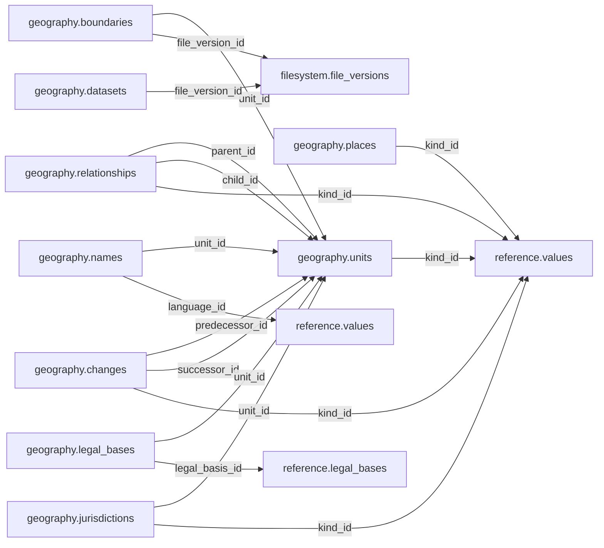

# geography — Phase 01

> **Phase 01 civic accountability scope agreed; table and column proposals remain unapproved.** No implementation is authorized by this documentation reorganization.

[Folder index](README.md) · [Full catalogue and relocation inventory](../README.md)

## Agreed responsibility — 12 November 2026

Administrative and electoral units, places, dated relationships, boundary versions, spatial representations and geographic history.

Include administrative, electoral and other geographic units needed by the civic pilot, physical places, parallel dated hierarchies, changing names, boundary versions, spatial representations and geographic history. Historical places and boundaries need not fit today's national borders. Keep retrieval time distinct from historical validity and mark approximate, disputed or missing geometry.

**A countrywide institution must link to the geographic unit representing the whole country.** A missing unit must never encode national scope. Distinguish an institution's physical headquarters from its jurisdiction and service coverage. Other missing facts stay explicitly unknown; do not fabricate boundaries or addresses.

PostGIS querying is part of Phase 01. Support: known-area lookup by identity/name and date; coordinate-to-area lookup against the applicable boundary version, including overlaps and edge ambiguity; nearby-place/facility searches with an explicit radius and distance units; and spatial intersections of areas, service coverage, projects and boundaries. Review coordinate reference systems, geometry validity, spatial indexes and query plans, and disclose the boundary edition and uncertainty. Spatial containment does not itself prove government authority.

The retained `geography.legal_bases` association now proposes `legal_basis_id` to `reference.legal_bases`, replacing its direct provision-version link. Language classification may use shared Reference vocabulary in the pilot; the older link to deferred Linguistics is not a Phase 01 prerequisite.

## Retained table proposals and review context

The following dictionaries preserve the earlier proposal inputs, adjusted for the agreed ownership above. They remain unapproved. Earlier inventories retain their measured names; collapsed historical sections do not override the 12 November decisions.

## Retained geography proposal

> **PROPOSED — USER REVIEW REQUIRED.** Schema assignment is agreed; proposed tables and columns still require review. No SQL or migration is authorized.

## Purpose and ownership

**Target:** Main. **Purpose:** Canonical territories, places and useful spatial geometry. Schema placement follows the 12 November scope decision; individual table/column designs remain proposals. Related owners follow the agreed responsibility section above.

## Current implementation and gaps

The active manifest has 30 manifest migrations and 49 distinct CREATE TABLE declarations (49 distinct current table names) in schemas `audit`, `auth`, `engine`, `filesystem`, `geography`, `legal`, `objects`, `reference`. Generated Dryv has 124 entities (digest `e0087da9cf5b00e91f283a5501c368c7696bdd841ea30629231dc9c590f7c1ee`). Counts describe current artifacts, not target design; SQL and Dryv diverge.

- SQL declarations: `geography.units` (geography/0001_geography.sql), `geography.names` (geography/0001_geography.sql), `geography.relationship_systems` (geography/0001_geography.sql), `geography.relationships` (geography/0001_geography.sql), `geography.boundary_representations` (geography/0001_geography.sql), `geography.country_territories` (geography/0002_country_territories.sql), `geography.unit_changes` (geography/0002_country_territories.sql), `geography.unit_legal_bases` (legal/0001_legal_minimum.sql)
- Dryv entities: `geography.boundaries` (geography.GeoBoundaryVersion), `geography.relationships` (geography.GeoRelationship), `geography.units` (geography.GeoUnit), `geography.changes` (geography.GeoUnitChange), `geography.names` (geography.GeoUnitNameVersion)

The inventory does not establish live database state and may miss ALTER-only changes. Before implementation, reconcile migrations, Dryv, generated output and callers.

## Proposed relationship map

> All nodes and edges are proposals. Main schemas may use local cross-schema foreign keys; no edge crosses the Main/Operations database boundary.

## Proposed table and column review

All tables and fields are hypothetical. Every proposed business column is listed; UUIDv7 `id` is a candidate default and remains open. Record every existing field disposition: KEEP / REMOVE / RENAME / MOVE / MERGE / SPLIT / DERIVE / ADD.

### `geography.units` — Territorial/reporting area identity

- **Example:** County
- **Profile:** entity; planning envelope below.

| Column | Proposed type | Meaning | Nullable | Default | Relationship | Units / validation | Proposed disposition |
|---|---|---|---|---|---|---|---|
| `id` | `uuid` | Proposed stable identity | No | Rust UUIDv7 candidate | Primary key | UUIDv7 candidate; unique and immutable after publication | KEEP (candidate match to current SQL/Dryv field; confirm meaning) |
| `code` | `text` | Stable identity | No | — | — | Nonblank when required; enforce domain-specific length, normalization and controlled vocabulary | KEEP (candidate match to current SQL/Dryv field; confirm meaning) |
| `name` | `text` | Accepted name | No | — | — | Nonblank when required; enforce domain-specific length, normalization and controlled vocabulary | KEEP (candidate match to current SQL/Dryv field; confirm meaning) |
| `kind_id` | `uuid` | Geographic kind | No | — | FK → `reference.values` | UUID syntax; FK target must exist when the relationship is required | ADD (proposed target field; pending user approval) |

- **Current SQL/Dryv fields without a proposed same-name column:** `created_at`, `emblem_marker`, `existence_status`, `flag_marker`, `is_active`, `is_current`, `jurisdiction_id`, `kind`, `level_id`, `parent_id`, `source_file_version_id`, `type_scheme_id`, `type_value_id`, `updated_at`, `valid_from`, `valid_from_precision`, `valid_to`, `valid_to_precision`, `version`, `wikidata_id`. **Disposition:** unresolved per field; propose KEEP, REMOVE, RENAME, MOVE, MERGE, SPLIT or DERIVE in review. Do not drop these fields until the user resolves each one.
- **FK action/cardinality:** Each non-null FK is many-to-one to its named target; nullable FKs are optional. Candidate delete/update behavior is RESTRICT/NO ACTION for accepted records; cascading canonical deletion is not proposed. Confirm uniqueness and exact behavior during review.
- **Constraints:** UNIQUE(code); historical polities supported. Exact keys and cross-field checks remain for review.
- **Indexes:** primary key on `id`; candidate B-tree indexes on FK columns `kind_id` for joins and referenced-entity filters; add temporal/spatial indexes only where the stated query needs them and benchmarks support them.
- **Relationships:** resolve each FK target. Main allows cross-schema FKs. Main and Operations have no cross-database FK.
- **Evidence/time:** preserve exact source/version, observation/retrieval time, historical context and uncertainty where applicable. Approve the exact evidence path for this table.
- **Growth/storage estimate (illustrative planning envelope, not measured):** Low: initial 1,000, +200/year, peak 20/day; five-year 2,000 rows ≈ 2.0 MiB live row+index budget; Expected: initial 10,000, +2,000/year, peak 200/day; five-year 20,000 rows ≈ 19.5 MiB live row+index budget; High: initial 100,000, +20,000/year, peak 2,000/day; five-year 200,000 rows ≈ 195.3 MiB live row+index budget. Model: initial rows + annual accepted rows × 5; multiply by a per-row budget of 1 KiB including a coarse index allowance. Replace assumptions with actual samples, ingest rates and `pg_total_relation_size` before approval. Large object bytes are excluded; WAL, replicas, backups and S3 are budgeted separately.
- **Workload:** Interactive lookup by identity and approved foreign keys; batch scans for import/reconciliation. Peak-day figure above is a scenario assumption, not a service-level commitment.
- **Partitioning:** None proposed initially; decide from measured scale/query plans. Check late data and partition count.
- **Files:** originals, full-resolution geometry, arrays, media and large exports may be immutable S3 objects. Keep searchable identity, required facts, hashes, coverage, access and provenance in PostgreSQL; use manifests and selective reads.
- **Retention/risks/benchmark:** preserve accepted evidence and corrections. Review late arrivals, contention, index/partition growth and recovery. Benchmark joins, filters, spatial access, ingestion bursts, concurrent access and interrupted publication.
### `geography.places` — Physical places

- **Example:** Town
- **Profile:** entity; planning envelope below.

| Column | Proposed type | Meaning | Nullable | Default | Relationship | Units / validation | Proposed disposition |
|---|---|---|---|---|---|---|---|
| `id` | `uuid` | Proposed stable identity | No | Rust UUIDv7 candidate | Primary key | UUIDv7 candidate; unique and immutable after publication | ADD (proposed target field; pending user approval) |
| `name` | `text` | Name | No | — | — | Nonblank when required; enforce domain-specific length, normalization and controlled vocabulary | ADD (proposed target field; pending user approval) |
| `kind_id` | `uuid` | Place kind | No | — | FK → `reference.values` | UUID syntax; FK target must exist when the relationship is required | ADD (proposed target field; pending user approval) |
| `position` | `geometry(Point,4326)` | Approximate point | Yes | — | — | Type checked; domain constraints and units must be approved for this field | ADD (proposed target field; pending user approval) |
| `accuracy_m` | `numeric` | Uncertainty | Yes | — | — | Type checked; domain constraints and units must be approved for this field | ADD (proposed target field; pending user approval) |

- **FK action/cardinality:** Each non-null FK is many-to-one to its named target; nullable FKs are optional. Candidate delete/update behavior is RESTRICT/NO ACTION for accepted records; cascading canonical deletion is not proposed. Confirm uniqueness and exact behavior during review.
- **Constraints:** Accuracy nonnegative; sensitive locations generalized. Exact keys and cross-field checks remain for review.
- **Indexes:** primary key on `id`; candidate B-tree indexes on FK columns `kind_id` for joins and referenced-entity filters; add temporal/spatial indexes only where the stated query needs them and benchmarks support them.
- **Relationships:** resolve each FK target. Main allows cross-schema FKs. Main and Operations have no cross-database FK.
- **Evidence/time:** preserve exact source/version, observation/retrieval time, historical context and uncertainty where applicable. Approve the exact evidence path for this table.
- **Growth/storage estimate (illustrative planning envelope, not measured):** Low: initial 1,000, +200/year, peak 20/day; five-year 2,000 rows ≈ 2.0 MiB live row+index budget; Expected: initial 10,000, +2,000/year, peak 200/day; five-year 20,000 rows ≈ 19.5 MiB live row+index budget; High: initial 100,000, +20,000/year, peak 2,000/day; five-year 200,000 rows ≈ 195.3 MiB live row+index budget. Model: initial rows + annual accepted rows × 5; multiply by a per-row budget of 1 KiB including a coarse index allowance. Replace assumptions with actual samples, ingest rates and `pg_total_relation_size` before approval. Large object bytes are excluded; WAL, replicas, backups and S3 are budgeted separately.
- **Workload:** Interactive lookup by identity and approved foreign keys; batch scans for import/reconciliation. Peak-day figure above is a scenario assumption, not a service-level commitment.
- **Partitioning:** None proposed initially; decide from measured scale/query plans. Check late data and partition count.
- **Files:** originals, full-resolution geometry, arrays, media and large exports may be immutable S3 objects. Keep searchable identity, required facts, hashes, coverage, access and provenance in PostgreSQL; use manifests and selective reads.
- **Retention/risks/benchmark:** preserve accepted evidence and corrections. Review late arrivals, contention, index/partition growth and recovery. Benchmark joins, filters, spatial access, ingestion bursts, concurrent access and interrupted publication.
### `geography.boundaries` — Versioned accepted boundaries

- **Example:** Electoral boundary used by release
- **Profile:** geometry; planning envelope below.

| Column | Proposed type | Meaning | Nullable | Default | Relationship | Units / validation | Proposed disposition |
|---|---|---|---|---|---|---|---|
| `id` | `uuid` | Proposed stable identity | No | Rust UUIDv7 candidate | Primary key | UUIDv7 candidate; unique and immutable after publication | KEEP (candidate match to current SQL/Dryv field; confirm meaning) |
| `unit_id` | `uuid` | Area | No | — | FK → `geography.units` | UUID syntax; FK target must exist when the relationship is required | KEEP (candidate match to current SQL/Dryv field; confirm meaning) |
| `edition` | `text` | Boundary edition | No | — | — | Nonblank when required; enforce domain-specific length, normalization and controlled vocabulary | ADD (proposed target field; pending user approval) |
| `effective` | `daterange` | Historical applicability | Yes | — | — | Type checked; domain constraints and units must be approved for this field | ADD (proposed target field; pending user approval) |
| `geometry` | `geometry(MultiPolygon,4326)` | Curated display/query shape | Yes | — | — | Type checked; domain constraints and units must be approved for this field | KEEP (candidate match to current SQL/Dryv field; confirm meaning) |
| `file_version_id` | `uuid` | Full precision shape | Yes | — | FK → `filesystem.file_versions` | UUID syntax; FK target must exist when the relationship is required | ADD (proposed target field; pending user approval) |

- **Current SQL/Dryv fields without a proposed same-name column:** `created_at`, `is_current`, `label_point`, `reference_year`, `updated_at`, `valid_from`, `valid_from_precision`, `valid_to`, `valid_to_precision`, `version`, `version_number`. **Disposition:** unresolved per field; propose KEEP, REMOVE, RENAME, MOVE, MERGE, SPLIT or DERIVE in review. Do not drop these fields until the user resolves each one.
- **FK action/cardinality:** Each non-null FK is many-to-one to its named target; nullable FKs are optional. Candidate delete/update behavior is RESTRICT/NO ACTION for accepted records; cascading canonical deletion is not proposed. Confirm uniqueness and exact behavior during review.
- **Constraints:** UNIQUE(unit,edition); geometry or file; valid geometry. Exact keys and cross-field checks remain for review.
- **Indexes:** primary key on `id`; candidate B-tree indexes on FK columns `unit_id`, `file_version_id` for joins and referenced-entity filters; add temporal/spatial indexes only where the stated query needs them and benchmarks support them.
- **Relationships:** resolve each FK target. Main allows cross-schema FKs. Main and Operations have no cross-database FK.
- **Evidence/time:** preserve exact source/version, observation/retrieval time, historical context and uncertainty where applicable. Approve the exact evidence path for this table.
- **Growth/storage estimate (illustrative planning envelope, not measured):** Low: initial 100, +20/year, peak 10/day; five-year 200 rows ≈ 0.8 MiB live row+index budget; Expected: initial 1,000, +200/year, peak 100/day; five-year 2,000 rows ≈ 7.8 MiB live row+index budget; High: initial 10,000, +2,000/year, peak 1,000/day; five-year 20,000 rows ≈ 78.1 MiB live row+index budget. Model: initial rows + annual accepted rows × 5; multiply by a per-row budget of 4 KiB including a coarse index allowance. Replace assumptions with actual samples, ingest rates and `pg_total_relation_size` before approval. Large object bytes are excluded; WAL, replicas, backups and S3 are budgeted separately.
- **Workload:** Interactive lookup by identity and approved foreign keys; batch scans for import/reconciliation. Peak-day figure above is a scenario assumption, not a service-level commitment.
- **Partitioning:** No partition approved. Benchmark first; time range is a candidate for append-heavy observations, and keys must include partition columns. Releases are normally unpartitioned unless measured need appears. Check late data and partition count.
- **Files:** originals, full-resolution geometry, arrays, media and large exports may be immutable S3 objects. Keep searchable identity, required facts, hashes, coverage, access and provenance in PostgreSQL; use manifests and selective reads.
- **Retention/risks/benchmark:** preserve accepted evidence and corrections. Review late arrivals, contention, index/partition growth and recovery. Benchmark joins, filters, spatial access, ingestion bursts, concurrent access and interrupted publication.
### `geography.relationships` — Typed dated spatial relation

- **Example:** Ward within constituency
- **Profile:** relation; planning envelope below.

| Column | Proposed type | Meaning | Nullable | Default | Relationship | Units / validation | Proposed disposition |
|---|---|---|---|---|---|---|---|
| `id` | `uuid` | Proposed stable identity | No | Rust UUIDv7 candidate | Primary key | UUIDv7 candidate; unique and immutable after publication | KEEP (candidate match to current SQL/Dryv field; confirm meaning) |
| `parent_id` | `uuid` | Related unit | No | — | FK → `geography.units` | UUID syntax; FK target must exist when the relationship is required | KEEP (candidate match to current SQL/Dryv field; confirm meaning) |
| `child_id` | `uuid` | Related unit | No | — | FK → `geography.units` | UUID syntax; FK target must exist when the relationship is required | KEEP (candidate match to current SQL/Dryv field; confirm meaning) |
| `kind_id` | `uuid` | Contains overlaps adjacent | No | — | FK → `reference.values` | UUID syntax; FK target must exist when the relationship is required | ADD (proposed target field; pending user approval) |
| `effective` | `daterange` | Interval | Yes | — | — | Type checked; domain constraints and units must be approved for this field | ADD (proposed target field; pending user approval) |

- **Current SQL/Dryv fields without a proposed same-name column:** `child_unit_id`, `claim_status`, `created_at`, `evidence_file_version_id`, `is_current`, `kind`, `observed_at`, `parent_unit_id`, `period`, `system_id`, `updated_at`, `valid_from`, `valid_from_precision`, `valid_to`, `valid_to_precision`, `version`. **Disposition:** unresolved per field; propose KEEP, REMOVE, RENAME, MOVE, MERGE, SPLIT or DERIVE in review. Do not drop these fields until the user resolves each one.
- **FK action/cardinality:** Each non-null FK is many-to-one to its named target; nullable FKs are optional. Candidate delete/update behavior is RESTRICT/NO ACTION for accepted records; cascading canonical deletion is not proposed. Confirm uniqueness and exact behavior during review.
- **Constraints:** No self relation; containment cycles rejected. Exact keys and cross-field checks remain for review.
- **Indexes:** primary key on `id`; candidate B-tree indexes on FK columns `parent_id`, `child_id`, `kind_id` for joins and referenced-entity filters; add temporal/spatial indexes only where the stated query needs them and benchmarks support them.
- **Relationships:** resolve each FK target. Main allows cross-schema FKs. Main and Operations have no cross-database FK.
- **Evidence/time:** preserve exact source/version, observation/retrieval time, historical context and uncertainty where applicable. Approve the exact evidence path for this table.
- **Growth/storage estimate (illustrative planning envelope, not measured):** Low: initial 1,000, +2,000/year, peak 100/day; five-year 11,000 rows ≈ 10.7 MiB live row+index budget; Expected: initial 10,000, +20,000/year, peak 1,000/day; five-year 110,000 rows ≈ 107.4 MiB live row+index budget; High: initial 100,000, +200,000/year, peak 10,000/day; five-year 1,100,000 rows ≈ 1,074.2 MiB live row+index budget. Model: initial rows + annual accepted rows × 5; multiply by a per-row budget of 1 KiB including a coarse index allowance. Replace assumptions with actual samples, ingest rates and `pg_total_relation_size` before approval. Large object bytes are excluded; WAL, replicas, backups and S3 are budgeted separately.
- **Workload:** Interactive lookup by identity and approved foreign keys; batch scans for import/reconciliation. Peak-day figure above is a scenario assumption, not a service-level commitment.
- **Partitioning:** None proposed initially; decide from measured scale/query plans. Check late data and partition count.
- **Files:** originals, full-resolution geometry, arrays, media and large exports may be immutable S3 objects. Keep searchable identity, required facts, hashes, coverage, access and provenance in PostgreSQL; use manifests and selective reads.
- **Retention/risks/benchmark:** preserve accepted evidence and corrections. Review late arrivals, contention, index/partition growth and recovery. Benchmark joins, filters, spatial access, ingestion bursts, concurrent access and interrupted publication.
### `geography.names` — Sourced geographic name

- **Example:** Historical name
- **Profile:** relation; planning envelope below.

| Column | Proposed type | Meaning | Nullable | Default | Relationship | Units / validation | Proposed disposition |
|---|---|---|---|---|---|---|---|
| `id` | `uuid` | Proposed stable identity | No | Rust UUIDv7 candidate | Primary key | UUIDv7 candidate; unique and immutable after publication | KEEP (candidate match to current SQL/Dryv field; confirm meaning) |
| `unit_id` | `uuid` | Area | No | — | FK → `geography.units` | UUID syntax; FK target must exist when the relationship is required | KEEP (candidate match to current SQL/Dryv field; confirm meaning) |
| `name` | `text` | Attested form | No | — | — | Nonblank when required; enforce domain-specific length, normalization and controlled vocabulary | KEEP (candidate match to current SQL/Dryv field; confirm meaning) |
| `language_id` | `uuid` | Language | Yes | — | FK → `reference.values` | UUID syntax; FK target must exist when the relationship is required | ADD (proposed target field; pending user approval) |
| `used_during` | `daterange` | Interval | Yes | — | — | Type checked; domain constraints and units must be approved for this field | ADD (proposed target field; pending user approval) |
| `date_note` | `text` | Uncertainty | Yes | — | — | Nonblank when required; enforce domain-specific length, normalization and controlled vocabulary | ADD (proposed target field; pending user approval) |

- **Current SQL/Dryv fields without a proposed same-name column:** `created_at`, `evidence_file_version_id`, `is_current`, `kind`, `language`, `language_tag`, `observed_at`, `period`, `updated_at`, `valid_from`, `valid_from_precision`, `valid_to`, `valid_to_precision`, `version`. **Disposition:** unresolved per field; propose KEEP, REMOVE, RENAME, MOVE, MERGE, SPLIT or DERIVE in review. Do not drop these fields until the user resolves each one.
- **FK action/cardinality:** Each non-null FK is many-to-one to its named target; nullable FKs are optional. Candidate delete/update behavior is RESTRICT/NO ACTION for accepted records; cascading canonical deletion is not proposed. Confirm uniqueness and exact behavior during review.
- **Constraints:** UNIQUE(unit,name,publication). Exact keys and cross-field checks remain for review.
- **Indexes:** primary key on `id`; candidate B-tree indexes on FK columns `unit_id`, `language_id` for joins and referenced-entity filters; add temporal/spatial indexes only where the stated query needs them and benchmarks support them.
- **Relationships:** resolve each FK target. Main allows cross-schema FKs. Main and Operations have no cross-database FK.
- **Evidence/time:** preserve exact source/version, observation/retrieval time, historical context and uncertainty where applicable. Approve the exact evidence path for this table.
- **Growth/storage estimate (illustrative planning envelope, not measured):** Low: initial 1,000, +2,000/year, peak 100/day; five-year 11,000 rows ≈ 10.7 MiB live row+index budget; Expected: initial 10,000, +20,000/year, peak 1,000/day; five-year 110,000 rows ≈ 107.4 MiB live row+index budget; High: initial 100,000, +200,000/year, peak 10,000/day; five-year 1,100,000 rows ≈ 1,074.2 MiB live row+index budget. Model: initial rows + annual accepted rows × 5; multiply by a per-row budget of 1 KiB including a coarse index allowance. Replace assumptions with actual samples, ingest rates and `pg_total_relation_size` before approval. Large object bytes are excluded; WAL, replicas, backups and S3 are budgeted separately.
- **Workload:** Interactive lookup by identity and approved foreign keys; batch scans for import/reconciliation. Peak-day figure above is a scenario assumption, not a service-level commitment.
- **Partitioning:** None proposed initially; decide from measured scale/query plans. Check late data and partition count.
- **Files:** originals, full-resolution geometry, arrays, media and large exports may be immutable S3 objects. Keep searchable identity, required facts, hashes, coverage, access and provenance in PostgreSQL; use manifests and selective reads.
- **Retention/risks/benchmark:** preserve accepted evidence and corrections. Review late arrivals, contention, index/partition growth and recovery. Benchmark joins, filters, spatial access, ingestion bursts, concurrent access and interrupted publication.
### `geography.changes` — Territorial succession assertion

- **Example:** Administrative split
- **Profile:** relation; planning envelope below.

| Column | Proposed type | Meaning | Nullable | Default | Relationship | Units / validation | Proposed disposition |
|---|---|---|---|---|---|---|---|
| `id` | `uuid` | Proposed stable identity | No | Rust UUIDv7 candidate | Primary key | UUIDv7 candidate; unique and immutable after publication | KEEP (candidate match to current SQL/Dryv field; confirm meaning) |
| `predecessor_id` | `uuid` | Earlier | No | — | FK → `geography.units` | UUID syntax; FK target must exist when the relationship is required | ADD (proposed target field; pending user approval) |
| `successor_id` | `uuid` | Later | No | — | FK → `geography.units` | UUID syntax; FK target must exist when the relationship is required | ADD (proposed target field; pending user approval) |
| `kind_id` | `uuid` | Split merge rename | No | — | FK → `reference.values` | UUID syntax; FK target must exist when the relationship is required | ADD (proposed target field; pending user approval) |
| `occurred_on` | `date` | Known date | Yes | — | — | Type checked; domain constraints and units must be approved for this field | ADD (proposed target field; pending user approval) |
| `date_note` | `text` | Uncertainty | Yes | — | — | Nonblank when required; enforce domain-specific length, normalization and controlled vocabulary | ADD (proposed target field; pending user approval) |

- **Current SQL/Dryv fields without a proposed same-name column:** `created_at`, `is_current`, `kind`, `source_unit_id`, `target_unit_id`, `updated_at`, `valid_from`, `valid_from_precision`, `valid_to`, `valid_to_precision`, `version`. **Disposition:** unresolved per field; propose KEEP, REMOVE, RENAME, MOVE, MERGE, SPLIT or DERIVE in review. Do not drop these fields until the user resolves each one.
- **FK action/cardinality:** Each non-null FK is many-to-one to its named target; nullable FKs are optional. Candidate delete/update behavior is RESTRICT/NO ACTION for accepted records; cascading canonical deletion is not proposed. Confirm uniqueness and exact behavior during review.
- **Constraints:** No self edge; preserve disputed succession. Exact keys and cross-field checks remain for review.
- **Indexes:** primary key on `id`; candidate B-tree indexes on FK columns `predecessor_id`, `successor_id`, `kind_id` for joins and referenced-entity filters; add temporal/spatial indexes only where the stated query needs them and benchmarks support them.
- **Relationships:** resolve each FK target. Main allows cross-schema FKs. Main and Operations have no cross-database FK.
- **Evidence/time:** preserve exact source/version, observation/retrieval time, historical context and uncertainty where applicable. Approve the exact evidence path for this table.
- **Growth/storage estimate (illustrative planning envelope, not measured):** Low: initial 1,000, +2,000/year, peak 100/day; five-year 11,000 rows ≈ 10.7 MiB live row+index budget; Expected: initial 10,000, +20,000/year, peak 1,000/day; five-year 110,000 rows ≈ 107.4 MiB live row+index budget; High: initial 100,000, +200,000/year, peak 10,000/day; five-year 1,100,000 rows ≈ 1,074.2 MiB live row+index budget. Model: initial rows + annual accepted rows × 5; multiply by a per-row budget of 1 KiB including a coarse index allowance. Replace assumptions with actual samples, ingest rates and `pg_total_relation_size` before approval. Large object bytes are excluded; WAL, replicas, backups and S3 are budgeted separately.
- **Workload:** Interactive lookup by identity and approved foreign keys; batch scans for import/reconciliation. Peak-day figure above is a scenario assumption, not a service-level commitment.
- **Partitioning:** None proposed initially; decide from measured scale/query plans. Check late data and partition count.
- **Files:** originals, full-resolution geometry, arrays, media and large exports may be immutable S3 objects. Keep searchable identity, required facts, hashes, coverage, access and provenance in PostgreSQL; use manifests and selective reads.
- **Retention/risks/benchmark:** preserve accepted evidence and corrections. Review late arrivals, contention, index/partition growth and recovery. Benchmark joins, filters, spatial access, ingestion bursts, concurrent access and interrupted publication.
### `geography.jurisdictions` — Authority identity and territory link

- **Example:** Country identity
- **Profile:** relation; planning envelope below.

| Column | Proposed type | Meaning | Nullable | Default | Relationship | Units / validation | Proposed disposition |
|---|---|---|---|---|---|---|---|
| `id` | `uuid` | Proposed stable identity | No | Rust UUIDv7 candidate | Primary key | UUIDv7 candidate; unique and immutable after publication | ADD (proposed target field; pending user approval) |
| `code` | `text` | Jurisdiction code | No | — | — | Nonblank when required; enforce domain-specific length, normalization and controlled vocabulary | ADD (proposed target field; pending user approval) |
| `title` | `text` | Name | No | — | — | Nonblank when required; enforce domain-specific length, normalization and controlled vocabulary | ADD (proposed target field; pending user approval) |
| `unit_id` | `uuid` | Territory | No | — | FK → `geography.units` | UUID syntax; FK target must exist when the relationship is required | ADD (proposed target field; pending user approval) |
| `kind_id` | `uuid` | Jurisdiction kind | No | — | FK → `reference.values` | UUID syntax; FK target must exist when the relationship is required | ADD (proposed target field; pending user approval) |

- **FK action/cardinality:** Each non-null FK is many-to-one to its named target; nullable FKs are optional. Candidate delete/update behavior is RESTRICT/NO ACTION for accepted records; cascading canonical deletion is not proposed. Confirm uniqueness and exact behavior during review.
- **Constraints:** UNIQUE(code); unit applicability versioned. Exact keys and cross-field checks remain for review.
- **Indexes:** primary key on `id`; candidate B-tree indexes on FK columns `unit_id`, `kind_id` for joins and referenced-entity filters; add temporal/spatial indexes only where the stated query needs them and benchmarks support them.
- **Relationships:** resolve each FK target. Main allows cross-schema FKs. Main and Operations have no cross-database FK.
- **Evidence/time:** preserve exact source/version, observation/retrieval time, historical context and uncertainty where applicable. Approve the exact evidence path for this table.
- **Growth/storage estimate (illustrative planning envelope, not measured):** Low: initial 1,000, +2,000/year, peak 100/day; five-year 11,000 rows ≈ 10.7 MiB live row+index budget; Expected: initial 10,000, +20,000/year, peak 1,000/day; five-year 110,000 rows ≈ 107.4 MiB live row+index budget; High: initial 100,000, +200,000/year, peak 10,000/day; five-year 1,100,000 rows ≈ 1,074.2 MiB live row+index budget. Model: initial rows + annual accepted rows × 5; multiply by a per-row budget of 1 KiB including a coarse index allowance. Replace assumptions with actual samples, ingest rates and `pg_total_relation_size` before approval. Large object bytes are excluded; WAL, replicas, backups and S3 are budgeted separately.
- **Workload:** Interactive lookup by identity and approved foreign keys; batch scans for import/reconciliation. Peak-day figure above is a scenario assumption, not a service-level commitment.
- **Partitioning:** None proposed initially; decide from measured scale/query plans. Check late data and partition count.
- **Files:** originals, full-resolution geometry, arrays, media and large exports may be immutable S3 objects. Keep searchable identity, required facts, hashes, coverage, access and provenance in PostgreSQL; use manifests and selective reads.
- **Retention/risks/benchmark:** preserve accepted evidence and corrections. Review late arrivals, contention, index/partition growth and recovery. Benchmark joins, filters, spatial access, ingestion bursts, concurrent access and interrupted publication.
### `geography.legal_bases` — Legal designation link

- **Example:** Statutory county establishment
- **Profile:** relation; planning envelope below.

| Column | Proposed type | Meaning | Nullable | Default | Relationship | Units / validation | Proposed disposition |
|---|---|---|---|---|---|---|---|
| `id` | `uuid` | Proposed stable identity | No | Rust UUIDv7 candidate | Primary key | UUIDv7 candidate; unique and immutable after publication | ADD (proposed target field; pending user approval) |
| `unit_id` | `uuid` | Unit | No | — | FK → `geography.units` | UUID syntax; FK target must exist when the relationship is required | ADD (proposed target field; pending user approval) |
| `legal_basis_id` | `uuid` | Exact authority | No | — | FK → `reference.legal_bases` | UUID syntax; FK target must exist when the relationship is required | ADD (proposed target field; pending user approval) |

- **FK action/cardinality:** Each non-null FK is many-to-one to its named target; nullable FKs are optional. Candidate delete/update behavior is RESTRICT/NO ACTION for accepted records; cascading canonical deletion is not proposed. Confirm uniqueness and exact behavior during review.
- **Constraints:** UNIQUE(unit,provision). Exact keys and cross-field checks remain for review.
- **Indexes:** primary key on `id`; candidate B-tree indexes on FK columns `unit_id`, `legal_basis_id` for joins and referenced-entity filters; add temporal/spatial indexes only where the stated query needs them and benchmarks support them.
- **Relationships:** resolve each FK target. Main allows cross-schema FKs. Main and Operations have no cross-database FK.
- **Evidence/time:** preserve exact source/version, observation/retrieval time, historical context and uncertainty where applicable. Approve the exact evidence path for this table.
- **Growth/storage estimate (illustrative planning envelope, not measured):** Low: initial 1,000, +2,000/year, peak 100/day; five-year 11,000 rows ≈ 10.7 MiB live row+index budget; Expected: initial 10,000, +20,000/year, peak 1,000/day; five-year 110,000 rows ≈ 107.4 MiB live row+index budget; High: initial 100,000, +200,000/year, peak 10,000/day; five-year 1,100,000 rows ≈ 1,074.2 MiB live row+index budget. Model: initial rows + annual accepted rows × 5; multiply by a per-row budget of 1 KiB including a coarse index allowance. Replace assumptions with actual samples, ingest rates and `pg_total_relation_size` before approval. Large object bytes are excluded; WAL, replicas, backups and S3 are budgeted separately.
- **Workload:** Interactive lookup by identity and approved foreign keys; batch scans for import/reconciliation. Peak-day figure above is a scenario assumption, not a service-level commitment.
- **Partitioning:** None proposed initially; decide from measured scale/query plans. Check late data and partition count.
- **Files:** originals, full-resolution geometry, arrays, media and large exports may be immutable S3 objects. Keep searchable identity, required facts, hashes, coverage, access and provenance in PostgreSQL; use manifests and selective reads.
- **Retention/risks/benchmark:** preserve accepted evidence and corrections. Review late arrivals, contention, index/partition growth and recovery. Benchmark joins, filters, spatial access, ingestion bursts, concurrent access and interrupted publication.
### `geography.datasets` — Detailed geospatial data catalog

- **Example:** GeoParquet roads
- **Profile:** release; planning envelope below.

| Column | Proposed type | Meaning | Nullable | Default | Relationship | Units / validation | Proposed disposition |
|---|---|---|---|---|---|---|---|
| `id` | `uuid` | Proposed stable identity | No | Rust UUIDv7 candidate | Primary key | UUIDv7 candidate; unique and immutable after publication | ADD (proposed target field; pending user approval) |
| `title` | `text` | Dataset | No | — | — | Nonblank when required; enforce domain-specific length, normalization and controlled vocabulary | ADD (proposed target field; pending user approval) |
| `file_version_id` | `uuid` | Exact file | No | — | FK → `filesystem.file_versions` | UUID syntax; FK target must exist when the relationship is required | ADD (proposed target field; pending user approval) |
| `coverage` | `geometry(Geometry,4326)` | Coverage | No | — | — | Type checked; domain constraints and units must be approved for this field | ADD (proposed target field; pending user approval) |
| `crs` | `text` | Coordinate reference | No | — | — | Nonblank when required; enforce domain-specific length, normalization and controlled vocabulary | ADD (proposed target field; pending user approval) |
| `resolution_m` | `numeric` | Nominal resolution | Yes | — | — | Type checked; domain constraints and units must be approved for this field | ADD (proposed target field; pending user approval) |

- **FK action/cardinality:** Each non-null FK is many-to-one to its named target; nullable FKs are optional. Candidate delete/update behavior is RESTRICT/NO ACTION for accepted records; cascading canonical deletion is not proposed. Confirm uniqueness and exact behavior during review.
- **Constraints:** Resolution positive; large geometry file offloaded. Exact keys and cross-field checks remain for review.
- **Indexes:** primary key on `id`; candidate B-tree indexes on FK columns `file_version_id` for joins and referenced-entity filters; add temporal/spatial indexes only where the stated query needs them and benchmarks support them.
- **Relationships:** resolve each FK target. Main allows cross-schema FKs. Main and Operations have no cross-database FK.
- **Evidence/time:** preserve exact source/version, observation/retrieval time, historical context and uncertainty where applicable. Approve the exact evidence path for this table.
- **Growth/storage estimate (illustrative planning envelope, not measured):** Low: initial 100, +20/year, peak 10/day; five-year 200 rows ≈ 0.4 MiB live row+index budget; Expected: initial 1,000, +200/year, peak 100/day; five-year 2,000 rows ≈ 3.9 MiB live row+index budget; High: initial 10,000, +2,000/year, peak 1,000/day; five-year 20,000 rows ≈ 39.1 MiB live row+index budget. Model: initial rows + annual accepted rows × 5; multiply by a per-row budget of 2 KiB including a coarse index allowance. Replace assumptions with actual samples, ingest rates and `pg_total_relation_size` before approval. Large object bytes are excluded; WAL, replicas, backups and S3 are budgeted separately.
- **Workload:** Interactive lookup by identity and approved foreign keys; batch scans for import/reconciliation. Peak-day figure above is a scenario assumption, not a service-level commitment.
- **Partitioning:** No partition approved. Benchmark first; time range is a candidate for append-heavy observations, and keys must include partition columns. Releases are normally unpartitioned unless measured need appears. Check late data and partition count.
- **Files:** originals, full-resolution geometry, arrays, media and large exports may be immutable S3 objects. Keep searchable identity, required facts, hashes, coverage, access and provenance in PostgreSQL; use manifests and selective reads.
- **Retention/risks/benchmark:** preserve accepted evidence and corrections. Review late arrivals, contention, index/partition growth and recovery. Benchmark joins, filters, spatial access, ingestion bursts, concurrent access and interrupted publication.

## Queries, lifecycle, capacity and approval

**Representative query:** Which approved boundary version applies to this query?

Lifecycle: preserve source bytes; extract into candidate revisions; validate; review or use approved deterministic checks; atomically publish; serve. Corrections create explicit versions/supersession. Preserve disagreement and uncertainty.

Capacity is unmeasured. Use low/expected/high input scenarios, explicit formulas and workload benchmarks; do not assume sizes or universal partitions.

**Status:** NOT REVIEWED. Schema assignment follows the handoff; tables, columns, relationships, partitioning and S3 choices still require user approval. Feedback: none. Approval reference/date/revision: none. Implementation authorization: not granted. Material changes reopen approval.

Earlier schema proposal preserved for history; superseded and not an approval

---
id: DOC-D57A9C234E81
name: Geography, places and geographic scope
type: documentation
tags: [improvements, schema-redesign, geography, planning]
extra: {status: planning_only, implementation: not_approved}
---

> **11 November 2026 precedence:** the connected foundation update at the end of this document supersedes conflicting jurisdiction, compatibility and cross-domain assumptions in the historical proposal below. Detailed table names remain design candidates; task 03 is prepared for design work, not a claim of completed implementation.

# Geography, places and geographic scope

**Planning only. Not approved for code changes or Taskcode task creation.** The user will direct the order of final design review and later tasks. All physical table/column changes below are proposals, not authorized migrations.

## 1. Current domain, user intent and boundaries

The user leans toward placing **geography and physical places together** while insisting they remain conceptually distinguishable. The current `geography` tables model administrative/territorial units, boundaries, names and history; `place` models physical locations, occupancy and expected presence. `contact` needs a separate evaluation of ownership rather than an automatic merge.

**Critical user concern:** country-wide Kenya ministries or IEBC must have an applicable **country-root geo unit**, not null merely because their scope is nationwide. But a registered supplier's unknown service area must not be invented as Kenya-wide, and its HQ in Nairobi must not be confused with geographic scope.

Design worldwide and historically: multiple administrative, electoral, statistical and customary systems can overlap; countries and boundaries have histories. Do not hardcode one Kenyan tree as universal.

## 2. Current database table and column inventory

These **real migration-declared** table/column names are from `.docs/_archives/2026-11-08-rewrite-snapshot/source/backend/engine/database/migrations/1793607856459-initial.ts` and relevant subsequent CREATE-table migrations. They form the **baseline**, not a certified live/current column audit: later ALTER migrations, current TypeORM entities and deployed schema may add/remove/rename fields. Compare against `source/backend/api/src/modules/`, Dryv and PostgreSQL before finalizing any column decision. This document deliberately does not invent exact types/FKs not yet checked against live metadata.

| Existing table | Columns declared at initial CREATE TABLE (baseline) |
|---|---|
| `contact.points` | `id`, `channel`, `created_at`, `is_current`, `label`, `scope_id`, `scope_kind`, `updated_at`, `valid_from`, `valid_from_precision`, `valid_to`, `valid_to_precision`, `value`, `version`, `visibility` |
| `geography.boundaries` | `id`, `created_at`, `geometry`, `is_current`, `label_point`, `reference_year`, `unit_id`, `updated_at`, `valid_from`, `valid_from_precision`, `valid_to`, `valid_to_precision`, `version`, `version_number` |
| `geography.changes` | `id`, `created_at`, `is_current`, `kind`, `source_unit_id`, `target_unit_id`, `updated_at`, `valid_from`, `valid_from_precision`, `valid_to`, `valid_to_precision`, `version` |
| `geography.names` | `id`, `created_at`, `is_current`, `language`, `name`, `unit_id`, `updated_at`, `valid_from`, `valid_from_precision`, `valid_to`, `valid_to_precision`, `version` |
| `geography.relationships` | `id`, `child_id`, `created_at`, `is_current`, `kind`, `parent_id`, `updated_at`, `valid_from`, `valid_from_precision`, `valid_to`, `valid_to_precision`, `version` |
| `geography.units` | `id`, `code`, `created_at`, `is_active`, `is_current`, `jurisdiction_id`, `kind`, `level_id`, `name`, `parent_id`, `updated_at`, `valid_from`, `valid_from_precision`, `valid_to`, `valid_to_precision`, `version` |
| `place.expectations` | `id`, `basis`, `created_at`, `facility_type_id`, `is_current`, `max_count`, `min_count`, `resolved_occupancy_id`, `role_id`, `scope_geo_unit_id`, `status`, `subject_id`, `subject_kind`, `updated_at`, `valid_from`, `valid_from_precision`, `valid_to`, `valid_to_precision`, `version` |
| `place.occupancies` | `id`, `created_at`, `is_current`, `place_id`, `role_id`, `status`, `subject_id`, `subject_kind`, `updated_at`, `valid_from`, `valid_from_precision`, `valid_to`, `valid_to_precision`, `version` |
| `place.occupancy_links` | `id`, `created_at`, `is_current`, `kind`, `predecessor_id`, `successor_id`, `updated_at`, `valid_from`, `valid_from_precision`, `valid_to`, `valid_to_precision`, `version` |
| `place.places` | `id`, `address_text`, `available_from`, `building_type_id`, `created_at`, `is_current`, `kind`, `latitude`, `located_in_unit_id`, `longitude`, `name`, `parent_id`, `status`, `updated_at`, `valid_from`, `valid_from_precision`, `valid_to`, `valid_to_precision`, `version` |

**Additional migration-managed table:** `geography.boundary_shapes` (PostGIS materialization; its precise columns must be confirmed from the boundary-shapes migration).

## 3. Potential target table responsibilities — **proposals only**

| Candidate | Role / evaluation |
|---|---|
| `geography.units` | Canonical territorial/administrative/statistical/electoral units and country/root representations; preserve stable IDs. |
| `relationships` | Dated, typed parent-child and other relations; authoritative source for hierarchy. |
| `unit_paths` (proposed) | Optional ancestor/descendant lookup with real FKs, relationship system, depth and validity. Derive from relationships, not independent truth. |
| `boundaries` / `boundary_shapes` | Boundary versions vs heavy PostGIS materialization; evaluate whether expensive geometry needs separate physical storage. |
| `names` / `changes` | Names/aliases and territorial historical changes including splits and mergers. |
| `places` | Distinct real physical sites/buildings, coordinates, addresses, geo placement and precision. |
| `occupancies` / `occupancy_links` | Which organization/institution/office uses which physical place over which interval. |
| `expectations` | Pattern-proposed placement or presence, distinct from verified actual address. |
| `contact.points` | Not yet assigned: audit whether belongs to person, organization, place, site/publisher or shared contact domain. |

## 4. Strong relationships, geography, law and query design

Maintain separate **jurisdiction**, **legal territorial scope**, **physical location**, **operational presence**, **election/representation area**, **procurement delivery**, and **statistical observation location**. A single geo_unit_id everywhere is ambiguous. Prefer clear FK field names where a relationship is singular, and typed FK junction tables where a record has several scope roles. Each jurisdiction-wide scope maps to a valid root geo unit; time-aware exceptions must remain possible.

A country query should find descendant county/ward data; a ward query should find relevant national institutions where the scope includes the ward, **without automatically copying national statistical values to every descendant**. Recursive CTEs are the baseline; test a temporal closure table for high-volume querying. Real FK both directions (ancestor/descendant) if adopted. Handle multiple administrative systems and historical periods.

## 5. Four-class acquisition, patterns and traceability

**Static seeded:** countries/counties and official levels with evidence. **Pattern seeded:** expected offices or service presence per unit, and anticipated geography relationships where authoritative definitions permit. **Automated collected:** updated boundaries, actual sites, contact/location observations. **Derived:** spatial rollups, closure paths, aggregate counts, distance/containment and coverage—never ungrounded propagation of source facts. Preserve explicit class eligibility, lineage, pattern version and geographic validity.

For all retained/new tables, add concise PostgreSQL **schema/table/column comments**, plus a maintained Markdown/table registry describing each column's meaning, nullability decision, allowed acquisition classes and expected pattern/automated inputs. Record per-row origin via traceable lineage and real FKs where structurally possible. Do not treat a table's class eligibility as every row's origin.

## 6. Query scenarios the design must support

List all entities legally scoped to Kenya including county-specific ones without conflating HQ; retrieve all counties below Kenya; roll a constituency to historical parents; find services **physically present** in Nairobi vs services **nationwide in scope**; track ward boundary changes for an election year; see expected versus verified place occupancy; distinguish a county office legal presence from a real geocoded building.

## 7. Migration, preservation, integrity and compatibility

Reconcile existing `place.places`, `geography.units` and institution/finance/electoral/statistical scope columns before moving tables. Add country-root scope backfills based on evidence and confirmed jurisdiction, not simplistic nonnull assumptions. Establish actual FKs to `reference.jurisdictions`, `geography.units`, `organization.entities`, `governance.institutions` etc. Geospatial checks and historical-mapping consistency must be explicit. Assess old code `geo_link.py`, office-generation fixtures and related integrity checks.

Global requirements: check live data, orphans, actual FK constraints, indexes and enum/lookup validity; reconcile every old→new table/column; preserve historical identities, evidence, versioning and record counts; update Dryv, API, ingestion and filesystem references with migrations only after explicit user approval. Never rewrite canonical facts to make a schema migration pass.

## 8. Decisions the user has not yet approved

1. Merge `place` into `geography` now, or only after full column/usage audit?
2. Where does `contact` fit given multiple owner kinds?
3. Use direct scope FKs, typed scope junctions, or both by cardinality?
4. Can temporally valid closure paths support multiple hierarchies without false containment?
5. Which nullable geos mean truly global/nonspatial/unknown, and which must reference root?
6. Which place links are factual versus pattern-expected, and who verifies them?

## 9. Related planning resources and decision status

See [master register](../../mzizi-data-schema-storage-and-pipelines-redesign.md), [schema review index](../README.md), [data classes/patterns](../../data-categories-and-patterns.md), and [independent pipelines](../../independent-data-pipelines.md). **Any preference noted here is a planning recommendation; the user decides the final schema/table/column specification and authorizes tasks one at a time.**

## Human review — editable user notes and design sign-off

**Review status:** `NOT REVIEWED` — AI-authored proposals in this document are not final approval.

**In my own words, what this schema should represent and exclude:**

> _My understanding and questions:_

**Tables/columns I want to keep, rename, move, merge, split, remove or add (and why):**

> _My proposed changes and alternative names:_

**Hard foreign keys, geographical and legal scope, pattern generation, classification and evidence I want changed or explained:**

> _My technical feedback, disagreements and alternatives:_

**Real data and queries I want to use to validate this design:**

> _My examples and expected results:_

**Unresolved decisions I want to discuss further:**

> _My remaining questions:_

**Final user decision:** `NOT DECIDED` / `NEEDS CHANGES` / `DESIGN VALIDATED BY USER` / `APPROVED FOR TASK PLANNING`.

**Approval reference and date:** _None. Only record explicit later user authorization. Even design validation does not authorize code, migration or Taskcode task creation._

## 2026-11-07 human proposal: canonical physical presence without expectation tables as a default

**Planning only:** The user does not want `place.expectations` to be the usual destination for pattern-generated guarantees. If an entity is truly established, it should become a real row with unknown fields left unfilled and monitored. This **reopens** the earlier accepted expectation/occupancy design for user review; it does not automatically delete or rename an existing table.

An established governor office belongs in `governance.offices` with a proper scope FK and no invented holder. A physical place is a different entity. Consider the following:

- **Established office, actual premises not established:** keep the real office and a gap requiring research of its location/physical presence; do not fabricate a `place` or claim verified occupancy.
- **Independently established physical presence but its site unknown:** consider a dated geo-scoped `presence`/occupancy link with a real office/institution FK, real `geo_unit_id` FK and nullable `place_id`, a visible `location_unknown` state, and source evidence. Evaluate whether this breaks the present meaning of `occupancies`.
- **Established site with incomplete coordinates/address:** create/reuse a real `geography.places` row with stable identity and nullable missing fields; link with FK to a proven occupancy, preserving history.
- **Only an unverified possible site:** `engine` discovery job/file plan, not a canonical place row.

Legal **obligation** to have premises is not always proof of a specific **actual building/occupancy**. Country-root geographic scope does not equate to precise building location. A row's completeness state is separate from current/retired and independently evidenced/structurally mandated status.

Future pattern/watch source: mostly DB-managed rules in proposed `reference` with `engine` gap and watcher execution, source evidence and versioned filesystem manifests. Reconsider `place.expectations` migration/adoption without losing historical provenance, stable IDs or resolved occupancies. **OPEN**: nullable FK vs separate presence table, mandatory/optional physical presence, exact evidence threshold, multiple premises, cardinality and site identity.

See [Pattern graph and materialization modes](../../data-categories-and-patterns.md).

## Mandatory per-table temporal, rigid-column and deletion review (2026-11-07)

**USER REQUIREMENT; planning only.** Examine every existing/proposed field and expressly record **KEEP / REMOVE / DERIVE / MOVE / RENAME / ADD** for `valid_from`, `valid_to`, `valid_from_precision`, `valid_to_precision`, `is_current`, `status`, `version`, `created_at`, `updated_at` and other copied/rigid flags. These fields are **opt-in by justified meaning**, not blanket schema conventions. Assess `deleted_at` only for recoverable soft deletion where appropriate. The full policy and migration/approval checklist is in [schema redesign README](../README.md).

**Domain-specific guidance:** Stable geographical units may derive applicable status from administrative/legal relations; boundaries, names, changing parent relationships and real occupancies may need independent dated intervals. A confirmed place need not have exact coordinates. Do not soft-delete historical geographical units/boundaries. Evaluate physical-presence relationships independently of office-rule applicability.

**OPEN for human review:** exact per-table/column disposition, derived status and as-of queries, pattern/legal links, justified precision, recoverable deletion versus domain lifecycle, history/identity preservation and hard-FK impact. No code or migration is authorized.

## 2026-11-11 — Connected foundation direction (controlling for task 03)

Geography is the spatial foundation for Africa, country territories, administrative/electoral/statistical units, settlements, regional membership coverage and historical/reconstructed/hypothetical areas. Modern country context is not mandatory ownership for cross-border or historical records. Use typed dated relationship systems, not an independently editable universal parent chain. Derived closures must preserve system/date semantics. Names, political control, geographic containment and legal applicability are different relationships.

Specify each geometry representation's source/version, applicable period, method and uncertainty. Distinguish official boundaries, disputed claims, reconstructions, linguistic distributions and hypothetical scenarios. A member-territory union must pin membership and boundary inputs and must not imply sovereignty or uniform legal applicability. Headquarters, serves-area, authority-area, electoral coverage and statistical coverage require explicit roles. Known nationwide reach links to the country territorial unit; unknown is not automatically national. GPS resolves location candidates and uncertainty, not citizenship/residence. Resolve place/presence/contact ownership without inventing buildings from legal duties.

Read [the connected foundation](../../connected-reference-geography-legal-foundation.md) for the decisions, candidate models, query examples, proof cases and primary research sources. Fresh construction in `mzizi_new` has no legacy database ID/data compatibility requirement; existing S3 evidence remains protected. This update records accepted direction and design deliverables, not final DDL or broad implementation authorization.

## 2026-11-11 — System-expansion alignment

The expansion keeps geographic identities, natural features, places and spatial representations with Geography; Civic owns built infrastructure function. Review feature/place/geometry boundaries and spatial asset lineage against the expansion proposal. See the [system-expansion proposal](../../advancement-and-system-expansion.md). This alignment note does not approve proposed schemas, tables or implementation.

