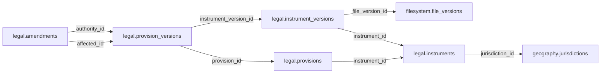

# legal — Phase 01

> **Phase 01 civic accountability scope agreed; table and column proposals remain unapproved.** No implementation is authorized by this documentation reorganization.

[Folder index](README.md) · [Full catalogue and relocation inventory](../README.md)

## Agreed responsibility — 12 November 2026

Legal instruments, provisions, amendments, versions and applicability; kept separate from Reference and Governance.

Legal remains a separate Phase 01 schema. Preserve stable instrument and provision identities, immutable wording versions, amendments/repeals and temporal, territorial, subject and personal applicability. Distinguish publication, enactment, commencement and effective dates; a citation alone does not establish compliance.

Governance and other domains reach legal foundations **through Reference**. Only Reference may hold incoming cross-schema links to Legal. Internal Legal relationships remain in Legal; Legal may retain its own source/file and geographic context links. Earlier reverse or direct domain legal-basis proposals in the historical material are superseded. Exact applicability tables and Reference bridge fields remain under review.

## Retained table proposals and review context

The following dictionaries preserve the earlier proposal inputs, adjusted for the agreed ownership above. They remain unapproved. Earlier inventories retain their measured names; collapsed historical sections do not override the 12 November decisions.

## Retained legal proposal

> **PROPOSED — USER REVIEW REQUIRED.** Schema assignment is agreed; proposed tables and columns still require review. No SQL or migration is authorized.

## Purpose and ownership

**Target:** Main. **Purpose:** Legal identity, text versions and authority. Schema placement follows the 12 November scope decision; individual table/column designs remain proposals. Related owners follow the agreed responsibility section above.

## Current implementation and gaps

The active manifest has 30 manifest migrations and 49 distinct CREATE TABLE declarations (49 distinct current table names) in schemas `audit`, `auth`, `engine`, `filesystem`, `geography`, `legal`, `objects`, `reference`. Generated Dryv has 124 entities (digest `e0087da9cf5b00e91f283a5501c368c7696bdd841ea30629231dc9c590f7c1ee`). Counts describe current artifacts, not target design; SQL and Dryv diverge.

- SQL declarations: `legal.instruments` (legal/0001_legal_minimum.sql), `legal.instrument_versions` (legal/0001_legal_minimum.sql), `legal.provisions` (legal/0001_legal_minimum.sql), `legal.provision_versions` (legal/0001_legal_minimum.sql)
- Dryv entities: `legal.amendments` (legal.LegalAmendment), `legal.changes` (legal.LegalAmendmentChange), `legal.links` (legal.LegalAuthorityLink), `legal.instruments` (legal.LegalInstrument), `legal.provisions` (legal.LegalProvision)

The inventory does not establish live database state and may miss ALTER-only changes. Before implementation, reconcile migrations, Dryv, generated output and callers.

## Proposed relationship map

> All nodes and edges are proposals. Main schemas may use local cross-schema foreign keys; no edge crosses the Main/Operations database boundary.

## Proposed table and column review

All tables and fields are hypothetical. Every proposed business column is listed; UUIDv7 `id` is a candidate default and remains open. Record every existing field disposition: KEEP / REMOVE / RENAME / MOVE / MERGE / SPLIT / DERIVE / ADD.

### `legal.instruments` — Stable legal instrument identity

- **Example:** A constitution
- **Profile:** entity; planning envelope below.

| Column | Proposed type | Meaning | Nullable | Default | Relationship | Units / validation | Proposed disposition |
|---|---|---|---|---|---|---|---|
| `id` | `uuid` | Proposed stable identity | No | Rust UUIDv7 candidate | Primary key | UUIDv7 candidate; unique and immutable after publication | KEEP (candidate match to current SQL/Dryv field; confirm meaning) |
| `title` | `text` | Official title | No | — | — | Nonblank when required; enforce domain-specific length, normalization and controlled vocabulary | KEEP (candidate match to current SQL/Dryv field; confirm meaning) |
| `jurisdiction_id` | `uuid` | Issuing jurisdiction | No | — | FK → `geography.jurisdictions` | UUID syntax; FK target must exist when the relationship is required | KEEP (candidate match to current SQL/Dryv field; confirm meaning) |
| `code` | `text` | Citation identity | No | — | — | Nonblank when required; enforce domain-specific length, normalization and controlled vocabulary | KEEP (candidate match to current SQL/Dryv field; confirm meaning) |
| `enacted_on` | `date` | Enactment date if known | Yes | — | — | Type checked; domain constraints and units must be approved for this field | ADD (proposed target field; pending user approval) |

- **Current SQL/Dryv fields without a proposed same-name column:** `content_hash`, `created_at`, `document_url`, `is_current`, `issuing_country_id`, `issuing_institution_id`, `kind_id`, `status`, `summary`, `updated_at`, `valid_from`, `valid_from_precision`, `valid_to`, `valid_to_precision`, `version`. **Disposition:** unresolved per field; propose KEEP, REMOVE, RENAME, MOVE, MERGE, SPLIT or DERIVE in review. Do not drop these fields until the user resolves each one.
- **FK action/cardinality:** Each non-null FK is many-to-one to its named target; nullable FKs are optional. Candidate delete/update behavior is RESTRICT/NO ACTION for accepted records; cascading canonical deletion is not proposed. Confirm uniqueness and exact behavior during review.
- **Constraints:** UNIQUE(jurisdiction_id,code). Exact keys and cross-field checks remain for review.
- **Indexes:** primary key on `id`; candidate B-tree indexes on FK columns `jurisdiction_id` for joins and referenced-entity filters; add temporal/spatial indexes only where the stated query needs them and benchmarks support them.
- **Relationships:** resolve each FK target. Main allows cross-schema FKs. Main and Operations have no cross-database FK.
- **Evidence/time:** preserve exact source/version, observation/retrieval time, historical context and uncertainty where applicable. Approve the exact evidence path for this table.
- **Growth/storage estimate (illustrative planning envelope, not measured):** Low: initial 1,000, +200/year, peak 20/day; five-year 2,000 rows ≈ 2.0 MiB live row+index budget; Expected: initial 10,000, +2,000/year, peak 200/day; five-year 20,000 rows ≈ 19.5 MiB live row+index budget; High: initial 100,000, +20,000/year, peak 2,000/day; five-year 200,000 rows ≈ 195.3 MiB live row+index budget. Model: initial rows + annual accepted rows × 5; multiply by a per-row budget of 1 KiB including a coarse index allowance. Replace assumptions with actual samples, ingest rates and `pg_total_relation_size` before approval. Large object bytes are excluded; WAL, replicas, backups and S3 are budgeted separately.
- **Workload:** Interactive lookup by identity and approved foreign keys; batch scans for import/reconciliation. Peak-day figure above is a scenario assumption, not a service-level commitment.
- **Partitioning:** None proposed initially; decide from measured scale/query plans. Check late data and partition count.
- **Files:** originals, full-resolution geometry, arrays, media and large exports may be immutable S3 objects. Keep searchable identity, required facts, hashes, coverage, access and provenance in PostgreSQL; use manifests and selective reads.
- **Retention/risks/benchmark:** preserve accepted evidence and corrections. Review late arrivals, contention, index/partition growth and recovery. Benchmark joins, filters, spatial access, ingestion bursts, concurrent access and interrupted publication.
### `legal.instrument_versions` — Exact source-backed legal releases

- **Example:** Consolidated text as published
- **Profile:** release; planning envelope below.

| Column | Proposed type | Meaning | Nullable | Default | Relationship | Units / validation | Proposed disposition |
|---|---|---|---|---|---|---|---|
| `id` | `uuid` | Proposed stable identity | No | Rust UUIDv7 candidate | Primary key | UUIDv7 candidate; unique and immutable after publication | KEEP (candidate match to current SQL/Dryv field; confirm meaning) |
| `instrument_id` | `uuid` | Instrument | No | — | FK → `legal.instruments` | UUID syntax; FK target must exist when the relationship is required | KEEP (candidate match to current SQL/Dryv field; confirm meaning) |
| `edition` | `text` | Version identifier | No | — | — | Nonblank when required; enforce domain-specific length, normalization and controlled vocabulary | ADD (proposed target field; pending user approval) |
| `commenced_on` | `date` | Legal force begins | Yes | — | — | Type checked; domain constraints and units must be approved for this field | KEEP (candidate match to current SQL/Dryv field; confirm meaning) |
| `ceased_on` | `date` | Legal force ends | Yes | — | — | Type checked; domain constraints and units must be approved for this field | ADD (proposed target field; pending user approval) |
| `file_version_id` | `uuid` | Official text | No | — | FK → `filesystem.file_versions` | UUID syntax; FK target must exist when the relationship is required | KEEP (candidate match to current SQL/Dryv field; confirm meaning) |

- **Current SQL/Dryv fields without a proposed same-name column:** `enacted_on`, `language_tag`, `observed_at`, `published_on`, `repealed_on`, `version_code`. **Disposition:** unresolved per field; propose KEEP, REMOVE, RENAME, MOVE, MERGE, SPLIT or DERIVE in review. Do not drop these fields until the user resolves each one.
- **FK action/cardinality:** Each non-null FK is many-to-one to its named target; nullable FKs are optional. Candidate delete/update behavior is RESTRICT/NO ACTION for accepted records; cascading canonical deletion is not proposed. Confirm uniqueness and exact behavior during review.
- **Constraints:** UNIQUE(instrument_id,edition); ceased_on >= commenced_on. Exact keys and cross-field checks remain for review.
- **Indexes:** primary key on `id`; candidate B-tree indexes on FK columns `instrument_id`, `file_version_id` for joins and referenced-entity filters; add temporal/spatial indexes only where the stated query needs them and benchmarks support them.
- **Relationships:** resolve each FK target. Main allows cross-schema FKs. Main and Operations have no cross-database FK.
- **Evidence/time:** preserve exact source/version, observation/retrieval time, historical context and uncertainty where applicable. Approve the exact evidence path for this table.
- **Growth/storage estimate (illustrative planning envelope, not measured):** Low: initial 100, +20/year, peak 10/day; five-year 200 rows ≈ 0.4 MiB live row+index budget; Expected: initial 1,000, +200/year, peak 100/day; five-year 2,000 rows ≈ 3.9 MiB live row+index budget; High: initial 10,000, +2,000/year, peak 1,000/day; five-year 20,000 rows ≈ 39.1 MiB live row+index budget. Model: initial rows + annual accepted rows × 5; multiply by a per-row budget of 2 KiB including a coarse index allowance. Replace assumptions with actual samples, ingest rates and `pg_total_relation_size` before approval. Large object bytes are excluded; WAL, replicas, backups and S3 are budgeted separately.
- **Workload:** Interactive lookup by identity and approved foreign keys; batch scans for import/reconciliation. Peak-day figure above is a scenario assumption, not a service-level commitment.
- **Partitioning:** No partition approved. Benchmark first; time range is a candidate for append-heavy observations, and keys must include partition columns. Releases are normally unpartitioned unless measured need appears. Check late data and partition count.
- **Files:** originals, full-resolution geometry, arrays, media and large exports may be immutable S3 objects. Keep searchable identity, required facts, hashes, coverage, access and provenance in PostgreSQL; use manifests and selective reads.
- **Retention/risks/benchmark:** preserve accepted evidence and corrections. Review late arrivals, contention, index/partition growth and recovery. Benchmark joins, filters, spatial access, ingestion bursts, concurrent access and interrupted publication.
### `legal.provisions` — Stable sections within an instrument

- **Example:** Article on county government
- **Profile:** entity; planning envelope below.

| Column | Proposed type | Meaning | Nullable | Default | Relationship | Units / validation | Proposed disposition |
|---|---|---|---|---|---|---|---|
| `id` | `uuid` | Proposed stable identity | No | Rust UUIDv7 candidate | Primary key | UUIDv7 candidate; unique and immutable after publication | KEEP (candidate match to current SQL/Dryv field; confirm meaning) |
| `instrument_id` | `uuid` | Parent instrument | No | — | FK → `legal.instruments` | UUID syntax; FK target must exist when the relationship is required | KEEP (candidate match to current SQL/Dryv field; confirm meaning) |
| `code` | `text` | Section identifier | No | — | — | Nonblank when required; enforce domain-specific length, normalization and controlled vocabulary | KEEP (candidate match to current SQL/Dryv field; confirm meaning) |
| `heading` | `text` | Section heading | No | — | — | Nonblank when required; enforce domain-specific length, normalization and controlled vocabulary | KEEP (candidate match to current SQL/Dryv field; confirm meaning) |

- **Current SQL/Dryv fields without a proposed same-name column:** `citation`, `content`, `created_at`, `is_current`, `kind`, `parent_id`, `previous_version_id`, `sort_order`, `title`, `updated_at`, `valid_from`, `valid_from_precision`, `valid_to`, `valid_to_precision`, `version`. **Disposition:** unresolved per field; propose KEEP, REMOVE, RENAME, MOVE, MERGE, SPLIT or DERIVE in review. Do not drop these fields until the user resolves each one.
- **FK action/cardinality:** Each non-null FK is many-to-one to its named target; nullable FKs are optional. Candidate delete/update behavior is RESTRICT/NO ACTION for accepted records; cascading canonical deletion is not proposed. Confirm uniqueness and exact behavior during review.
- **Constraints:** UNIQUE(instrument_id,code). Exact keys and cross-field checks remain for review.
- **Indexes:** primary key on `id`; candidate B-tree indexes on FK columns `instrument_id` for joins and referenced-entity filters; add temporal/spatial indexes only where the stated query needs them and benchmarks support them.
- **Relationships:** resolve each FK target. Main allows cross-schema FKs. Main and Operations have no cross-database FK.
- **Evidence/time:** preserve exact source/version, observation/retrieval time, historical context and uncertainty where applicable. Approve the exact evidence path for this table.
- **Growth/storage estimate (illustrative planning envelope, not measured):** Low: initial 1,000, +200/year, peak 20/day; five-year 2,000 rows ≈ 2.0 MiB live row+index budget; Expected: initial 10,000, +2,000/year, peak 200/day; five-year 20,000 rows ≈ 19.5 MiB live row+index budget; High: initial 100,000, +20,000/year, peak 2,000/day; five-year 200,000 rows ≈ 195.3 MiB live row+index budget. Model: initial rows + annual accepted rows × 5; multiply by a per-row budget of 1 KiB including a coarse index allowance. Replace assumptions with actual samples, ingest rates and `pg_total_relation_size` before approval. Large object bytes are excluded; WAL, replicas, backups and S3 are budgeted separately.
- **Workload:** Interactive lookup by identity and approved foreign keys; batch scans for import/reconciliation. Peak-day figure above is a scenario assumption, not a service-level commitment.
- **Partitioning:** None proposed initially; decide from measured scale/query plans. Check late data and partition count.
- **Files:** originals, full-resolution geometry, arrays, media and large exports may be immutable S3 objects. Keep searchable identity, required facts, hashes, coverage, access and provenance in PostgreSQL; use manifests and selective reads.
- **Retention/risks/benchmark:** preserve accepted evidence and corrections. Review late arrivals, contention, index/partition growth and recovery. Benchmark joins, filters, spatial access, ingestion bursts, concurrent access and interrupted publication.
### `legal.provision_versions` — Versioned provision wording

- **Example:** Exact wording of one article
- **Profile:** release; planning envelope below.

| Column | Proposed type | Meaning | Nullable | Default | Relationship | Units / validation | Proposed disposition |
|---|---|---|---|---|---|---|---|
| `id` | `uuid` | Proposed stable identity | No | Rust UUIDv7 candidate | Primary key | UUIDv7 candidate; unique and immutable after publication | KEEP (candidate match to current SQL/Dryv field; confirm meaning) |
| `provision_id` | `uuid` | Stable section | No | — | FK → `legal.provisions` | UUID syntax; FK target must exist when the relationship is required | KEEP (candidate match to current SQL/Dryv field; confirm meaning) |
| `instrument_version_id` | `uuid` | Matching instrument release | No | — | FK → `legal.instrument_versions` | UUID syntax; FK target must exist when the relationship is required | KEEP (candidate match to current SQL/Dryv field; confirm meaning) |
| `body` | `text` | Accepted extracted legal text | No | — | — | Nonblank when required; enforce domain-specific length, normalization and controlled vocabulary | ADD (proposed target field; pending user approval) |

- **Current SQL/Dryv fields without a proposed same-name column:** `effective_period`, `file_version_id`, `instrument_id`, `observed_at`, `text_locator`. **Disposition:** unresolved per field; propose KEEP, REMOVE, RENAME, MOVE, MERGE, SPLIT or DERIVE in review. Do not drop these fields until the user resolves each one.
- **FK action/cardinality:** Each non-null FK is many-to-one to its named target; nullable FKs are optional. Candidate delete/update behavior is RESTRICT/NO ACTION for accepted records; cascading canonical deletion is not proposed. Confirm uniqueness and exact behavior during review.
- **Constraints:** UNIQUE(provision_id,instrument_version_id); parents must share instrument. Exact keys and cross-field checks remain for review.
- **Indexes:** primary key on `id`; candidate B-tree indexes on FK columns `provision_id`, `instrument_version_id` for joins and referenced-entity filters; add temporal/spatial indexes only where the stated query needs them and benchmarks support them.
- **Relationships:** resolve each FK target. Main allows cross-schema FKs. Main and Operations have no cross-database FK.
- **Evidence/time:** preserve exact source/version, observation/retrieval time, historical context and uncertainty where applicable. Approve the exact evidence path for this table.
- **Growth/storage estimate (illustrative planning envelope, not measured):** Low: initial 100, +20/year, peak 10/day; five-year 200 rows ≈ 0.4 MiB live row+index budget; Expected: initial 1,000, +200/year, peak 100/day; five-year 2,000 rows ≈ 3.9 MiB live row+index budget; High: initial 10,000, +2,000/year, peak 1,000/day; five-year 20,000 rows ≈ 39.1 MiB live row+index budget. Model: initial rows + annual accepted rows × 5; multiply by a per-row budget of 2 KiB including a coarse index allowance. Replace assumptions with actual samples, ingest rates and `pg_total_relation_size` before approval. Large object bytes are excluded; WAL, replicas, backups and S3 are budgeted separately.
- **Workload:** Interactive lookup by identity and approved foreign keys; batch scans for import/reconciliation. Peak-day figure above is a scenario assumption, not a service-level commitment.
- **Partitioning:** No partition approved. Benchmark first; time range is a candidate for append-heavy observations, and keys must include partition columns. Releases are normally unpartitioned unless measured need appears. Check late data and partition count.
- **Files:** originals, full-resolution geometry, arrays, media and large exports may be immutable S3 objects. Keep searchable identity, required facts, hashes, coverage, access and provenance in PostgreSQL; use manifests and selective reads.
- **Retention/risks/benchmark:** preserve accepted evidence and corrections. Review late arrivals, contention, index/partition growth and recovery. Benchmark joins, filters, spatial access, ingestion bursts, concurrent access and interrupted publication.
### `legal.amendments` — Changes made by legal authority

- **Example:** Act replaces a provision
- **Profile:** relation; planning envelope below.

| Column | Proposed type | Meaning | Nullable | Default | Relationship | Units / validation | Proposed disposition |
|---|---|---|---|---|---|---|---|
| `id` | `uuid` | Proposed stable identity | No | Rust UUIDv7 candidate | Primary key | UUIDv7 candidate; unique and immutable after publication | KEEP (candidate match to current SQL/Dryv field; confirm meaning) |
| `authority_id` | `uuid` | Amending provision | No | — | FK → `legal.provision_versions` | UUID syntax; FK target must exist when the relationship is required | ADD (proposed target field; pending user approval) |
| `affected_id` | `uuid` | Affected wording | No | — | FK → `legal.provision_versions` | UUID syntax; FK target must exist when the relationship is required | ADD (proposed target field; pending user approval) |
| `operation` | `text` | insert replace repeal | No | — | — | Nonblank when required; enforce domain-specific length, normalization and controlled vocabulary | ADD (proposed target field; pending user approval) |
| `effective_on` | `date` | Effective date | Yes | — | — | Type checked; domain constraints and units must be approved for this field | ADD (proposed target field; pending user approval) |

- **Current SQL/Dryv fields without a proposed same-name column:** `amending_instrument_id`, `code`, `created_at`, `instrument_id`, `is_current`, `summary`, `updated_at`, `valid_from`, `valid_from_precision`, `valid_to`, `valid_to_precision`, `version`. **Disposition:** unresolved per field; propose KEEP, REMOVE, RENAME, MOVE, MERGE, SPLIT or DERIVE in review. Do not drop these fields until the user resolves each one.
- **FK action/cardinality:** Each non-null FK is many-to-one to its named target; nullable FKs are optional. Candidate delete/update behavior is RESTRICT/NO ACTION for accepted records; cascading canonical deletion is not proposed. Confirm uniqueness and exact behavior during review.
- **Constraints:** authority_id != affected_id. Exact keys and cross-field checks remain for review.
- **Indexes:** primary key on `id`; candidate B-tree indexes on FK columns `authority_id`, `affected_id` for joins and referenced-entity filters; add temporal/spatial indexes only where the stated query needs them and benchmarks support them.
- **Relationships:** resolve each FK target. Main allows cross-schema FKs. Main and Operations have no cross-database FK.
- **Evidence/time:** preserve exact source/version, observation/retrieval time, historical context and uncertainty where applicable. Approve the exact evidence path for this table.
- **Growth/storage estimate (illustrative planning envelope, not measured):** Low: initial 1,000, +2,000/year, peak 100/day; five-year 11,000 rows ≈ 10.7 MiB live row+index budget; Expected: initial 10,000, +20,000/year, peak 1,000/day; five-year 110,000 rows ≈ 107.4 MiB live row+index budget; High: initial 100,000, +200,000/year, peak 10,000/day; five-year 1,100,000 rows ≈ 1,074.2 MiB live row+index budget. Model: initial rows + annual accepted rows × 5; multiply by a per-row budget of 1 KiB including a coarse index allowance. Replace assumptions with actual samples, ingest rates and `pg_total_relation_size` before approval. Large object bytes are excluded; WAL, replicas, backups and S3 are budgeted separately.
- **Workload:** Interactive lookup by identity and approved foreign keys; batch scans for import/reconciliation. Peak-day figure above is a scenario assumption, not a service-level commitment.
- **Partitioning:** None proposed initially; decide from measured scale/query plans. Check late data and partition count.
- **Files:** originals, full-resolution geometry, arrays, media and large exports may be immutable S3 objects. Keep searchable identity, required facts, hashes, coverage, access and provenance in PostgreSQL; use manifests and selective reads.
- **Retention/risks/benchmark:** preserve accepted evidence and corrections. Review late arrivals, contention, index/partition growth and recovery. Benchmark joins, filters, spatial access, ingestion bursts, concurrent access and interrupted publication.

## Queries, lifecycle, capacity and approval

**Representative query:** Which provision in force authorized this office?

Lifecycle: preserve source bytes; extract into candidate revisions; validate; review or use approved deterministic checks; atomically publish; serve. Corrections create explicit versions/supersession. Preserve disagreement and uncertainty.

Capacity is unmeasured. Use low/expected/high input scenarios, explicit formulas and workload benchmarks; do not assume sizes or universal partitions.

**Status:** NOT REVIEWED. Schema assignment follows the handoff; tables, columns, relationships, partitioning and S3 choices still require user approval. Feedback: none. Approval reference/date/revision: none. Implementation authorization: not granted. Material changes reopen approval.

Earlier schema proposal preserved for history; superseded and not an approval

---
id: DOC-F63B18A2C705
name: Neutral global legal domain and law-driven generation
type: documentation
tags: [improvements, schema-redesign, legal, planning]
extra: {status: planning_only, implementation: not_approved}
---

> **11 November 2026 precedence:** the connected foundation update at the end of this document supersedes conflicting jurisdiction, compatibility and cross-domain assumptions in the historical proposal below. Detailed table names remain design candidates; task 03 is prepared for design work, not a claim of completed implementation.

# Neutral global legal domain and law-driven generation

**Planning only. Not approved for code changes or Taskcode task creation.** The user will direct the order of final design review and later tasks. All physical table/column changes below are proposals, not authorized migrations.

## 1. Current domain, user intent and boundaries

Keep `legal` recognizable but make it understandable, neutral and internationally applicable. The user requires connections to constitutions, Acts, Bills, laws, provisions, legislative processes, amendments, authority for ministries/offices and evidence of real activities. Model laws over time, without assuming every country has the same Parliament, legal hierarchy, customary-law treatment or assent procedure.

Distinguish identity and versions of legal instruments; draft/proposal ≠ enacted instrument; passing/assent/commencement/publication ≠ identical event; legislation that establishes an office ≠ evidence that a person currently occupies the office. Legal models must be auditable by jurisdiction and time.

## 2. Current database table and column inventory

These **real migration-declared** table/column names are from `.docs/_archives/2026-11-08-rewrite-snapshot/source/backend/engine/database/migrations/1793607856459-initial.ts` and relevant subsequent CREATE-table migrations. They form the **baseline**, not a certified live/current column audit: later ALTER migrations, current TypeORM entities and deployed schema may add/remove/rename fields. Compare against `source/backend/api/src/modules/`, Dryv and PostgreSQL before finalizing any column decision. This document deliberately does not invent exact types/FKs not yet checked against live metadata.

| Existing table | Columns declared at initial CREATE TABLE (baseline) |
|---|---|
| `legal.amendments` | `id`, `amending_instrument_id`, `code`, `created_at`, `instrument_id`, `is_current`, `summary`, `updated_at`, `valid_from`, `valid_from_precision`, `valid_to`, `valid_to_precision`, `version` |
| `legal.changes` | `id`, `amendment_id`, `created_at`, `is_current`, `kind`, `new_text`, `previous_text`, `provision_id`, `updated_at`, `valid_from`, `valid_from_precision`, `valid_to`, `valid_to_precision`, `version` |
| `legal.instruments` | `id`, `code`, `content_hash`, `created_at`, `document_url`, `is_current`, `issuing_institution_id`, `jurisdiction_id`, `kind_id`, `status`, `summary`, `title`, `updated_at`, `valid_from`, `valid_from_precision`, `valid_to`, `valid_to_precision`, `version` |
| `legal.links` | `id`, `created_at`, `is_current`, `note`, `provision_id`, `target_id`, `target_kind`, `updated_at`, `valid_from`, `valid_from_precision`, `valid_to`, `valid_to_precision`, `version` |
| `legal.provisions` | `id`, `citation`, `code`, `content`, `created_at`, `heading`, `instrument_id`, `is_current`, `kind`, `parent_id`, `previous_version_id`, `sort_order`, `updated_at`, `valid_from`, `valid_from_precision`, `valid_to`, `valid_to_precision`, `version` |

## 3. Potential target table responsibilities — **proposals only**

| Current or candidate | Meaning / possible change |
|---|---|
| `instruments` | Constitutions, statutes, regulations, orders, treaties and other legal instruments; review kind/status/version and jurisdiction. |
| `provisions` | Numbered articles, sections, parts and schedules with stable identity and dated text versions. |
| `amendments` and `changes` | Track instrument-wide amendment events separately from specific provision replacements, insertions, repeals and retroactive applicability. |
| `links` | Typed legal basis, enactment and instrument–instrument relations with explicit links to compatible target tables where possible. |
| `proposals` / `bills` (proposed) | Jurisdiction-neutral proposed instrument/change; may never become law. |
| `processes` / `proceedings` (proposed) | Actual lawmaking processes and dated readings, committee actions, votes, assent etc. |
| `process_definitions` (proposed) | Versioned process patterns defined by jurisdiction and institution type. |
| `rules` / `applicability` (proposed) | Formalized establishment/authorization obligations and their geographic/institutional reach. |

## 4. Strong relationships, geography, law and query design

Prefer **real FK**: `legal.provisions.instrument_id`, dated `legal.amendments.instrument_id`, `governance.rules.legal_basis_id` (or a well-typed junction to provisions), `governance.institutions` establishment and `procurement` relevant law where factually applicable. A pattern rule can carry the establishing provision, while generated offices retain traced pattern lineage; do not add identical law IDs to every generated row by reflex. Build typed relationships such as established_by, authorized_by, repealed_by and regulated_by, with temporal semantics. Be careful not to equate cited legal basis with regulatory compliance.

## 5. Four-class acquisition, patterns and traceability

**Static seeded:** canonical constitutional/instrument identities, curated legal hierarchies and jurisdiction procedure definitions. **Pattern seeded:** versioned office/service/legal process rules. **Automated collected:** enacted bills, gazettes, law updates, provisions and dated proceedings from approved sources. **Derived:** effective-law timelines, impacted office patterns, legal coverage or historical snapshots. Original legal text remains evidence in `source`/`filesystem`, linked to versioned provisions, not overwritten.

For all retained/new tables, add concise PostgreSQL **schema/table/column comments**, plus a maintained Markdown/table registry describing each column's meaning, nullability decision, allowed acquisition classes and expected pattern/automated inputs. Record per-row origin via traceable lineage and real FKs where structurally possible. Do not treat a table's class eligibility as every row's origin.

## 6. Query scenarios the design must support

What provision authorized a ministry in 2019? Which offices were generated from a statutory rule and which are directly observed? Is a proposed Bill enacted, pending, withdrawn or superseded? Which law version applied at an election/contract date? What legal amendment changed the expected number/type of positions? What other jurisdictions use a different lawmaking path?

## 7. Migration, preservation, integrity and compatibility

Audit current instrument `kind_id`, `jurisdiction_id`, `issuing_institution_id` and `legal.links` polymorphic references; distinguish stable IDs from version numbers and `content_hash` of legal text. Separate source-publication facts from legal effective dates. Implement actual FKs as appropriate across `reference`, `governance` and `legal`, with optional typed links. Revise Dryv contracts and importers with historical continuity, no one-off Kenya enum.

Global requirements: check live data, orphans, actual FK constraints, indexes and enum/lookup validity; reconcile every old→new table/column; preserve historical identities, evidence, versioning and record counts; update Dryv, API, ingestion and filesystem references with migrations only after explicit user approval. Never rewrite canonical facts to make a schema migration pass.

## 8. Decisions the user has not yet approved

1. Which legal process concepts genuinely need standalone tables vs `activity` events?
2. How to model legal hierarchy, customary/historical legal sources and treaties across jurisdictions?
3. Where should effect/commencement and retroactive dates live?
4. What can be pattern-generated from a law, versus requiring independent evidence?
5. Should a law/provision FK point at a stable identity or a specific published version?
6. What automatic amendment detection and review policies are acceptable?

## 9. Related planning resources and decision status

See [master register](../../mzizi-data-schema-storage-and-pipelines-redesign.md), [schema review index](../README.md), [data classes/patterns](../../data-categories-and-patterns.md), and [independent pipelines](../../independent-data-pipelines.md). **Any preference noted here is a planning recommendation; the user decides the final schema/table/column specification and authorizes tasks one at a time.**

## Human review — editable user notes and design sign-off

**Review status:** `NOT REVIEWED` — AI-authored proposals in this document are not final approval.

**In my own words, what this schema should represent and exclude:**

> _My understanding and questions:_

**Tables/columns I want to keep, rename, move, merge, split, remove or add (and why):**

> _My proposed changes and alternative names:_

**Hard foreign keys, geographical and legal scope, pattern generation, classification and evidence I want changed or explained:**

> _My technical feedback, disagreements and alternatives:_

**Real data and queries I want to use to validate this design:**

> _My examples and expected results:_

**Unresolved decisions I want to discuss further:**

> _My remaining questions:_

**Final user decision:** `NOT DECIDED` / `NEEDS CHANGES` / `DESIGN VALIDATED BY USER` / `APPROVED FOR TASK PLANNING`.

**Approval reference and date:** _None. Only record explicit later user authorization. Even design validation does not authorize code, migration or Taskcode task creation._

## Mandatory per-table temporal, rigid-column and deletion review (2026-11-07)

**USER REQUIREMENT; planning only.** Examine every existing/proposed field and expressly record **KEEP / REMOVE / DERIVE / MOVE / RENAME / ADD** for `valid_from`, `valid_to`, `valid_from_precision`, `valid_to_precision`, `is_current`, `status`, `version`, `created_at`, `updated_at` and other copied/rigid flags. These fields are **opt-in by justified meaning**, not blanket schema conventions. Assess `deleted_at` only for recoverable soft deletion where appropriate. The full policy and migration/approval checklist is in [schema redesign README](../README.md).

**Domain-specific guidance:** A law may have enacted, commenced, amended, repealed and published dates with distinct meanings; avoid generic valid_from/to on every provision. Provision versions can inherit effective context from the instrument but may have independent amendment history. Legal currentness is an as-of legal query; historical or approximate dates merit precision only where evidenced. No ordinary trash deletion of enacted legal history.

**OPEN for human review:** exact per-table/column disposition, derived status and as-of queries, pattern/legal links, justified precision, recoverable deletion versus domain lifecycle, history/identity preservation and hard-FK impact. No code or migration is authorized.

## 2026-11-11 — Connected foundation direction (controlling for task 03)

Separate stable legal instruments/provisions, their textual versions/languages, legal effect periods and exact filesystem evidence. Typed domain-specific associations can link offices, institutions, structured rules, electoral rules, political requirements and geographic changes to multiple precise provision versions. Basis roles distinguish establishment, powers, selection and boundary alteration. Do not duplicate contradictory legal support through both rule and entity links without an authority policy; do not claim `target_kind + target_id` provides referential integrity.

Territorial, personal, subject and temporal applicability differ. Spatial inclusion alone cannot establish applicable law, and cited support is not proof of compliance or settled interpretation. Extracted text is not executable behavior; reviewed structured rules and registered handlers implement supported behavior. Historical/customary/de facto institutions may have non-statutory documented bases and must not be assigned invented constitutional support. Task 03 defines the minimal legal interface/bootstrap order and proof cases; task 04 finalizes full instruments/provisions/processes and downstream legal associations.

Read [the connected foundation](../../connected-reference-geography-legal-foundation.md) for the decisions, candidate models, query examples, proof cases and primary research sources. Fresh construction in `mzizi_new` has no legacy database ID/data compatibility requirement; existing S3 evidence remains protected. This update records accepted direction and design deliverables, not final DDL or broad implementation authorization.

## 2026-11-11 — System-expansion alignment

The expanded domains retain typed, direct legal-basis links where legal authority is a real relationship; the broader topic list does not create automatic legal FKs or implied applicability. See the [system-expansion proposal](../../advancement-and-system-expansion.md). This alignment note does not approve proposed schemas, tables or implementation.

