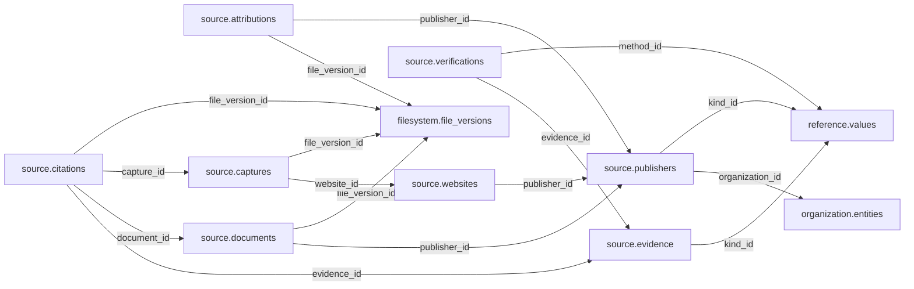

# source schema — review and approval proposal

> **PROPOSED — USER REVIEW REQUIRED.** This is the review authority for whether the schema should exist and which tables/columns it owns. No SQL or migration is authorized.

## Purpose and ownership

**Target:** Main. **Purpose:** Verified publisher/site identities and claim evidence. This separate schema is a proposal based on distinct lifecycle, vocabulary and queries; merging or rejection remains open. Related owners: filesystem,organization,reference.

## Current implementation and gaps

The active manifest has 30 manifest migrations and 49 distinct CREATE TABLE declarations (49 distinct current table names) in schemas `audit`, `auth`, `engine`, `filesystem`, `geography`, `legal`, `objects`, `reference`. Generated Dryv has 124 entities (digest `e0087da9cf5b00e91f283a5501c368c7696bdd841ea30629231dc9c590f7c1ee`). Counts describe current artifacts, not target design; SQL and Dryv diverge.

- SQL declarations: None found.
- Dryv entities: `source.attributions` (source.Attribution), `source.captures` (source.Capture), `source.documents` (source.Document), `source.document_classifications` (source.DocumentClassification), `source.methods` (source.Method), `source.publishers` (source.Publisher), `source.verifications` (source.Verification)

The inventory does not establish live database state and may miss ALTER-only changes. Before implementation, reconcile migrations, Dryv, generated output and callers.

## Proposed relationship map

> All nodes and edges are proposals. Main schemas may use local cross-schema foreign keys; no edge crosses the Main/Operations database boundary.

## Proposed table and column review

All tables and fields are hypothetical. Every proposed business column is listed; UUIDv7 `id` is a candidate default and remains open. Record every existing field disposition: KEEP / REMOVE / RENAME / MOVE / MERGE / SPLIT / DERIVE / ADD.

### `source.publishers` — Verified publishing organization/site

- **Example:** Statistics agency
- **Profile:** entity; planning envelope below.

| Column | Proposed type | Meaning | Nullable | Default | Relationship | Units / validation | Proposed disposition |
|---|---|---|---|---|---|---|---|
| `id` | `uuid` | Proposed stable identity | No | Rust UUIDv7 candidate | Primary key | UUIDv7 candidate; unique and immutable after publication | KEEP (candidate match to current SQL/Dryv field; confirm meaning) |
| `organization_id` | `uuid` | Legal publisher | Yes | — | FK → `organization.entities` | UUID syntax; FK target must exist when the relationship is required | ADD (proposed target field; pending user approval) |
| `name` | `text` | Accepted public source name | No | — | — | Nonblank when required; enforce domain-specific length, normalization and controlled vocabulary | KEEP (candidate match to current SQL/Dryv field; confirm meaning) |
| `kind_id` | `uuid` | Publisher type | No | — | FK → `reference.values` | UUID syntax; FK target must exist when the relationship is required | KEEP (candidate match to current SQL/Dryv field; confirm meaning) |
| `trust_basis` | `text` | Verification basis | No | — | — | Nonblank when required; enforce domain-specific length, normalization and controlled vocabulary | ADD (proposed target field; pending user approval) |

- **Current SQL/Dryv fields without a proposed same-name column:** `code`, `created_at`, `jurisdiction_id`, `reliability`, `updated_at`, `version`, `website_url`. **Disposition:** unresolved per field; propose KEEP, REMOVE, RENAME, MOVE, MERGE, SPLIT or DERIVE in review. Do not drop these fields until the user resolves each one.
- **FK action/cardinality:** Each non-null FK is many-to-one to its named target; nullable FKs are optional. Candidate delete/update behavior is RESTRICT/NO ACTION for accepted records; cascading canonical deletion is not proposed. Confirm uniqueness and exact behavior during review.
- **Constraints:** Trust is scoped and revisable, not a universal authority score. Exact keys and cross-field checks remain for review.
- **Indexes:** primary key on `id`; candidate B-tree indexes on FK columns `organization_id`, `kind_id` for joins and referenced-entity filters; add temporal/spatial indexes only where the stated query needs them and benchmarks support them.
- **Relationships:** resolve each FK target. Main allows cross-schema FKs. Main and Operations have no cross-database FK.
- **Evidence/time:** preserve exact source/version, observation/retrieval time, historical context and uncertainty where applicable. Approve the exact evidence path for this table.
- **Growth/storage estimate (illustrative planning envelope, not measured):** Low: initial 1,000, +200/year, peak 20/day; five-year 2,000 rows ≈ 2.0 MiB live row+index budget; Expected: initial 10,000, +2,000/year, peak 200/day; five-year 20,000 rows ≈ 19.5 MiB live row+index budget; High: initial 100,000, +20,000/year, peak 2,000/day; five-year 200,000 rows ≈ 195.3 MiB live row+index budget. Model: initial rows + annual accepted rows × 5; multiply by a per-row budget of 1 KiB including a coarse index allowance. Replace assumptions with actual samples, ingest rates and `pg_total_relation_size` before approval. Large object bytes are excluded; WAL, replicas, backups and S3 are budgeted separately.
- **Workload:** Interactive lookup by identity and approved foreign keys; batch scans for import/reconciliation. Peak-day figure above is a scenario assumption, not a service-level commitment.
- **Partitioning:** None proposed initially; decide from measured scale/query plans. Check late data and partition count.
- **Files:** originals, full-resolution geometry, arrays, media and large exports may be immutable S3 objects. Keep searchable identity, required facts, hashes, coverage, access and provenance in PostgreSQL; use manifests and selective reads.
- **Retention/risks/benchmark:** preserve accepted evidence and corrections. Review late arrivals, contention, index/partition growth and recovery. Benchmark joins, filters, spatial access, ingestion bursts, concurrent access and interrupted publication.
### `source.websites` — Accepted source website identity

- **Example:** Official government portal
- **Profile:** entity; planning envelope below.

| Column | Proposed type | Meaning | Nullable | Default | Relationship | Units / validation | Proposed disposition |
|---|---|---|---|---|---|---|---|
| `id` | `uuid` | Proposed stable identity | No | Rust UUIDv7 candidate | Primary key | UUIDv7 candidate; unique and immutable after publication | ADD (proposed target field; pending user approval) |
| `publisher_id` | `uuid` | Publisher | Yes | — | FK → `source.publishers` | UUID syntax; FK target must exist when the relationship is required | ADD (proposed target field; pending user approval) |
| `origin` | `text` | Normalized origin | No | — | — | Nonblank when required; enforce domain-specific length, normalization and controlled vocabulary | ADD (proposed target field; pending user approval) |
| `verified_at` | `timestamptz` | Verification time | No | — | — | Type checked; domain constraints and units must be approved for this field | ADD (proposed target field; pending user approval) |
| `access_basis` | `text` | Policy/licence basis | No | — | — | Nonblank when required; enforce domain-specific length, normalization and controlled vocabulary | ADD (proposed target field; pending user approval) |

- **FK action/cardinality:** Each non-null FK is many-to-one to its named target; nullable FKs are optional. Candidate delete/update behavior is RESTRICT/NO ACTION for accepted records; cascading canonical deletion is not proposed. Confirm uniqueness and exact behavior during review.
- **Constraints:** UNIQUE(origin); ownership and domain changes evidenced. Exact keys and cross-field checks remain for review.
- **Indexes:** primary key on `id`; candidate B-tree indexes on FK columns `publisher_id` for joins and referenced-entity filters; add temporal/spatial indexes only where the stated query needs them and benchmarks support them.
- **Relationships:** resolve each FK target. Main allows cross-schema FKs. Main and Operations have no cross-database FK.
- **Evidence/time:** preserve exact source/version, observation/retrieval time, historical context and uncertainty where applicable. Approve the exact evidence path for this table.
- **Growth/storage estimate (illustrative planning envelope, not measured):** Low: initial 1,000, +200/year, peak 20/day; five-year 2,000 rows ≈ 2.0 MiB live row+index budget; Expected: initial 10,000, +2,000/year, peak 200/day; five-year 20,000 rows ≈ 19.5 MiB live row+index budget; High: initial 100,000, +20,000/year, peak 2,000/day; five-year 200,000 rows ≈ 195.3 MiB live row+index budget. Model: initial rows + annual accepted rows × 5; multiply by a per-row budget of 1 KiB including a coarse index allowance. Replace assumptions with actual samples, ingest rates and `pg_total_relation_size` before approval. Large object bytes are excluded; WAL, replicas, backups and S3 are budgeted separately.
- **Workload:** Interactive lookup by identity and approved foreign keys; batch scans for import/reconciliation. Peak-day figure above is a scenario assumption, not a service-level commitment.
- **Partitioning:** None proposed initially; decide from measured scale/query plans. Check late data and partition count.
- **Files:** originals, full-resolution geometry, arrays, media and large exports may be immutable S3 objects. Keep searchable identity, required facts, hashes, coverage, access and provenance in PostgreSQL; use manifests and selective reads.
- **Retention/risks/benchmark:** preserve accepted evidence and corrections. Review late arrivals, contention, index/partition growth and recovery. Benchmark joins, filters, spatial access, ingestion bursts, concurrent access and interrupted publication.
### `source.documents` — Published source document identity

- **Example:** Official PDF
- **Profile:** entity; planning envelope below.

| Column | Proposed type | Meaning | Nullable | Default | Relationship | Units / validation | Proposed disposition |
|---|---|---|---|---|---|---|---|
| `id` | `uuid` | Proposed stable identity | No | Rust UUIDv7 candidate | Primary key | UUIDv7 candidate; unique and immutable after publication | KEEP (candidate match to current SQL/Dryv field; confirm meaning) |
| `publisher_id` | `uuid` | Publisher | No | — | FK → `source.publishers` | UUID syntax; FK target must exist when the relationship is required | KEEP (candidate match to current SQL/Dryv field; confirm meaning) |
| `file_version_id` | `uuid` | Exact artifact | No | — | FK → `filesystem.file_versions` | UUID syntax; FK target must exist when the relationship is required | ADD (proposed target field; pending user approval) |
| `title` | `text` | Publisher title | No | — | — | Nonblank when required; enforce domain-specific length, normalization and controlled vocabulary | KEEP (candidate match to current SQL/Dryv field; confirm meaning) |
| `published_on` | `date` | Publication date | Yes | — | — | Type checked; domain constraints and units must be approved for this field | KEEP (candidate match to current SQL/Dryv field; confirm meaning) |
| `source_identifier` | `text` | Publisher ID | Yes | — | — | Nonblank when required; enforce domain-specific length, normalization and controlled vocabulary | ADD (proposed target field; pending user approval) |

- **Current SQL/Dryv fields without a proposed same-name column:** `citation`, `created_at`, `jurisdiction_id`, `kind_id`, `language`, `licence`, `published_on_precision`, `site_id`, `updated_at`, `url`, `version`. **Disposition:** unresolved per field; propose KEEP, REMOVE, RENAME, MOVE, MERGE, SPLIT or DERIVE in review. Do not drop these fields until the user resolves each one.
- **FK action/cardinality:** Each non-null FK is many-to-one to its named target; nullable FKs are optional. Candidate delete/update behavior is RESTRICT/NO ACTION for accepted records; cascading canonical deletion is not proposed. Confirm uniqueness and exact behavior during review.
- **Constraints:** Unique publisher/source identifier where available. Exact keys and cross-field checks remain for review.
- **Indexes:** primary key on `id`; candidate B-tree indexes on FK columns `publisher_id`, `file_version_id` for joins and referenced-entity filters; add temporal/spatial indexes only where the stated query needs them and benchmarks support them.
- **Relationships:** resolve each FK target. Main allows cross-schema FKs. Main and Operations have no cross-database FK.
- **Evidence/time:** preserve exact source/version, observation/retrieval time, historical context and uncertainty where applicable. Approve the exact evidence path for this table.
- **Growth/storage estimate (illustrative planning envelope, not measured):** Low: initial 1,000, +200/year, peak 20/day; five-year 2,000 rows ≈ 2.0 MiB live row+index budget; Expected: initial 10,000, +2,000/year, peak 200/day; five-year 20,000 rows ≈ 19.5 MiB live row+index budget; High: initial 100,000, +20,000/year, peak 2,000/day; five-year 200,000 rows ≈ 195.3 MiB live row+index budget. Model: initial rows + annual accepted rows × 5; multiply by a per-row budget of 1 KiB including a coarse index allowance. Replace assumptions with actual samples, ingest rates and `pg_total_relation_size` before approval. Large object bytes are excluded; WAL, replicas, backups and S3 are budgeted separately.
- **Workload:** Interactive lookup by identity and approved foreign keys; batch scans for import/reconciliation. Peak-day figure above is a scenario assumption, not a service-level commitment.
- **Partitioning:** None proposed initially; decide from measured scale/query plans. Check late data and partition count.
- **Files:** originals, full-resolution geometry, arrays, media and large exports may be immutable S3 objects. Keep searchable identity, required facts, hashes, coverage, access and provenance in PostgreSQL; use manifests and selective reads.
- **Retention/risks/benchmark:** preserve accepted evidence and corrections. Review late arrivals, contention, index/partition growth and recovery. Benchmark joins, filters, spatial access, ingestion bursts, concurrent access and interrupted publication.
### `source.captures` — Accepted source capture snapshot

- **Example:** HTML snapshot of official page
- **Profile:** release; planning envelope below.

| Column | Proposed type | Meaning | Nullable | Default | Relationship | Units / validation | Proposed disposition |
|---|---|---|---|---|---|---|---|
| `id` | `uuid` | Proposed stable identity | No | Rust UUIDv7 candidate | Primary key | UUIDv7 candidate; unique and immutable after publication | KEEP (candidate match to current SQL/Dryv field; confirm meaning) |
| `website_id` | `uuid` | Website | No | — | FK → `source.websites` | UUID syntax; FK target must exist when the relationship is required | ADD (proposed target field; pending user approval) |
| `file_version_id` | `uuid` | Immutable captured bytes | No | — | FK → `filesystem.file_versions` | UUID syntax; FK target must exist when the relationship is required | KEEP (candidate match to current SQL/Dryv field; confirm meaning) |
| `captured_at` | `timestamptz` | Retrieval time | No | — | — | Type checked; domain constraints and units must be approved for this field | ADD (proposed target field; pending user approval) |
| `http_status` | `integer` | Response status | Yes | — | — | Type checked; domain constraints and units must be approved for this field | KEEP (candidate match to current SQL/Dryv field; confirm meaning) |
| `content_hash` | `text` | Verified body hash | No | — | — | Nonblank when required; enforce domain-specific length, normalization and controlled vocabulary | KEEP (candidate match to current SQL/Dryv field; confirm meaning) |

- **Current SQL/Dryv fields without a proposed same-name column:** `assessment_id`, `created_at`, `document_id`, `domain_id`, `family_version_id`, `retrieved_at`, `retrieved_by`, `retrieved_url`, `site_id`, `structure_version_id`, `tool`, `updated_at`, `version`. **Disposition:** unresolved per field; propose KEEP, REMOVE, RENAME, MOVE, MERGE, SPLIT or DERIVE in review. Do not drop these fields until the user resolves each one.
- **FK action/cardinality:** Each non-null FK is many-to-one to its named target; nullable FKs are optional. Candidate delete/update behavior is RESTRICT/NO ACTION for accepted records; cascading canonical deletion is not proposed. Confirm uniqueness and exact behavior during review.
- **Constraints:** Unique website/hash/capture identity; accepted captures retained per policy. Exact keys and cross-field checks remain for review.
- **Indexes:** primary key on `id`; candidate B-tree indexes on FK columns `website_id`, `file_version_id` for joins and referenced-entity filters; add temporal/spatial indexes only where the stated query needs them and benchmarks support them.
- **Relationships:** resolve each FK target. Main allows cross-schema FKs. Main and Operations have no cross-database FK.
- **Evidence/time:** preserve exact source/version, observation/retrieval time, historical context and uncertainty where applicable. Approve the exact evidence path for this table.
- **Growth/storage estimate (illustrative planning envelope, not measured):** Low: initial 100, +20/year, peak 10/day; five-year 200 rows ≈ 0.4 MiB live row+index budget; Expected: initial 1,000, +200/year, peak 100/day; five-year 2,000 rows ≈ 3.9 MiB live row+index budget; High: initial 10,000, +2,000/year, peak 1,000/day; five-year 20,000 rows ≈ 39.1 MiB live row+index budget. Model: initial rows + annual accepted rows × 5; multiply by a per-row budget of 2 KiB including a coarse index allowance. Replace assumptions with actual samples, ingest rates and `pg_total_relation_size` before approval. Large object bytes are excluded; WAL, replicas, backups and S3 are budgeted separately.
- **Workload:** Interactive lookup by identity and approved foreign keys; batch scans for import/reconciliation. Peak-day figure above is a scenario assumption, not a service-level commitment.
- **Partitioning:** No partition approved. Benchmark first; time range is a candidate for append-heavy observations, and keys must include partition columns. Releases are normally unpartitioned unless measured need appears. Check late data and partition count.
- **Files:** originals, full-resolution geometry, arrays, media and large exports may be immutable S3 objects. Keep searchable identity, required facts, hashes, coverage, access and provenance in PostgreSQL; use manifests and selective reads.
- **Retention/risks/benchmark:** preserve accepted evidence and corrections. Review late arrivals, contention, index/partition growth and recovery. Benchmark joins, filters, spatial access, ingestion bursts, concurrent access and interrupted publication.
### `source.evidence` — Durable evidence bundle

- **Example:** Evidence for a boundary assertion
- **Profile:** entity; planning envelope below.

| Column | Proposed type | Meaning | Nullable | Default | Relationship | Units / validation | Proposed disposition |
|---|---|---|---|---|---|---|---|
| `id` | `uuid` | Proposed stable identity | No | Rust UUIDv7 candidate | Primary key | UUIDv7 candidate; unique and immutable after publication | ADD (proposed target field; pending user approval) |
| `kind_id` | `uuid` | Evidence kind | No | — | FK → `reference.values` | UUID syntax; FK target must exist when the relationship is required | ADD (proposed target field; pending user approval) |
| `description` | `text` | Scope and claim context | No | — | — | Nonblank when required; enforce domain-specific length, normalization and controlled vocabulary | ADD (proposed target field; pending user approval) |
| `access` | `text` | Public, restricted or private | No | — | — | Nonblank when required; enforce domain-specific length, normalization and controlled vocabulary | ADD (proposed target field; pending user approval) |

- **FK action/cardinality:** Each non-null FK is many-to-one to its named target; nullable FKs are optional. Candidate delete/update behavior is RESTRICT/NO ACTION for accepted records; cascading canonical deletion is not proposed. Confirm uniqueness and exact behavior during review.
- **Constraints:** Bundle is stable cited evidence unit; no generic target pointer. Exact keys and cross-field checks remain for review.
- **Indexes:** primary key on `id`; candidate B-tree indexes on FK columns `kind_id` for joins and referenced-entity filters; add temporal/spatial indexes only where the stated query needs them and benchmarks support them.
- **Relationships:** resolve each FK target. Main allows cross-schema FKs. Main and Operations have no cross-database FK.
- **Evidence/time:** preserve exact source/version, observation/retrieval time, historical context and uncertainty where applicable. Approve the exact evidence path for this table.
- **Growth/storage estimate (illustrative planning envelope, not measured):** Low: initial 1,000, +200/year, peak 20/day; five-year 2,000 rows ≈ 2.0 MiB live row+index budget; Expected: initial 10,000, +2,000/year, peak 200/day; five-year 20,000 rows ≈ 19.5 MiB live row+index budget; High: initial 100,000, +20,000/year, peak 2,000/day; five-year 200,000 rows ≈ 195.3 MiB live row+index budget. Model: initial rows + annual accepted rows × 5; multiply by a per-row budget of 1 KiB including a coarse index allowance. Replace assumptions with actual samples, ingest rates and `pg_total_relation_size` before approval. Large object bytes are excluded; WAL, replicas, backups and S3 are budgeted separately.
- **Workload:** Interactive lookup by identity and approved foreign keys; batch scans for import/reconciliation. Peak-day figure above is a scenario assumption, not a service-level commitment.
- **Partitioning:** None proposed initially; decide from measured scale/query plans. Check late data and partition count.
- **Files:** originals, full-resolution geometry, arrays, media and large exports may be immutable S3 objects. Keep searchable identity, required facts, hashes, coverage, access and provenance in PostgreSQL; use manifests and selective reads.
- **Retention/risks/benchmark:** preserve accepted evidence and corrections. Review late arrivals, contention, index/partition growth and recovery. Benchmark joins, filters, spatial access, ingestion bursts, concurrent access and interrupted publication.
### `source.citations` — Evidence item and location

- **Example:** PDF page 32
- **Profile:** relation; planning envelope below.

| Column | Proposed type | Meaning | Nullable | Default | Relationship | Units / validation | Proposed disposition |
|---|---|---|---|---|---|---|---|
| `id` | `uuid` | Proposed stable identity | No | Rust UUIDv7 candidate | Primary key | UUIDv7 candidate; unique and immutable after publication | ADD (proposed target field; pending user approval) |
| `evidence_id` | `uuid` | Bundle | No | — | FK → `source.evidence` | UUID syntax; FK target must exist when the relationship is required | ADD (proposed target field; pending user approval) |
| `document_id` | `uuid` | Document | Yes | — | FK → `source.documents` | UUID syntax; FK target must exist when the relationship is required | ADD (proposed target field; pending user approval) |
| `capture_id` | `uuid` | Capture | Yes | — | FK → `source.captures` | UUID syntax; FK target must exist when the relationship is required | ADD (proposed target field; pending user approval) |
| `file_version_id` | `uuid` | Exact version | Yes | — | FK → `filesystem.file_versions` | UUID syntax; FK target must exist when the relationship is required | ADD (proposed target field; pending user approval) |
| `locator` | `text` | Page, section, row or URL fragment | Yes | — | — | Nonblank when required; enforce domain-specific length, normalization and controlled vocabulary | ADD (proposed target field; pending user approval) |
| `quote_hash` | `text` | Hash of permitted excerpt | Yes | — | — | Nonblank when required; enforce domain-specific length, normalization and controlled vocabulary | ADD (proposed target field; pending user approval) |

- **FK action/cardinality:** Each non-null FK is many-to-one to its named target; nullable FKs are optional. Candidate delete/update behavior is RESTRICT/NO ACTION for accepted records; cascading canonical deletion is not proposed. Confirm uniqueness and exact behavior during review.
- **Constraints:** At least one exact source target; rights and locator required. Exact keys and cross-field checks remain for review.
- **Indexes:** primary key on `id`; candidate B-tree indexes on FK columns `evidence_id`, `document_id`, `capture_id`, `file_version_id` for joins and referenced-entity filters; add temporal/spatial indexes only where the stated query needs them and benchmarks support them.
- **Relationships:** resolve each FK target. Main allows cross-schema FKs. Main and Operations have no cross-database FK.
- **Evidence/time:** preserve exact source/version, observation/retrieval time, historical context and uncertainty where applicable. Approve the exact evidence path for this table.
- **Growth/storage estimate (illustrative planning envelope, not measured):** Low: initial 1,000, +2,000/year, peak 100/day; five-year 11,000 rows ≈ 10.7 MiB live row+index budget; Expected: initial 10,000, +20,000/year, peak 1,000/day; five-year 110,000 rows ≈ 107.4 MiB live row+index budget; High: initial 100,000, +200,000/year, peak 10,000/day; five-year 1,100,000 rows ≈ 1,074.2 MiB live row+index budget. Model: initial rows + annual accepted rows × 5; multiply by a per-row budget of 1 KiB including a coarse index allowance. Replace assumptions with actual samples, ingest rates and `pg_total_relation_size` before approval. Large object bytes are excluded; WAL, replicas, backups and S3 are budgeted separately.
- **Workload:** Interactive lookup by identity and approved foreign keys; batch scans for import/reconciliation. Peak-day figure above is a scenario assumption, not a service-level commitment.
- **Partitioning:** None proposed initially; decide from measured scale/query plans. Check late data and partition count.
- **Files:** originals, full-resolution geometry, arrays, media and large exports may be immutable S3 objects. Keep searchable identity, required facts, hashes, coverage, access and provenance in PostgreSQL; use manifests and selective reads.
- **Retention/risks/benchmark:** preserve accepted evidence and corrections. Review late arrivals, contention, index/partition growth and recovery. Benchmark joins, filters, spatial access, ingestion bursts, concurrent access and interrupted publication.
### `source.verifications` — Evidence evaluation

- **Example:** Claim supported but disputed
- **Profile:** relation; planning envelope below.

| Column | Proposed type | Meaning | Nullable | Default | Relationship | Units / validation | Proposed disposition |
|---|---|---|---|---|---|---|---|
| `id` | `uuid` | Proposed stable identity | No | Rust UUIDv7 candidate | Primary key | UUIDv7 candidate; unique and immutable after publication | KEEP (candidate match to current SQL/Dryv field; confirm meaning) |
| `evidence_id` | `uuid` | Bundle | No | — | FK → `source.evidence` | UUID syntax; FK target must exist when the relationship is required | ADD (proposed target field; pending user approval) |
| `reviewed_at` | `timestamptz` | Review time | No | — | — | Type checked; domain constraints and units must be approved for this field | ADD (proposed target field; pending user approval) |
| `method_id` | `uuid` | Method | No | — | FK → `reference.values` | UUID syntax; FK target must exist when the relationship is required | ADD (proposed target field; pending user approval) |
| `outcome` | `text` | supports disputes insufficient | No | — | — | Nonblank when required; enforce domain-specific length, normalization and controlled vocabulary | ADD (proposed target field; pending user approval) |
| `confidence` | `numeric` | Calibrated confidence | Yes | — | — | Type checked; domain constraints and units must be approved for this field | ADD (proposed target field; pending user approval) |
| `reviewer_snapshot` | `jsonb` | Durable actor identity/role | No | — | — | Type checked; domain constraints and units must be approved for this field | ADD (proposed target field; pending user approval) |

- **Current SQL/Dryv fields without a proposed same-name column:** `created_at`, `decided_by`, `decision_id`, `is_current`, `rationale`, `state`, `target_id`, `target_kind`, `updated_at`, `version`. **Disposition:** unresolved per field; propose KEEP, REMOVE, RENAME, MOVE, MERGE, SPLIT or DERIVE in review. Do not drop these fields until the user resolves each one.
- **FK action/cardinality:** Each non-null FK is many-to-one to its named target; nullable FKs are optional. Candidate delete/update behavior is RESTRICT/NO ACTION for accepted records; cascading canonical deletion is not proposed. Confirm uniqueness and exact behavior during review.
- **Constraints:** Confidence 0..1; review is immutable and attributable. Exact keys and cross-field checks remain for review.
- **Indexes:** primary key on `id`; candidate B-tree indexes on FK columns `evidence_id`, `method_id` for joins and referenced-entity filters; add temporal/spatial indexes only where the stated query needs them and benchmarks support them.
- **Relationships:** resolve each FK target. Main allows cross-schema FKs. Main and Operations have no cross-database FK.
- **Evidence/time:** preserve exact source/version, observation/retrieval time, historical context and uncertainty where applicable. Approve the exact evidence path for this table.
- **Growth/storage estimate (illustrative planning envelope, not measured):** Low: initial 1,000, +2,000/year, peak 100/day; five-year 11,000 rows ≈ 10.7 MiB live row+index budget; Expected: initial 10,000, +20,000/year, peak 1,000/day; five-year 110,000 rows ≈ 107.4 MiB live row+index budget; High: initial 100,000, +200,000/year, peak 10,000/day; five-year 1,100,000 rows ≈ 1,074.2 MiB live row+index budget. Model: initial rows + annual accepted rows × 5; multiply by a per-row budget of 1 KiB including a coarse index allowance. Replace assumptions with actual samples, ingest rates and `pg_total_relation_size` before approval. Large object bytes are excluded; WAL, replicas, backups and S3 are budgeted separately.
- **Workload:** Interactive lookup by identity and approved foreign keys; batch scans for import/reconciliation. Peak-day figure above is a scenario assumption, not a service-level commitment.
- **Partitioning:** None proposed initially; decide from measured scale/query plans. Check late data and partition count.
- **Files:** originals, full-resolution geometry, arrays, media and large exports may be immutable S3 objects. Keep searchable identity, required facts, hashes, coverage, access and provenance in PostgreSQL; use manifests and selective reads.
- **Retention/risks/benchmark:** preserve accepted evidence and corrections. Review late arrivals, contention, index/partition growth and recovery. Benchmark joins, filters, spatial access, ingestion bursts, concurrent access and interrupted publication.
### `source.attributions` — Attribution and rights record

- **Example:** Attribution metadata
- **Profile:** relation; planning envelope below.

| Column | Proposed type | Meaning | Nullable | Default | Relationship | Units / validation | Proposed disposition |
|---|---|---|---|---|---|---|---|
| `id` | `uuid` | Proposed stable identity | No | Rust UUIDv7 candidate | Primary key | UUIDv7 candidate; unique and immutable after publication | KEEP (candidate match to current SQL/Dryv field; confirm meaning) |
| `file_version_id` | `uuid` | Exact artifact | No | — | FK → `filesystem.file_versions` | UUID syntax; FK target must exist when the relationship is required | ADD (proposed target field; pending user approval) |
| `publisher_id` | `uuid` | Publisher | Yes | — | FK → `source.publishers` | UUID syntax; FK target must exist when the relationship is required | ADD (proposed target field; pending user approval) |
| `license` | `text` | License | Yes | — | — | Nonblank when required; enforce domain-specific length, normalization and controlled vocabulary | ADD (proposed target field; pending user approval) |
| `credit` | `text` | Required citation | Yes | — | — | Nonblank when required; enforce domain-specific length, normalization and controlled vocabulary | ADD (proposed target field; pending user approval) |
| `access_basis` | `text` | Publication permission | No | — | — | Nonblank when required; enforce domain-specific length, normalization and controlled vocabulary | ADD (proposed target field; pending user approval) |

- **Current SQL/Dryv fields without a proposed same-name column:** `attributed_by`, `capture_id`, `confidence`, `created_at`, `document_id`, `locator`, `method_id`, `relation`, `target_field`, `target_id`, `target_kind`, `updated_at`, `version`. **Disposition:** unresolved per field; propose KEEP, REMOVE, RENAME, MOVE, MERGE, SPLIT or DERIVE in review. Do not drop these fields until the user resolves each one.
- **FK action/cardinality:** Each non-null FK is many-to-one to its named target; nullable FKs are optional. Candidate delete/update behavior is RESTRICT/NO ACTION for accepted records; cascading canonical deletion is not proposed. Confirm uniqueness and exact behavior during review.
- **Constraints:** One exact version; do not infer license. Exact keys and cross-field checks remain for review.
- **Indexes:** primary key on `id`; candidate B-tree indexes on FK columns `file_version_id`, `publisher_id` for joins and referenced-entity filters; add temporal/spatial indexes only where the stated query needs them and benchmarks support them.
- **Relationships:** resolve each FK target. Main allows cross-schema FKs. Main and Operations have no cross-database FK.
- **Evidence/time:** preserve exact source/version, observation/retrieval time, historical context and uncertainty where applicable. Approve the exact evidence path for this table.
- **Growth/storage estimate (illustrative planning envelope, not measured):** Low: initial 1,000, +2,000/year, peak 100/day; five-year 11,000 rows ≈ 10.7 MiB live row+index budget; Expected: initial 10,000, +20,000/year, peak 1,000/day; five-year 110,000 rows ≈ 107.4 MiB live row+index budget; High: initial 100,000, +200,000/year, peak 10,000/day; five-year 1,100,000 rows ≈ 1,074.2 MiB live row+index budget. Model: initial rows + annual accepted rows × 5; multiply by a per-row budget of 1 KiB including a coarse index allowance. Replace assumptions with actual samples, ingest rates and `pg_total_relation_size` before approval. Large object bytes are excluded; WAL, replicas, backups and S3 are budgeted separately.
- **Workload:** Interactive lookup by identity and approved foreign keys; batch scans for import/reconciliation. Peak-day figure above is a scenario assumption, not a service-level commitment.
- **Partitioning:** None proposed initially; decide from measured scale/query plans. Check late data and partition count.
- **Files:** originals, full-resolution geometry, arrays, media and large exports may be immutable S3 objects. Keep searchable identity, required facts, hashes, coverage, access and provenance in PostgreSQL; use manifests and selective reads.
- **Retention/risks/benchmark:** preserve accepted evidence and corrections. Review late arrivals, contention, index/partition growth and recovery. Benchmark joins, filters, spatial access, ingestion bursts, concurrent access and interrupted publication.

## Queries, lifecycle, capacity and approval

**Representative query:** Which publisher and exact artifact supports this published fact?

Lifecycle: preserve source bytes; extract into candidate revisions; validate; review or use approved deterministic checks; atomically publish; serve. Corrections create explicit versions/supersession. Preserve disagreement and uncertainty.

Capacity is unmeasured. Use low/expected/high input scenarios, explicit formulas and workload benchmarks; do not assume sizes or universal partitions.

**Status:** NOT REVIEWED. Schema existence, tables, columns, relationships, partitioning and S3 choices require user approval. Feedback: none. Approval reference/date/revision: none. Implementation authorization: not granted. Material changes reopen approval.

Earlier schema proposal preserved for history; superseded and not an approval

---
id: DOC-6DB908A17FE4
name: Source and website schema simplification plan
type: documentation
tags: [improvements, schema-redesign, source, website, provenance, planning]
extra: {status: planning_only, merge: undecided}
---

# Source — evidence, publishers, website registry and provenance (with website simplification)

> **2026-11-07 clarification:** The user has **NOT** approved merging `website` into `source`. The concept of `source.websites`, domains, pages, paths, links, visits and TLD/zones is an alternative to assess **table by table**, not an accepted target schema. Also evaluate a separate shared `pattern` schema. See [source redesign and adaptive website intelligence](../source-redesign/README.md) for the consolidated planning-only review of unknown-site discovery, link/URL deduplication, optional YAML structures, semantic retrieval/ML, incremental processing, the dedicated vector index alternatives and the shared pattern-schema option. **No source/website collapse, new pattern schema or target table set has been approved.**

**PLANNING ONLY.** The user wants `source` and `website` meaningfully linked or potentially consolidated, **not aggressively** or by losing functionality. Existing website tables are too complicated to understand in places; `filesystem`, `source`, `website` and `staging` have overlapping concerns. The user wants clear custody and extraction contracts, reusable site structures and readable Markdown derivatives with fine-grained content change hashing.

## Four concepts that must never be confused

1. **Publisher or publishing organization** — authority/organization that produces or is responsible for an information source.
2. **Website identity and source location** — official site, domain, sections, source URLs, website family patterns, routes and discovery policies.
3. **Published document or capture** — a specific publication/record and retrieval instance, including URL, time and content version.
4. **Stored file, extracted content and candidate claim** — respectively `filesystem` artifact bytes/logical identity, Markdown/structured extraction output, and `engine` staging/review candidate. These are not one table.

Source attributions connect **which statement or version was supported by which artifact, locator, publication and method**. They must survive extraction improvements and later contradictions.

## Current `source` tables (7)

| Table | Current purpose and redesign question |
|---|---|
| `publishers` | Identifiable publishing authority; FK to `organization.entities`/`governance.institutions` where verified, independent of the website. |
| `documents` | Logical publication/document identity and external IDs; must not be synonymous with S3 object or URL. |
| `captures` | Individual retrieval, source URL, file version/content hash, tool, site, domain, structure version, retrieval metadata. |
| `methods` | Evidence/extraction/research methods; compare against pipeline-run/tool version registry to avoid duplicated semantics. |
| `attributions` | Record/field/value-level evidence links; existing flexible targets need real FK design discussion. |
| `verifications` | Verification/review outcome for claims/artifacts; distinguish review decision from proof itself. |
| `document_classifications` | Auto/curated document type/scope/semantics and confidence, with version and provenance. |

**Review all current columns.** Check `source.captures.document_id` as a concrete intra-schema FK, plus `file_version_id`, `site_id`, `structure_version_id`, `domain_id` and `assessment_id` which may currently be plain UUIDs. Their real target tables live in `filesystem` or `website` and must receive typed, hard cross-schema constraints where meanings are correct. A site isn't necessarily its publisher and a document can be discovered at multiple URLs.

## Existing `website` tables (20) — deliberate simplification map

| Current table | What to preserve / simplify / possibly move |
|---|---|
| `sites` | Stable website identity and official status independent of hostname. |
| `domains` | Dated mappings of domain/hostname to website. |
| `site_publishers` | Site↔publisher roles over time; avoid duplicating publisher identity. |
| `structures` | Named site extraction/structure definition identity. |
| `structure_versions` | Versioned authored structure profile and effective inheritance/rules hash. |
| `structure_files` | Versioned files/bundles that make a structure; FK to `filesystem.versions`. |
| `checks` | Site verification/crawl checks; could be operational source monitoring rather than domain content. |
| `families` | Reusable website families, e.g. county government sites. |
| `domain_patterns` | Rules predicting/recognizing sites; needs pattern registry lineage and date/scope. |
| `members` | Site/family relationship; inspect actual meaning and uniqueness. |
| `subjects` | Site→geography/institution/organization subject associations; currently flexible target issue. |
| `traits` | Site/family labels/characteristics; check if tags overlap classifications. |
| `relations` | Site↔site or family cross-relations; ensure constrained typed meaning. |
| `fingerprints` | Structural similarity features/digests; **not semantic page content hash**. |
| `assessments` | Legality/source collection assessment and permission gate; do not drop. |
| `dossiers` | Sourced investigation/review of site structure or approval; distinguish from generated site report. |
| `domain_zones` | DNS zone/TLD data; assess if needed for actual website research, avoid unnecessary unrelated technical modeling. |
| `dns_snapshots` | DNS changes; source monitoring and identity evidence, not a publication. |
| `document_sightings` | Links between captured documents and where they were discovered; keep reappearance at multiple URLs. |
| `section_visits` | A crawler's page/section visit record and source coverage, more operational than canonical site identity. |

**No automatic website merge:** A few website tables may properly stay as a distinct `website` domain if user wants that, or be relocated to a clearer `source`/`engine` arrangement. Decide per table and column. A site family structure is not merely a capture's "source". Preserve legal collection gate, structure inheritance and page provenance.

## Website → Markdown and change-aware ingestion design

Use `.docs/docs/SITE_STRUCTURE_SPEC.md` and Python `structure/{bundle,effective,sections,selectors,extract,validate}.py` as existing foundations. The new requirement is a faithful **HTML/CSS/JS-rendered site content → readable Markdown** extraction, not line-by-line CSS/JS conversion. Store raw capture as evidence, normalise meaningful DOM sections, identify stable content sections and hash the semantic tree; create Markdown with titles, headings, dates, lists, links, tables, references and attachments, plus an extraction manifest.

Maintain distinct fingerprints:
- Raw content-object SHA-256.
- Structural website-family fingerprint for similarity and template selection.
- Semantic page/section/subtree hash for change detection, including newly added/removed/moved sections.
- Extractor/profile/version/config hash for reproducible Markdown output.
- Candidate payload/natural-key hash for domain updates.
- Site inventory/page manifest hash for overall source coverage.

The current `fingerprint.py` generates structural similarity, and `crawl.py` tracks section visits and can skip previously sighted URLs. **A URL seen once is not proof the page never changes**; change-aware revalidation, conditional requests and versioned DOM comparisons are proposed extensions. Avoid losing important dynamic deadline changes when ignoring volatile page elements.

## Data classes, patterns and relationships

1A: verified official publishers/site IDs, curated site structures and known source registries. 1B: website family patterns, common extraction modules and expected domain/site sections. 2A: fetched pages, documents, HTML→Markdown, extracted tables, source metadata and link sightings. 2B: semantic similarity, site coverage and derived entity relationship proposals. Link per-record acquisition metadata, source validity, structure version and object hash, never conflate source URL with stable identity.

Fks: publisher→canonical `organization`/`governance` when verified; document→publisher; capture→document, website/domain/structure/source assessment and file version; site subject→typed entity/geo links; structure file→filesystem file version; generic attributions→explicit typed association FKs or a rigorously constrained registry. Avoid a generic reference masquerading as FK by storing text `target_kind` plus UUID only.

## What stays operational rather than canonical

A source document may be long-lived canonical evidence identity. A transient crawl attempt or section visit should be associated with `engine.runs/jobs`, not mistaken for a verified website. Web properties can have observed domain/DNS changes independent of content changes. Keep evidence and site owner relationships temporally stable. `filesystem` owns bytes/tags/folders, `engine` owns execution state, `audit` owns review actions; responsibility changes do not necessarily imply immediate schema moves.

## Evaluation queries and safety

Locate official sites publishing for Kenya or a county institution; show all document captures and independent sightings for an official notice; identify which Markdown subsection supported a candidate law or appointment; detect a changed tender deadline but skip unchanged site navigation; show website family structure overlays and approved source assessment; prevent source fetching when the collection gate disallows it. Every mapped fact must retain its page URL/time, section locator and extraction version.

## Migration and unresolved decisions

Audit all 27 combined source+website entity tables, actual columns, cardinalities, privileges, unique keys, existing source download objects and current source attributions. Map old→new targets and enforce actual cross-schema FKs where meaning is stable. Never delete raw evidence or collapse distinct publisher identities to reduce table count. Existing Dryv website and source contracts, crawlers, importers and legal gates must remain coherent during later migration.

**OPEN:** whether one merged `source` schema is the best result; how many site-family/trait/relation tables to retain; where DNS, site checks and section visits belong; artifact/document/capture identity; stable semantic DOM hashing schema; site Markdown bundle format and derived file metadata; generic attribution hard-FK strategy; original source publication license/public-access review. See [site Markdown plan](../site-structure-and-markdown-extraction.md), [file management](../file-management-and-s3.md), and [master record](../mzizi-data-schema-storage-and-pipelines-redesign.md).

**Status: not approved for schema compression or implementation.**

## Human review — editable user notes and design sign-off

**Review status:** `NOT REVIEWED` — AI-authored proposals in this document are not final approval.

**In my own words, what this schema should represent and exclude:**

> _My understanding and questions:_

**Tables/columns I want to keep, rename, move, merge, split, remove or add (and why):**

> _My proposed changes and alternative names:_

**Hard foreign keys, geographical and legal scope, pattern generation, classification and evidence I want changed or explained:**

> _My technical feedback, disagreements and alternatives:_

**Real data and queries I want to use to validate this design:**

> _My examples and expected results:_

**Unresolved decisions I want to discuss further:**

> _My remaining questions:_

**Final user decision:** `NOT DECIDED` / `NEEDS CHANGES` / `DESIGN VALIDATED BY USER` / `APPROVED FOR TASK PLANNING`.

**Approval reference and date:** _None. Only record explicit later user authorization. Even design validation does not authorize code, migration or Taskcode task creation._

## Mandatory per-table temporal, rigid-column and deletion review (2026-11-07)

**USER REQUIREMENT; planning only.** Examine every existing/proposed field and expressly record **KEEP / REMOVE / DERIVE / MOVE / RENAME / ADD** for `valid_from`, `valid_to`, `valid_from_precision`, `valid_to_precision`, `is_current`, `status`, `version`, `created_at`, `updated_at` and other copied/rigid flags. These fields are **opt-in by justified meaning**, not blanket schema conventions. Assess `deleted_at` only for recoverable soft deletion where appropriate. The full policy and migration/approval checklist is in [schema redesign README](README.md).

**Domain-specific guidance:** Captures need retrieval time, documents publication/version context, verifications decision times. Website domain relationships may genuinely be temporally valid; site checks and crawl visits are point-in-time. Avoid generic is_current and soft-delete on immutable evidence, and keep original capture and derived Markdown versions.

**OPEN for human review:** exact per-table/column disposition, derived status and as-of queries, pattern/legal links, justified precision, recoverable deletion versus domain lifecycle, history/identity preservation and hard-FK impact. No code or migration is authorized.

## 2026-11-07 freshness provenance and announcement detection (planning)

**Separate detection, retrieval, assertion and verification.** `source.captures` fetched today is not proof the captured claim is accurate today. A `website` Markdown section may have a new semantic hash without changing any canonical fact; a user may ask a recheck even though the source HTML hash remains unchanged. The fact that a publisher is official does not itself guarantee each extracted assertion is correct or applicable.

**Existing code evidence on `develop`:** `source/backend/api/src/modules/source/entities/verification.entity.ts` has a verification state, review decision references and generic `target_kind` + `target_id`; it does **not** by itself provide a robust per-field freshness ledger or an enforced FK from generic target to arbitrary domain rows. The existing source capture/crawl/Markdown extraction planning should be reused rather than copied.

A site watcher for news/announcements should:
1. Confirm collection permission, jurisdiction/source profile and bounded refresh policy.
2. Revalidate page and detect changed meaningful DOM sections (not only raw HTML noise); preserve source and Markdown versions in filesystem/S3.
3. Extract **event candidates**, distinguish an official notice from commentary and deduplicate with existing `activity` records.
4. Retain publication date, announced effective date, time of retrieval, capture/version and exact section citation separately.
5. Trigger only matching reference-owned watch rules; processing may return `unchanged`, `new evidence`, `conflicting` or `unavailable`, with evidence and review gate.
6. Advance fact-level `last_verified_at` only after verifier policy is genuinely satisfied. `last_source_seen_at` or `last_checked_at` should reflect their narrower meaning.

**Candidate linkage:** source publication/capture ↔ proposed or confirmed event ↔ watcher rule evaluation ↔ engine job/verification outcome ↔ affected canonical row/field group. The user still requires real FKs; generic evidence targets need a typed association/validated-record design, not ordinary unconstrained `target_kind` and ID. A manual administrator-submitted URL becomes evidence to evaluate, not automatic fact approval.

**Open:** What is a successful independent fact check? May the same publisher's unchanged page constitute renewed verification, or must there be another corroborating source for sensitive fields? How are source corrections/retractions mapped to existing activities and records? Which verification state belongs in `source` versus the operational engine? No tables or scripts approved.

## 2026-11-08 — Manifest-driven API and website sources (user direction)

The user requires a jurisdiction-neutral extraction engine whose normal source onboarding and maintenance are data changes, not new source-specific Python modules. APIs and websites are both first-class sources. Define **api.structure.yaml** for API acquisition/mapping and equivalent versioned website structure manifests. Store prepared manifests under root seed/ (for example seed/ke/sites/<source-code>/api.structure.yaml or seed/global/sites/<source-code>/api.structure.yaml), with inherited folder provenance/access and manifest registration. APIs need not be associated with a public website: use a clear API-specific source path where appropriate. Country/publisher facts remain in manifests/DB records; folder location is not a runtime special case.

### Manifest content and reusable capabilities

An API manifest must declare stable source identity/version and schema reference; source kind and publisher; approved endpoint/base URL and path templates; request methods and parameters; credential references (never credentials); allowed request/redirect hosts and source permissions; response media format; record selectors and field mappings; identifiers and relation bindings; pagination/cursors; bounded rate limits/retries/timeouts; expected response shape and validation; transformations, units and date interpretation; incremental checkpoints; provenance locators; evidence capture and destination candidate contracts. Handle error responses, empty pages, cursor loops, schema drift, unknown values and conflicting records explicitly. Record parameter bindings from existing jurisdiction/geography/institution resources rather than copying hard-coded country lists into runtime code.

Website manifests describe discovery scope, link/URL identity, optional rendering, selectors/structural hints, main-content extraction, tables/media, reusable templates and destination mappings. YAML is optional for initial generic discovery; the engine may propose new or repaired manifests from observations. API/OpenAPI discovery may help propose an API manifest but never bypass source approval or validation. Shared manifest composition/inheritance must have deterministic precedence, versioned dependencies and bounded expansion. Preserve exactly which effective configuration a run used.

Retain reusable capabilities for HTTP/API requests, pagination, JSON/XML/CSV/GeoJSON parsing, HTML/Markdown extraction, PDF/table/OCR processing, selectors, normalization, entity linking, classification and evidence capture. Globally reusable protocol/ecosystem packages such as Wikipedia/MediaWiki may expose general capabilities, but no package may hard-code a particular county, official, IEBC page, Kenyan institution, World Bank indicator/country, or destination fact list. World Bank-specific endpoint paths, indicator choices and mappings belong in manifests where supported by generic API capabilities. Source-specific algorithms that cannot yet be expressed must become an explicit generic capability gap, not a new hidden site module or arbitrary Python embedded in YAML.

The listed county_assembly_members, county_leaders_web, gazette_appointments, iebc_commissioners, iebc_gazette_mca, klrc_constitution, leadership_pages, ngcdf_api, orpp_parties, parliament_members, ppf_distribution, sitting_pdf, tenders_pe, wikidata_county_executives, wikipedia_holders and worldbank modules are rewrite inventory. Translate source-specific knowledge to reviewed manifests and replace bespoke orchestration with reusable capabilities. geojson, html_legal, legal_pdf, ocds, ocr, pdf and __init__ are also inventory, but generic parsing/standards/OCR code and package initializers are not forbidden merely by filename. Evaluate actual content; extract reusable functionality and eliminate jurisdiction/publisher branches. No legacy file layout or compatibility obligation applies. This documentation update does not remove current modules.

### One schema home: source/schema/

All machine-readable schema contracts for system input artifacts must live under **source/schema/**, including seed manifests, folder descriptors, API and website structures, patterns, mappings, and system-consumed JSON/YAML/CSV input shapes. CSV schemas must specify column names/types, required values, null handling, keys, references and semantic validation; YAML/JSON share appropriate structural schemas after parsing. Store schema code and shared definitions here rather than duplicating validators per source or treating every JSON file as untyped data.

Provide a versioned catalog with stable IDs, examples and recognized validator bindings. Resolve schema references locally against the approved catalog, not unrestricted remote references. Distinguish this input-schema home from Dryv's canonical database/API modeling contracts under dryv/; where representations overlap, define one authoritative definition and generated exports/staleness checks rather than two hand-maintained sources of truth. The exact catalog format/dialect/version strategy belongs to the design task. This requirement establishes the location, not approval of an invented final schema set.

Structural validation alone is insufficient. Validate registry references, scope, transformation bindings, target columns, FK relationships, request limits and permitted hosts against current approved resources/contracts before execution. Reject unknown capabilities and arbitrary code/eval, SQL, shell commands or Python imports in manifests. Secrets use named environment/vault bindings. All fetch/pagination/render/subresource paths use the shared collection gate and admission limits.

### DB and YAML coordination, provenance and learned configuration

The database manages source identities, approved manifest releases/bindings, resource relationships, access and activation; editable YAML/JSON/CSV files represent reproducible definitions. Store immutable manifest artifacts through filesystem/S3 and link approved release rows with real FKs. Pin each run to release, hash, schema version, capability versions, input resources and parameters. Do not let latest-file contents silently redefine an active run.

Design import/export, authoring ownership, revision conflicts and atomic activation explicitly: DB edits produce a new exportable artifact/version; Git edits import a proposed release. Neither side silently wins. Reviewed activation selects the effective release; preserve DB and repository changes with optimistic version/hash checks. Mutable execution/checkpoint state belongs in engine, not handwritten structure files. DB runtime state is not copied back into Git on every request.

Learning, fuzzy matching and AI-assisted discovery may propose mappings/structure repairs with attributed inputs and quality diagnostics. Validate, compare and review these proposals according to policy before activation or canonical publication. Do not promise successful extraction from every arbitrary site/API: unsupported semantics, inaccessible sources or uncertain matches must abstain with a capability/coverage finding. The goal is broad reusable extraction with rarely changing code, measured on held-out sources/countries.

### Design and delivery requirements

Source task 05 specifies exact source/API/manifest tables, columns, FKs, releases, file relationships, import/export ownership and activation semantics against the agreed domain schemas. Pipeline task 06 implements reusable capabilities and manifest execution only when that milestone is authorized. Preserve source evidence and normalized candidates before controlled promotion; manifests do not grant direct arbitrary canonical SQL writes.

Inventory every listed extractor/importer and map its source knowledge, parser capability, manifest replacement, dependencies and retirement criteria. Demonstrate onboarding multiple websites and APIs from different jurisdictions by adding/editing manifests without source-specific engine code. Test API pagination/retry/checkpoint replay, HTML/PDF variability, seed/folder/schema validation, deterministic effective manifest resolution, conflict rejection, unsupported-format abstention and source gate enforcement. Replay captured evidence to verify mappings without unbounded live requests. The new database is mzizi_new and compatibility with old schemas is unnecessary; existing S3 artifacts remain protected.

Status: user-approved architecture/documentation direction. No current source-module removal, runtime rewrite, live fetch or schema migration is performed by recording this requirement.

## 2026-11-11 — System-expansion alignment

Expanded environmental, biodiversity, agricultural, economic, historical and heritage claims use the existing Source evidence/provenance model; original artifacts remain preserved and AI-derived interpretations attributable. See the [system-expansion proposal](../advancement-and-system-expansion.md). This alignment note does not approve proposed schemas, tables or implementation.

