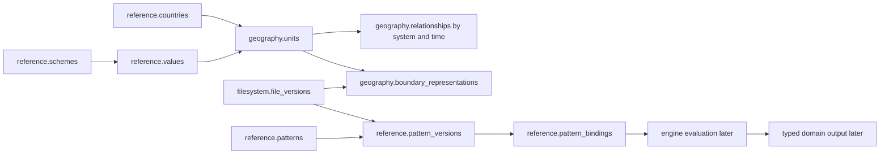

# Task 03: proposed foundation specification

## Authority and verified baseline

This document combines the accepted direction in `connected-reference-geography-legal-foundation.md` with the first applied slice. The initial baseline had auth, provisional engine and filesystem migrations only. Task 03 has now applied additive reference, geography and minimum legal migrations to verified `mzizi_new`; see `source/schema/database/migrations.yaml`. Active Dryv reference still defines `Jurisdiction` and `ClassificationRecord`; geography still defines `GeoUnit.parentId`, a relationship table, boundaries and names. Those generated NestJS readers have not been switched to the rewrite schema. The filesystem has seven tables, including `file_versions` and `file_relations`; auth has nine tables. The archived engines are historical. The root seed manifest has a new structural baseline entry and existing loaders remain archived. No live S3 operation was done for this task.

## Disposition and ownership

| Current concept | Consumers | Disposition and reason | New owner / dependency |
| --- | --- | --- | --- |
| `reference.jurisdictions` | Dryv reference/geography and generated API | REMOVE as a universal country/polity/authority bucket; modern countries gain explicit identity | `reference.countries`; historical polities later in history/organization |
| `reference.classifications` with free-text `scheme` | Most Dryv domain contracts | SPLIT into schemes, values, labels and semantic relations; wrong-scheme IDs must fail in SQL | `reference`; domain consumers update after schema approval |
| `geography.units.parentId` | Dryv geography/API children/hierarchy | REMOVE as an independently writable universal parent | Dated `geography.relationships`; as-of traversal in API |
| `geography.units.jurisdictionId/levelId` | Dryv geography and seed mappings | REPLACE with typed country links and scheme-constrained type value | Reference/geography; dependent loaders need new IDs |
| `geography.boundaries.geometry` as GeoJSON text | Dryv map reads | MOVE geometry to PostGIS representation; preserve raw artifact separately | Geography + filesystem exact file version |
| `place.expectations` / generic occupancy ideas | Dryv place and governance | REVIEW: legal duty creates a research gap; actual place/presence requires separate evidence | Task 04 place/governance contract |
| `seed/ke/patterns/ke-office-patterns.json` | Archived patterns loader | KEEP as research input; no direct canonical application | Root seed, new reference pattern release after review |
| `source/backend/engine` jobs/capabilities | Engine callers | KEEP operational state; ADD reviewed definition bindings | Engine execution, reference definitions |
| Filesystem folders/versions/relations | Sync and engine filesystem API | KEEP; no new file-type/object/extraction tables | Existing filesystem package |

`code` is stable, unique within its table, lowercase dot-separated and never reused. For geography it names an identity namespace (`geo.ke.nairobi`), not a territorial ancestor. Reparenting or boundary changes do not recode it. Every seed-loaded row has `code`. UUIDs are internal FKs. All proposed tables have UUID `id` unless a composite PK is stated. Canonical delete policy is RESTRICT; corrections add new assertions/versions or retire a definition, never cascade evidence deletion.

## Exact relational proposal

The types and constraints below are normative for the next implementation review. `id uuid NOT NULL DEFAULT gen_random_uuid() PRIMARY KEY`, `code text NOT NULL UNIQUE` with the repository code-shape CHECK, and `created_at timestamptz NOT NULL DEFAULT now()` are abbreviated as **identity** only where listed. All named FKs use `ON DELETE RESTRICT`. Every table and column needs a SQL COMMENT matching its meaning below when DDL is authored. PostgreSQL btree indexes follow FK and as-of filters; geometry uses GiST. `daterange` intervals are `[)`; an unknown endpoint is unbounded, never a guessed date. `observed_at` describes when Mzizi learned an assertion, separate from historical applicability.

| Table | Exact columns beyond identity; keys, checks and indexes | Meaning and lifecycle |
| --- | --- | --- |
| `reference.countries` | identity; `name text NOT NULL`, `iso_alpha2 char(2) NULL UNIQUE`, `recognition_status text NOT NULL CHECK IN ('recognized','disputed','historical_transition')`, `source_file_version_id uuid NULL REFERENCES filesystem.file_versions(id)` | Modern country context; recognition is sourced, not inferred from ISO membership. No universal `world` row. |
| `reference.schemes` | identity; `name text NOT NULL`, `description text NOT NULL`, `owner text NOT NULL CHECK IN ('global','country','domain')`, `country_id uuid NULL REFERENCES reference.countries(id)`, CHECK owner/country pairing | Describes a vocabulary. Global has no country. |
| `reference.values` | identity; `scheme_id uuid NOT NULL REFERENCES reference.schemes(id)`, `label text NOT NULL`, `description text NOT NULL`, `retired_at timestamptz NULL`, `superseded_by_id uuid NULL REFERENCES reference.values(id)`, `UNIQUE(scheme_id,id)`, `UNIQUE(scheme_id,code)`, CHECK supersession differs from self; index `(scheme_id,retired_at)` | Value identity persists through label changes. Retirement is curation time, not historical validity. |
| `reference.value_labels` | `value_id uuid NOT NULL REFERENCES reference.values(id)`, `language_tag text NOT NULL`, `label text NOT NULL`, `label_kind text NOT NULL CHECK IN ('preferred','alternate')`, `PRIMARY KEY(value_id,language_tag,label,label_kind)`; partial unique preferred per value/language | Localized presentation, never a second value identity. |
| `reference.value_relations` | `from_id uuid NOT NULL REFERENCES reference.values(id)`, `to_id uuid NOT NULL REFERENCES reference.values(id)`, `kind text NOT NULL CHECK IN ('broader','narrower','related','exact_mapping','close_mapping')`, `evidence_file_version_id uuid NULL REFERENCES filesystem.file_versions(id)`, `PRIMARY KEY(from_id,to_id,kind)`, CHECK unequal | Semantic relation, never geographic containment; exact mapping needs reviewed evidence. |
| `reference.value_applicability` | `value_id uuid NOT NULL REFERENCES reference.values(id)`, `country_id uuid NULL REFERENCES reference.countries(id)`, `period daterange NULL`, `status text NOT NULL CHECK IN ('approved','disputed')`, `evidence_file_version_id uuid NULL REFERENCES filesystem.file_versions(id)`, `UNIQUE(value_id,country_id,period)`, GiST on period | Null country means explicit global applicability; null period means time independent. Scope is reviewed. |
| `reference.topics` | identity; `name text NOT NULL`, `description text NOT NULL`, `parent_id uuid NULL REFERENCES reference.topics(id)`; cycle guard | Navigation meaning. A topic is not a domain entity or data permission. |
| `geography.units` | identity; `type_scheme_id uuid NOT NULL REFERENCES reference.schemes(id)`, `type_value_id uuid NOT NULL`, composite FK `(type_scheme_id,type_value_id)` to `reference.values(scheme_id,id)`, `name text NOT NULL`, `existence_status text NOT NULL CHECK IN ('established','disputed','hypothetical')`, `source_file_version_id uuid NULL REFERENCES filesystem.file_versions(id)`, CHECK known type scheme is the registered `geo_unit_type` scheme | Stable area identity; geometry and a single parent are absent. Hypothetical units cannot enter official traversal. |
| `geography.names` | `id uuid PK`, `unit_id uuid NOT NULL REFERENCES geography.units(id)`, `name text NOT NULL`, `language_tag text NULL`, `kind text NOT NULL CHECK IN ('official','historical','alternate')`, `period daterange NULL`, `evidence_file_version_id uuid NULL REFERENCES filesystem.file_versions(id)`, `observed_at timestamptz NOT NULL DEFAULT now()`; indexes `(unit_id,kind)` and GiST(period) | Dated, sourced names. Unknown historical period stays null. |
| `geography.relationship_systems` | identity; `name text NOT NULL`, `kind text NOT NULL CHECK IN ('administrative','electoral','statistical','historical','other')`, `country_id uuid NULL REFERENCES reference.countries(id)`, `hierarchical boolean NOT NULL`, `description text NOT NULL` | Separates parallel hierarchies. A system can be cross-border. |
| `geography.relationships` | `id uuid PK`, `system_id uuid NOT NULL REFERENCES geography.relationship_systems(id)`, `parent_unit_id uuid NOT NULL REFERENCES geography.units(id)`, `child_unit_id uuid NOT NULL REFERENCES geography.units(id)`, `kind text NOT NULL CHECK IN ('contains','overlaps','adjacent','claimed_by','administers')`, `period daterange NULL`, `evidence_file_version_id uuid NULL REFERENCES filesystem.file_versions(id)`, `observed_at timestamptz NOT NULL DEFAULT now()`, `claim_status text NOT NULL CHECK IN ('verified','disputed','reconstructed')`, CHECK different endpoints; index `(system_id,parent_unit_id,kind)` and `(system_id,child_unit_id,kind)`, GiST(period) | Only verified `contains` participates in official ancestry. Deferred trigger rejects cycles and overlapping duplicate containment within a hierarchical system/as-of period. Competing claims remain separate rows. |
| `geography.boundary_representations` | `id uuid PK`, `unit_id uuid NOT NULL REFERENCES geography.units(id)`, `edition_code text NOT NULL`, `kind text NOT NULL CHECK IN ('official','reconstruction','disputed','hypothetical','member_union','distribution')`, `period daterange NULL`, `geometry geometry(MultiPolygon,4326) NULL`, `file_version_id uuid NOT NULL REFERENCES filesystem.file_versions(id)`, `method text NOT NULL`, `uncertainty text NULL`, `observed_at timestamptz NOT NULL DEFAULT now()`, `UNIQUE(unit_id,edition_code)`, GiST(geometry), GiST(period) | Exact artifact pins source bytes. Null geometry permits an established area with unknown outline. A version is a new row; old representations remain. Member union has separate derived input lineage. |
| `reference.patterns` | identity; `name text NOT NULL`, `description text NOT NULL`, `owner_account_id uuid NOT NULL REFERENCES auth.accounts(id)` | Stable definition identity. |
| `reference.pattern_versions` | `id uuid PK`, `pattern_id uuid NOT NULL REFERENCES reference.patterns(id)`, `version integer NOT NULL CHECK(version>0)`, `file_version_id uuid NOT NULL REFERENCES filesystem.file_versions(id)`, `schema_version text NOT NULL`, `capability text NOT NULL`, `capability_version text NOT NULL`, `input_hash char(64) NOT NULL`, `max_outputs integer NOT NULL CHECK(max_outputs BETWEEN 1 AND 100000)`, `reviewed_by uuid NULL REFERENCES auth.accounts(id)`, `reviewed_at timestamptz NULL`, `activated_at timestamptz NULL`, `retired_at timestamptz NULL`, `UNIQUE(pattern_id,version)`, CHECK reviewed/activation order | Immutable definition release. Activation is administrative; rule applicability is in bindings. Updates create another version. |
| `reference.pattern_dependencies` | `upstream_version_id uuid NOT NULL REFERENCES reference.pattern_versions(id)`, `downstream_version_id uuid NOT NULL REFERENCES reference.pattern_versions(id)`, `PRIMARY KEY(upstream_version_id,downstream_version_id)`, CHECK unequal; recursive cycle guard | Definition DAG only; inputs and run ordering are separate. |
| `reference.pattern_bindings` | `id uuid PK`, `version_id uuid NOT NULL REFERENCES reference.pattern_versions(id)`, `country_id uuid NULL REFERENCES reference.countries(id)`, `geo_unit_id uuid NULL REFERENCES geography.units(id)`, `period daterange NULL`, `target_contract text NOT NULL`, `prerequisite_contract text NOT NULL`, `legal_provision_version_id uuid NULL` (added as FK when legal minimum exists), `UNIQUE(version_id,country_id,geo_unit_id,period,target_contract)` | Applicability and validated target. Null country/geo require explicit `global` scope in artifact schema. No generic target ID is accepted as a FK. |

Where a row needs a known scheme, seed its scheme ID and enforce the expected scheme through a small typed lookup table or trigger checking `schemes.code`; the composite FK alone proves membership in the supplied scheme but does not prove the supplied scheme is the mandated one. The implementation must test both checks. Relations that cite a file version require that version to be pinned before approval; a deferred integrity trigger should enforce the pin or approval transaction must pin and verify it atomically.

## Diagram and bootstrap

Initialize existing auth/filesystem first, then reference countries/schemes/values, geography units/systems/relationships/boundaries, then patterns/versions/bindings. The applied order follows this, then creates minimum legal identity/provision-version tables and adds the `pattern_bindings.legal_provision_version_id` FK and a typed geography legal-basis junction. The structural vocabulary loader applies root seed content to `mzizi_new` independently from filesystem artifact publication; that publication is still pending. Seed global schemes before country-scoped values and units. Existing S3 objects are retained.

## Legal and domain contracts for task 04

Minimum legal FK target: `legal.instruments(id,code)`, `instrument_versions(id,instrument_id,file_version_id,publication_date,enacted_on,commenced_on,repealed_on)`, `provisions(id,instrument_id,code)`, `provision_versions(id,provision_id,instrument_version_id,file_version_id,text_locator,effective_period)`. Each version pins an exact filesystem version. A typed basis junction in each owning domain has `provision_version_id` FK, `basis_role` (establishes/powers/selection/boundary), `interpretation_status`, `evidence_file_version_id` and its own real owner FK. Legal text, legal force and actual compliance are distinct.

Governance must own office definitions, actual offices, territorial mandates and holder terms. Electoral contests target an office and electoral reporting area; candidacy party is election-specific; result, declaration and term commencement are separate facts. Political membership is dated independently. Organizations own EAC/COMESA identity, dated membership and organs. A member-territory map pins membership rows and boundary versions, method and as-of date, and is explicitly derived coverage. Statistics own measurement definition, counted population, method, observed period, release/revision, boundary edition and uncertainty. Shared statistical mechanics cannot coerce incompatible meanings into one comparable series. Physical place identity belongs to place/geography; actual occupancy and presence need sourced owner FKs. A legal duty alone generates a gap, not a building or holder.

## Pattern execution and folder proof

Definitions bind only registered engine capabilities and JSON Schemas under `source/schema/`. Definition DAG, input prerequisite FKs and engine job/run dependencies are separate. The runner loads an approved immutable version, validates inputs, expands a bounded preview and calculates deterministic output codes. Apply uses the existing filesystem sync/service APIs for folders, checks folder-scoped auth, creates parents first and rejects access widening. A repeat with the same version/input hash is unchanged. A changed rule yields a diff for review; independent edits and pinned artifacts remain. Missing legal evidence or uncertain existence yields a deduplicated research proposal. No generated output is silently deleted.

Use `/seeds` classification inheritance and a system log root code; create `logs.<pipeline>.<year>.<month>` only when an authorized run requires it. Access defaults to internal; explicit reviewed authorization is required for public. Governance office generation is a contract fixture until its tables are approved. Output lineage is a typed junction per implemented destination, referencing output row, pattern version, run and exact input file/record versions; never `target_kind + target_id` alone.

## Topic and query contract

Author public input/result DTOs in Dryv; export JSON Schema into `source/schema/` with a generated marker and drift check. The engine's operational capability registry stays under `source/backend/engine`; reference topics bind only approved capability names/versions and allowed presentations. Each request includes topic, place input (unit or coordinates), as-of date and requested filters. Each response includes requested/resolved scope, data period, boundary edition, method, release, evidence file-version IDs, uncertainty, gaps and fallback reason. Coordinates return candidate areas under dated boundaries and never prove residence or eligibility. Queries filter by actual availability before advertising trend, age, map or comparison controls.

Population follows measurement coverage → release → definition/method → boundary; no incompatible rollup. Representatives follow territorial office mandate → term → person with legal-basis links; a contest result alone is not a term. Budget follows responsible institution → fiscal period → documented coverage; national budget is labeled national if local data is absent. All three return an explicit unavailable result if no supported data exists.

## Review and implementation sequence

## Contract fixtures and expected results

These are design fixtures, not production records or executed SQL. Identifiers below are symbolic and must be resolved to real FK rows in implementation.

| Fixture | Input and expected result |
| --- | --- |
| Kenyan governor | `office_category=governor`; Kenya county governor definition; Nairobi office with county mandate; separate provision-version links for Constitution Articles 176 (structure), 179 (executive powers) and 180 (selection). The office may exist while `holder_term` is absent. No building or person is inferred. |
| Election and term | Contest names an office and electoral area. Candidacy records person and election-time party. Result and declaration are dated separately; a holder term begins only on independently sourced assumption/appointment. Party membership is a separate dated fact. |
| EAC organ and map | Treaty provision supports an organ; organization membership rows as of a date select member territories and boundary editions. Derived map pins all inputs and method; it conveys coverage, never sovereignty or uniform treaty applicability. A member's departure changes future map editions only. |
| Historical area | One area has an established identity, two competing reconstructed boundaries and different periods/methods. Neither inherits a modern country as owner. An explicitly hypothetical area does not enter official hierarchy traversal. |
| Wrong scheme | A valid value UUID from `office_category` supplied as a `geo_unit_type` is rejected by the composite FK/expected-scheme guard. An unknown UUID also fails FK validation. |
| Hierarchy | A Kenyan county may be under Kenya in the administrative system while an electoral area overlaps it in another system. As-of queries respect period and system. `A contains B` and `B contains A` in one overlapping hierarchical period is rejected. |
| Folders | Preview creates nothing; apply creates ancestors before descendants; repeat is unchanged; changed access requires explicit transition; a rule cannot widen a restricted ancestor or delete a pinned file. Lazy log month appears only for a real run. |
| Statistics | Census usual-resident count, revised estimate, language-use survey and approximate historical population carry distinct definitions, methods, periods and boundary editions. Aggregation of overlapping or incompatible coverage fails validation. Missing county numbers yield explicit national fallback or unavailable, never copied county values. |

Design validation checks each fixture against the proposed table/FK graph and query semantics. Future SQL tests must create a throwaway schema in `mzizi_new`, prove wrong-scheme/cycle/period constraints and folder idempotency, and roll back. Future API contract tests must verify fallback and evidence fields. No production data or S3 publication is part of these fixtures.

## African country source preparation and current database state

The user requested all African countries from reviewed official artifacts. The captured [African Union member list](https://www.au.int/en/AU_Member_States) has 55 members; the [UN Statistics Division M49 overview](https://unstats.un.org/unsd/methodology/m49/overview/) supplies matching ISO alpha-2 codes. Exact HTML snapshots are under `seed/global/reference/sources/`, with SHA-256 identities in `african-countries-au-un-2026-11-11.json`. The seven differing labels are explicit in `au-m49-aliases.json`. Sahrawi Republic maps to M49 Western Sahara (`EH`) and is marked disputed; this reconciliation does not settle recognition, sovereignty or boundary geometry. It deliberately excludes the other non-member territories/areas in the UN Africa grouping. All 55 AU names have a unique matched code.

The country loader requires both official page snapshots to be registered as pinned `filesystem.file_versions` with the matching manifest entry and hash. The source sync preview was clean, but the apply failed to connect to the configured `http://192.168.100.13:18333` endpoint; no file versions were registered. Alternate documented local/Docker endpoints were also unreachable. The country loader correctly refused to insert any rows; `reference.countries` is empty. The logical `/seeds/global/reference/sources` folder was created by the failed sync, and no S3 object or file row was registered. Keep task 03 open until source artifact custody and the remaining contracts are complete.

Applied so far: the reference/geography SQL foundation, a minimum legal FK target, a structural vocabulary seed loader and direct constraint checks. Still pending: source-backed country/area/legal data; Dryv exports and API reads; reviewed pattern activation/registered capability validation, a folder consumer and lineage; other typed domain FKs under task 04; topic queries backed by actual domain data. Verify `mzizi_new` identity before any future reset. No legacy ID compatibility is required. The fixture scenarios above are design cases, not deployed end-to-end behavior.
